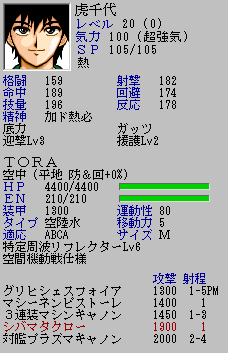

**ステータスウインドウ**

ユニット・パイロットの状態を表示します。ウインドウに表示されるユニットを変更するにはマップウインドウのユニット上にマウスカーソルを持ってくればＯＫです。

ユニットに複数のパイロットが乗り込んでいる場合、パイロットの顔グラフィック表示窓をクリックすることでステータス表示するパイロットを変更することができます。

> **元の SRC との違い**: SRC# では、顔グラフィックをクリックしても表示するパイロットは変わりません（未実装）。表示されるのはメインパイロットです。（7474/SRC#1485）

下の図の各部分をクリックすると、その表示項目の説明に移ります。

<map name="statuswindow">
<area shape="rect" coords="2,273,222,348" href="#hlp000196" title="ユニットの武器" alt="ユニットの武器">
<area shape="rect" coords="3,242,144,266" href="#hlp000191" title="ユニットの特殊能力・アイテム" alt="ユニットの特殊能力・アイテム">
<area shape="rect" coords="2,227,87,240" href="#hlp000189" title="ユニットの地形適応" alt="ユニットの地形適応">
<area shape="rect" coords="115,230,188,243" href="#hlp000190" title="ユニットのサイズ" alt="ユニットのサイズ">
<area shape="rect" coords="115,215,190,228" href="#hlp000188" title="ユニットの移動力" alt="ユニットの移動力">
<area shape="rect" coords="113,203,190,215" href="#hlp000186" title="ユニットの運動性" alt="ユニットの運動性">
<area shape="rect" coords="0,218,92,231" href="#hlp000187" title="ユニットの移動タイプ" alt="ユニットの移動タイプ">
<area shape="rect" coords="3,206,92,219" href="#hlp000185" title="ユニットの装甲" alt="ユニットの装甲">
<area shape="rect" coords="5,193,214,205" href="#hlp000184" title="ユニットの現在のＥＮ／最高ＥＮ" alt="ユニットの現在のＥＮ／最高ＥＮ">
<area shape="rect" coords="1,180,214,192" href="#hlp000183" title="ユニットの現在のＨＰ／最高ＨＰ" alt="ユニットの現在のＨＰ／最高ＨＰ">
<area shape="rect" coords="34,167,130,180" href="#hlp000182" title="ユニットのいる地形" alt="ユニットのいる地形">
<area shape="rect" coords="1,167,31,180" href="#hlp000181" title="ユニットの位置" alt="ユニットの位置">
<area shape="rect" coords="3,153,69,167" href="#hlp000180" title="ユニット名称" alt="ユニット名称">
<area shape="rect" coords="2,122,164,148" href="#hlp000178" title="パイロットの特殊能力" alt="パイロットの特殊能力">
<area shape="rect" coords="116,98,180,112" href="#hlp000176" title="パイロットの反応" alt="パイロットの反応">
<area shape="rect" coords="3,109,92,123" href="#hlp000177" title="パイロットのスペシャルパワー" alt="パイロットのスペシャルパワー">
<area shape="rect" coords="3,99,64,110" href="#hlp000175" title="パイロットの技量" alt="パイロットの技量">
<area shape="rect" coords="114,87,179,98" href="#hlp000174" title="パイロットの回避能力" alt="パイロットの回避能力">
<area shape="rect" coords="2,2,70,71" href="#hlp000170" title="パイロットの顔グラフィック" alt="パイロットの顔グラフィック">
<area shape="rect" coords="3,87,61,99" href="#hlp000173" title="パイロットの攻撃の正確さ" alt="パイロットの攻撃の正確さ">
<area shape="rect" coords="114,73,180,87" href="#hlp000172" title="パイロットの射撃攻撃力" alt="パイロットの射撃攻撃力">
<area shape="rect" coords="1,72,64,87" href="#hlp000171" title="パイロットの格闘攻撃力" alt="パイロットの格闘攻撃力">
<area shape="rect" coords="75,56,174,71" href="#hlp000169" title="現在使用中のスペシャルパワー" alt="現在使用中のスペシャルパワー">
<area shape="rect" coords="75,44,172,56" href="#hlp000168" title="パイロットの現在のＳＰ値／最高ＳＰ値" alt="パイロットの現在のＳＰ値／最高ＳＰ値">
<area shape="rect" coords="136,30,192,44" href="#hlp000167" title="パイロットの性格" alt="パイロットの性格">
<area shape="rect" coords="76,30,129,44" href="#hlp000166" title="パイロットの気力" alt="パイロットの気力">
<area shape="rect" coords="77,18,165,30" href="#hlp000165" title="パイロットのレベル" alt="パイロットのレベル">
<area shape="rect" coords="77,4,167,17" href="#hlp000164" title="パイロットの名称" alt="パイロットの名称">
</map>

| 項目 | 説明 |
|---|---|
| **パイロットの名称** |  |
| **パイロットのレベル** |  |
| **パイロットの気力** | 初期状態は100で、これより高くなると攻撃力・装甲が上昇します。必殺技の多くは気力が高くないと使用できません。 |
| **パイロットの性格** | 味方ユニットがやられたときの気力の変動に影響します。弱気なら気力が減少し、強気だと逆に上昇します。 |
| **パイロットの現在のＳＰ値／最高ＳＰ値** | このポイントはパイロットがスペシャルパワーを使うときに消費されます。 |
| **現在使用中のスペシャルパワー** | 多くのスペシャルパワーは戦闘が行われるまで、または次のターンまで効果が持続します。各スペシャルパワーは漢字１文字で表示されます。 |
| **パイロットの顔グラフィック** | 複数のパイロットが乗るユニットの場合はここをクリックすることで表示するパイロットを切り替えられます（SRC# では未実装）。 |
| **パイロットの格闘攻撃力** | パイロットが格闘型の攻撃に分類される武器を使った場合の攻撃力を表します。射程が１、または「格」と表示された武器は格闘型の武器です。 |
| **パイロットの射撃攻撃力** | パイロットが射撃型の攻撃に分類される武器を使った場合の攻撃力を表します。射程が２以上、または「射」と表示された武器は射撃型の武器です。 |
| **パイロットの攻撃の正確さ** | 数値が高いほど命中率が上がります。特殊能力による修正が加わる場合には＋○○のように示されます。 |
| **パイロットの回避能力** | この数値が高いほど相手の攻撃の命中率が低下します。特殊能力による修正がある場合には＋○○として表示されます。 |
| **パイロットの技量** | この数値が高いほど攻撃時のクリティカル発生率が増します。いくつかのスペシャルパワーはこの数値が相手パイロットを上回ってる必要があります。 |
| **パイロットの反応** | この数値が高いと攻撃の命中率、相手の攻撃に対する回避率の両方が増加します。また、この数値が200以上だと１ターンに２回行動できます。(Optionコマンドで２回行動能力使用のオプションが指定されていない場合) |
| **パイロットのスペシャルパワー** | パイロットが現時点で習得しているスペシャルパワーです。ＳＰ値が足らないため使用できないコマンドは赤色で表示されます。 |
| **パイロットの特殊能力** | パイロットが現時点で習得している特殊能力の一覧です。 |
| **ユニット名称** |  |
| **ユニットの位置** | 空中、地上、水上、水中、地中、宇宙のいずれかになります。 |
| **ユニットのいる地形** | 地形による修正値がある場合はそれも表示されます。防ダメージへの修正回命中率への修正ＨＨＰの回復率ＥＥＮの回復率 |
| **ユニットの現在のＨＰ／最高ＨＰ** | ０になるとそのユニットは破壊されます。 |
| **ユニットの現在のＥＮ／最高ＥＮ** | 武器を使う際に使用するエネルギーを示します。このポイントが足りない場合には武器は使用できません。ＥＮが0になるとユニットは行動不能に陥ります。 |
| **ユニットの装甲** | ユニットの防御力を示します。この数値だけダメージを軽減できます。 |
| **ユニットの運動性** | ユニットの機動力を現わします。攻撃の命中率・回避力の両方に影響します。 |
| **ユニットの移動タイプ** | ユニットが移動可能な地形のタイプを示します。 |
| **ユニットの移動力** | ユニットが移動できる範囲を示します。 |
| **ユニットの地形適応** | ユニットが各地形においてどれだけ効率良く動けるかを示します。Aが最高～Eが最低になっており、空中、地上、水中、宇宙の順で表示されています。 |
| **ユニットのサイズ** | ユニットの大きさを示します。ＳＳ＜Ｓ＜Ｍ＜Ｌ＜ＬＬ＜ＸＬの順になっており、大きいほど回避力が低下します。 |
| **ユニットの特殊能力・アイテム** | ユニットの持つ特殊能力・アイテムの一覧です。 |
| **ユニットの武器** | ユニットが持っている武器の一覧です。武器の攻撃力と射程も表示されます。赤字で表示されているのは弾切れやＥＮ切れ、気力不足により使用できない武器です。 |
