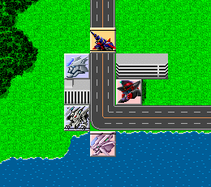

**マップウインドウ**

戦闘の舞台となるマップを表わしたものです。マップ全体のうち、15×15の範囲が表示されています。

**マップウインドウの表示内容について**

ユニットの所属する[陣営](陣営名.md "ユニットがどの陣営に所属するかを現わします。")はユニットの色によって示されています。

**味方ユニット・ＮＰＣユニット**青色

**敵ユニット**赤色

**中立ユニット**黄色

ユニットのいる位置はユニット上に入れられている線で判別できます。

**地上・水上**線なし

**空中**下部に線

**水中**上部に線

**地中**上部と下部に線

（宇宙にいるユニットは、月面の地形にいるときだけ下部に線が入ります）

網掛けで表示されているユニットは行動済み、もしくは行動不能のものです。

ユニット用のビットマップが用意されていないユニットは空白のまま表示されます。

> **元の SRC との違い**: SRC#Avalonia・SRC#Web では、ビットマップが用意されていないユニットは、ユニットの名前の先頭の 1 文字を表示します（SRC#Form は元の SRC と同じく空白です）。
