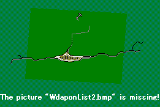

**反撃**

敵の攻撃後に反撃を行います。反撃に使用する武器を選択してください。

反撃をキャンセルするには右クリックを使います。

| 項目 | 説明 |
|---|---|
| **攻撃の命中率** | こちらからの攻撃の命中率（クリティカル発生率）です。攻撃目標選択時にのみ表示されます。 |
| **敵ユニットの反撃手段** | 敵ユニットが反撃に使用する武器の名称です。攻撃目標選択時にのみ表示されます。 |
| **敵の反撃の命中率** | 敵からの反撃の命中率（クリティカル発生率）を示します。攻撃目標選択時にのみ表示されます。 |
| **敵の反撃の攻撃力** | 敵が反撃に使用する武器の攻撃力を示します。 |
