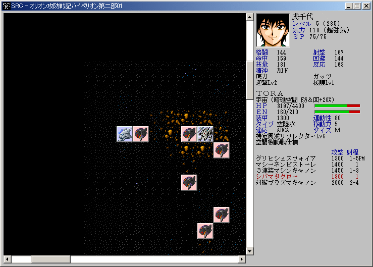

**画面の説明**

戦闘が進行している場面では常にこの画面になります。このウインドウをメインウインドウと呼びます。メインウインドウは左側の[マップウインドウ](マップウインドウ.md)、右側の[ステータスウインドウ](ステータスウインドウ.md)に分割されています。

SRC#Form では[メッセージウインドウ](メッセージウインドウ.md)は別のウインドウとして表示されます。SRC#Avalonia・SRC#Web では、メッセージウインドウもメインウインドウの左下に重ねて表示されます。

