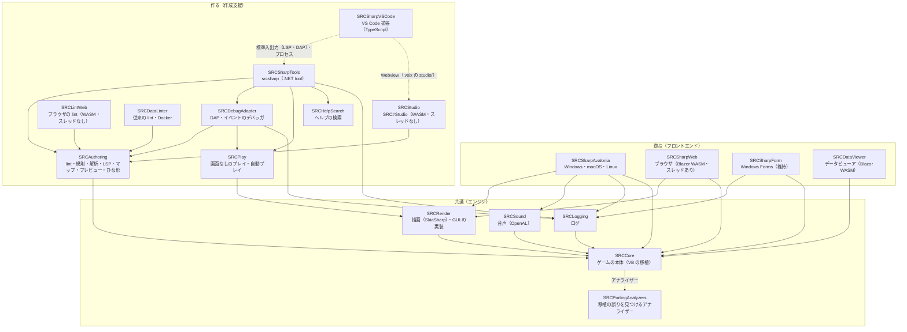

# コンポーネントの構成

SRC# を構成するプロジェクトと、その間の関係です。開発者向けの参考情報です（使い方はヘルプと各ドキュメント）。参照の向きは `*.csproj` の `ProjectReference` のとおりで、プロジェクトを足したり参照を変えたりしたら、この文書も直します。

## 層

- 実線は `ProjectReference`。点線はプロセス・Webview・アナライザーとしての使い方
- 作成支援の部品の役割と、VS Code 拡張・単独での使い方の対応は [作成支援ツール](./tools/authoring.md) の「VS Code 拡張と、単独で使える部品」。GUI の層（SRCRender と各フロントエンド）は [GUI の構成](./gui/README.md)

## プロジェクト

| プロジェクト | 種類 | 参照 | 役割 |
|---|---|---|---|
| SRCCore | ライブラリ（.NET Standard 2.1） | （アナライザー: SRCPortingAnalyzers） | ゲームの本体。データの読み込み・イベント・戦闘・マップ。画面・音は `IGUI` などのインターフェース越しに呼ぶ |
| SRCRender | ライブラリ（.NET Standard 2.1） | SRCCore | SkiaSharp による描画と、UI フレームワークに依存しない GUI の実装（`ScreenGUI`） |
| SRCSound | ライブラリ（.NET Standard 2.1） | SRCCore | OpenAL による音声（WAV・MP3・MIDI） |
| SRCLogging | ライブラリ | SRCCore | ログ（Microsoft.Extensions.Logging） |
| SRCSharpAvalonia | アプリ | SRCCore・SRCRender・SRCSound・SRCLogging | デスクトップのフロントエンド（推奨） |
| SRCSharpWeb | アプリ（Blazor WASM、マルチスレッド） | SRCCore・SRCRender | ブラウザのフロントエンド（推奨）。音声はブラウザの Web Audio |
| SRCSharpForm | アプリ（Windows Forms） | SRCCore・SRCLogging | Windows のフロントエンド（維持）。描画は自前 |
| SRCDataViewer | アプリ（Blazor WASM） | SRCCore | データビューア。データ・画像・音と、組の評価の比較 |
| SRCPlay | ライブラリ | SRCRender | 画面なしでシナリオを動かす（`ScreenScenarioRunner`）、自動プレイ（`PlayScript`・`AutoPlayer`）。E2E と `srcsharp play`・デバッガが使う |
| SRCAuthoring | ライブラリ | SRCCore | 作成支援の計算。lint（`DataLinter`）と規則、イベントの解析（`ScenarioAnalyzer`）、データの参照（`DataReferenceChecker`）、LSP（`LspServer`・`HelpReference`）、バランス、マップ（`Maps`）、プレビュー（`Preview`）、ひな形（`Templates`）。描画に依存しない |
| SRCDebugAdapter | ライブラリ | SRCAuthoring・SRCPlay・SRCLogging | DAP のサーバーとイベントのデバッガ、ホットリロード |
| SRCHelpSearch | ライブラリ | ― | ヘルプの全文検索・ベクトル検索（`srcsharp help --search`） |
| SRCSharpTools | アプリ（.NET tool `srcsharp`） | SRCAuthoring・SRCDebugAdapter・SRCPlay・SRCHelpSearch・SRCLogging | CLI（`new`・`lint`・`play`・`trial`・`balance`・`help`）、`lsp`・`dap`。ヘルプ（`SRC.Sharp.Help/src`）を埋め込む |
| SRCStudio | WASM（スレッド・AOT なし、`JSExport`） | SRCAuthoring | SRC#Studio の計算（マップ・プレビュー・かんたん作成のイベント）。かんたん作成のシナリオは同じサイトの SRC#Web にブラウザの IndexedDB で渡す。画面は `wwwroot` の HTML・JavaScript。スタンドアロン（Pages の `/studio/`）と VS Code の Webview で同じものを使う |
| SRCLintWeb | WASM（スレッド・AOT なし、`JSExport`） | SRCAuthoring | ブラウザの lint。投稿サイト（7474/SRC-Site）が使う |
| SRCDataLinter | アプリ・Docker | SRCAuthoring | 従来の lint の CLI と Docker イメージ（GitHub Action） |
| SRCPortingAnalyzers | Roslyn アナライザー | ― | VB からの移植で起きやすい誤りを、SRCCore のビルドで知らせる |
| SRCSharpVSCode | VS Code 拡張（TypeScript） | （`srcsharp` をプロセスで、SRC#Studio を Webview で） | 作成環境の主。部品を束ねる薄い層 |

テストのプロジェクト（`*Tests`）と E2E（`SRCSharpWeb.E2E`）は [テストと CI の設計](./testing.md)。

## 守ること

- **SRCCore は画面・音・UI フレームワークに依存しない。** フロントエンドは SRCCore のインターフェース（`IGUI`・`IGUIMap` など）を実装する。描画の共通部分は SRCRender に置く
- **作成支援の計算は SRCAuthoring に置き、描画に依存させない。** ブラウザ（SRCStudio・SRCLintWeb。スレッドなしの WASM）からも使うため。画面が要るもの（自動プレイ・デバッガの画面）だけが SRCPlay（SRCRender）を使う
- **VS Code 拡張に機能を置かない。** 計算は SRCAuthoring・SRCStudio・SRCSharpTools に置き、拡張はプロセス（LSP・DAP・CLI）と Webview でつなぐ（[作成支援ツール](./tools/authoring.md)）
- **ゲームと同じ結果を出す処理は、SRCCore の処理を呼ぶ。** マップの読み書き・地形の画像の探し方・データの読み込みなどを、作成支援の側で書き直さない（書き直すときは、SRCCore と同じに読めることをテストで確かめる。例: `MapDocumentTests`）

## リポジトリの外

| リポジトリ | 関係 |
|---|---|
| 7474/SRC-Data | データ（GSC データパックなど）。GitHub Pages で組の評価の JSON を作る（`tools/pack-analysis`・`tools/pack-stats` を使う）。データビューア・SRC#Studio の「比べる」とかんたん作成（作品のデータ・場面のカタログ）が読む |
| 7474/SRC-Site | SRC#Web のリリース版のサイトと投稿（SRCLintWeb を使う）。SRC#Studio も `/studio/` に置く |
| 7474/SRC-DataLinter | SRCDataLinter の GitHub Action |

配布物とワークフローの関係は [運用の全体像](./operations.md)。
