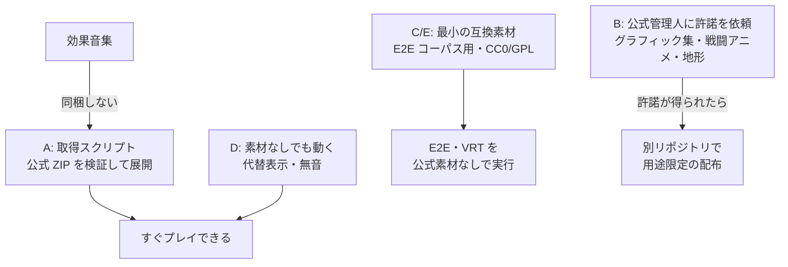

# 素材データの再配布の検討 / Asset Redistribution Study

> 調査日: 2026-10-12
> 対象: SRC安定版フルパッケージ Ver.2.2.33-111106（`srcall-2_2_33-111106.zip`）

SRC# でのプレイに必要な汎用データ（グラフィック・戦闘アニメ・効果音・地形データなど）を、本リポジトリに含めて再配布できるか、ライセンス・道義・実現性の観点で検討する。

## 結論

- **フルパッケージの素材を、そのまま本リポジトリ（GPLv3・公開）に含めて再配布しない**
  - 汎用データには「SRC 本体および派生版での利用に限る」趣旨の個別条件があり、GPL として公開できない
  - 公開リポジトリに一度入れると、履歴・フォーク・キャッシュに残り取り消せない
- **効果音集は、許諾を得られても同梱しない**（市販素材集を元に作られており、元素材の権利処理が確認できない）
- 進め方は次の組み合わせとする
  1. **A. 取得スクリプト**: 公式サイトのフルパッケージを利用者側で取得・検証・展開する（本リポジトリからは再配布しない）
  2. **B. 許諾を得て別リポジトリで配布**: グラフィック集・戦闘アニメ・地形データ・スペシャルパワー eve について、公式サイト管理人の許諾を得て、用途を限定して配布する
  3. **C/E. 互換素材**: E2E テストや最小限のプレイに必要な分は、自作または CC0 の素材でまかなう
  4. **D. 素材が無くても動く作り**: 素材が無い場合も代替表示で実行を続ける（**対応済み**）

## フルパッケージの内訳と利用条件

| 区分 | 該当 | 規模 | 利用条件 | 同梱の可否 |
|---|---|---|---|---|
| SRC 本体（VB 版） | `Src.exe`、`Source/`、`SRC.HLP` | 約13MB | Readme では「無断配布禁止」。ソースは GPL のヘッダ付きで、本リポジトリは派生版規約を遵守する前提で既に収録済み | SRC# の動作には不要 |
| グラフィック集 | `Bitmap/Map`（7,376ファイル）、`Bitmap/Event`、`Lib/スペシャルパワー.eve`、`Data/System/terrain.txt` ほか | 約39MB（`Bitmap` 全体） | 素材集としての有償配布の禁止。改変してローカル画像としてシナリオに添付することは許可 | 要許諾 |
| 汎用戦闘アニメ | `Bitmap/Anime`（14,945ファイル）、`Lib/汎用戦闘アニメ`、マニュアル | `Bitmap` に含む | 上記に加え、画像・eve の改変、改変物のシナリオ添付・SRC 素材系サイトへの投稿を、元画像の作者の許可なく認める | 要許諾 |
| 効果音集 | `Sound/`（240ファイル） | 8.7MB | 市販素材集（Object Club 2、PUBLISHER'S Paradise）や書籍付属素材を利用。「SRC の効果音として以外は使わない」。改変と、SRC 以外を目的としたパッケージへの使用を禁止 | 不可 |
| サンプルシナリオ | `サンプルシナリオ/` | 1.7MB | 有志作。添付素材は「無償の SRC シナリオへの添付はフリー」だが、改変しての再配布は不可 | 不可（作者側への確認が必要） |
| 第三者バイナリ | `VBMP3.dll`、`ifpng.spi`、`FlashControl.ocx`、`MELT.exe`、`MapEdit.exe` | 小 | 各作者の条件による | SRC# には不要 |

派生版での利用について、公式サイトは各素材サイトに「当サイトで配布している SRC 用の素材に関しては SRC 公式サイトで配布されている SRC 本体、及び SRC 派生版での利用に限り、フリーといたします」と表現を改めるよう周知する方針を示している。つまり**利用は派生版でも認められる方向だが、再配布までは認められていない**。

## 課題

### ライセンス

- **GPL と混ぜられない**: 汎用データは用途限定の条件付き。GPLv3 のリポジトリでは、別ライセンスと明記しても用途限定を守らせる手段がない
- **派生版規約 第4条**: 製作者の許諾がない添付、製作者の意思に沿わない運用、入手先の規約に反する運用を禁止している。同条第2項により、製作者が配布を委託しているサイト（公式の汎用データコーナー）の許諾で足りる。グラフィック集と戦闘アニメは**公式管理人の許諾が窓口**になる
- **効果音の元素材**: 市販素材集の再配布条件は SRC 側では処理できない

### 道義

- SRC コミュニティは、取り込み画像・無断転載の排除と素材製作者の保護を重視してきた（派生版規約の目的条項）。作者の多くは連絡がつかない有志である
- 用途を限定して公開された素材を、誰でも何にでも使える形に広げると、その前提を崩す。公開リポジトリはスクレイピングや SRC 以外での流用を防げない
- 素材を添付する際は入手元と作者名を ReadMe に記す慣習がある。どの形で配布する場合もクレジットを整備する

### 実務

- 公式サイトは調査中にも断続的に HTTP 503 を返した。取得スクリプトは配布元の可用性に依存する
- `Bitmap/Anime` だけで 14,945 ファイルあり、互換素材での全面置き換えは現実的でない

## 案の比較

| 案 | 内容 | ライセンスリスク | 手間 | プレイしやすさ |
|---|---|---|---|---|
| A. 取得スクリプト | 公式のフルパッケージ（ZIP 24,387,683 byte）を SHA-256 で検証して取得し、`Bitmap` / `Lib` / `Data` / `Sound` を展開。CI では Actions のキャッシュに置く | 低 | 小 | 中 |
| B. 許諾を得て別リポジトリで配布 | グラフィック集・戦闘アニメ・地形データ・スペシャルパワー eve を別リポジトリまたは Release に置き、用途を「SRC 本体および派生版での利用」に限ると明記。効果音は除く | 中（許諾の範囲次第） | 中 | 高 |
| C. 互換素材の自作 | 同じファイル名で差し替えられる素材を自作。CC0 や GPL で本リポジトリに置ける | 低 | 大 | 部分的 |
| D. 素材が無くても動く作り | 素材が無い場合も代替表示・無音で実行を続ける | なし | 中 | 見た目は劣るがすぐ遊べる |
| E. CC0 素材の活用 | Kenney などの CC0 素材から効果音や汎用エフェクトを選んで同梱 | 低（素材ごとに確認） | 中 | 部分的 |

## 進め方

1. **D（対応済み）**: SRC#Avalonia / SRCRender は素材が無くても実行できる
   - `SRC.AllowMissingAssets` を追加。`true` の場合、起動時の環境チェック（`Bitmap` / `Sound` フォルダ）と `Data\System\terrain.txt` の不足は情報ログに留める
   - マップが未定義の地形番号を使っている場合は、仮の地形（`TerrainDataList.DefinePlaceholder`、陸・移動コスト1・修正なし）を登録して読み込む
   - 画像の無い地形は地形の種類の色で塗り、地形番号ごとに明度を変えて枠を付ける。画像の無いユニットは陣営の色と名前の頭文字で表示する
   - 効果音・BGM が無い場合は鳴らさない。スペシャルパワー・汎用戦闘アニメの eve は、元々ファイルが無ければ読み込まない
   - `ScreenSession`（SRC#Avalonia が使う）は既定で `AllowMissingAssets = true`。SRC#Form は従来どおり素材を必須とする
2. **A**: 取得スクリプトを用意する（公式 ZIP の URL と SHA-256 を固定する）
3. **C/E**（一部対応済み）: E2E テスト用コーパスで使う素材を自作・CC0 で用意する。遊べるシナリオ（ランタン号）に必要な地形データ・スペシャルパワーデータ・地形とユニットの画像は `SRC.Sharp/Content/basic-data` に自作した
   - `SRC.Sharp/E2E/` のケースは、自作の最小のデータと音声（`sound` の MIDI・WAV）で動く（[E2E テスト方針](../gui/e2e-testing.md)）
4. **B**: 公式管理人へ問い合わせる。対象（グラフィック集・汎用戦闘アニメ・地形データ・スペシャルパワー eve。効果音は除く）、配布形態（別リポジトリ、用途を SRC 本体および派生版に限定、クレジット付き）、形式変換（PNG 化など）が改変にあたるかを確認する

## 出典

- [SRC公式サイト 規約](http://www.src-srpg.jpn.org/info_kiyaku.shtml)（配布ファイルの転載などについて）
- [SRC公式サイト 派生版について](http://www.src-srpg.jpn.org/development_hasei.shtml)
- [SRC公式サイト 新規インストール](http://www.src-srpg.jpn.org/play_newinstall.shtml)
- [SRC公式ページ 個別ダウンロード](http://www.src-srpg.jpn.org/play_download.shtml)
- フルパッケージ内の `Readme.txt`、`フルパッケージ版内容.txt`、`Sound/Readme.txt`、`サンプルシナリオ/readme.txt`
- 本リポジトリの [派生版規約（形式１）](../../src_hasei_kiyaku1.md) / [（形式２）](../../src_hasei_kiyaku2.md)、[LICENSE](../../LICENSE)（GPLv3）
