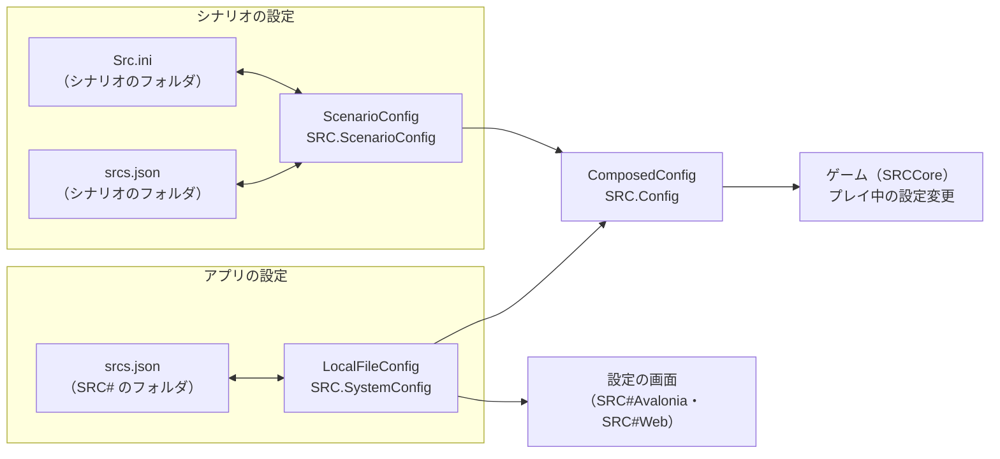

# 設定の構成

SRC# の設定は「アプリの設定」と「シナリオの設定」を別々に読み書きし、ゲームはそれを重ねた設定を参照する。元の SRC の `ReadIni`・`WriteIni`（`SRC/SRC_20121125/GeneralLib.bas`）と同じ振る舞いにする。

| クラス | 場所 | 役割 |
|---|---|---|
| `LocalFileConfig` | `SRCCore/Config/LocalFileConfig.cs` | アプリの設定。SRC# のフォルダの `srcs.json` を読み書きする。`SRC.SystemConfig` |
| `ScenarioConfig` | `SRCCore/Config/ScenarioConfig.cs` | シナリオのフォルダの `Src.ini`・`srcs.json`。ファイルにある項目だけを持ち、変えたらそのファイルに書き戻す（無い項目は足さない）。`SRC.ScenarioConfig` |
| `ComposedConfig` | `SRCCore/Config/ComposedConfig.cs` | ゲームが参照する設定。値は持たず、参照するたびにシナリオの設定・アプリの設定の順に引く。`SRC.Config` |
| `SrcIni` | `SRCCore/Config/SrcIni.cs` | `Src.ini` の読み取り（Shift_JIS か UTF-8。名前の大文字・小文字は区別しない） |

## 読む

- `SRC.Execute` がシナリオのフォルダを決めたところで `SRC.LoadScenarioConfig()` を呼ぶ。シナリオのフォルダが SRC# のフォルダと同じなら読まない（その `srcs.json` はアプリの設定そのもの）。
- `Src.ini` の `[Option]` は元の SRC の項目名で読み、`ISystemConfig` のプロパティに対応させる（`Square` → `ShowSquareLine`、`MindEffect` → `SpecialPowerAnimation`、`ImageBufferNum` → `ImageBufferSize`、`MaxImageBufferSize`（MB）→ `MaxImageBufferByteSize`、`MP3Volume` → `SoundVolume`、`AutoDeffence` → `AutoDefense`）。ほかのセクション（`[BGM]` など）は項目のまま。
- `srcs.json` はアプリの設定と同じ形式。両方にある項目は `srcs.json` を使う。`AppPath`・`ExtDataPath`・`ExtDataPath2` はシナリオでは変えない。
- `SRCCompatibilityMode` は `false`・`true`・数値・名前（`"Read"` など）を受け付ける。

## 書く

`ComposedConfig` に書くと、シナリオの設定にある項目は `ScenarioConfig` に、ほかはアプリの設定に書く（元の SRC の `WriteIni`）。`Save()` はそれぞれのファイルに保存する。

- `Src.ini` は変えた行だけを書き換え、文字コード・改行・コメントはそのまま残す。
- シナリオのファイルに書けないとき（読み取り専用のフォルダなど）は警告のログを出し、変えた値はそのプレイの間だけ効く。
- SRC#Web は、シナリオのフォルダ（.NET のメモリ上のファイルシステム）に書いた `Src.ini`・`srcs.json` を、セーブデータと同じく IndexedDB にシナリオごとに残し、次にシナリオを開くときに戻す（`SRCSharpWeb/SaveSync.cs`。シナリオに同梱のものを上書きする）。元の SRC がシナリオの `Src.ini` に書き込むのと同じく、変えた設定はそのシナリオだけに次回も残る。セーブデータの一覧には出さない。
- 設定の画面（SRC#Avalonia の設定のウィンドウ、SRC#Web の設定）はアプリの設定（`SRC.SystemConfig`）だけを読み書きする。シナリオの設定はアプリの設定に混ざらない。

## ゲームの中だけで変える値

汎用戦闘アニメのインクルードファイル（`Lib/汎用戦闘アニメ/include.eve`）が無いときは、`SRC.BattleAnimationUnavailable` で戦闘アニメを使わない。設定には書かない（元の SRC が変数の `BattleAnimation` だけを変えるのと同じ）。プレイ中の設定変更で戦闘アニメを選び直すと使う。
