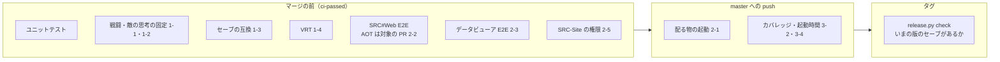

# リグレッションを防ぐことを最優先にした品質保証の改善

- 日付: 2026-10-31
- 状態: 採用（進め方は #1350 とそのサブ Issue で追う）

## 背景

移植は完了し（[判断の記録](./2026-10-20-porting-complete.md)）、今の主な作業は SRC#Web・描画・作成支援ツールの機能の追加と、元の SRC との違いの修正になった。いま動いているものを壊さないこと（リグレッションを防ぐこと）が、品質の最大の課題になっている。

2026-10-31 に、領域ごとに次の 3 つを調べた。

- 変更と修正の多さ: 2026-09-01 以降のコミットのうち、Dependabot を除く 377 件
- テストの厚さ: SRCCore・SRCRender・SRCPlay・SRCLogging のカバレッジ（行）。全体で 65.0%、分岐は 59.4%
- 壊れたときに気づける位置: マージの前か、後か、気づけないか

| 領域 | 変更 | うち修正 | テスト・カバレッジ | 気づける位置 | 壊れたときの影響 |
|---|---|---|---|---|---|
| 戦闘・ユニット（`SRCCore/Units`） | 27 | 17 | 61%（`Unit.attackcheck` 45%・`Unit.attack` 51%・`Unit.ability` 44%・`UnitWeapon` 55%） | 一部はマージの前（ユニットテスト・シナリオ E2E） | 命中率・ダメージが黙って変わる。画面では気づきにくい |
| 敵の思考（`SRCCore/COM.cs`） | — | — | 40% | ほぼ無し | 敵の行動・オートプレイが変わる |
| 描画（`SRCRender`） | 54 | 11 | 64%（`ScreenGUI.status` 41%・`ScreenGUI.message` 58%） | VRT（一部の画面だけ） | 表示が崩れる |
| SRC#Web（`SRCSharpWeb`） | 59 | 5 | Playwright 41 件。配る AOT 版の E2E はマージの後。SoundFont の 2 件は CI で常に飛ぶ | 大半はマージの前 | 遊べなくなる（いちばん使われている入口） |
| セーブデータ | — | — | `SRC.save.cs` 100%。ただし同じ版で保存して読む往復だけ | 版をまたぐ互換は気づけない | 利用者のセーブ（ブラウザに保存されている）が読めなくなる |
| 配る物（SRC#Avalonia の 4 つの単一ファイル・SRC#Form の zip・`srcsharp` の NuGet） | — | — | 起動の確認なし。Avalonia の単一ファイルと NuGet の pack は、タグのときに初めて作る | 気づけない（利用者が気づく） | 起動しない版を出す |
| SRC#Form（`SRCSharpForm`、29,074 行） | 18 | 3 | 0。描画は SRCRender を使わないので VRT も効かない | 気づけない | 配っている版が壊れる。**当面の対象から外す**（下の「範囲」） |
| イベントコマンド | — | — | 185 のうち、シナリオ E2E で通らないもの 37。ユニットテストを合わせても 30% 未満が 16（Upgrade・ClearSkill・Join・MapAttack・SetStatus など） | 一部 | そのコマンドを使うシナリオが壊れる |
| データビューア（`SRCTestBlazor`） | 11 | 0 | Cypress 2 件（配信の後に動き、マージを止めない） | マージの後 | SRC-Site の `/viewer/` が壊れる |
| VS Code 拡張 | 24 | 1 | 0（.vsix を作るだけ） | 気づけない | 拡張が動かない |
| 7474/SRC-Site のルート（認証・権限・投稿・承認） | — | — | 0（テストは zip・カタログのライブラリだけ） | 気づけない | 権限の誤りは安全性の問題になる |

依存の更新でも壊れている。#1336 では、ソリューションに入っていない `SRCSharpWeb` だけ SkiaSharp が上がらず、10/28〜10/30 に CI が NU1605 で失敗した。また、SRC#Avalonia で効果音が鳴らないという報告がある（#1341）。

## 判断

### 方針

1. **リスクの高い順に手を打つ。** リスクは「変更の多さ × 壊れたときの影響 × 気づけない度合い」で測る。カバレッジの数字そのものは目標にしない。
2. **いまの振る舞いを固定するテスト（特性テスト）を先に作る。** 正しさを一から書き起こすのではなく、いまの出力を記録して、変わったら知らせる。元の SRC に合わせると決めた領域は、今までどおり VB 版を期待値にする（[判断の記録](./2026-10-15-vb-behavior-as-test-oracle.md)）。
3. **マージの前に気づけるようにする。** テストは `ci-passed` の下に置く。マージの後や、タグを打った後に気づく仕組みは補いとして扱う。
4. **意図した変更は PR の差分で見せる。** 固定した結果（スナップショット）を変える PR は、その差分を PR に載せる。黙って上書きしない。
5. **当面は自動化を優先する。** 固定した結果の更新に人のレビューを必須にはしない。リグレッションが起きたら（`regression` のラベルの Issue が出たら）、その領域の手順・ゲートを見直す。エラーバジェットは設けないが、考え方は同じで、壊れたときに守りを厚くする。

### 範囲

- **SRC#Form は当面の対象から外す。** リリースでは今までどおり配るが、自動の確認は作らない（[フロントエンドのサポート階層](./2026-10-29-frontend-support-tiers.md)の「維持」）。
- **macOS は、理屈の上で動く（発行できる）ところまでとする。** 起動の確認はしない。

### 段階

#### 段階 0: ゲートの穴をふさぐ（すぐ。小さな変更）

| # | 内容 | 防ぐもの |
|---|---|---|
| 0-1 | `test-web` で `timgm6mb-soundfont` を入れ、SoundFont の MIDI のテスト 2 件を動かす | SRC#Web の MIDI の再生が壊れること |
| 0-2 | Dependabot の対象に `SRCSharpWeb`・`SRCLintWeb` と、npm のフォルダ（`SRCSharpVSCode`・`SRCSharpWeb.E2E`・`SRCTestBlazor/E2E`）を入れる。`@vscode/vsce` を 4.x に上げ、`@azure/msal-node` の脆弱性を解消する | 版のずれによるビルドの失敗（#1336 の再発） |
| 0-3 | 不安定なテスト「取得したアーカイブはキャッシュし、version が変わるまで取得し直さない」の原因を直す。やり直しで通ったテストは、CI のサマリに一覧で出す | やり直しが本当の不具合を隠すこと |
| 0-4 | 不具合の Issue に `regression` のラベルを設け、前の版で動いていたものが壊れたかを記録する | （効果を測る物差し） |

#### 段階 1: 結果を固定する（最優先）

| # | 内容 | 作り方 |
|---|---|---|
| 1-1 | **戦闘の計算結果の固定** | テスト用のデータ（`SRC.Sharp/E2E` の汎用データと、組み合わせ用に足すユニット・武器・特殊能力）で、攻撃側 × 防御側 × 武器 × 地形 × スペシャルパワー・気力の組み合わせごとに、`HitProbability`・`Damage`・`CriticalProbability`・`IsWeaponAvailable` の結果を表（テキスト）に出す。リポジトリに置いた表と比べる。変えるときは、表の差分を PR に載せる |
| 1-2 | **敵の思考の固定** | 乱数の種（`GeneralLib.RndSeed`）を固定してシナリオ E2E を動かし、敵フェイズの行動（移動先・武器・対象・使ったスペシャルパワー）の列を記録し、前の記録と比べる。オートプレイのコーパス（`E2E/autoplay`）と戦闘のコーパスを使う |
| 1-3 | **セーブデータの版をまたぐ互換** | リリースのたびに、通常・中断・クイックのセーブを `SRC.Sharp/E2E/saves/v<版>/` に残す。CI で、すべての版のセーブを読み込み、続きのプレイが数ターン進むことを確かめる。`tools/release.py check` で、いまの版のセーブがあることも確かめる |
| 1-4 | **画面の VRT を足す** | ステータス画面（ユニットの種類・特殊能力・非表示の指定）、メッセージ（折り返し・顔の絵）、戦闘の予想の画面を基準画像にする（`ScreenGUI.status` 41%・`Command.preview` 16%） |

#### 段階 2: 配る物とフロントエンド

| # | 内容 | 作り方 |
|---|---|---|
| 2-1 | **配る物の起動の確認を、master への push ごとに行う** | <ul><li>SRC#Avalonia: 自己完結の単一ファイルを、linux-x64 は ubuntu、win-x64 は windows のランナーで作り、起動して終わることを確かめる（起動して終わるための引数を足す）。osx-arm64・osx-x64 は発行できることだけを確かめる</li><li>`srcsharp`: `dotnet pack` → `dotnet tool install` → `srcsharp --version` と `lint`</li><li>公開ワークフローの「作る」部分を共通のワークフロー（`workflow_call`）にし、タグで初めて作ることを無くす</li></ul> |
| 2-2 | **SRC#Web の AOT 版を PR でも確かめる** | `SRCSharpWeb`・`SRCRender`・発行の設定を変えた PR では、AOT で発行して E2E を通す（約 8 分増える）。そのほかの PR は今までどおりインタープリター |
| 2-3 | **データビューアの E2E をゲートに入れる** | Playwright のテストを `test-web` に足し、リポジトリの中のデータで動かす（外部の SRC-Data に頼らない）。#1338 の機能（アーカイブ・MIDI・BGM・`viewer.json`）を含める |
| 2-5 | **7474/SRC-Site のルートの権限のテスト** | `@cloudflare/vitest-pool-workers` で D1 を使い、次のことを確かめる。<ul><li>他人のシナリオ・パックを変えられないこと</li><li>パックの管理者でない人は承認できないこと</li><li>上限を超えた投稿が拒まれること</li></ul> |

#### 段階 3: 網羅を広げる・続ける

| # | 内容 |
|---|---|
| 3-1 | 30% 未満のイベントコマンド 16 と、シナリオ E2E で通る行の少ないコマンド（ChangeArea 5%・Enable 6%・ChangeTerrain 7%）を、E2E のコーパスに足す |
| 3-2 | カバレッジを全アセンブリで計り、PR ごとに「変えた行のうちテストが通った割合」をサマリに出す。下限は設けず、低いときに知らせるだけにする |
| 3-3 | VS Code 拡張に、起動とコマンドの登録を確かめる最小のテスト（`@vscode/test-electron`）を足す |
| 3-4 | SRC#Web の起動時間（ランタン号を選んでから最初の入力待ちまで）を `test-web` で測ってサマリに出し、前より大きく遅くなったら知らせる |

### マージの前・後・リリースのどこで気づくか

## 理由

- 修正のコミットが多く、カバレッジが低く、壊れても画面で気づきにくいのは、戦闘・ユニットと敵の思考。ここは、いまの結果を表にして固定するのがいちばん安く、効き目が大きい。テスト用の公開のメソッド（`HitProbability`・`Damage` など）があり、乱数の種も固定できる。
- セーブの互換と配る物の起動は、壊れると利用者のデータや入手した版が使えなくなる。そのうえ今は、利用者が気づくまで分からない。
- SRC#Form は「維持」の階層で、利用者も SRC#Web・SRC#Avalonia に移っているため、当面は手を入れない。

## 影響

- CI の時間
  - 段階 1 の固定のテストは、ユニットテストと同じジョブで数十秒程度の見込み。
  - 2-2（AOT）は、対象の PR で約 8 分増える。
  - 2-1 の起動の確認は、master への push のときだけにし、PR の待ち時間は増やさない。
- 意図して結果を変える PR では、固定した表・記録・基準画像の差分が出る。更新の手順（更新用のコマンド）を [テストと CI の設計](../testing.md) に書く。
- 効果は次のもので測る。
  - `regression` のラベルが付いた Issue の数（0-4）
  - 段階 1 の対象のファイルのカバレッジ
  - やり直しで通ったテストの数

## 決めたこと

- SRC#Form は当面の対象から外す（2-4 は行わない）。
- macOS は発行できることだけを確かめ、起動の確認はしない。
- 固定した結果の更新に人のレビューを必須にしない。自動化を優先し、リグレッションが起きたら見直す。

## 参照

- [テストと CI の設計](../testing.md)
- [元の SRC の動作を期待値にしたテストで移植の不具合を記録する](./2026-10-15-vb-behavior-as-test-oracle.md)
- [E2E テストと VRT を SRCRender 上のヘッドレスなプレイで行い、フロントエンドの UI テストは最小にする](./2026-10-12-headless-e2e-vrt.md)
- [フロントエンドにサポート階層を設け、SRC#Form を維持の階層にする](./2026-10-29-frontend-support-tiers.md)
