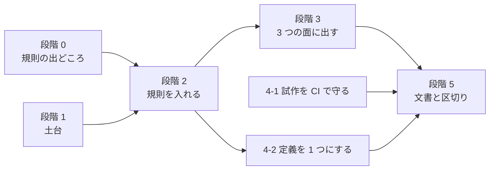

# データ検証の補強を規則の検査に絞り、作成支援ツールを収束させる

- 日付: 2026-11-13
- 状態: 採用（進め方は #1388 とそのサブ Issue で追う）

## 背景

#1388 は、ロボダン（ロボッとダンジョンＢ！）の `Lib\UnitChecker.eve` を手がかりに、データの指定のありがちな誤りを調べられるようにする Issue である。2026-10-31 から 2 週間で、次のものができた。

| できたもの | 内容 |
|---|---|
| 設計 | [準拠データパックに応じたバランスの検査](../tools/balance-pack.md)（規則 12 個、数値の比較、組の評価、パック定義。進め方は 9 段階） |
| 試作 | `tools/pack-stats`（17 コマンド）・`tools/pack-analysis`。ソリューションと CI の外 |
| 文書 | 利用者向けの説明（実装前の下書き）、試作結果（719KB）、読み物 |
| SRC-Data | データ作成ガイドラインと、作品ごとの評価を出す GitHub Pages |

2026-11-13 に、作る人の道具（`srcsharp`・VS Code 拡張・SRCLintWeb・SRCDataLinter・試作）と、それを使う SRC-Data・SRC-Site を調べた。

| 見つかったこと | 根拠 |
|---|---|
| Issue の本題が、配っている道具に入っていない | `srcsharp lint` が出すのは SRCCore の読み込みの誤りだけ。設計の 9 段階は未着手 |
| 同じ検査の定義が 3 か所にある | 設計の規則、`pack-stats` の `check` の「要確認」、`srcsharp balance` の z 値。「射程 2 以上に射」は前の 2 つに重なる |
| 試作が本番で使われているのに守られていない | SRC-Data の Pages（毎週）が、SRC の master の `tools/pack-stats`・`tools/pack-analysis` をビルドして使う。SRCCore を変えて壊れても、SRC の CI では分からない |
| 文書が「現状だけを書く」方針から外れている | `docs/tools` に、未実装の設計、まだ無いコマンドの使い方、試作結果、読み物がある。[一覧](../README.md) にも無い |
| 範囲が検証から評価へ広がった | 設計の重い部分（役割と格の推定、組の評価、パック定義）は、誤りを見つけるためのものではない |
| データを書く人は、エディタで何も出ない | LSP の診断は `*.eve` だけ。データは「ワークスペースを lint」の出力を読むしかない |

## 判断

### 方針

1. **#1388 は「ありがちな書き間違いに、書いているその場で気づける」ところで閉じる。** 入れるのは規則の検査だけにする。
2. **検査のエンジンと規則の定義を 1 つにする。** 置き場は SRCAuthoring。出す先は CLI（CI）・VS Code・SRC-Site の 3 つで、同じデータには同じ診断を出す。
3. **既定で動く規則は「情報」にし、終了コードに数えない。** 版を上げただけで、既存のシナリオの CI を落とさない。
4. **SRC の仕様の規則は、元の SRC の実装を根拠にする。** ヘルプの記述だけでなく、VB 版（`SRC/SRC_20121125`）の読み込みの処理と突き合わせて書く。
5. **試作は機能を足さず、壊れないように守る。**

### 範囲

| 扱い | もの |
|---|---|
| #1388 で行う | 規則の検査（SRC の仕様の組 `src`、GSC の決まりの組 `gsc-robo`・`gsc-ext`）、定義の場所の記録、3 つの面への表示、試作の CI、文書の整理 |
| #1607 に切り出す | パックの同じ層の実態との比較（`balance --pack`）、役割表、組の評価、パック定義（JSON）。パック定義で書く数値の上限（`basis`）と SP の組み合わせ（`sp-combo`）。`UnitChecker.eve` の数値の上限と SP の組み合わせは、その見本になる（下の「`UnitChecker.eve` の項目の扱い」） |
| 作らない | パックの推定（作品の一覧からの自動の選択）、`name-separator` の規則、数値の範囲を外れたことを知らせる規則を、パック定義なしに既定で動かすこと |

### 決めたこと

- **数値の比較と組の評価は #1388 から外す。** 入れると設計の 9 段階すべてが終わりの条件になり、区切りがつかない。
- **`tools/pack-stats`・`tools/pack-analysis` は SRC に残す。** SRCCore をプロジェクト参照でき、master の修正にそのまま追従できる。SRC-Data へは移さない。
- **規則の組は、名前で選ぶだけにする。** `srcsharp lint --rules src,gsc-ext`、VS Code の設定 `srcsharp.rules`、SRCLintWeb の `rules`。既定は `src`。設定ファイルは作らない。
- **作品独自の武器属性を、規則の判定で無いものとして扱う指定だけを足す。** `srcsharp lint --ignore-weapon-attributes 延`、VS Code の設定 `srcsharp.ignoreWeaponAttributes`、SRCLintWeb の `ignoreWeaponAttributes`。ロボダンの `UnitChecker.eve` は、独自の属性「延」（延長攻撃。alias.txt で定義し、射程が延びる近接武器に付ける）の武器を、射程と格・射・Ｐの規則から除いている。GSC の組をロボダンのデータにかけると、これが誤検知になる。設計のパック定義の `ignoreWeaponAttributes` と同じ意味で、パック定義を作るとき（#1607）にそちらへ寄せる。

### 段階

4-1 はほかを待たずに行える。

#### 段階 0: 規則の出どころを決める

| # | 内容 | 終わりの条件 |
|---|---|---|
| 0-1 | `UnitChecker.eve` の＜注意＞を表にし、項目ごとに「規則にする（組は `src` か GSC か）／数値の閾値なので入れない／データだけでは判定できない」を決める。表はこの記録に足す | 表が、段階 2 で入れる規則の一覧になる（済。下の表） |

##### `UnitChecker.eve` の項目の扱い

ロボダン（ロボッとダンジョンＢ！ v13404b）の `lib/UnitChecker.eve` を調べた（2026-11-13）。`Call ローカルデータミス確認 ユニットID` で、ゲームの中のユニット 1 体（乗っているパイロットと、変形・換装・他形態・ハイパーモード・パーツ分離・パーツ合体の先の形態を含む）を調べ、見つけたものを `Confirm` で知らせる。＜注意＞は 39 か所で、1 か所（迎撃に使える武器が無い）はコメントアウトされている。ファイルはリポジトリに入れない。

| 対象 | ＜注意＞ | 数 | 扱い | 理由 |
|---|---|--:|---|---|
| パイロット | 経験値 > 200 | 1 | 入れない（#1607） | 数値の上限。パックと範囲（味方・敵・ボス）で違う |
| パイロット | 格闘・射撃・命中・回避 > 165、技量 > 190、反応 > 170 | 6 | 入れない（#1607） | 同上 |
| パイロット | 格闘 + 射撃 > 300 | 1 | 入れない（#1607） | 同上。設計のときの試作では、ロボダン自身の味方のデータも、これらの上限を 157 件超えていた |
| パイロット | SP の組み合わせで最大火力が 3 倍（2 倍の SP〈熱血・奇襲・勇気・夢〉＋クリティカルの SP〈痛撃・闘志・夢〉）・4.5 倍（3 倍の SP〈魂・決意・捨て身・奇跡〉＋クリティカルの SP） | 2 | 入れない（#1607 の `sp-combo`） | 作品の釣り合いの決まりで、SRC の仕様の誤りでも GSC の決まりでもない。ユニットに乗る全員の SP を合わせて見るので、パイロットとユニットの組が要る |
| パイロット | SP の無限コンボ（自爆か夢＋祈りか再動） | 4 | 入れない（#1607 の `sp-combo`） | 同上 |
| パイロット | SP の強いコンボ（集中・ひらめき・捨て身・みがわり＋忍耐、捨て身＋復活） | 5 | 入れない（#1607 の `sp-combo`） | 同上 |
| ユニット | 乗っているパイロット数が規定パイロット数より少ない（１人乗り可能で 1 人のときを除く） | 1 | 入れない | ゲームの中で乗せた人数を見る。データだけでは判定できない |
| ユニット | 経験値 > 200 | 1 | 入れない（#1607） | 数値の上限 |
| ユニット | 移動可能地形に「海」 | 1 | 規則にする（`src`）：`unit-transportation-invalid` | 元の SRC は移動可能地形を文字列のまま持ち、「空」「陸」「水」「地中」が含まれるかだけを見る（`UnitDataList.cls`・`Unit.cls` の `InStr(Transportation, …)`）。「海」は水中移動として扱われない |
| ユニット | 移動可能地形に空・陸・水・宇宙があるのに、その地形適応が `-` | 4 | 規則にする（`src`）：`unit-transportation-adaption` | ロボダンも 4 つを別々に知らせている。設計の規則と同じ |
| ユニット | HP > 15000、EN > 300、装甲 > 2500、運動性 > 140、移動力 > 7 | 5 | 入れない（#1607） | 数値の上限 |
| 武器 | 射程 2 以上の突・武・接に、格・複が無い | 1 | 規則にする（GSC）：`weapon-cross-range-shooting` | 設計の規則と同じ |
| 武器 | 射程 2 以上に射（延を除く） | 1 | 規則にする（GSC）：`weapon-range2-shooting` | 設計の規則と同じ。延は `--ignore-weapon-attributes` で除く |
| 武器 | 射程 1 に格（延を除く） | 1 | 規則にする（GSC）：`weapon-range1-infight` | 同上 |
| 武器 | 射程 1 にＰ（延を除く） | 1 | 規則にする（GSC）：`weapon-range1-p` | 同上 |
| 武器 | Ｂで、水の地形適応が A・B | 1 | 規則にする（`gsc-robo`）：`weapon-beam-adaption` | 設計の規則（射程 2 以上のＢで、地形適応が `AA-A`・`AACA` 以外）に含まれる。ロボダンは射程 1 のＢの水の適応も見る。射程 1 のＢは、設計の `weapon-beam-melee`（射程 1 にＢ）で知らせる |
| 武器 | 最強の武器（いちばん後ろの武器）の格闘・射撃の判定が、乗っているパイロットの得意（格闘と射撃の差が 5 以上）と食い違う | 2 | 入れない（#1607 の組の評価） | パイロットとユニットの組が要る。データだけでは判定できない |
| 武器 | 迎撃に使える武器が無い | 1 | 入れない | コメントアウトされていて、動いていない |

この表から、入れる規則に足すものは無い（すべて下の表にある）。足すのは、作品独自の武器属性を除く指定（上の「決めたこと」）だけである。

#### 段階 1: 土台

| # | 内容 | 終わりの条件 |
|---|---|---|
| 1-1 | 規則が使うデータ（ユニット・パイロット・武器・アビリティ・メッセージ）に、定義のあるファイルと行を記録する。読み込みの結果とゲームの動作は変えない | 読み込んだデータから、定義のファイルと行を引ける。既存のテストが変わらず通る |
| 1-2 | 規則の仕組みを SRCAuthoring に作る。`IDataRule`（ID・組・既定の重さ・検査）、`SrcDiagnostic.RuleId`、SARIF の規則、`lint --rules`・`lint --list-rules`。「情報」は `HasError` に数えない | 規則が 1 つも無い状態で、今のデータの出力と終了コードが変わらない |

#### 段階 2: 規則を入れる

| # | 内容 | 終わりの条件 |
|---|---|---|
| 2-1 | `src` の組（既定で動く。すべて「情報」）。下の表と、0-1 で `src` としたもの | GSC データパックにかけた件数を記録し、設計の表の件数と合う |
| 2-2 | `gsc-robo`・`gsc-ext` の組（選んだときだけ動く）。下の表と、0-1 で GSC としたもの。作品独自の武器属性を除く指定（`--ignore-weapon-attributes`） | 同上。選ばなければ、何も変わらない |

入れる規則。ID と重さは設計の「規則」の表に合わせる。

| 組 | 規則 | 出どころ |
|---|---|---|
| `src` | 移動可能地形に、空・陸・水・地中・宇宙・`-` 以外がある | 設計・`UnitChecker.eve` |
| `src` | 移動可能地形に空・陸・水・宇宙があるのに、その地形適応が `-` | 設計・`UnitChecker.eve` |
| `src` | 1 人のパイロットが同じ SP を重ねて持つ | `pack-stats check` |
| `src` | メッセージのシチュエーションが、SRC のものでも、武器・アビリティ・特殊能力の名前でもない（表示されない） | `pack-stats check` |
| GSC | 射程 1 に格、射程 2 以上に射、射程 1 にＰ、射程 2 以上の突・武・接に格・複が無い | 設計・`UnitChecker.eve` |
| GSC | Ｂの地形適応、射程 1 のＢ（`gsc-robo`）、飛べないユニットの空の適応（`gsc-ext`） | 設計（Ｂの地形適応は `UnitChecker.eve` にもある） |
| GSC | 名前の長さ（パイロット愛称 10・ユニット愛称 16・武器名 14） | 設計 |
| GSC | 数値の刻み（HP 100・EN 10・装甲 50・運動性 5・攻撃力 100・消費 EN 5） | `pack-stats check` |
| GSC | 名前付きのパイロットの SP が 6 つでない、SP を覚えるレベルがすべて 5 の倍数か間隔が一定、SP 使用時のメッセージがある | `pack-stats check` |

パックの分布を使うもの（得意・苦手が無い、同じ層の 5%〜95% の外など）は規則にしない（#1607）。

#### 段階 3: 3 つの面に出す

| # | 内容 | 終わりの条件 |
|---|---|---|
| 3-1 | LSP でデータファイル（`robot.txt`・`pilot.txt` など）にも診断を出す。VS Code の設定 `srcsharp.rules` | データに書いた誤りが、エディタの波線と問題パネルに出る |
| 3-2 | SRCLintWeb に `rules` を足し、診断に規則の ID を入れる。SRC-Site のチェッカーで「情報」として出す | SRC-Site のチェッカーに、`srcsharp lint` と同じ診断が出る |
| 3-3 | SRC-Data の検証を `srcsharp lint` の入口に寄せ、ガイドラインのチェックリストを `srcsharp lint --rules` に直す。同じデータで 3 つの面の診断が一致することをテストで確かめる | SRC-Data の CI が、新しい規則を「情報」として出して通る |

#### 段階 4: 試作の落ち着き先

| # | 内容 | 終わりの条件 |
|---|---|---|
| 4-1 | `tools/pack-stats`・`tools/pack-analysis` を CI でビルドし、リポジトリの中の小さなデータで動かす。README に、機能を足さないことと使われている先（SRC-Data の Pages）を書く | SRCCore の変更で試作が壊れたら、マージの前に分かる |
| 4-2 | `pack-stats check` の「要確認」のうち規則にしたものを、SRCAuthoring の規則を呼ぶ形に置き換える | 規則の定義が 1 か所になる。SRC-Data の作品ごとのページの指摘は、置き換えの前後で変わらない |

#### 段階 5: 文書と区切り

| # | 内容 | 終わりの条件 |
|---|---|---|
| 5-1 | 文書を実装に合わせ、#1388 を閉じる。下の「文書の落ち着き先」のとおり | `docs/tools` に未実装の記述が無い |

文書の落ち着き先。

| 文書 | 行き先 |
|---|---|
| `docs/tools/authoring.md` | 規則の一覧・組の選び方・データの診断を書く。「未対応」の表を今に合わせる |
| `docs/tools/balance-pack-guide.md` | 消す。実装した分（書き間違いに気づく・パックの書き方の決まり）は `authoring.md` に書く |
| `docs/tools/balance-pack.md` | `docs/history/tools/` へ移す。続きは #1607 |
| `docs/tools/balance-pack-analysis.md`・`balance-pack-reading.md` | `docs/history/tools/` へ移す。SRC-Data のガイドラインがコマンドの例で `docs/tools/balance-pack-analysis.md` を指しているので、合わせて直す |
| `SRCSharpTools`・`SRCSharpVSCode` の README、拡張の CHANGELOG、リリースの案内 | 規則と `--rules`・`srcsharp.rules` を書く |

### #1388 を閉じる条件

- 0-1 の表のすべての項目に、扱い（規則にした／入れない理由）が書かれている
- `srcsharp lint` が、規則の ID・ファイル・行の付いた診断を出す
- 同じ診断が、VS Code のデータファイルと SRC-Site のチェッカーに出る
- 版を上げただけでは、SRC-Data・`SRC.Sharp/E2E`・`SRC.Sharp/Compat` の lint の終了コードが変わらない
- `tools/pack-stats`・`tools/pack-analysis` が CI で動く
- `docs/tools` に未実装の記述が無い

## 理由

- 2 週間で設計・試作・文書は増えたが、データを書く人が使う `srcsharp lint` は変わっていない。広げた範囲のまま続けると、終わりが見えない。
- 規則の検査は、設計のうち小さく（定義の場所の記録と規則の仕組み）、効き目がはっきりしている。GSC のデータで守られている率を測ってあり、誤検知の少ない規則から入れられる。
- 数値の比較と組の評価は、SRC-Data の Pages でもう見られる。`srcsharp` に入れる前に、使われるかを見られる。
- 試作を SRC-Data に移すと、SRCCore を NuGet の版で参照することになり、master の修正（#1413 のような読み込みの修正）が届くのが遅れる。

## 影響

- `srcsharp lint` の出力に「情報」の診断が増える。終了コードは変わらない。従来の SRCDataLinter の出力には「情報」を出さない（今の書式は、エラー以外をすべて warning と書くため）。
- `tools/pack-stats`・`tools/pack-analysis` に機能を足すのは、#1607 に着手するまで止める。SRC-Data のガイドラインの集計に要る修正は行う。
- 設計の「進め方」の 9 段階は、この記録の段階に置き換える。設計に書いた比較レポートと組の評価の使い方は、実装されるまで利用者向けの文書には載せない。
- SRC-Data と SRC-Site にも変更が要る（3-2・3-3・5-1）。

## 確かめていないこと

- `UnitChecker.eve` の項目は 0-1 で表にした。ロボダンのデータに規則をかけた件数は数えていない（2-1・2-2 で、GSC データパックと合わせて数える）。
- この記録を書いた環境には .NET が無く、`tools/pack-stats`・`tools/pack-analysis` が今の master でビルドできるかは確かめていない（4-1 で確かめる）。

## 参照

- #1388（データ検証の補強）、#1607（切り出した先）
- [準拠データパックに応じたバランスの検査（設計）](../tools/balance-pack.md)
- [作成支援ツール](../tools/authoring.md)
- [役目を終えたコード・ツール・ワークフローを消す](./2026-10-31-repository-cleanup.md)
