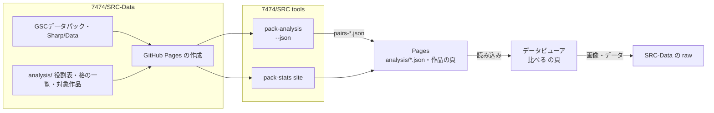

# データの比較を、楽しむための道具として整える

- 日付: 2026-11-14
- 状態: 採用（進め方は #1607 とそのサブ Issue で追う）
- 関連: [データ検証の補強を規則の検査に絞り、作成支援ツールを収束させる](./2026-11-13-authoring-tools-convergence.md)（数値の比較・組の評価・パック定義を #1607 に切り出した）

## 背景

#1607 は、#1388 から切り出した「準拠データパックの水準との比較」と「ユニットとパイロットの組の評価」を扱う。主な目的を、**作者（7474）がデータを比較して楽しむこと**に置き直した。誤りを見つける検査ではないので、`srcsharp lint` の規則にも、データを作る人への強制にもしない。

2026-11-14 時点で、次のものがある。

| もの | 内容 | 困っていること |
|---|---|---|
| `tools/pack-analysis` | 組を作り、ゲームと同じ計算で使いどころ（ボス戦・ザコ掃討・回避・囮・遊撃・長距離・支援）の評価（S〜D）と、8 種の指数（実効性能・単純数字。同じ帯の中央値 = 100）を出す | 出力は Markdown だけで、ほかの画面から使えない |
| `tools/pack-stats` の `site` | SRC-Data の GitHub Pages（Jekyll）に、作品ごとの頁（データの評価・組の評価・レーダーチャート）を作る | 静的な表で、並べ替え・絞り込み・作品をまたいだ比較・選んだ組の横並べができない。画像が無い |
| 役割表・格の一覧・対象作品の一覧 | `tools/pack-analysis/roles-*.csv`・`tools/pack-stats/tiers-*.tsv`・`works-*.txt` | データ（SRC-Data）と別のリポジトリ（SRC）にあり、データを見ながら直しにくい。名前の誤りに気づけない |
| データビューア（SRC#DataViewer） | SRC-Data の作品のユニット・パイロットを画像付きで見る（`raw.githubusercontent.com` の目次を読む） | 評価は見られない |

SRC-Data の Pages（`https://7474.github.io/SRC-Data/`）は、ほかのサイトからの読み込みを許している（`access-control-allow-origin: *`）。

## 判断

### 方針

1. **計算は試作（`tools/pack-analysis`）のまま使い、結果を JSON にして配る。** srcsharp には入れない（使う人は作者で、CLI で比べる必要が無い）。
2. **見せる場所はデータビューアにする。** ユニット・パイロットの画像と同じ画面で比べられ、作品の頁から比較へ行ける。
3. **データの整備は、データの横（SRC-Data）で行う。** 役割表・格の一覧・対象作品の一覧を SRC-Data に移し、名前の誤りは SRC-Data の CI で知らせる。
4. **自動で作り直す。** SRC-Data の Pages を作るとき（データ・役割表が変わったとき、手動、毎週）に JSON も作る。データビューアは最新の JSON を読む。

### 全体

### 段階

| # | 観点 | 内容 |
|---|---|---|
| 1 | 自動化 | `pack-analysis --json` で、組ごとの評価（作品・パイロット・ユニット・帯・格・使いどころの評価と上位の %・指数・主な能力値）と前提を JSON に書く。SRC の CI（`tools/pack_tools_check.sh`）で、JSON の形を確かめる |
| 2 | 自動化・データ整備 | SRC-Data の Pages で JSON を `analysis/` に出す。役割表・格の一覧・対象作品の一覧を SRC-Data の `analysis/` に移し、`site/build.sh` はそれを使う。名前の確かめ（`pack-analysis --check-roles`）を SRC-Data の CI で動かす |
| 3 | 見せ方・比べ方 | データビューアに「比べる」の頁を足す。ランキング（指数・評価で並べ替え、区分・作品・帯・格で絞り込み、実効性能と単純数字の切り替え）、選んだ組（4 組まで）の横並べ（画像・レーダーチャート・指数・評価・能力値）、作品同士の比較（作品ごとの指数の中央値と最大）、自分のデータ（`Sharp`）の位置（同じ帯の分布の中の印） |
| 4 | データ整備 | 役割表を書く手間を減らす。組の評価の頁に、役割表の無い作品と、自動で組んだ組を出す。`pack-analysis --roles-template 作品` で、自動で組んだ組を役割表の行の形で出す |

### 作らないもの

- srcsharp の `balance --pack`・パック定義（JSON）。比較は作者が見て楽しむためのもので、作る人の手元・CI で使う要望が出るまで作らない
- 誤りとして知らせる数値の上限（作品ごとの `basis`）。ロボダンの上限は `robodun` の規則（`srcsharp lint`）にある

## 理由

- 試作の計算は GSC の主な作品で確かめてあり、作り直す理由が無い。結果を JSON にすれば、見せ方だけを変えられる。
- データビューアは画像・BGM と一緒にデータを見る場所で、比べて楽しむのに向く。静的な Markdown の頁は、並べ替え・横並べに向かない。
- 役割表は「このキャラはこの機体に乗る」「この格」という、データを見ながら書く情報である。データと同じリポジトリにあれば、データの変更と一緒に直せる。

## 影響

- SRC-Data の Pages の作成は、JSON の分だけ出力が増える（計算は今と同じ組で、時間は変わらない）。
- データビューアは、SRC-Data の Pages の JSON を読む。読めなければ「比べる」の頁にその旨を出し、ほかの頁は今までどおり動く。
- `tools/pack-analysis` に機能を足す（「試作に機能を足さない」とした [判断](./2026-11-13-authoring-tools-convergence.md) を、#1607 の範囲で改める）。

## 参照

- #1607
- [準拠データパックに応じたバランスの検査（設計、履歴）](../history/tools/balance-pack.md)
- [データビューア](../gui/dataviewer.md)
