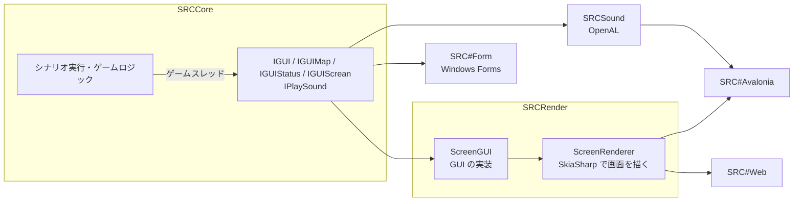

# GUI の構成

SRC# のフロントエンドと、それらが共有する部品の構成。各フロントエンドの詳細は個別の文書にある。この構成を選んだ理由は [判断の記録](../decisions/2026-10-12-gui-frontend-architecture.md) にある。

## フロントエンド

| フロントエンド | 階層 | プロジェクト | 動く環境 | 描画 | 音声 | 文書 |
|---|---|---|---|---|---|---|
| SRC#Avalonia | 推奨 | `SRCSharpAvalonia` | Windows・macOS・Linux | `SRCRender`（SkiaSharp） | `SRCSound`（OpenAL） | [SRC#Avalonia](./avalonia.md) |
| SRC#Web | 推奨 | `SRCSharpWeb` | ブラウザ（静的サイト） | `SRCRender`（SkiaSharp の WebAssembly 版） | Web Audio API（MIDI は MeltySynth） | [SRC#Web](./web.md)・[外部のサイトに置く](./web-hosting.md) |
| SRC#Form | 維持 | `SRCSharpForm` | Windows（x64） | GDI+（Windows Forms の部品と直描き） | NAudio・DryWetMidi | — |

階層は、開発・検証でどのフロントエンドを優先するかを表す（[判断の記録](../decisions/2026-10-29-frontend-support-tiers.md)）。

- **推奨**: 開発・検証の軸。新機能を先に対応し、不具合を直す
- **維持**: 削除はしないが、重大な不具合と元の SRC（VB5）との互換性に関わる不具合を可能な範囲で直すにとどめる。新機能は後追い、または対応しない

SRC#Avalonia と SRC#Web は、`SRCRender` が描いた 1 枚の画面を表示し、入力を渡すだけの薄い層になっている。SRC#Form は元の SRC（VB5）の画面をそのまま Windows Forms に移したもので、`SRCRender` を使わない。

データビューア（`SRCTestBlazor`。[データビューア](./dataviewer.md)）と動作確認用のフォーム（`SRCTestForm`）はデータを見るためのもので、シナリオはプレイしない。

## 構成

- **境界**: `SRCCore` は `IGUI` 系のインターフェースだけを通して画面・入力・音声を扱う。`SRCCore` は `System.Drawing.Common` に依存しない（`Color`・`Point` など System.Drawing.Primitives の型は使う）
- **ゲームスレッド**: シナリオは専用のゲームスレッドで実行し、メッセージ送り・選択などの待ちはゲームスレッドで止まって待つ。UI からの入力はゲームスレッドへ渡して処理する（`SRCCore.Threading`）。`IGUI` は同期のまま
  - SRC#Avalonia と SRC#Web は常にゲームスレッドで動く。SRC#Web は .NET の WebAssembly マルチスレッドでゲームスレッドを Web Worker で動かす
  - SRC#Form は既定では UI スレッドでシナリオを実行し、起動引数 `--game-thread` を付けたときだけゲームスレッドで動く
- **描画**: `SRCRender` はマップ・ステータス・メッセージ・リスト・メニュー・ダイアログをすべて 1 枚の画面に描く。OS のフォーム部品は使わない。表示と操作は SRC#Form に合わせ、フォームの部品配置を `SRCRender/Compat` のモデルに写している（[WinForms 版との対応](./avalonia.md#winforms-版との対応)）
- **文字入力・ファイル選択**: フロントエンドが `IScreenDialogHost` で提供する（SRC#Avalonia は Avalonia の部品、SRC#Web はページ上のモーダル）
- **素材が無い場合**: SRC#Avalonia・SRC#Web（`ScreenSession`）は素材が無くても動く。SRC#Form は素材を必須とする（[素材](../assets.md)）

## テスト

シナリオの挙動と見た目は `SRCRender` のヘッドレスな E2E・VRT で確かめ、フロントエンドのテストは表示と入力の経路に絞る（[E2E テスト](./e2e-testing.md)・[テストと CI の設計](../testing.md)）。
