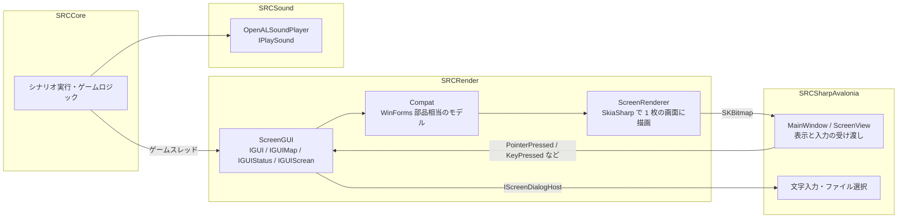

# SRC#Avalonia

> 更新日: 2026-10-12

Windows / macOS / Linux で動く SRC# のフロントエンド。WinForms 版（SRC#Form）とは別のプロジェクト `SRCSharpAvalonia` として作っている。

## 構成



- シナリオはゲームスレッドで実行する。メッセージ・リスト・ダイアログの待ちはゲームスレッドで行い、UI からの入力はゲームスレッドへ渡して処理する
- 画面（720×496）はマップ・ステータス・メッセージ・リスト・メニュー・ダイアログをすべて `SRCRender` が描く。Avalonia はでき上がった画像を表示し、マウス・キー入力を `ScreenGUI` に渡すだけ
- 文字入力（IME を使う）とファイル選択だけは Avalonia の部品（`TextBox`、[StorageProvider](https://docs.avaloniaui.net/docs/concepts/services/storage-provider/)）を使う。`IScreenDialogHost` を実装しないホストでは、文字入力は既定値で確定し、セーブはシナリオフォルダに保存する

## WinForms 版との対応

表示と操作は WinForms 版に合わせた。フォームの部品配置（`*.Designer.cs`）を `SRCRender/Compat` のモデルに写し、WinForms 版の処理をほぼそのまま移植している。

| WinForms 版 | SRC#Avalonia（SRCRender） | 備考 |
|---|---|---|
| `Forms/Main.guimap.cs` / `Main.guiscrean.cs` / `SRCSharpFormGUI.draw.cs` | `ScreenGUI.map.cs` / `ScreenGUI.draw.cs` / `ScreenGUI.animation.cs` | マップの 3 バッファ構成、ユニット描画、Paint 系コマンド、移動・破壊アニメーション |
| `Forms/Main.guistatus.cs` | `ScreenGUI.status.cs` | ステータス表示 |
| `SRCSharpFormGUI.message.cs` / `Forms/Message.cs` | `ScreenGUI.message.cs` / `Compat.MessageWindow` | メッセージウィンドウ |
| `Forms/ListBox.cs` | `ScreenGUI.list.cs` / `Compat.ListWindow` | リスト（武器・アビリティ選択、Ask、Question の制限時間、ユニット表示、コメント） |
| `Forms/MultiColumListBox.cs` / `Forms/MultiSelectListBox.cs` | `ScreenGUI.list.cs` / `Compat.MultiColumnListWindow` / `Compat.MultiSelectListWindow` | 多段リスト、出撃ユニット選択 |
| `Forms/Configuration.cs` | `ScreenGUI.config.cs` / `Compat.ConfigWindow` | 設定変更（メッセージスピードと MIDI 音源リセットは WinForms 版でも反映していないため省いた） |
| `Forms/Main.cs`（マウス・キー） | `ScreenGUI.cs`（`PointerPressed` / `PointerMoved` / `KeyPressed` など） | ドラッグでのスクロール、右ダブルクリックのキャンセル、ホットポイントのツールチップ、`KeyState` 関数 |
| `ContextMenuStrip` / `MessageBox` | `ScreenRenderer`（`DrawMenu` / `DrawDialog`） | Windows 標準の見た目で描画する |
| `Resoruces/WindowsManagedPlayer.cs`（NAudio・DryWetMidi） | `SRCSound/OpenALSoundPlayer.cs` | 下記 |

### 表示上の違い

- **フォント**: ＭＳ 明朝・ＭＳ ゴシックが無い環境では、等幅の指定（ＭＳ 明朝・ＭＳ ゴシック）を Noto Sans Mono CJK JP、明朝系のプロポーショナル指定を Noto Serif CJK JP、それ以外を Noto Sans CJK JP で描く。空白で桁を揃えている表示（ステータス・武器一覧など）がずれないよう、等幅の指定は必ず等幅フォントにする。行の高さは ＭＳ 明朝と同じ 1em として扱う（Noto CJK の行の高さ 1.448em のままだと行がずれて下が見切れる）
- **文字の縦位置**: 元の SRC（GDI）は指定位置を文字の上端とし、ベースラインをフォントの ascent（OS/2 の usWinAscent）だけ下げる。行の高さ（`TextHeight`）は ascent + descent。代わりのフォントで描く場合も、指定されたフォント名の Windows での寸法（`SRCRender/Compat/WindowsFontMetrics.cs`）で配置する。メイリオは行の高さが約 1.5em と大きく、これを使わないと文字の位置や `TextHeight` による縦の中央寄せがずれる
    - 表の値の一部は公開情報からの暫定値（`Verified = false`）。Windows では `SRCRenderTests` の `WindowsFontMetricsTests.MatchesInstalledWindowsFonts` が実フォントを GDI+（`FontFamily.GetCellAscent` など）で測って照合し、表に貼れる形で `TestResults/fontmetrics.txt` に書き出す（CI の Windows ジョブの成果物 `windows-font-metrics`）。暫定値が残っている間はこのテストは Inconclusive になる
    - 確かめる手順: Windows で `dotnet test SRC.Sharp/SRCRenderTests --filter MatchesInstalledWindowsFonts` を実行し、書き出された値で表を更新して `Verified` を `true` にする
- **ウィンドウ**: リスト・設定変更・メッセージボックスは別ウィンドウではなく、画面内にタイトルバー付きの枠として描く

## マウスカーソルの自動移動

設定「マウスカーソルを自動的に移動する」（メッセージ・リスト・ユニットへカーソルを動かす）は、Avalonia にカーソルを動かす API が無いため、OS の API を直接呼ぶ（`SRCSharpAvalonia/NativeCursor.cs`）。`ScreenGUI` は WinForms 版の `MoveCursorPos` / `RestoreCursorPos` を移植し、カーソルの操作は `IScreenCursorHost` でホストに任せる。

| OS | API |
|---|---|
| Windows | user32 の [SetCursorPos](https://learn.microsoft.com/windows/win32/api/winuser/nf-winuser-setcursorpos) / GetCursorPos |
| macOS | CoreGraphics の [CGWarpMouseCursorPosition](https://developer.apple.com/documentation/coregraphics/1456387-cgwarpmousecursorposition) / CGEventGetLocation |
| Linux（X11 / XWayland） | libX11 の [XWarpPointer](https://www.x.org/releases/current/doc/man/man3/XWarpPointer.3.xhtml) / XQueryPointer |

- Wayland のネイティブ環境はアプリからカーソルを動かせないため、何もしない
- macOS はアクセシビリティの許可が無いとカーソルを動かせない場合がある
- Linux（Xvfb）でカーソルが動くことを `SRCSharpAvaloniaTests` で確認している。Windows・macOS の実機では未確認

## 音声（SRCSound）

| 形式 | 実装 | ライセンス |
|---|---|---|
| 出力 | [Silk.NET.OpenAL](https://www.nuget.org/packages/Silk.NET.OpenAL/2.23.0) 2.23.0 + [OpenAL Soft](https://openal-soft.org/)（[Silk.NET.OpenAL.Soft.Native](https://www.nuget.org/packages/Silk.NET.OpenAL.Soft.Native/1.23.1) 1.23.1） | MIT / LGPL-2.0-or-later（動的リンク） |
| WAV | 自前の RIFF 読み込み（PCM 8/16/24/32 bit、IEEE float） | — |
| MP3 | [NLayer](https://www.nuget.org/packages/NLayer/3.0.0) 3.0.0（[GitHub](https://github.com/naudio/NLayer)） | MIT |
| MIDI | [MeltySynth](https://www.nuget.org/packages/MeltySynth/2.4.1) 2.4.1（[GitHub](https://github.com/sinshu/meltysynth)）で SoundFont から合成 | MIT |

- AIFF は再生しない（ログに警告を出す）
- 音声出力デバイスを開けない環境では、何も鳴らさずに動く
- SRC フルパッケージの効果音・MIDI（242 ファイル）がすべて読み込めることを確認した

### SoundFont

MIDI の合成には SoundFont（.sf2）が必要。ライセンスの都合で同梱しない（[素材データの再配布の検討](../assets/redistribution-study.md)）。次の順に探し、最初に見つかったものを使う。

1. 設定ファイル `srcs.json` の `Option` セクションの `SoundFont`（パス）
2. 環境変数 `SRC_SOUNDFONT`
3. SRC のフォルダ直下、`Midi` フォルダの `*.sf2`
4. Linux の標準の場所（`/usr/share/sounds/sf2/default-GM.sf2` など。Debian / Ubuntu では `fluid-soundfont-gm` や `timgm6mb-soundfont` パッケージで入る）

見つからない場合、MIDI は鳴らない。

## 実行

```sh
dotnet run --project SRC.Sharp/SRCSharpAvalonia -- <シナリオの .eve / セーブデータ>
```

- 引数を省くとファイル選択ダイアログを表示する
- 汎用グラフィック集などの素材が無くても起動できる（画像は代替表示になる）

## テスト

| プロジェクト | 内容 |
|---|---|
| `SRCRenderTests` | `ScreenGUI` でシナリオをプレイし、画面の状態と VRT を検証する。リスト・多段リスト・出撃選択・設定変更・メニュー・メッセージボックス・ドラッグ・ホットポイント・文字入力・`KeyState` |
| `SRCSharpAvaloniaTests` | `Avalonia.Headless` でウィンドウを動かし、マウス入力でシナリオを進める。文字入力ダイアログ、キーコードの変換 |
| `SRCSoundTests` | WAV・MP3・MIDI の復号と、OpenAL Soft の null 出力（環境変数 `ALSOFT_DRIVERS=null`）での再生・ループ・停止 |

詳細は [E2E テスト方針](./e2e-testing.md)。
