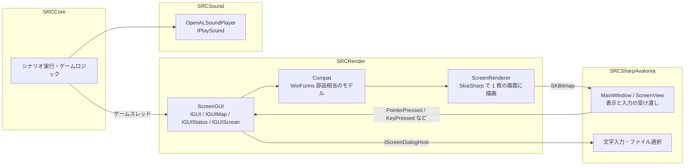

# SRC#Avalonia

Windows / macOS / Linux で動く SRC# のフロントエンド。WinForms 版（SRC#Form）とは別のプロジェクト `SRCSharpAvalonia`。フロントエンド全体の構成は [GUI の構成](./README.md) を参照。

## 構成



- シナリオはゲームスレッドで実行する。メッセージ・リスト・ダイアログの待ちはゲームスレッドで行い、UI からの入力はゲームスレッドへ渡して処理する
- 画面（720×496）はマップ・ステータス・メッセージ・リスト・メニュー・ダイアログをすべて `SRCRender` が描く。Avalonia はでき上がった画像を表示し、マウス・キー入力を `ScreenGUI` に渡すだけ
- メインウィンドウ（マップ・ステータス）を隠している間（`Hide`、プロローグ・インターミッションなど、元の SRC がメインウィンドウを出していないとき）は、マップとステータスを描かずに黒くする。メッセージ・リスト・タイトルなどの別のウィンドウだけを描く。`Show`・`Wait Click`・ステージの開始などで表示すると、隠している間の描画もまとめて出る
- 別のウィンドウの位置は元の SRC（`SRC/SRC_20121125/GUI.bas`）に合わせる。元の SRC はメインウィンドウを画面の中央に置くため、「画面の中央」は 720×496 の画面全体（ステータスを含む）の中央にあたる

| ウィンドウ | メインウィンドウを表示 | 隠している |
|---|---|---|
| メッセージ（`OpenMessageForm`） | 開いたときに左下（下端を合わせる） | 画面の中央 |
| リスト（`ListBox`） | 横: `HorizontalSize` が S なら左端、他は中央。縦: `VerticalSize` が M で「中央表示」でなければ下端、他は中央 | 画面の中央 |
| 多段のリスト（`MultiColumnListBox`） | 横は中央。縦は下端（中央表示なら中央） | 画面の中央 |
| 複数選択のリスト（`MultiSelectListBox`） | 左端・縦は中央 | 同じ |
| テロップ（`DisplayTelop`） | マップの中央 | 画面の中央 |
| Now Loading・タイトル | 画面の中央（Now Loading はメインウィンドウを表示していればマップの中央） | 画面の中央 |
- 文字入力（IME を使う）とファイル選択だけは Avalonia の部品（`TextBox`、[StorageProvider](https://docs.avaloniaui.net/docs/concepts/services/storage-provider/)）を使う。`IScreenDialogHost` を実装しないホストでは、文字入力は既定値で確定し、セーブはシナリオフォルダに保存する

## WinForms 版との対応

表示と操作は WinForms 版に合わせている。フォームの部品配置（`*.Designer.cs`）を `SRCRender/Compat` のモデルに写し、WinForms 版の処理をほぼそのまま移植している。

| WinForms 版 | SRC#Avalonia（SRCRender） | 備考 |
|---|---|---|
| `Forms/Main.guimap.cs` / `Main.guiscrean.cs` / `SRCSharpFormGUI.draw.cs` | `ScreenGUI.map.cs` / `ScreenGUI.draw.cs` / `ScreenGUI.animation.cs` | マップの 3 バッファ構成、ユニット描画、Paint 系コマンド、移動・破壊アニメーション |
| `Forms/Main.guistatus.cs` | `ScreenGUI.status.cs` | ステータス表示 |
| `SRCSharpFormGUI.message.cs` / `Forms/Message.cs` | `ScreenGUI.message.cs` / `Compat.MessageWindow` | メッセージウィンドウ |
| `Forms/ListBox.cs` | `ScreenGUI.list.cs` / `Compat.ListWindow` | リスト（武器・アビリティ選択、Ask、Question の制限時間、ユニット表示、コメント） |
| `Forms/MultiColumListBox.cs` / `Forms/MultiSelectListBox.cs` | `ScreenGUI.list.cs` / `Compat.MultiColumnListWindow` / `Compat.MultiSelectListWindow` | 多段リスト、出撃ユニット選択 |
| `Forms/Configuration.cs` | `ScreenGUI.config.cs` / `Compat.ConfigWindow` | 設定変更（メッセージスピードと MIDI 音源リセットは WinForms 版でも反映していないため省いた） |
| `Forms/Main.cs`（マウス・キー） | `ScreenGUI.cs`（`PointerPressed` / `PointerMoved` / `KeyPressed` など） | ドラッグでのスクロール、右ダブルクリックのキャンセル、ホットポイントのツールチップ、`KeyState` 関数 |
| `ContextMenuStrip` / `MessageBox` | `ScreenRenderer`（`DrawMenu` / `DrawDialog`） | Windows 標準の見た目で描画する |
| `Resoruces/WindowsManagedPlayer.cs`（NAudio・DryWetMidi） | `SRCSound/OpenALSoundPlayer.cs` | 下記 |

### 表示上の違い

- **フォント**: ＭＳ 明朝・ＭＳ ゴシックが無い環境では、等幅の指定（ＭＳ 明朝・ＭＳ ゴシック）を Noto Sans Mono CJK JP、明朝系のプロポーショナル指定を Noto Serif CJK JP、それ以外を Noto Sans CJK JP で描く。空白で桁を揃えている表示（ステータス・武器一覧など）がずれないよう、等幅の指定は必ず等幅フォントにする。行の高さは ＭＳ 明朝と同じ 1em として扱う（Noto CJK の行の高さ 1.448em のままだと行がずれて下が見切れる）
- **文字の縦位置**: 元の SRC（GDI）は指定位置を文字の上端とし、ベースラインをフォントの ascent（OS/2 の usWinAscent）だけ下げる。行の高さ（`TextHeight`）は ascent + descent。代わりのフォントで描く場合も、指定されたフォント名の Windows での寸法（`SRCRender/Compat/WindowsFontMetrics.cs`）で配置する。メイリオは行の高さが約 1.5em と大きく、これを使わないと文字の位置や `TextHeight` による縦の中央寄せがずれる
    - 表の値の一部は公開情報からの暫定値（`Verified = false`）。Windows では `SRCRenderTests` の `WindowsFontMetricsTests.MatchesInstalledWindowsFonts` が実フォントを GDI+（`FontFamily.GetCellAscent` など）で測って照合し、表に貼れる形で `TestResults/fontmetrics.txt` に書き出す（CI の Windows ジョブの成果物 `windows-font-metrics`）。暫定値が残っている間はこのテストは Inconclusive になる
    - 確かめる手順: Windows で `dotnet test SRC.Sharp/SRCRenderTests --filter MatchesInstalledWindowsFonts` を実行し、書き出された値で表を更新して `Verified` を `true` にする
- **ウィンドウ**: リスト・設定変更・メッセージボックスは別ウィンドウではなく、画面内にタイトルバー付きの枠として描く

## メニュー

ウィンドウの上のメニュー（`MainWindow`）。

| メニュー | 項目 | 動作 |
|---|---|---|
| ファイル | シナリオを開く... | シナリオを選んで始める。実行中なら、セーブしていない進行状況が失われることを確かめる。選ばなければ今のシナリオを続ける |
| | 最初からやり直す | 今のシナリオ（ファイル）を始め直す。実行中なら確かめる |
| | 終了 | アプリを終える。実行中なら確かめる |
| 表示 | 100%・150%・200% | 表示倍率（下記） |
| 設定 | 設定... | 素材・ゲーム・BGM・表示言語・ログ・開発者向けの設定（下記） |
| | 開発者向けの設定... | 設定のウィンドウを「開発者向け」のタブで開く |
| ヘルプ | ヘルプを開く | [SRC# のヘルプ](https://srch.7474.jp/)をブラウザで開く |
| | SRC#Avalonia の使い方 | ヘルプの [SRC#Avaloniaの使い方](../../SRC.Sharp.Help/src/SRCSharpAvaloniaの使い方.md) を開く |
| | SRC# のサイト | [リポジトリ](https://github.com/7474/SRC)をブラウザで開く |
| | ログのフォルダを開く | 今のログのフォルダ（`LogHost.FileDirectory`。ファイルに出していなければ既定のフォルダ）を開く |
| | バージョン情報 | 版とライセンスを示す |

- シナリオを開き直す・やり直すときは、今のシナリオを止め（ゲームスレッド・音）、同じウィンドウで新しく始める（`App.StopSession`・`App.StartSession`）。止まりきる前に前のシナリオが描いたものなどは、新しいシナリオに混ざらないよう捨てる（`SessionHost`）
- メニューは Alt キーでも操作できる（Avalonia の標準の動き）。押すとゲームの画面からフォーカスが移る

## 表示倍率

画面は 720×496 で描き、`ScreenView` が補間せずドットのまま拡大して表示する（`ScreenView.DisplayScales`。100%・150%・200%）。ウィンドウの大きさは画面に合わせて決まり、ドラッグでは変えられない。

- 150% は、よくある画面（1920×1080 の 125%、2560×1440 の 150%、MacBook Air など）に収まる大きさとして選べるようにしている。整数倍でないため、ドットの太さは揃わない（1 画素と 2 画素が交互になる）

- メニューの「表示」で倍率を選ぶ。選んだ倍率は `srcs.json` の `Option/DisplayScale`（100 = 100%）に保存し、次に起動したときも使う
- 設定が無ければ、ウィンドウ（タイトルバー・メニューを含む）が画面の作業領域に収まる、いちばん大きな倍率にして画面の中央に置く（`App.FitToScreen`）
- 100%・200% でも、OS の表示倍率が整数でない（125% など）と、実際の画素では整数倍にならない（OS の拡大が加わる）

## 設定

メニューの「設定 > 設定...」で設定のウィンドウを開く（`SettingsWindow`）。「素材」「表示」「ログ」のタブに分ける。保存すると `srcs.json` に書く。素材と表示言語は次に起動したときから、ログは保存したときから効く（`LogHost.ApplyConfig`。引数・環境変数で指定した項目は上書きしない）。

SRC# が `srcs.json` から読む設定（フロントエンドの設定を含む）は、すべてこのウィンドウか「表示」メニューで変えられるようにする。

| タブ | 項目 | `srcs.json` |
|---|---|---|
| 素材 | 拡張データフォルダ 1・2、MIDI の SoundFont、素材パック | 下表 |
| ゲーム | 元の SRC の設定変更の画面と同じ項目（`ScreenGUI.Configure`）と自動反撃モード。音量はその場で変える | `BattleAnimation` など、`Option/Turn`、`Option/AutoDefense`、`SoundVolume` |
| BGM | 場面ごとの曲のファイル名（`Sound.BGMName`）。元の SRC の Src.ini の `[BGM]` を取り込める（`SrcIni`） | `BGM/<名前>` |
| 表示 | 表示言語（OS の言語に合わせる・対応言語） | `Option/Language` |
| ログ | レベル・ファイルに出すか・フォルダ・残す日数（[ログの設計](../logging.md)） | `Log/Level`・`Log/File`・`Log/Path`・`Log/RetainDays` |
| 開発者向け | デバッグモード、Shift_JIS の読み書き（`SRCCompatibilityMode`）、画像のバッファ（描画では使わず `Info` で読めるだけ） | `Option/DebugMode`・`SRCCompatibilityMode`・`ImageBufferSize` など |

### 素材

| 項目 | `srcs.json` | 内容 |
|---|---|---|
| 拡張データフォルダ 1・2 | `ExtDataPath`・`ExtDataPath2` | 元の SRC の Src.ini と同じ。SRC# のフォルダとシナリオのフォルダに無いデータ・グラフィック・音楽を探すフォルダ。SRC 本体（汎用グラフィック集などを入れたもの）や開発パックのフォルダを指定する |
| MIDI の SoundFont | `Option/SoundFont` | 下記の [SoundFont](#soundfont) の 1 番目 |

- フォルダは参照ボタンで選べる。指定したフォルダに `Bitmap`・`Data`・`Midi`・`Sound` のどれがあるかを示し、無いフォルダ・素材のフォルダが一つも無いフォルダ・`Bitmap` などのフォルダそのもの（親を指定する）は警告する
- SoundFont が空欄なら、自動で探して見つかるもの（無ければ MIDI が鳴らないこと）を示す
- シナリオの実行中に保存した場合も、ゲーム中に変えた設定を上書きしないよう、実行中のシナリオが持つ設定に書いてから保存する
- システムデータ（`Data\System` の terrain.txt・sp.txt・mind.txt・alias.txt・item.txt・battle.txt）は、元の SRC と同じく SRC# のフォルダから読み、無ければ拡張データフォルダ 1・2 からも読む（元の SRC は SRC のフォルダだけを見る）。SRC# を SRC 本体と別のフォルダに置き、拡張データフォルダで SRC 本体を指す使い方のため（`SRC.SystemDataRoots`）
- BGM が見つからないときは、その名前をログ（Info）に残す

### 素材パック

汎用グラフィック集や開発パックなどの zip を、SRC# のフォルダの `Packs` フォルダに置くと、展開せずに SRC# のフォルダに重ねて読む（SRC#Web で素材の zip を追加するのと同じ扱い。`SRCCore.Filesystem.AssetPacks`）。

- 素材パックの欄（設定のウィンドウの「素材」）で、置いた zip と、中の素材のフォルダ（`Bitmap`・`Data`・`Lib`・`Midi`・`Sound`）を示す。「素材パックを追加...」で選んだ zip を `Packs` フォルダに写し、「フォルダを開く」で `Packs` フォルダを開く
- zip の最上位に `Bitmap` などがあればそのまま、最上位のフォルダが 1 つだけでその中にあれば、そのフォルダを SRC# のフォルダに重ねる。どちらでもない zip は読まない（ログに残す）
- 名前順に重ね、名前が後ろのものほど優先する。SRC# のフォルダに実在するファイルは素材パックより優先する
- zip のファイル名は、UTF-8 として読めなければ Shift_JIS として読む（Windows で作った zip）
- 次に起動したとき（シナリオを始めるとき）に読む

## マウスカーソルの自動移動

設定「マウスカーソルを自動的に移動する」（メッセージ・リスト・ユニットへカーソルを動かす）は、Avalonia にカーソルを動かす API が無いため、OS の API を直接呼ぶ（`SRCSharpAvalonia/NativeCursor.cs`）。`ScreenGUI` は WinForms 版の `MoveCursorPos` / `RestoreCursorPos` を移植し、カーソルの操作は `IScreenCursorHost` でホストに任せる。

| OS | API |
|---|---|
| Windows | user32 の [SetCursorPos](https://learn.microsoft.com/windows/win32/api/winuser/nf-winuser-setcursorpos) / GetCursorPos |
| macOS | CoreGraphics の [CGWarpMouseCursorPosition](https://developer.apple.com/documentation/coregraphics/1456387-cgwarpmousecursorposition) / CGEventGetLocation |
| Linux（X11 / XWayland） | libX11 の [XWarpPointer](https://www.x.org/releases/current/doc/man/man3/XWarpPointer.3.xhtml) / XQueryPointer |

- Wayland のネイティブ環境はアプリからカーソルを動かせないため、何もしない
- macOS はアクセシビリティの許可が無いとカーソルを動かせない場合がある
- Linux（Xvfb）でカーソルが動くことを `SRCSharpAvaloniaTests` で確認している。Windows・macOS の実機では未確認

## 音声（SRCSound）

| 形式 | 実装 | ライセンス |
|---|---|---|
| 出力 | [Silk.NET.OpenAL](https://www.nuget.org/packages/Silk.NET.OpenAL/2.23.0) 2.23.0 + [OpenAL Soft](https://openal-soft.org/)（[Silk.NET.OpenAL.Soft.Native](https://www.nuget.org/packages/Silk.NET.OpenAL.Soft.Native/1.23.1) 1.23.1） | MIT / LGPL-2.0-or-later（動的リンク） |
| WAV | 自前の RIFF 読み込み（PCM 8/16/24/32 bit、IEEE float） | — |
| MP3 | [NLayer](https://www.nuget.org/packages/NLayer/3.0.0) 3.0.0（[GitHub](https://github.com/naudio/NLayer)） | MIT |
| MIDI | [MeltySynth](https://www.nuget.org/packages/MeltySynth/2.4.1) 2.4.1（[GitHub](https://github.com/sinshu/meltysynth)）で SoundFont から合成 | MIT |

- AIFF は再生しない（ログに警告を出す）
- 音声出力デバイスを開けない環境では、何も鳴らさずに動く
- SRC フルパッケージの効果音・MIDI（242 ファイル）はすべて読み込める
- シナリオの `PlaySound` で、効果音のチャンネルに WAV を渡して再生することを `SRCSharpAvaloniaTests`（`AppTests`）で確かめている（#1341）。実際に音が出るかは OpenAL Soft と音声出力デバイスによる

### フォント

日本語は、指定のフォント（ＭＳ 明朝など）が無ければ Noto CJK、それも無ければ OS が「あ」を描けるとするフォントで描く（`SRCRender/Compat/Drawing.cs` の `SkiaFonts`）。次のフォントも読み込む。

- 環境変数 `SRCSHARP_FONTS` に指定したフォントのファイル・フォルダ（パスの区切り文字で区切る）
- WSL（Linux から `/mnt/c/Windows/Fonts` が見える）では、Windows の ＭＳ ゴシック・ＭＳ 明朝（`msgothic.ttc`・`msmincho.ttc`）。日本語名（ＭＳ ゴシックなど）でも引ける

日本語のフォントが一つも無いと豆腐になる。`srcsharp dap` はデバッグの開始時にこれを調べ、無ければ通知する（VS Code の `important` の出力）。

### SoundFont

MIDI の合成には SoundFont（.sf2）が必要。次の順に探し、最初に見つかったものを使う。

1. 設定ファイル `srcs.json` の `Option` セクションの `SoundFont`（パス）
2. 環境変数 `SRC_SOUNDFONT`
3. SRC のフォルダ直下、`Midi` フォルダの `*.sf2`
4. Linux の標準の場所（`/usr/share/sounds/sf2/default-GM.sf2` など。Debian / Ubuntu では `fluid-soundfont-gm` や `timgm6mb-soundfont` パッケージで入る）
5. 同梱の TimGM6mb（実行ファイルの隣の `SoundFont` フォルダ）

TimGM6mb（約 6 MB、GPL-2.0）はビルド時に取得して同梱する（`SRCSharpAvalonia.csproj`。取得元は `Directory.Build.props` で SRC#Web と同じ）。ライセンスの全文（`COPYING`）と出典（`README.txt`）を添える。取得できない（ネットワークが無い）ビルドでは同梱せず、そのときに 1〜4 が無ければ MIDI は鳴らない（[判断の記録](../decisions/2026-11-01-bundle-soundfont.md)）。

## 実行

```sh
dotnet run --project SRC.Sharp/SRCSharpAvalonia -- <シナリオの .eve / セーブデータ>
```

- 引数を省くとファイル選択ダイアログを表示する。前回ファイル選択で開いたシナリオのフォルダ（`srcs.json` の `Option/LastScenarioFolder`）から選ばせる
- 汎用グラフィック集などの素材が無くても起動できる（画像は代替表示になる）

## テスト

| プロジェクト | 内容 |
|---|---|
| `SRCRenderTests` | `ScreenGUI` でシナリオをプレイし、画面の状態と VRT を検証する。リスト・多段リスト・出撃選択・設定変更・メニュー・メッセージボックス・ドラッグ・ホットポイント・文字入力・`KeyState` |
| `SRCSharpAvaloniaTests` | `Avalonia.Headless` でウィンドウを動かし、マウス入力でシナリオを進める。文字入力ダイアログ、キーコードの変換 |
| `SRCSoundTests` | WAV・MP3・MIDI の復号と、OpenAL Soft の null 出力（環境変数 `ALSOFT_DRIVERS=null`）での再生・ループ・停止 |

詳細は [E2E テスト](./e2e-testing.md)。
