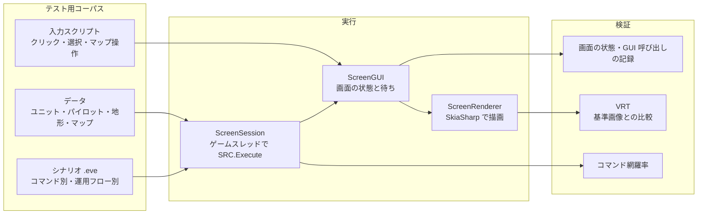

# E2E テスト方針 / E2E Testing

> 調査日: 2026-10-12

SRC# の E2E テスト（シナリオを実際にプレイして挙動を確認するテスト）と VRT（ビジュアルリグレッションテスト）の方針。

## 結論

- **全コマンドと運用フローを網羅するテスト用データ・シナリオを用意し、入力スクリプトに沿ってヘッドレスでプレイする**
- 検証は2系統で行う
  - **挙動**: 画面の状態（メッセージ、選択肢、マップ、ユニット）と、GUI 呼び出しの記録
  - **見た目（VRT）**: `SRCRender` が描画した画面を基準画像と比較する
- すべて Linux の CI で実行する。フロントエンド固有の UI テストは最小限にする

## 構成



## テスト用コーパス

| 区分 | 内容 | 例 |
|---|---|---|
| コマンド別 | 各イベントコマンドを1つ以上実行するシナリオ。ヘルプの記載に沿った期待値を持つ | `Talk` / `Ask` / `Set` / `If` / `ChangeMap` / `Create` / `Attack` / `Paint` 系 |
| 運用フロー | 実際のプレイの流れを通しで実行する | プロローグ → 出撃 → 戦闘 → 勝利条件 → エピローグ → インターミッション → 次ステージ、セーブ／ロード、クイックセーブ、中断データ |
| データ | 上記を動かすための最小データ | ユニット・パイロット・武器・アビリティ・地形・マップ・アイテム |
| 互換性 | 元の SRC との挙動差の回帰確認 | [SRC-SharpTestScenario](https://github.com/7474/SRC-SharpTestScenario) のシナリオ |

- 置き場所は `SRC.Sharp/E2E/`（データ・シナリオ・入力スクリプト・基準画像）とする想定
- 乱数を使うシナリオは乱数系列を固定して実行する（`GeneralLib.RndSeed`）
- **網羅率の検査**: 実行したコマンドの種類（`CmdType`）を記録し、コーパス全体で未実行のコマンドがあればテストを失敗させる。これでコマンドの追加・移植漏れを検出できる

### 入力スクリプト

画面の状態を待ってから入力する手順を、シナリオごとに記述する。現在は C# で書いている（`ScreenScenarioRunner`）。コーパスが増えた段階で、次のようなテキスト形式に移す。

```text
wait message "ヘッドレステスト開始"
snapshot scenario-01-message
click message
wait list "選択"
choose 1
wait message "はいが選ばれた"
click message
expect terminated
```

## VRT

- `SRCRender` は画面全体（マップ・メッセージ・選択肢・ステータス）を SkiaSharp だけで描くため、UI フレームワークや OS の描画系に依存せず、同じ入力から同じ画像が得られる
- 基準画像は `SRCRenderTests/Baselines/*.png`。`VisualAssert.MatchesBaseline` で比較する
  - チャンネルごとに ±24、不一致ピクセル 0.2% までを許容（アンチエイリアスの揺れの吸収）
  - 差分があると `TestResults/vrt/` に `*.actual.png` と `*.diff.png`（差分をマゼンタで表示）を書き出す。CI では成果物 `screenshots` として保存する
  - 基準画像の更新は `SRC_VRT_UPDATE=1 dotnet test SRC.Sharp/SRCRenderTests` で行い、差分をレビューしてコミットする
- **フォントを固定する**: 基準画像は Ubuntu 24.04 + `fonts-noto-cjk`（Noto Sans CJK JP）で作成している。CI の Linux ジョブも同じフォントを入れる。Noto Sans CJK JP が無い環境（Windows など）では比較せず Inconclusive とする
- 今後の対象: ユニットの表示・移動アニメーション、戦闘画面、`Paint` 系コマンドの描画（`SRCRender` で実装した後）

## 現在のテスト

| プロジェクト | 内容 | 実行環境 |
|---|---|---|
| `SRCCoreTests` | ユニットテスト。`E2E/HeadlessScenarioTests` は GUI 呼び出しの記録を、ゲームスレッドあり／なしで比較 | Windows / Linux |
| `SRCRenderTests` | `ScreenGUI` でシナリオをプレイし、画面の状態と VRT を検証 | Windows / Linux（VRT は Linux のみ） |
| `SRCSharpAvaloniaTests` | SRC#Avalonia のウィンドウを `Avalonia.Headless` で動かし、マウス入力でシナリオを進める。描画結果を `TestResults/avalonia/` に保存 | Windows / Linux |
| `SRCSharpFormTestWinAppDriver` | SRC#Form の起動確認 | Windows のみ |
| `SRCTestBlazor/E2E` | Cypress。データ閲覧画面 | ブラウザ |

## フロントエンドごとの UI テスト

シナリオの挙動と見た目は `SRCRender` 側で網羅し、フロントエンドのテストは「画面が表示され、入力が `ScreenGUI` に届くか」に絞る。

| 対象 | 方針 | 根拠 |
|---|---|---|
| SRC#Avalonia | `Avalonia.Headless` で起動・入力・描画を確認する | [Headless Testing with XUnit](https://docs.avaloniaui.net/docs/testing/headless-xunit)、[Headless Testing Platform](https://docs.avaloniaui.net/docs/concepts/headless/) |
| SRC#Form | WinAppDriver の継続は避け、必要なら FlaUI（UIA3）に置き換える。対象は起動・終了程度 | WinAppDriver は大きな更新がなく保守モードとされる（[TestGuild](https://testguild.com/automation-tools-desktop/)、[FlaUI.WebDriver](https://github.com/FlaUI/FlaUI.WebDriver)）。WinForms 版は移行後に縮退させる前提 |
| SRCTestBlazor | 既存の Cypress を継続 | — |

## 次の作業

1. `SRC.Sharp/E2E/` にコーパスの置き場所と、テキスト形式の入力スクリプトの実行器を作る
2. コマンド網羅率の検査を入れ、未実行のコマンドを一覧化する
3. ユニット・パイロットの最小データを用意し、出撃・移動・戦闘・勝利条件までの運用フローを通す
4. セーブ／ロード、インターミッション、次ステージへの遷移を通す
