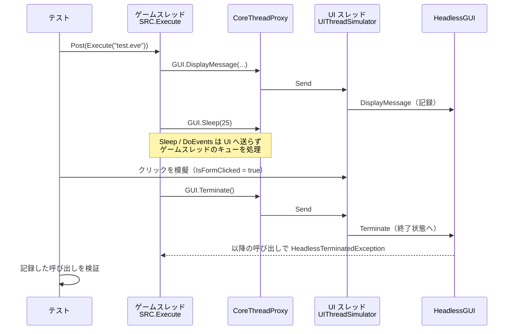

# E2E テスト方針 / E2E Testing

> 調査日: 2026-10-12

SRC# の E2E テスト（シナリオを実際に動かして挙動を確認するテスト）の現状と今後の方針。

## 結論

- 主軸は **HeadlessGUI によるシナリオ実行テスト**（Linux の CI で実行できる）
- 画面実装に固有の確認は、フロントエンドごとに薄く持つ
  - SRC#Form: WinAppDriver から FlaUI への置き換えを検討
  - SRC#Avalonia: `Avalonia.Headless` で書く
  - SRCTestBlazor: 既存の Cypress を継続

## 現状

| 対象 | 方式 | 実行環境 | 内容 |
|---|---|---|---|
| SRCCore | MSTest ユニットテスト（`SRCCoreTests`） | Windows / Linux | コマンド・式・データ単位の検証 |
| SRCCore | **HeadlessGUI によるシナリオ実行**（`SRCCoreTests/E2E`） | Windows / Linux | `.eve` を `SRC.Execute` で実行し、GUI 呼び出しの記録を検証 |
| SRC#Form | WinAppDriver（`SRCSharpFormTestWinAppDriver`） | Windows のみ | 起動してウィンドウタイトルを確認するのみ |
| SRCTestBlazor | Cypress（`SRCTestBlazor/E2E`） | ブラウザ | データ閲覧画面 |

## HeadlessGUI によるシナリオ実行テスト

`SRCCore.TestLib` に次の部品を用意した。

- `HeadlessGUI`: `IGUI` / `IGUIMap` / `IGUIStatus` / `IGUIScrean` / `IPlaySound` の呼び出しをすべて記録する画面なしの GUI
  - プロパティは設定値を、メソッドは戻り値型の既定値を返す。`Handle("ListBox", ...)` などで応答を差し替えられる
  - `IGUI.Terminate`（`Quit` コマンドなど）が呼ばれると、プロセスを終了させずに以降の呼び出しで `HeadlessTerminatedException` を送出し、シナリオの実行を打ち切る
- `UIThreadSimulator`: UI スレッドを模擬する `SynchronizationContext`。`CoreThreading` と組み合わせて、ゲームスレッド方式を Linux で検証できる

現在のテスト（`SRCCoreTests/E2E/HeadlessScenarioTests.cs`）:

- `Talk` / `Wait Click` / `Ask` / `If` / `Quit` を含むシナリオを実行し、メッセージ表示と選択結果を検証する
- 同じシナリオを、呼び出し元スレッドで直接実行した場合とゲームスレッドで実行した場合とで、GUI 呼び出しの列が一致することを検証する（`Sleep` / `DoEvents` など待ちに関わる呼び出しは除く）

### 今後の拡張案

1. **ゴールデンファイル化**: シナリオごとの GUI 呼び出しの記録をテキストで保存し、差分で検証する。移植の精度確認（元の SRC との挙動比較）にも使える
2. **入力スクリプト**: クリック、選択肢、マップ上のクリック（`Commands.ProceedInput` の投入）を、時系列のスクリプトで与えられるようにする
3. **テストシナリオの拡充**: [SRC-SharpTestScenario](https://github.com/7474/SRC-SharpTestScenario) のシナリオを CI で取得して実行する。画像・音声は不要なので、最小構成の `Bitmap` / `Sound` / `Data/System/terrain.txt` を用意すれば足りる（`HeadlessScenarioTests.Initialize` を参照）
4. **マップ・戦闘を含むシナリオ**: ユニットデータとマップファイルを含むシナリオで、戦闘や AI の挙動を記録・比較する
5. **描画結果の検証**: 描画層を SkiaSharp に切り出した後（移行手順4）、画面バッファの画像比較を加える

## フロントエンドごとの UI テスト

| 対象 | 方針 | 根拠 |
|---|---|---|
| SRC#Form | WinAppDriver の継続は避け、必要なら FlaUI（UIA3）に置き換える。対象は起動・終了・ダイアログなど最小限 | WinAppDriver は大きな更新がなく保守モードとされる（[TestGuild](https://testguild.com/automation-tools-desktop/)、[FlaUI.WebDriver](https://github.com/FlaUI/FlaUI.WebDriver)）。WinForms 版は移行後に縮退させる前提 |
| SRC#Avalonia | `Avalonia.Headless.XUnit` で書く。Skia 描画を有効にすれば画面のキャプチャ比較もできる | [Headless Testing with XUnit](https://docs.avaloniaui.net/docs/testing/headless-xunit)、[Headless Testing Platform](https://docs.avaloniaui.net/docs/concepts/headless/) |
| SRCTestBlazor | 既存の Cypress を継続 | — |

シナリオの挙動は HeadlessGUI 側で網羅し、フロントエンドの UI テストは「GUI 呼び出しが画面に正しく反映されるか」に絞る。
