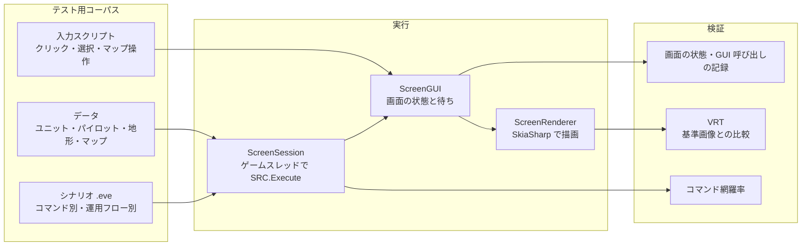

# E2E テスト方針 / E2E Testing

> 調査日: 2026-10-12（更新: 2026-10-13）

SRC# の E2E テスト（シナリオを実際にプレイして挙動を確認するテスト）と VRT（ビジュアルリグレッションテスト）の方針。

## 結論

- **全コマンドと運用フローを網羅するテスト用データ・シナリオを用意し、入力スクリプトに沿ってヘッドレスでプレイする**
- 検証は2系統で行う
  - **挙動**: 画面の状態（メッセージ、選択肢、マップ、ユニット）と、GUI 呼び出しの記録
  - **見た目（VRT）**: `SRCRender` が描画した画面を基準画像と比較する
- すべて Linux の CI で実行する。フロントエンド固有の UI テストは最小限にする

## 構成



## テスト用コーパス

| 区分 | 内容 | 例 |
|---|---|---|
| コマンド別 | 各イベントコマンドを1つ以上実行するシナリオ。ヘルプの記載に沿った期待値を持つ | `Talk` / `Ask` / `Set` / `If` / `ChangeMap` / `Create` / `Attack` / `Paint` 系 |
| 運用フロー | 実際のプレイの流れを通しで実行する | プロローグ → 出撃 → 戦闘 → 勝利条件 → エピローグ → インターミッション → 次ステージ、セーブ／ロード、クイックセーブ、中断データ |
| データ | 上記を動かすための最小データ | ユニット・パイロット・武器・アビリティ・地形・マップ・アイテム |
| 互換性 | 元の SRC との挙動差の回帰確認 | [SRC-SharpTestScenario](https://github.com/7474/SRC-SharpTestScenario) のシナリオ |

- 置き場所は `SRC.Sharp/E2E/`（データ・シナリオ・入力スクリプト）。基準画像は `SRCRenderTests/Baselines/` に置く
- 乱数を使うシナリオは乱数系列を固定して実行する（`GeneralLib.RndSeed`）
- **網羅率の検査**: 実行したコマンドの種類（`CmdType`）を記録し、コーパス全体で未実行のコマンドがあればテストを失敗させる。これでコマンドの追加・移植漏れを検出できる

### 入力スクリプト（PlayScript）

コーパスは `SRC.Sharp/E2E/ケース名/` に置く。ケースのフォルダをシナリオのフォルダとして使い、`test.eve` から始めて `play.txt` の手順でプレイする（`SRCRenderTests` の `E2ECorpusTests`）。素材はテスト用の最小構成を使い、データ（ユニット・パイロット等）は自作の最小のものをケースに含める。フォルダを追加するだけでテストが増える。

PlayScript の実装は `SRC.Sharp/SRCPlay` にある。作成支援ツールの `srcsharp play --script` やデバッガでも同じ書式を使う（[作成支援ツール](../tools/authoring.md)）。

| コマンド | 内容 |
|---|---|
| `auto [秒]` | メッセージ・ダイアログ・リストを自動で進め、マップで操作を受け付ける状態になるまで待つ |
| `wait ready\|message\|list\|menu\|dialog\|click [文字列]` | 各状態になるまで待つ |
| `click X Y [right]` / `cell X Y [right]` | 画面座標・マップのマスをクリックする |
| `menu 項目` / `list 文字列\|#番号` / `dialog ボタン` / `key キー` | メニュー・リスト・ダイアログ・キーの操作 |
| `phase` / `turns 回数` | 味方フェイズを簡単な方針で自動で行う（攻撃できれば攻撃、できなければ敵へ近づいて待機、最後にターン終了）。`turns` は「auto → phase」を繰り返す |
| `choose 見出し 項目` | `auto`・`turns` で、見出し（または説明）にその文字列を含むリストが出たら、その文字列を含む項目を選ぶ。インターミッション（`choose コマンド 次のステージへ`）やシナリオ独自の選択肢の答えを決める。規則の無いリストは先頭の有効な項目を選び、同じリストが繰り返し出る場合は順に別の項目を選び、すべて選んでも抜けられなければキャンセルする |
| `choose1 見出し 項目` | `choose` と同じだが一度だけ使う（先に追加したものから順に使う）。`choose` より優先する |
| `chooseseq 見出し 項目1\|項目2\|...` | 見出しの合うリストが出るたびに、項目を順に選ぶ（最後まで選んだら先頭に戻る。今の位置の項目が無ければ次にある項目）。インターミッションで毎回同じ手順を踏むのに使う |
| 見出し `クリック` / `ホットポイント` | `choose`・`choose1`・`chooseseq` の見出しに `クリック` を指定すると、スクリプトが描いたクリック領域（`MousePoint.eve` の `MP_ClickPoint`）を ID で選ぶ。`ホットポイント` を指定すると、`HotPoint` を名前で選ぶ（`choose` の項目は、見出しによらず、ホットポイントの名前か説明に含まれるものにも合う）。`choose1`・`chooseseq` は名前と一致するもので、項目の末尾が `*` なら前方一致 |
| `points` | 今のクリック領域の ID を記録する（規則を書くための調査用。止まって押した時にも記録する） |
| `policy smart\|advance\|hold` | `phase` の方針。`smart`（既定）は SRC の CPU と同じ見積もり（`COM.SelectWeapon`）で目標と武器を選び、移動先は移動後の攻撃の見込みと敵から受ける危険で決める。HP が 35% を下回ったら、倒しきれる見込みが高い敵がいなければ下がる。行動の前に、自分に使うスペシャルパワーのうち回復・防御（HP が減ったとき）と命中を上げるもの（ボスやネームドの敵への命中率が 70% 未満のとき）を使う。`advance` は攻撃できなければ最も近い敵へ近づく、`hold` は移動せず届く敵だけ攻撃する |
| `autodefense on\|off` | 敵の攻撃への反撃・防御・回避を SRC に任せる（設定「自動反撃」。CPU と同じ判断で選ぶ） |
| `set 変数 値` | SRC の変数に値を設定する（検証の前提を整える。例: `set 設定[難易度] ベリーイージー`） |
| `print 式` | SRC の式の値を記録する（例: `print ダンジョン階数`） |
| `stall 秒` | 待ちの状態でないまま進まない（`KeyState` でクリックを待つ演出など）ときにボタンを押すまでの時間（既定 5 秒） |
| `snapshot 名前` | 画面を保存する（`TestResults/e2e/ケース名/`、CI の成果物 `screenshots`） |
| `expect finished\|message 文字列\|log 文字列\|error none` | シナリオの終了・表示されたメッセージ・操作の記録・エラーの有無を確かめる |
| `expect eval 式 演算子 式` | SRC の式を評価して比べる（例: `expect eval Damage(標的パイロット) > 0`） |

```text
# battle-basic/play.txt
auto 60
expect message 戦闘開始
turns 3
expect log 攻撃: 標的機
expect eval ターン数 >= 3
expect eval Damage(標的パイロット) > 0
```

`phase` は実際のシナリオ（ロボッとダンジョンＢ！ など）の自動プレイにも使える。シナリオ独自のメニュー（マウスの位置で選ぶもの）は `click` で操作する。

現在のケース:

| ケース | 内容 |
|---|---|
| `battle-basic` | 出撃・移動・待機・ターン終了・敵フェイズ（攻撃と反撃）を 3 ターン |
| `battle-victory` | 敵を倒し「全滅 敵」イベントで勝利してシナリオが終わるまで |
| `sound` | `StartBGM`（MIDI）と `PlaySound`（WAV）。音声ファイルはこのケースのために作ったもの |
| `intermission-save` | `Continue` でインターミッションに入り、データセーブしてから次のステージへ進んで終わるまで。SRC#Web ではブラウザに残ったセーブデータから再開できることも確かめる |
| `intermission-commands` | インターミッションのコマンド（ユニットステータス・パイロットステータス・ユーザー定義のコマンド・機体改造）を開き、毎回インターミッションへ戻れるまで。ステータス表示は `SRC.Sharp/Content/basic-data/Lib` を AppPath に置いて使う（E2E のコーパスはすべて同じ Lib を重ねる）。SRC#Web では仮想パッドと同じキー操作で戻る |
| `cmd-unexec-*` | それまでどのシナリオでも実行されなかったイベントコマンド 16 種（`Read`・`Write`・`Exec`・`SaveData`・`Suspend`・`CallIntermissionCommand`・`ShowImage`・`ClearImage`・`ChangeLayer`・`ClearLayer`・`PaintSysString`・`SetWindowColor`・`SetWindowFrameWidth`・`SetStatusStringColor`・`Debug`・`ElseIf`）。結果を変数・ファイル・`Info` で確かめる |
| `cmd-branch-*` | 行カバレッジの低かったイベントコマンド（`RankUp`・`ChangeMode`・`RemoveUnit`・`RemovePilot`・`Destroy`・`RemoveItem`・`UseAbility`・`MapAbility`・`SpecialPower`・`If`・`CopyArray`・`SetSkill`・`Print`・`FillStyle`・`PaintString`）の引数の形ごとの分岐 |
| `unit-cmd-*` | ユニット・マップのコマンドをマスのクリックとメニューで実行する（アビリティ・修理・補給・スペシャルパワー・変形・合体・分離・母艦への収納と発進・会話・チャージ・援護攻撃・テレポート・ジャンプ・召喚・命令・マップのメニュー・クイックセーブ／ロード・ユニットステータスでの換装など） |

## VRT

- `SRCRender` は画面全体（マップ・メッセージ・選択肢・ステータス）を SkiaSharp だけで描くため、UI フレームワークや OS の描画系に依存せず、同じ入力から同じ画像が得られる
- 基準画像は `SRCRenderTests/Baselines/*.png`。`VisualAssert.MatchesBaseline` で比較する
  - チャンネルごとに ±24、不一致ピクセル 0.2% までを許容（アンチエイリアスの揺れの吸収）
  - 差分があると `TestResults/vrt/` に `*.actual.png` と `*.diff.png`（差分をマゼンタで表示）を書き出す。CI では成果物 `screenshots` として保存する
  - 基準画像の更新は `SRC_VRT_UPDATE=1 dotnet test SRC.Sharp/SRCRenderTests` で行い、差分をレビューしてコミットする
- **フォントを固定する**: 基準画像は Ubuntu 24.04 + `fonts-noto-cjk`（Noto Sans CJK JP / Noto Sans Mono CJK JP）で作成している。CI の Linux ジョブも同じフォントを入れる。Noto CJK が無い環境（Windows など）では比較せず Inconclusive とする
- **撮影前に描画を待つ**: UI からの入力はゲームスレッドで処理して描画するため、`ScreenScenarioRunner.SnapshotPng` はそれまでに渡した処理が終わるのを待ってから撮る
- 対象: メッセージ・選択肢・`Paint` 系コマンド・素材なしの表示・リスト（多段・出撃選択）・設定変更・メニュー・メッセージボックス・ホットポイント・ドラッグ後のマップ
- 今後の対象: 戦闘画面・移動アニメーション（ユニット・パイロットのテスト用データを用意した後）

## 現在のテスト

| プロジェクト | 内容 | 実行環境 |
|---|---|---|
| `SRCCoreTests` | ユニットテスト。`E2E/HeadlessScenarioTests` は GUI 呼び出しの記録を、ゲームスレッドあり／なしで比較 | Windows / Linux |
| `SRCRenderTests` | `ScreenGUI` でシナリオをプレイし、画面の状態と VRT を検証。リスト・設定変更・メニュー・ダイアログ・マップ操作・文字入力（`IScreenDialogHost`）・`KeyState` | Windows / Linux（VRT は Linux のみ） |
| `SRCSharpAvaloniaTests` | SRC#Avalonia のウィンドウを `Avalonia.Headless` で動かし、マウス入力でシナリオを進める。文字入力ダイアログ。描画結果を `TestResults/avalonia/` に保存 | Windows / Linux |
| `SRCSoundTests` | 音声の復号と、OpenAL Soft の null 出力（`ALSOFT_DRIVERS=null`）での再生 | Windows / Linux（出力を開けない環境では再生のテストは Inconclusive） |
| `SRCAuthoringTests` | 作成支援ツール（`srcsharp` の LSP・DAP・lint・バランス集計） | Windows / Linux |
| `SRCSharpWeb.E2E` | Playwright。発行した SRC#Web を Chromium でプレイする（[SRC#Web](./web.md)） | ブラウザ（CI は Linux） |
| `SRCSharpFormTestWinAppDriver` | SRC#Form の起動確認 | Windows のみ |
| `SRCTestBlazor/E2E` | Cypress。データ閲覧画面 | ブラウザ |

## フロントエンドごとの UI テスト

シナリオの挙動と見た目は `SRCRender` 側で網羅し、フロントエンドのテストは「画面が表示され、入力が `ScreenGUI` に届くか」に絞る。

| 対象 | 方針 | 根拠 |
|---|---|---|
| SRC#Avalonia | `Avalonia.Headless` で起動・入力・描画・文字入力ダイアログを確認する | [Headless Testing with XUnit](https://docs.avaloniaui.net/docs/testing/headless-xunit)、[Headless Testing Platform](https://docs.avaloniaui.net/docs/concepts/headless/) |
| SRC#Form | WinAppDriver の継続は避け、必要なら FlaUI（UIA3）に置き換える。対象は起動・終了程度 | WinAppDriver は大きな更新がなく保守モードとされる（[TestGuild](https://testguild.com/automation-tools-desktop/)、[FlaUI.WebDriver](https://github.com/FlaUI/FlaUI.WebDriver)）。WinForms 版は移行後に縮退させる前提 |
| SRCTestBlazor | 既存の Cypress を継続 | — |

## 次の作業

1. ~~`SRC.Sharp/E2E/` にコーパスの置き場所と、テキスト形式の入力スクリプトの実行器を作る~~（対応済み）
2. ~~コマンド網羅率の検査を入れ、未実行のコマンドを一覧化する~~（CI の `test-srccore-linux` で `SRCRenderTests` のカバレッジから `.github/scripts/command-coverage.py` が集計し、ジョブのサマリーに出す）
3. ~~ユニット・パイロットの最小データを用意し、出撃・移動・戦闘・勝利条件までの運用フローを通す~~（`battle-basic` / `battle-victory`）
4. ~~セーブ／ロード、インターミッション、次ステージへの遷移を通す~~（`intermission-save`。ロードは SRC#Web の E2E で確かめる）
