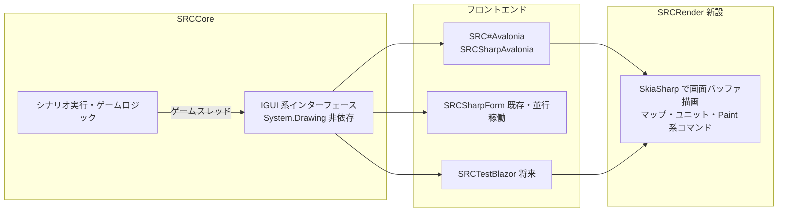

# GUI 実装移行の検討 / GUI Migration Study

> 調査日: 2026-10-12

現在の GUI 実装（`SRCCore/TestLib` のモック、`SRCSharpForm` の Windows Forms）から、メンテナンス性を考慮して新規実装へ移行する場合の候補と進め方を検討する。

## 結論

- 推奨: **Avalonia UI 12 系 ＋ SkiaSharp による描画層**
- ただし、どのフレームワークに移行する場合でも、先に SRCCore 側で以下 2 点の解消が必要で、これが移行コストの大半を占める
  1. SRCCore の `System.Drawing.Common` 依存の除去
  2. 同期・ブロッキング前提の `IGUI` を UI スレッドから切り離して動かせる実行モデルへの変更

## 現状

| 項目 | 現状 | 移行への影響 |
|---|---|---|
| Core | `SRCCore` は netstandard2.1、`System.Drawing.Common` を参照 | .NET 6 以降 `System.Drawing.Common` は Windows 専用（[MS Learn](https://learn.microsoft.com/en-us/dotnet/core/compatibility/core-libraries/6.0/system-drawing-common-windows-only)）。`IGUI.CurrentPaintFont` の `Font` 型などは非 Windows で実行時例外になる。`Color` / `Point` / `SizeF` は System.Drawing.Primitives 側なので問題ない |
| UI 境界 | `SRCCore/UIInterface/IGUI.cs` に約 150 メンバー、加えて `IGUIMap` / `IGUIScrean` / `IGUIStatus` / `IPlaySound` | 境界は既に存在し、`TestLib/MockGUI.cs` もあるため移行の足場は良い |
| 実行モデル | `ListBox()` が `int` を返す等のモーダル同期 API。`Sleep` / `DoEvents` は `Application.DoEvents()` 依存 | Avalonia / Uno / Blazor には `DoEvents` 相当がなく、そのままでは載らない |
| WinForms 実装 | 約 28,800 行（うち `GUI.ref.cs` 11,640 行は参照用） | 実移植対象は約 17,000 行。`Forms/Main.guistatus.cs`（3,421 行）、`SRCSharpFormGUI.message.cs`（2,675 行）が大きい |
| 描画 | GDI+（`Graphics` / `Bitmap`）直描き | 描画 API の置き換えが必須 |
| 音声 | NAudio、Melanchall.DryWetMidi | NAudio の出力部は Windows 依存。クロスプラットフォーム化には別実装が必要 |
| テスト / CI | `SRCSharpFormTestWinAppDriver`、CI は `windows-latest` | WinAppDriver は長期間メンテナンスされておらず置き換えたい |
| Web | `SRCTestBlazor`（WASM、データ閲覧のみ）が SRCCore を参照 | Web 版プレイヤーの土台になり得る |

## 候補比較

| 候補 | 対応 OS | SRC との相性 | 主なリスク |
|---|---|---|---|
| **Avalonia 12** | Windows / macOS / Linux / WASM | ◎ カスタム描画コントロールで GDI+ 的な描画を置換しやすい。`Avalonia.Headless` で UI テストを CI 実行可能。MIT ライセンス | `DoEvents` なし。Linux の Wayland 対応は private preview（[Avalonia 12](https://avaloniaui.net/blog/avalonia-12)、[12.1.0](https://newreleases.io/project/github/AvaloniaUI/Avalonia/release/12.1.0)） |
| Uno Platform 6.6 | Windows / macOS / Linux / WASM / モバイル | ○ Skia 統一レンダラー。IME 入力・フォントフォールバックが強化 | WinUI / XAML 流儀で学習コスト高め。モバイル対応は SRC には過剰（[Uno 6.6](https://infoq.com/news/2026/08/uno-platform-6-6)、[Uno 6.0](https://www.infoq.com/news/2025/05/uno-platform-6-release)） |
| MonoGame 3.8.5 | Windows / macOS / Linux | △ マップ描画・アニメーションは得意 | リストボックス・入力・設定画面等の UI 部品を自作する必要があり、UI 部品比重の大きい SRC では工数大（[MonoGame 3.8.5](https://gamefromscratch.com/monogame-3-8-5-released/)） |
| Blazor WASM（`SRCTestBlazor` 拡張） | ブラウザ | ○ 配布不要 | ブラウザのメインスレッドはブロックできないため `IGUI` の非同期化が前提。ローカルの SRC フォルダ読み込みの設計も必要 |
| .NET MAUI 10 / Blazor Hybrid | Windows / macOS（＋モバイル） | △ | 公式は Linux 非対応。Avalonia による Linux バックエンドは .NET 11 向けプレビュー段階（[The Register](https://theregister.com/2026/03/23/maui_linux_avalonia)、[Avalonia](https://avaloniaui.net/blog/net-maui-is-coming-to-linux-and-the-browser-powered-by-avalonia)） |
| WPF / WinUI 3 | Windows のみ | △ | WinForms からの改善幅が小さく、Windows 専用の制約が残る |

## 推奨構成

- **ゲームスレッド分離**: シナリオ実行を専用スレッドで回し、`ListBox` 等のモーダル呼び出しは Dispatcher で UI スレッドへ投げて結果を待つ。`DoEvents` はゲームスレッド上の `Sleep` に置き換える。これにより `IGUI` のシグネチャを変えずに済み、Core の変更が最小になる
- **描画共通化**: GDI+ の処理を SkiaSharp（`SKCanvas`）に寄せ、フロントエンド非依存のライブラリにする。Avalonia と Blazor（Canvas 転送）で共用できる
- **WinForms**: 新フロントエンドの機能が揃うまで `IGUI` 準拠の実装として並行稼働させる

## 段階的移行手順

1. **Core の Drawing 非依存化**（対応済み）: `IGUI.CurrentPaintFont` を自前型 `PaintFont` に置換、`ColorTranslator.FromHtml` 相当を `ColorExtension.FromHexString` に自前実装し、SRCCore から `System.Drawing.Common` を外した。`Color` / `Point` 等の System.Drawing.Primitives の型は引き続き使用する
2. **Linux 上でのテスト実行**（対応済み）: CI に `SRCCoreTests` を `ubuntu-latest` で実行するジョブ `test-srccore-linux` を追加した
3. **スレッドモデル分離**（実装済み・Windows での確認待ち）: まず WinForms 上でゲームスレッド方式に切り替え、挙動不変を確認する。最大のリスク要因のため、新 UI 作成前に既存 UI で検証する
    - `SRCCore.Threading`（`GameThread` / `CoreThreadProxy` / `CoreThreading`）を追加し、SRC#Form は起動引数 `--game-thread` を付けた場合のみゲームスレッドで動く（既定は従来どおり）
    - Linux ではヘッドレス E2E テストでスレッド分離あり／なしの GUI 呼び出しが一致することを確認済み。詳細は [E2E テスト方針](./e2e-testing.md)
4. **描画層の切り出し**: `SRCSharpFormGUI.draw.cs`、`Forms/Main.guimap.cs`、`Forms/Main.guiscrean.cs` を SkiaSharp ベースへ移す
5. **Avalonia 版の作成**: WinForms 版（SRC#Form）とは別のプロジェクト SRC#Avalonia（`SRCSharpAvalonia`）として作る。メイン画面 → メッセージ → リストボックス類 → ステータス → 設定の順。UI テストは `Avalonia.Headless` で書き、WinAppDriver テストを置き換える
6. **音声の差し替え**: NAudio の出力部をクロスプラットフォームなライブラリ（OpenAL 系、SDL 系等）で `IPlaySound` の別実装として用意する
7. **（任意）Web 版**: 3 で分離したゲームスレッドを、WASM 向けには `IGUI` の非同期版で置き換えるかをこの時点で判断する

## 判断の分岐

- **非 Windows 対応が不要な場合**: フレームワーク移行の価値は小さい。手順 1・3・4（Core 整理と描画分離）のみ行い WinForms を継続するのが最安
- **ブラウザ実行を最優先する場合**: Avalonia を経由せず、`IGUI` を `Task` ベースに非同期化して `SRCTestBlazor` を拡張する。ただし Core 全体（コマンド実行・イベント処理）に `async` が波及するため工数は最大になる
