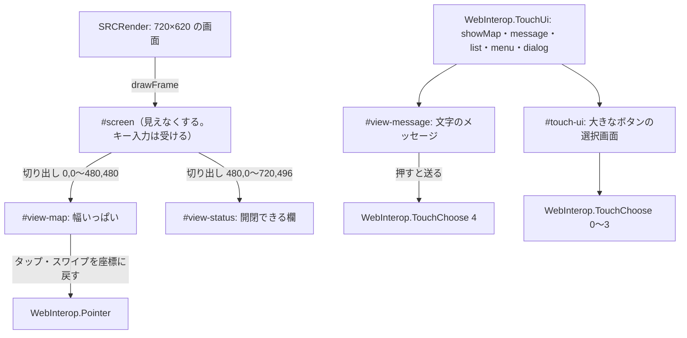

# SRC#Web のゲーム内の UI の見直し（スマートフォン向け）

ゲームの画面（マップ・ステータス・メッセージ・リストなど）を、スマートフォンで遊びやすくする方法を比べる。あわせて、試作（「設定」の「画面の配置」を「スマートフォン向け（試作）」にする）の内容と、わかった課題を記す。

## 現状の課題

ゲームの画面は元の SRC と同じ 720×620 の 1 枚の画像（SRCRender）で、Web 版はこれを画面の幅に縮めて表示している。

| 部分 | 元の大きさ | 幅 390px のスマートフォン（約 0.54 倍） |
|---|---|---|
| マップ（15×15 マス） | 480×480、1 マス 32px | 1 マス約 17px。指で狙いにくい |
| ステータス | 240×496 | 文字が約 6〜7px で読めない |
| メッセージ | 720×124、文字 16px | 文字が約 9px |
| リスト・メニュー・ダイアログ | 行の高さ 16px 前後 | 約 9px で押せない（[タッチ向けの選択画面](./web.md#タッチ向けの画面) で対応済み） |

縦持ちの画面では、720×620 の横長の画像の上下に余白ができる。その一方で、マップは小さくなる。

## 方針の比較

| 案 | 内容 | 互換性への影響 | 手間 | 効果 |
|---|---|---|---|---|
| A. 拡大縮小 | ピンチ操作でゲームの画面を拡大する | なし | 小 | 拡大中は画面の一部しか見えず、スクロールの操作が増える |
| B. 選択を HTML に | リスト・メニュー・ダイアログを大きなボタンの一覧でも出す | なし | 小 | 選ぶ操作は解決するが、マップ・ステータス・メッセージは小さいまま（7474/SRC#1199） |
| **C. Web 側で組み替える（試作）** | ゲームの画面から、マップとステータスを切り出して配置し直す。メッセージは文字で出す | なし（SRCRender は変えない） | 中 | マップが約 1.5 倍、メッセージは 16px の文字になる。縦持ちの余白を使える |
| D. SRCRender の配置を可変に | 画面の大きさ・縦横に応じて、SRCRender がマップのマス数・ステータスの位置を変えて描く | 大（座標を前提にしたイベント・PaintPicture など） | 大 | 縦持ちでマップの行を増やせる |
| E. UI を HTML で作り直す | ステータス・メッセージ・メニューなどを、ゲームの状態から HTML で作る。マップだけを画像で描く | 中（見た目は元の SRC と変わる） | 大 | 文字の大きさ・配置を自由にできる |

順番の案:
1. B と C で、SRCRender を変えずに遊べる形にする
2. 実機で試し、使いにくいところを E（ステータス・メッセージを HTML に）に置き換える
3. D は、イベントが前提にする座標との互換を確かめてから検討する

## 試作（案 C）の内容

- 有効にする方法: 「設定」の「画面の配置」（標準・スマートフォン向け（試作））か、プレイ中のシステムメニューの「画面の配置の切り替え」。html の `data-layout`（`classic`・`phone`）に付け、localStorage の `srcweb.layout` に保存する
- マップを表示している間だけ組み替える。タイトル・イベントの画面（`ShowMap` が偽、タイトル・スプラッシュの表示中）は、ゲームの画面をそのまま出す
- マップ: ゲームの画面の 0,0〜480,480 を、フレームを描くたびに別の canvas に写す。タップ・長押し・スワイプは、その canvas 上の位置をゲームの画面の座標に戻して渡す（`bindPointer`）
- ステータス: 480,0〜720,496 を写す。「ステータス」のボタンで開閉する
- メッセージ: `MessageState` の話し手と行を文字で出す。押すと、メッセージウィンドウをクリックしたのと同じになる（`TouchChoose` の 4）
- リスト・メニュー・ダイアログ: タッチ向けの選択画面（案 B）をそのまま使う

### 試作でわかった課題

- マップは 15×15 マスのまま。縦持ちでも行は増えない（D が必要）
- ステータスは画像を拡大しているので、文字がぼやける（E で HTML にしたい）
- メッセージに顔グラフィックが無い。文字の色・大きさの指定も反映しない
- 横持ちでは、マップの右にステータスを並べるほうがよい。いまは縦に並べるだけ
- マップの外（ステータス・メッセージの位置）に描くイベントの画像（PaintPicture など）は、マップを表示している間は見えない
- 戦闘アニメーションのうち、マップの外に描くものも同じく見えない
