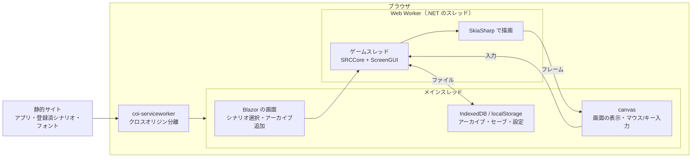
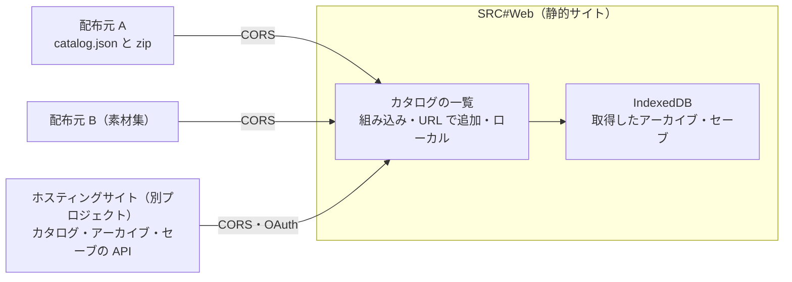

# SRC#Web（ブラウザ版）

> 更新日: 2026-10-13

ブラウザで動く SRC#。データビューアの `SRCTestBlazor` とは別のプロジェクト `SRCSharpWeb` として作る。

## 方針

- **静的サイトで完結させる**: GitHub Pages などの静的ホスティングに置くだけで動く。サーバ側の処理は持たない
- **永続化はブラウザ内**: シナリオのアーカイブ・セーブデータ・設定は、ブラウザのストレージ（IndexedDB / localStorage）に保存する
- **描画とゲーム処理は SRC#Avalonia と共通**: `SRCRender`（SkiaSharp で画面を描く `ScreenGUI`）と `SRCCore` をそのまま使う

## 構成



### スレッド

SRCCore はゲームスレッドで処理を止めて待つ（メッセージ送り・選択待ちなど）作りのため、.NET の WebAssembly マルチスレッド（`WasmEnableThreads`）を使い、ゲームスレッドを Web Worker で動かす。メインスレッドは止めないので、待っている間も画面と入力は動く。

- マルチスレッドには SharedArrayBuffer が必要で、ページがクロスオリジン分離されている（`Cross-Origin-Opener-Policy: same-origin` と `Cross-Origin-Embedder-Policy: require-corp`）必要がある
- GitHub Pages はヘッダを設定できないため、[coi-serviceworker](https://github.com/gzuidhof/coi-serviceworker)（MIT）でヘッダを付ける。初回は Service Worker を有効にするために 1 回再読み込みする。分離が有効になるまで .NET を起動しない
- 確認済み（Chromium、ローカル）: ヘッダ付きの配信と coi-serviceworker のどちらでも、裏のスレッドが `Thread.Sleep` で待つ間もメインスレッドの画面が更新される。SkiaSharp（`SkiaSharp.NativeAssets.WebAssembly` のマルチスレッド版）で裏のスレッドから描画できる
- ビルドには `wasm-tools` ワークロードが必要（SkiaSharp のネイティブライブラリのリンクのため）

### ファイル

- SRCCore の `LocalFileSystem` はフォルダと zip アーカイブを重ねて扱える（`AddPath` / `AddAchive`）。ブラウザでは .NET のメモリ上のファイルシステムに zip を置いて使う
- 重ねる順: シナリオのアーカイブ → 共通素材のアーカイブ（汎用グラフィック集など、利用者が追加した場合） → なし（素材なしでも動く。`SRC.AllowMissingAssets`）

### シナリオ

| 種類 | 置き場所 | 内容 |
|---|---|---|
| 登録済シナリオ | 静的サイト `scenarios/catalog.json` と zip | 再配布できるシナリオ。一覧から選んでプレイする。遊べるシナリオ「灯の巡航船ランタン号」（`SRC.Sharp/Content/lantern`）を先頭に置き、自作の最小の汎用データ（`SRC.Sharp/Content/basic-data`、`assets/basic-data.zip`）を素材として重ねる。続けて E2E のコーパス |
| 追加したアーカイブ | IndexedDB | 利用者が zip を選んで追加する。シナリオの zip と共通素材の zip を追加できる。ブラウザに残り、次回も選べる |

### 永続化

| データ | 保存先 | 備考 |
|---|---|---|
| アーカイブ（zip） | IndexedDB | 利用者が追加したもの。大きいため IndexedDB に Blob で保存する |
| カタログのアーカイブ（zip） | Cache Storage | 取得したものを URL ごとに置き、次からはネットワークを使わない。カタログの `version` が置いたときと違えば取得し直す（`wwwroot/js/store.js` の `fetchArchive`）。組み込みのカタログの `version` は zip の SHA-256 |
| セーブデータ（通常・中断・クイック） | IndexedDB | シナリオごとに保存する。ファイルとして書き出す・読み込む操作も用意する |
| 設定（`srcs.json` 相当） | localStorage | |

ブラウザのストレージは利用者やブラウザの判断で消えることがあるため、セーブデータはファイルとして書き出せるようにする。

### フォント

ブラウザには日本語フォントが無い前提で、OFL のフォントを静的サイトに置いて読み込む。等幅の指定（ＭＳ ゴシック・ＭＳ 明朝）には等幅のフォントを使う（空白で桁を揃える表示のため）。縦の寸法は `WindowsFontMetrics` で元の SRC に合わせる。

### 音声

Web Audio API で鳴らす（`WebSoundPlayer`）。

| 形式 | 方法 |
|---|---|
| WAV・MP3 | ブラウザで復号する（`decodeAudioData`） |
| MIDI | SRC#Avalonia と同じく [MeltySynth](https://github.com/sinshu/meltysynth)（MIT）で合成する。別のスレッドで少し先まで合成し、描画の機会ごとに約 1 秒先まで PCM を送る |

- ブラウザは利用者の操作があるまで音を鳴らさないため、画面の最初のクリック・キー入力で開始する（[Autoplay policy](https://developer.chrome.com/blog/autoplay)）
- SoundFont（.sf2）は同梱しない。シナリオのアーカイブに含まれる .sf2 を使い、無ければ素材（カタログの `requires` や利用者が追加した素材のアーカイブ）に含まれる .sf2 を使う。どちらにも無ければ MIDI は鳴らさない
- 和音 3 つの短い MIDI で、合成が実時間に間に合うことを確認した。重い曲で間に合わない場合は AOT コンパイル（`RunAOTCompilation`）を検討する

### タッチ操作

タッチ（とペン）は Pointer Events で受け取り、マウスの操作に置き換える（`wwwroot/js/srcweb.js`）。

| 操作 | SRC への入力 |
|---|---|
| タップ | 左クリック。左ボタンを約 0.2 秒押した状態にしてから離す。近くを続けてタップするとダブルクリック |
| 長押し（約 0.5 秒） | 右クリック。指を離すまで右ボタンを押した状態にする（押し続けてメッセージを送る操作にもなる）。押している間、触れた位置に輪を出す |
| 触れたまま動かす（スワイプ） | マップのスクロール（マウスの左ボタンでのドラッグと同じ）とカーソルの移動。クリックにはしない |

ボタンを押した状態はシナリオの `KeyState(1)`（左）・`KeyState(2)`（右）にも反映される。KeyState で押されるのを待つイベント（クリック領域など）は、タップと長押しで操作できる。

### タッチ向けの画面

タッチの端末では、指で押しやすい画面にする。

- 判定: html の `data-input`（`touch`・`mouse`）で切り替える
  - index.html が描画の前に決める。主なポインタがタッチ（`(pointer: coarse)`）なら `touch`
- 手動の切り替え: シナリオ選択の画面の「設定」の「操作」で、自動・タッチ・マウスから選ぶ
  - localStorage の `srcweb.input` に保存する
  - タブレットにマウスをつないだときなどに使う
- タッチ向けの画面で変えること:
  - ボタン・入力欄・一覧の行・メニュー・ダイアログのボタンを高さ 44px 前後にし、文字を大きくする
  - 入力欄の文字は 16px にする（iOS が入力時に画面を拡大しないように）
  - 飾りの最小化・最大化・閉じるボタンとアドレスバーを省く
  - プレイ中の仮想キーを、はじめから表示する（システムメニューで表示を切り替えていなければ）
  - ゲームの選択肢（リスト）・ユニットのコマンドなどのメニュー・確認のダイアログを、画面の下側に大きなボタンの一覧（タッチ向けの選択画面）でも出す
    - ゲームの画面の小さな表示はそのまま残す
    - 中身は `WebInterop.TouchUi` で読み、押したものは `WebInterop.TouchChoose` でゲームに渡す。自動プレイ（PlayScript）と同じ操作で、リストはカーソルを合わせて Enter、メニュー・ダイアログはその位置をクリック、キャンセルは右クリック
    - ゲームの画面の描画は変えないので、マウス向けの画面や元の SRC との互換には影響しない

### スマートフォン向けの配置（試作）

「設定」の「画面の配置」を「スマートフォン向け（試作）」にすると、次のように組み替える。
- マップ: ゲームの画面から切り出し、幅いっぱいに出す
- ステータス: 開閉できる欄に出す
- メッセージ: 文字で出す

比べた方法と試作の課題は [ゲーム内の UI の見直し](./web-phone-layout.md) を参照。

### 仮想キー

キーボードの無い端末向けに、画面の下に仮想キー（↑←↓→・Esc・Space・Ctrl・Shift・Z・X・Enter）を出す。押している間は物理キーと同じくキーが押された状態になり、シナリオの `KeyState` にも、メッセージ送り・カーソルの移動にも効く。矢印は押し続けると繰り返す。

タッチの端末（`pointer: coarse`）では既定で出し、それ以外では出さない。システムメニューの「仮想キーの表示の切り替え」で切り替えられ、設定はブラウザ（localStorage の `srcweb.virtualKeys`）に残る。

画面ではスクロール・拡大・長押しのメニューを止める（`touch-action: none`）。タッチの後にブラウザが作る互換のマウスイベントは無視する。プレイ中のシステムメニュー（画面の右下の ≡）は、タッチの端末では押しやすい大きさにする。

### システムメニュー

プレイ中の操作は、画面の右下の ≡（システムメニュー）にまとめる（`App.razor`）。誤って押してもすぐにはゲームが終わらない。

| 項目 | 動作 |
|---|---|
| シナリオ選択へ戻る… | 確認してからゲームを終え、シナリオ選択へ戻る。「いいえ」ならプレイを続ける。セーブしていない進行状況は失われる |
| 全画面表示の切り替え | 画面を全画面にする・戻す |
| 仮想キーの表示の切り替え | 仮想キーを出す・隠す |
| 閉じる | メニューを閉じる |

メニューの外を押しても閉じる。閉じると、キー入力をゲームの画面に戻す。

### 画面のテーマ

シナリオ選択の画面は、往年の Windows のエクスプローラーを模す。
- 上から、タイトルバー、アドレスバー、本体、ステータスバーを並べる
- 本体は、左が作業ウィンドウ（カタログ・アーカイブの追加、設定）、右が一覧（カタログごとのシナリオ、追加したアーカイブ）
- 幅が 760px 以下では、作業ウィンドウを一覧の下に置く

「設定」の「テーマ」で、次の 2 つから選ぶ。選んだものは localStorage（`srcweb.theme`）に保存する。

| テーマ | 見た目 |
|---|---|
| Windows 95（既定） | 灰色の立体の枠、紺のグラデーションのタイトルバー、青緑のデスクトップ |
| Windows XP | Luna（青）のタイトルバーと角の丸い枠、青のグラデーションの作業ウィンドウ |

- テーマは html の `data-theme`（`95`・`xp`）で切り替え、色と枠は `wwwroot/css/app.css` の変数で決める
- index.html が描画の前に `data-theme` を付けるので、読み込みのときに見た目が切り替わらない
- プレイ中の画面の下のバー、システムメニュー、ダイアログも同じテーマで表示する

### 表示言語

シナリオ選択の画面の「言語（Language）」で、15 の言語から選ぶ。既定はサイトの設定（`srcweb.json` の `language`）、無ければ日本語。仕組みは [多言語対応](../i18n.md#srcweb) を参照。

### 文字入力・ファイル選択

`IScreenDialogHost` をページ上のモーダルで実装する（`WebScreenHost`）。JS を呼べるのは UI 側のスレッドだけのため、ゲームスレッドからの依頼は画面の書き込みと同じ機会（requestAnimationFrame）に始め、結果をゲームスレッドへ返す。ファイル選択はシナリオのフォルダの中に限る。

### セーブデータ

ゲームはシナリオのフォルダ（.NET のメモリ上のファイルシステム）にセーブデータ（.srcs・.srcq）を書く。プレイ中は 1 秒ごとに変化を調べ、書き込まれたものを IndexedDB に保存する（`SaveSync`）。シナリオを開くときに保存しておいたものをフォルダに戻し、「セーブデータから再開」に並べる。書き出し（ダウンロード）・読み込み・削除もここで行う。

## 外部のコンテンツ源

> サイトの設定（`srcweb.json`）、カタログ（名前付きの形式・`kind`・`requires`・`root`）、URL での起動、利用者による素材・カタログの追加は実装済み。置き方と形式は [SRC#Web を外部のサイトに置く](./web-hosting.md) を参照。取得したアーカイブは Cache Storage に置き、`version` で更新を判定する。`sha256` による確認、`soundfont`、セーブデータの保存先の差し替え、Range 要求による部分読み込みは未実装。

SRC#Web はゲームプレイヤーに徹し、シナリオ・素材・セーブデータは外部から管理できるようにする。権利の扱いは各コンテンツの配布元が負い、SRC#Web のサイトはコンテンツを配布しない。利用者登録や更新ができるホスティングサイトは別のプロジェクトとし、SRC#Web は決まった形式を読むだけにする。



### カタログの形式（案）

```json
{
  "format": 1,
  "name": "配布元の名前",
  "entries": [
    {
      "id": "robodan",
      "kind": "scenario",
      "title": "ロボッとダンジョンＢ！",
      "author": "作者",
      "license": "配布条件の説明または URL",
      "archive": "https://example.com/robodan.zip",
      "size": 276897247,
      "sha256": "…",
      "eve": "ロボッとダンジョンＢ！_-ロボダン-/ニューゲーム.eve",
      "requires": ["asset:general-graphics"]
    },
    {
      "id": "general-graphics",
      "kind": "asset",
      "title": "汎用グラフィック集",
      "archive": "https://example.com/graphics.zip"
    }
  ]
}
```

- `kind`: `scenario`（シナリオ）・`asset`（汎用グラフィック集などの素材）・`soundfont`（MIDI の SoundFont）
- `requires`: 一緒に重ねる素材。`LocalFileSystem` のアーカイブの重ね合わせ（シナリオ → 素材 → なし）に使う
- `sha256`: 取得したアーカイブの確認と、IndexedDB に保存したものの更新判定に使う

### 方針

| 項目 | 方針 |
|---|---|
| カタログの追加 | 組み込みのカタログ（現在の `scenarios/catalog.json`）に加え、利用者が URL を追加できる。追加した URL は localStorage に保存する |
| 取得 | 配布元は CORS を許可する必要がある（クロスオリジン分離のため）。GitHub Pages は `Access-Control-Allow-Origin: *` を返す。Google Drive のダウンロードリンクは CORS を返さないため直接は使えない |
| 素材の重ね合わせ | `requires` の素材を取得し、シナリオと重ねて展開する。素材の配布元は別でもよい |
| セーブデータ | 保存先を差し替えられるようにする。既定は IndexedDB とファイルの書き出し・読み込み。選択肢として、ローカルのフォルダ（[File System API](https://developer.mozilla.org/docs/Web/API/File_System_API)、Chromium のみ）やホスティングサイトの API（静的サイトからも OAuth の PKCE で認証できる）を置ける |
| 大きいアーカイブ | カタログの大きい zip（32MB を超えるもの）はストリームのままブラウザ内のファイルシステムに書いてから展開する（WebAssembly のメモリは増えたら返せないため、zip を byte[] に読まない）。展開したファイルはすべてメモリ（JS 側）に置かれる。将来は HTTP の Range 要求と zip の目録で必要なファイルだけを読む（ゲームスレッドは Worker のため同期の取得もできる） |
| 安全性 | シナリオは SRC のイベントとして解釈されるだけで、JS は実行されない。zip の展開サイズなどの上限を設ける |

### 段階

1. カタログの形式を決め、組み込みのカタログを同じ形式にする
2. カタログの URL の追加・削除と、取得したアーカイブのキャッシュ（Cache Storage。`version` で更新判定）
3. `requires` による素材の重ね合わせ
4. セーブデータの保存先の差し替え（ローカルのフォルダ）
5. ホスティングサイト向けの API（カタログ・アーカイブ・セーブ）の仕様

## 段階（SRC#Web 全体）

| 段階 | 内容 | 状況 |
|---|---|---|
| 1 | 登録済シナリオを選んでプレイできる（メッセージ・選択肢・マップ・戦闘） | 済 |
| 2 | zip のアーカイブを追加してプレイできる（ブラウザに保存し、次回も選べる。Shift_JIS のファイル名） | 済 |
| 3 | セーブ・ロード（ブラウザ内保存、ファイルの書き出し・読み込み）、文字入力 | 済 |
| 4 | 音声（WAV・MP3・MIDI） | 済 |
| 5 | GitHub Pages への配置（データビューアと同じサイトの `web/`） | 済 |

## 配置

GitHub Pages に、データビューア（`SRCTestBlazor`）と同じサイトの `web/` として置く（`.github/workflows/CD-pages.yml`）。master に入るたびに更新する開発版。

外部のサイトに置くためのパッケージ（`SRCSharpWeb.zip`）は、リリースのタグで GitHub Releases に置く（`Publish-Package.yml` の `release-web`、[バージョンの管理](../versioning.md)）。置き方は [SRC#Web を外部のサイトに置く](./web-hosting.md) を参照。

- `index.html` の `<base href>` を `<Pages のベースパス>/web/` に書き換える
- coi-serviceworker のスコープは `web/` になるため、クロスオリジン分離はデータビューアには及ばない
- データビューアの Service Worker（スコープはサイト全体）は `web/` 配下の要求を扱わないようにした。扱うと、ページ遷移にデータビューアの index.html を返してしまう

## テスト

`SRC.Sharp/SRCSharpWeb.E2E`（Playwright）。発行した静的ファイルをヘッダなしで配信し（coi-serviceworker でクロスオリジン分離）、Chromium で次を確かめる。CI の Linux ジョブで実行する。

- 登録済シナリオを選んでプレイする
- アーカイブ（日本語のファイル名）を追加し、再読み込み後も残っていてプレイできる。削除できる
- インターミッションでデータセーブし、再読み込み後にセーブデータから再開して次のステージへ進む
- 効果音（WAV）が鳴る。SoundFont が無ければ MIDI は鳴らさずに進む
- アーカイブに含めた SoundFont で MIDI を合成して鳴らす（テストの中で zip を作る。SoundFont は CI で入れる TimGM6mb）
- 表示言語を英語にし、選択欄で日本語に戻す。`auto` ではブラウザの言語（韓国語のブラウザで韓国語）に従う
- URL の `play`・`archive` で直接始める。サイトの設定とカタログで配信し、シナリオが求める素材を重ねる
- システムメニューから戻るときは確認し、「いいえ」ならプレイを続ける
- タップで左クリック、長押しで右クリックになり、シナリオの `KeyState` でも検出できる
- 仮想キーをシステムメニューで表示し、押したキーがシナリオの `KeyState` に届く

画面の状態は `WebInterop.DebugState`（実行中のイベントの行・リスト・ダイアログ・メッセージの JSON）で調べる。

```sh
dotnet workload install wasm-tools
dotnet publish SRC.Sharp/SRCSharpWeb -c Release -o SRC.Sharp/SRCSharpWeb/bin/web
cd SRC.Sharp/SRCSharpWeb.E2E && npm ci && npx playwright install chromium && npx playwright test
```
