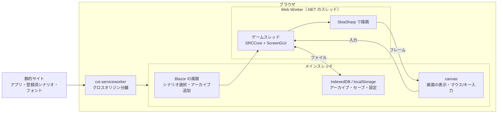

# SRC#Web（ブラウザ版）

> 更新日: 2026-10-12

ブラウザで動く SRC#。データビューアの `SRCTestBlazor` とは別のプロジェクト `SRCSharpWeb` として作る。

## 方針

- **静的サイトで完結させる**: GitHub Pages などの静的ホスティングに置くだけで動く。サーバ側の処理は持たない
- **永続化はブラウザ内**: シナリオのアーカイブ・セーブデータ・設定は、ブラウザのストレージ（IndexedDB / localStorage）に保存する
- **描画とゲーム処理は SRC#Avalonia と共通**: `SRCRender`（SkiaSharp で画面を描く `ScreenGUI`）と `SRCCore` をそのまま使う

## 構成

### スレッド

SRCCore はゲームスレッドで処理を止めて待つ（メッセージ送り・選択待ちなど）作りのため、.NET の WebAssembly マルチスレッド（`WasmEnableThreads`）を使い、ゲームスレッドを Web Worker で動かす。メインスレッドは止めないので、待っている間も画面と入力は動く。

- マルチスレッドには SharedArrayBuffer が必要で、ページがクロスオリジン分離されている（`Cross-Origin-Opener-Policy: same-origin` と `Cross-Origin-Embedder-Policy: require-corp`）必要がある
- GitHub Pages はヘッダを設定できないため、[coi-serviceworker](https://github.com/gzuidhof/coi-serviceworker)（MIT）でヘッダを付ける。初回は Service Worker を有効にするために 1 回再読み込みする。分離が有効になるまで .NET を起動しない
- 確認済み（Chromium、ローカル）: ヘッダ付きの配信と coi-serviceworker のどちらでも、裏のスレッドが `Thread.Sleep` で待つ間もメインスレッドの画面が更新される。SkiaSharp（`SkiaSharp.NativeAssets.WebAssembly` のマルチスレッド版）で裏のスレッドから描画できる
- ビルドには `wasm-tools` ワークロードが必要（SkiaSharp のネイティブライブラリのリンクのため）

### ファイル

- SRCCore の `LocalFileSystem` はフォルダと zip アーカイブを重ねて扱える（`AddPath` / `AddAchive`）。ブラウザでは .NET のメモリ上のファイルシステムに zip を置いて使う
- 重ねる順: シナリオのアーカイブ → 共通素材のアーカイブ（汎用グラフィック集など、利用者が追加した場合） → なし（素材なしでも動く。`SRC.AllowMissingAssets`）

### シナリオ

| 種類 | 置き場所 | 内容 |
|---|---|---|
| 登録済シナリオ | 静的サイト `scenarios/catalog.json` と zip | 再配布できるシナリオ（E2E のコーパスなど）。一覧から選んでプレイする |
| 追加したアーカイブ | IndexedDB | 利用者が zip を選んで追加する。シナリオの zip と共通素材の zip を追加できる。ブラウザに残り、次回も選べる |

### 永続化

| データ | 保存先 | 備考 |
|---|---|---|
| アーカイブ（zip） | IndexedDB | 大きいため IndexedDB に Blob で保存する |
| セーブデータ（通常・中断・クイック） | IndexedDB | シナリオごとに保存する。ファイルとして書き出す・読み込む操作も用意する |
| 設定（`srcs.json` 相当） | localStorage | |

ブラウザのストレージは利用者やブラウザの判断で消えることがあるため、セーブデータはファイルとして書き出せるようにする。

### フォント

ブラウザには日本語フォントが無い前提で、OFL のフォントを静的サイトに置いて読み込む。等幅の指定（ＭＳ ゴシック・ＭＳ 明朝）には等幅のフォントを使う（空白で桁を揃える表示のため）。縦の寸法は `WindowsFontMetrics` で元の SRC に合わせる。

### 音声

初版は無音。次の段階で Web Audio API で鳴らす（WAV・MP3 はブラウザで復号、MIDI は MeltySynth で合成）。

## 段階

1. 登録済シナリオを選んでプレイできる（メッセージ・選択肢・マップ・戦闘）
2. zip のアーカイブを追加してプレイできる（ブラウザに保存し、次回も選べる）
3. セーブ・ロード（ブラウザ内保存、ファイルの書き出し・読み込み）
4. 音声
5. GitHub Pages への配置（CI）
