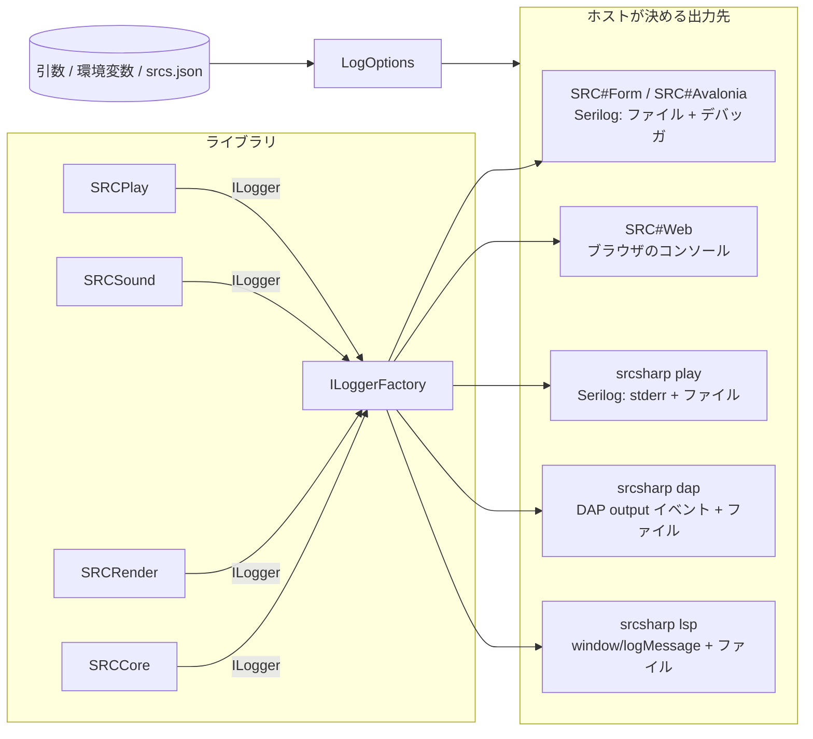

# ログの設計

SRC#（各アプリ・`srcsharp`・VS Code 拡張）のログの方針。7474/SRC#358 で検討した。

## 目的

| 目的 | 読む人 | 必要なもの |
|---|---|---|
| 不具合報告 | プレイヤー → 開発者 | 既定でファイルに残っていること。版・OS・シナリオ・例外が入っていること。場所がヘルプに書いてあること |
| シナリオ・データの作成 | シナリオ作者 | イベントのエラー・素材の欠落・未対応コマンドが、ファイル名・行番号つきで出ること |
| 開発・調査 | 開発者 | コマンド・変数・関数の実行を細かく追えること。アプリを作り直さずにレベルを変えられること |

## 現状（2026-10 時点）

| 対象 | 出力先 | レベル | 変えられるか |
|---|---|---|---|
| SRC#Form | デバッガ出力（Serilog.Sinks.Debug）、`<exe のフォルダ>/logs/srcsform.<日付>.log`（1 日ごと） | Information | 引数 `-v`（Debug）・`-vv`（Verbose）だけ |
| SRC#Avalonia | デバッガ出力（`SRC()` の既定）。Avalonia 自体は `.LogToTrace()` | Debug 固定 | 不可 |
| SRC#Web | ブラウザのコンソール（Blazor の既定） | Information | 不可 |
| `srcsharp play`・DAP | デバッガ出力（`SRC()` の既定）。CLI 自身は Console、DAP は `output` イベント | Debug 固定 | 不可 |
| `srcsharp lsp` | なし（例外だけ stderr） | ― | 不可 |
| VS Code 拡張 | 出力パネル「SRC#」（`createOutputChannel`） | なし | 不可 |

問題点

- 設定ファイル（`srcs.json`）でログを設定できない。
- SRC#Form 以外はファイルに残らない。デバッガを付けていないと SRCCore のログを見られない。
- `SRC.LogError`・`SRC.LogWarn`（`SRCCore/SRC.cs`）が `Log.LogDebug` で出しているため、Information 以上の設定では**エラーが記録されない**。
- SRCCore のカテゴリが `SRCCore` の 1 つだけで、範囲を絞れない。
- メッセージを文字列連結で作っており、`{}` を含む値で書式が崩れうる。構造化もされていない。
- SRC#Form は起動直後（`RootForm` でファイル出力を足すまで）のログがファイルに残らない。
- SRC#Web・SRCDebugAdapter・SRCAuthoring に `Console.WriteLine`・`Console.Error.WriteLine` が散らばっていて、レベルで制御できない。
- ログの場所・取り方がヘルプにない。

## 方針

1. **すべて `Microsoft.Extensions.Logging`（`ILogger`）で書く**。出力先（Serilog・ブラウザ・DAP・LSP）はホスト（各アプリ）が決める（[.NET のログ](https://learn.microsoft.com/dotnet/core/extensions/logging)）。
2. **設定は「引数 > 環境変数 > `srcs.json` > 既定値」の順に効く**。項目名はすべてのアプリで共通にする。
3. **デスクトップ（SRC#Form・SRC#Avalonia・`srcsharp`）は既定でファイルに Information 以上を残す**。場所は OS ごとのユーザーの領域にする。
4. **プロトコルが使う stdout にはログを書かない**（LSP・DAP）。ログはプロトコルのログ通知で送る。
5. **レベルは実行中に変えられる**（設定画面・VS Code の設定から）。



## 設定

### 項目

| 項目 | `srcs.json`（`Log` セクション） | 環境変数 | 引数 | 既定値 |
|---|---|---|---|---|
| レベル | `Level` | `SRCSHARP_LOG_LEVEL` | `--log-level <レベル>`、`-v`（Debug）、`-vv`（Trace） | `Information` |
| カテゴリごとのレベル | `Level:<カテゴリ>`（例: `Level:SRCCore.Expression`） | ― | ― | なし |
| ファイル出力 | `File`（`On`・`Off`） | `SRCSHARP_LOG_FILE`（`Off` またはパス） | `--log-file <パス>`、`--no-log-file` | デスクトップは `On`、Web は対象外 |
| ファイルの場所 | `Path` | （同上） | （同上） | 下表 |
| 残す日数 | `RetainDays` | ― | ― | `7` |

- レベル名は `Trace`・`Debug`・`Information`・`Warning`・`Error`・`Critical`・`None`（[LogLevel](https://learn.microsoft.com/dotnet/api/microsoft.extensions.logging.loglevel)）。既存の `-vv` の Serilog の `Verbose` は `Trace` と同じ扱いにする。
- `srcs.json` の書き方は既存の `Option` セクションと同じ（`Sections` の `Name`・`Items`）。

```json
{
  "Sections": [
    {
      "Name": "Log",
      "Items": [
        { "Name": "Level", "Value": "Debug" },
        { "Name": "Level:SRCCore.Expression", "Value": "Trace" },
        { "Name": "File", "Value": "On" }
      ]
    }
  ]
}
```

### ファイルの場所（既定）

| OS | 場所 |
|---|---|
| Windows | `%LOCALAPPDATA%\SRCSharp\logs\` |
| macOS | `~/Library/Logs/SRCSharp/` |
| Linux | `$XDG_STATE_HOME/srcsharp/logs/`（未設定なら `~/.local/state/srcsharp/logs/`、[XDG Base Directory](https://specifications.freedesktop.org/basedir-spec/latest/)） |

- ファイル名は `<アプリ>-<日付>.log`（`srcsform-20261017.log`・`srcsavalonia-…`・`srcsharp-…`）。Serilog.Sinks.File の `rollingInterval: Day`・`retainedFileCountLimit`・`fileSizeLimitBytes`（既定 1 GB）で回す（[serilog-sinks-file](https://github.com/serilog/serilog-sinks-file)）。
- 実行ファイルの場所にしないのは、macOS の `.app` や `Program Files`・`dotnet tool` の置き場所に書けないことがあるため。SRC#Form は今の `<exe のフォルダ>/logs` から移る。
- 同時に起動した複数のプロセスが同じファイルに書くときは `shared: true` にする。

### いつ読むか

`srcs.json` はシナリオを選ぶまで読めない（`AppPath` が決まらない）。そのため 2 段階で構成する。

1. 起動直後: 引数・環境変数・既定値で構成する。起動のログ（版・OS・.NET）はここで出す。
2. `srcs.json` を読んだ後: Serilog の `LoggingLevelSwitch` でレベルを、ファイルの設定が変わっていればシンクを差し替える（[Dynamic levels](https://github.com/serilog/serilog/wiki/Writing-Log-Events#dynamic-levels)）。引数・環境変数で指定された項目は上書きしない。

設定画面からレベルを変えたときも `LoggingLevelSwitch` で反映する。

## レベルの使い分け

| レベル | 出すもの | 例 |
|---|---|---|
| Critical | プロセスが続けられない例外 | 未処理例外（`AppDomain.UnhandledException`・`GameThread.UnhandledException`） |
| Error | 処理を中断した失敗 | イベントのエラー（ファイル名・行番号つき）、セーブ・ロードの失敗、データの読み込みエラー |
| Warning | 続けられるが結果が元の SRC と違うもの | 未対応コマンド（`GUINotImplemented`）、素材の欠落（`AllowMissingAssets`）、SoundFont・フォントが見つからず代わりのものを使ったとき |
| Information | 起動・終了と大きな状態の変化 | 起動（版・OS・.NET・引数）、シナリオの読み込み（パス・所要時間）、セーブ・ロード、ステージの開始・終了、効いている設定 |
| Debug | 処理の流れ | イベントコマンドの実行（`CmdData`）、ユニットへのコマンド（`Commands`）、イベントのキュー、COM の思考 |
| Trace | 量の多い細部 | 変数の読み書き、関数の呼び出し、描画（`PaintPicture`） |

- 既定の Information で、不具合報告に要る情報（版・環境・シナリオ・エラー）がそろうようにする。
- Debug 以下は量が多いので、`IsEnabled` で確かめてから文字列を作る（今の `SRC.LogDebug` と同じ）。

## カテゴリ

`ILoggerFactory.CreateLogger(<カテゴリ>)` で分け、カテゴリごとのレベルを設定できるようにする。

| カテゴリ | 範囲 |
|---|---|
| `SRCCore` | 起動・データの読み込み・セーブ・ロード |
| `SRCCore.Event` | イベントの実行・コマンド |
| `SRCCore.Expression` | 式・変数・関数 |
| `SRCCore.Command` | ユニットへのコマンド・COM |
| `SRCRender` | 画面・画像・フォント |
| `SRCSound` | 音の再生・SoundFont |
| `SRCSharpForm`・`SRCSharpAvalonia`・`SRCSharpWeb`・`SRCSharp.Tools` | 各アプリ自身 |
| `SRCSharp.Lsp`・`SRCSharp.Dap` | Language Server・Debug Adapter |

## 書式

- ファイル: `{Timestamp:yyyy-MM-dd HH:mm:ss.fff} [{Level:u3}] {SourceContext}: {Message:lj}{NewLine}{Exception}`
- メッセージはテンプレートで書く（`Log.LogError(ex, "イベントのエラー {File}({Line}): {Message}", ...)`）。文字列連結はやめる（[ログのメッセージテンプレート](https://learn.microsoft.com/dotnet/core/extensions/logging#log-message-template)）。
- 例外は `Exception` 引数で渡し、スタックトレースをメッセージに連結しない。

## アプリ・ツールごとの出力

| 対象 | 出力先 | レベルの変え方 |
|---|---|---|
| SRC#Form | ファイル + デバッガ出力 | `srcs.json`・引数・環境変数・設定画面 |
| SRC#Avalonia | ファイル + デバッガ出力（Avalonia 自体のログもファイルへ） | 同上 |
| SRC#Web | ブラウザのコンソール。ファイルは無し | URL の `?log=<レベル>`、設定画面（`localStorage` に保存）。`builder.Logging.SetMinimumLevel` で反映（[Blazor のログ](https://learn.microsoft.com/aspnet/core/blazor/fundamentals/logging)） |
| `srcsharp play` | stderr（stdout は結果用）+ ファイル | `--log-level`・`-v`・`-vv`・環境変数 |
| `srcsharp dap` | DAP の `output` イベント（`category: console`、Warning 以上は `stderr`）+ ファイル | `launch.json` の `logLevel`（[Output Event](https://microsoft.github.io/debug-adapter-protocol/specification#Events_Output)） |
| `srcsharp lsp` | `window/logMessage` + ファイル | 初期化オプション・`srcsharp.trace.server`（[window/logMessage](https://microsoft.github.io/language-server-protocol/specifications/lsp/3.17/specification/#window_logMessage)） |
| VS Code 拡張 | 出力パネル「SRC#」を `LogOutputChannel`（`createOutputChannel('SRC#', { log: true })`）にする。レベルは VS Code の「Developer: Set Log Level」で変える | ― ([LogOutputChannel](https://code.visualstudio.com/api/references/vscode-api#LogOutputChannel)) |
| SRCDataLinter・`srcsharp lint` | 対象外（出力は結果そのもの） | ― |

## 実装の置き場所

| 置き場所 | 内容 |
|---|---|
| `SRCCore/Logging/LogOptions.cs`（netstandard2.1、依存なし） | 設定の読み取り（引数・環境変数・`ISystemConfig`）と優先順位、既定のファイルの場所 |
| `SRCCore/SRC.cs` | `LogError`・`LogWarn` のレベルを直す。カテゴリごとの `ILogger` を持つ。`SRC()` の既定は `NullLoggerFactory` にする（ログを出すかどうかはホストが決める） |
| `SRCLogging`（新規、net10.0、Serilog 依存） | デスクトップ用の構成（ファイル・デバッガ・stderr、`LoggingLevelSwitch`）。SRC#Form・SRC#Avalonia・`srcsharp` が使う |
| SRCDebugAdapter・SRCAuthoring | DAP・LSP へ送る `ILoggerProvider` |
| SRCSharpWeb | `Console.WriteLine` を `ILogger` に置き換え、URL・設定でレベルを変える |

## ヘルプ・docs

- ヘルプ（`SRC.Sharp.Help`）に「ログ」のページを作る。各アプリでの場所、レベルの変え方、不具合報告で添えるファイルを書く。ログにはファイルのパス（ユーザー名を含む）が入ることも書く。
- `srcsharp` の `--help` と VS Code 拡張の README に、引数と設定を書く。

## 進める順番

1. SRCCore: `LogError`・`LogWarn` のレベルを直す。メッセージをテンプレートにする。カテゴリを分ける
2. `LogOptions` と `SRCLogging` を作り、SRC#Form を移す（#358 の本体。`srcs.json` での設定）
3. SRC#Avalonia・`srcsharp play` に入れる
4. DAP・LSP・VS Code 拡張（`LogOutputChannel`）
5. SRC#Web
6. 設定画面（レベル・ファイルを開くボタン）とヘルプ
