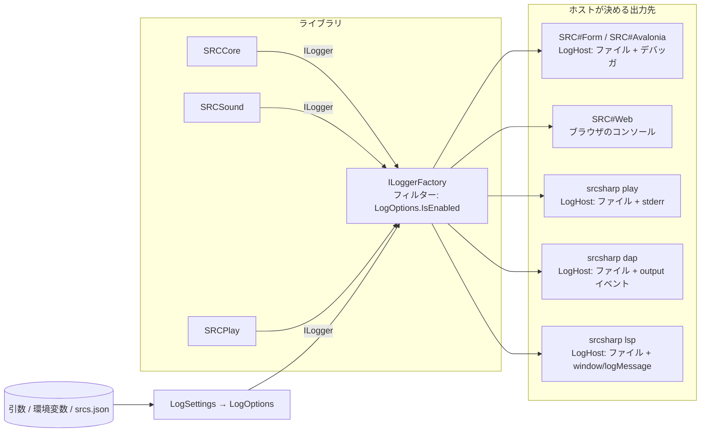

# ログの設計

SRC#（各アプリ・`srcsharp`・VS Code 拡張）のログの方針と構成。7474/SRC#358 で検討し、実装した。使う人向けの説明はヘルプの「[ログ](../SRC.Sharp.Help/src/ログ.md)」にある。

## 目的

| 目的 | 読む人 | 必要なもの |
|---|---|---|
| 不具合報告 | プレイヤー → 開発者 | 既定でファイルに残っていること。版・OS・シナリオ・例外が入っていること。場所がヘルプに書いてあること |
| シナリオ・データの作成 | シナリオ作者 | イベントのエラー・素材の欠落・未対応コマンドが、ファイル名・行番号つきで出ること |
| 開発・調査 | 開発者 | コマンド・変数・関数の実行を細かく追えること。アプリを作り直さずにレベルを変えられること |

## 以前の問題点

#358 の時点（3.5.2）では次の問題があった。

- 設定ファイル（`srcs.json`）でログを設定できなかった。レベルを変えられたのは SRC#Form の引数 `-v`・`-vv` だけだった。
- SRC#Form 以外はファイルに残らず、デバッガを付けていないと SRCCore のログを見られなかった。
- `SRC.LogError`・`SRC.LogWarn` が `Log.LogDebug` で出していたため、Information 以上の設定ではエラーが記録されなかった。
- SRCCore のカテゴリが `SRCCore` の 1 つだけだった。メッセージを文字列連結で作っており、`{}` を含む値で書式が崩れうる箇所もあった。
- SRC#Web・SRCDebugAdapter・SRCAuthoring に `Console.WriteLine`・`Console.Error.WriteLine` が散らばっていた。
- ログの場所・取り方がヘルプになかった。

## 方針

1. **すべて `Microsoft.Extensions.Logging`（`ILogger`）で書く**。出力先（Serilog・ブラウザ・DAP・LSP）はホスト（各アプリ）が決める（[.NET のログ](https://learn.microsoft.com/dotnet/core/extensions/logging)）。
2. **設定は「引数 > 環境変数 > `srcs.json` > 既定値」の順に効く**。項目名はすべてのアプリで共通にする。
3. **デスクトップ（SRC#Form・SRC#Avalonia・`srcsharp`）は既定でファイルに Information 以上を残す**。場所は OS ごとのユーザーの領域にする。
4. **プロトコルが使う stdout にはログを書かない**（LSP・DAP）。ログはプロトコルのログ通知で送る。
5. **レベルは実行中に変えられる**（設定ファイルを読んだ後、VS Code の設定、SRC#Web の設定画面）。



## 設定

### 項目

| 項目 | `srcs.json`（`Log` セクション） | 環境変数 | 引数 | 既定値 |
|---|---|---|---|---|
| レベル | `Level` | `SRCSHARP_LOG_LEVEL` | `--log-level <レベル>`、`-v`（Debug）、`-vv`（Trace） | `Information` |
| カテゴリごとのレベル | `Level:<カテゴリ>`（例: `Level:SRCCore.Expression`） | ― | ― | なし |
| ファイル出力 | `File`（`On`・`Off`） | `SRCSHARP_LOG_FILE`（`On`・`Off`） | `--no-log-file` | デスクトップは `On`、Web はファイルなし |
| ファイルの場所 | `Path` | `SRCSHARP_LOG_DIR` | `--log-dir <フォルダ>` | 下表 |
| 残す日数 | `RetainDays` | ― | ― | `7` |

- レベル名は `Trace`・`Debug`・`Information`・`Warning`・`Error`・`Critical`・`None`（[LogLevel](https://learn.microsoft.com/dotnet/api/microsoft.extensions.logging.loglevel)）。Serilog の `Verbose`・`Fatal`、短い `Info`・`Warn` も受け付ける。
- カテゴリごとのレベルは、前方一致する最も長いカテゴリのものを使う（`Level:SRCCore` は `SRCCore.Event` にも効く）。`srcs.json` から読めるカテゴリは `LogCategories.All` のもの。
- `srcs.json` の書き方は既存の `Option` セクションと同じ（`Sections` の `Name`・`Items`）。

```json
{
  "Sections": [
    {
      "Name": "Log",
      "Items": [
        { "Name": "Level", "Value": "Debug" },
        { "Name": "Level:SRCCore.Expression", "Value": "Trace" },
        { "Name": "File", "Value": "On" }
      ]
    }
  ]
}
```

### ファイルの場所（既定）

| OS | 場所 |
|---|---|
| Windows | `%LOCALAPPDATA%\SRCSharp\logs\` |
| macOS | `~/Library/Logs/SRCSharp/` |
| Linux | `$XDG_STATE_HOME/srcsharp/logs/`（未設定なら `~/.local/state/srcsharp/logs/`、[XDG Base Directory](https://specifications.freedesktop.org/basedir-spec/latest/)） |

- ファイル名は `<アプリ>-<日付>.log`（`srcsform`・`srcsavalonia`・`srcsharp-play`・`srcsharp-lsp`・`srcsharp-dap`）。Serilog.Sinks.File の `rollingInterval: Day`・`retainedFileCountLimit`・`rollOnFileSizeLimit`（既定 1 GB）で回す（[serilog-sinks-file](https://github.com/serilog/serilog-sinks-file)）。
- 実行ファイルの場所にしないのは、macOS の `.app` や `Program Files`・`dotnet tool` の置き場所に書けないことがあるため。SRC#Form は 3.5.2 までの `<exe のフォルダ>/logs` から移った。
- 同時に起動した複数のプロセスが同じファイルに書けるよう `shared: true` にする。
- フォルダを作れない・書けないときは、ファイルに出さずに動かす（デバッガ・stderr などには警告を出す）。

### いつ読むか

`srcs.json` はアプリの設定を読むまで（SRC#Web・`srcsharp` はシナリオを選ぶまで）読めない。そのため 2 段階で構成する。

1. 起動直後: 引数・環境変数・既定値で構成する。起動のログ（版・OS・.NET・引数）はここで出す。
2. `srcs.json` を読んだ後: `LogHost.ApplyConfig`（SRC#Web は `WebLogging.ApplyConfig`）で、レベル・ファイルを反映する。引数・環境変数で指定された項目は上書きしない。

レベルは `ILoggerFactory` のフィルター（`AddFilter((category, level) => options.IsEnabled(category, level))`）で出すたびに判定するため、`LogOptions` を変えればすぐ効く。ファイルの出力先は `SwitchableSink` で差し替える。

## レベルの使い分け

| レベル | 出すもの | 例 |
|---|---|---|
| Critical | プロセスが続けられない例外 | 未処理例外（`AppDomain.UnhandledException`・SRC#Web の `GameThread.UnhandledException`） |
| Error | 処理を中断した失敗 | イベントのエラー（ファイル名・行番号つき）、セーブ・ロードの失敗、データの読み込みエラー |
| Warning | 続けられるが結果が元の SRC と違うもの | 未対応コマンド（`GUINotImplemented`）、SoundFont が無い・読めない、OpenAL を開けない |
| Information | 起動・終了と大きな状態の変化 | 起動（版・OS・.NET・引数）、効いているログの設定、素材が見つからないこと、[Debug コマンド](../SRC.Sharp.Help/src/Debugコマンド.md) のメッセージ |
| Debug | 処理の流れ | イベントコマンドの実行（`CmdData`）、ユニットへのコマンド（`Commands`）、イベントのキュー、COM の思考 |
| Trace | 量の多い細部 | 変数の読み書き、関数の呼び出し、描画（`PaintPicture`） |

- 既定の Information で、不具合報告に要る情報（版・環境・シナリオ・エラー）がそろうようにする。
- Debug 以下は量が多いので、`IsEnabled` で確かめてから文字列を作る（`LoggerExtensions.WriteWithCaller`。呼び出し元のメソッド名を調べるのもこの時だけ）。

## カテゴリ

`ILoggerFactory.CreateLogger(<カテゴリ>)` で分ける。名前は `SRCCore.Logging.LogCategories`。

| カテゴリ | 範囲 | `SRC` のプロパティ |
|---|---|---|
| `SRCCore` | 起動・データの読み込み・セーブ・ロード | `Log` |
| `SRCCore.Event` | イベントの実行・コマンド | `EventLog` |
| `SRCCore.Expression` | 式・変数・関数 | `ExpressionLog` |
| `SRCCore.Command` | ユニットへのコマンド・COM | `CommandLog` |
| `SRCRender` | 画面・画像・フォント | ― |
| `SRCSound` | 音の再生・SoundFont | ― |
| `SRCSharpForm`・`SRCSharpAvalonia`・`SRCSharpWeb`・`SRCSharp.Tools` | 各アプリ自身 | ― |
| `SRCSharp.Lsp`・`SRCSharp.Dap` | Language Server・Debug Adapter | ― |
| `Avalonia` | Avalonia 自体（警告以上） | ― |

## 書式

- ファイル・デバッガ・stderr: `{Timestamp:yyyy-MM-dd HH:mm:ss.fff} [{Level:u3}] {SourceContext}: {Message:lj}{NewLine}{Exception}`
- DAP・LSP: `[INF] SRCCore.Event: メッセージ`（時刻はクライアントがつける）
- メッセージはテンプレートで書く（`Log.LogError(ex, "イベントのエラー {File}({Line}): {Message}", ...)`）。文字列連結はやめる（[ログのメッセージテンプレート](https://learn.microsoft.com/dotnet/core/extensions/logging#log-message-template)）。元の SRC から移したコードの `SRC.LogDebug(message, params string[])` などは、`{Message} {Args}` のテンプレートで出す。
- 例外は `Exception` 引数で渡し、スタックトレースをメッセージに連結しない。

## アプリ・ツールごとの出力

| 対象 | 出力先 | レベルの変え方 |
|---|---|---|
| SRC#Form | ファイル + デバッガ出力 | 引数・環境変数・`srcs.json` |
| SRC#Avalonia | ファイル + デバッガ出力（Avalonia 自体の警告以上も） | 同上 |
| SRC#Web | ブラウザのコンソール（Blazor の既定の出力。Error 以上は `console.error` なので、エラーの収集にも乗る）。ファイルは無し | URL の `?log=<レベル>`、システムメニューの設定の「ログ」（`localStorage` の `srcweb.logLevel`）、`srcs.json`。index.html が環境変数 `SRCSHARP_LOG_LEVEL` で .NET に渡す（[Blazor のログ](https://learn.microsoft.com/aspnet/core/blazor/fundamentals/logging)） |
| `srcsharp play` | ファイル + stderr（stdout は結果用。stderr は、レベルを引数・環境変数で指定しない限り警告以上） | 引数・環境変数・`srcs.json` |
| `srcsharp dap` | ファイル + DAP の `output` イベント（`category: console`、Warning 以上は `stderr`） | `launch.json` の `logLevel`（無ければ `srcsharp.logLevel`）（[Output Event](https://microsoft.github.io/debug-adapter-protocol/specification#Events_Output)） |
| `srcsharp lsp` | ファイル + `window/logMessage` | 初期化オプションの `logLevel`（`srcsharp.logLevel`）（[window/logMessage](https://microsoft.github.io/language-server-protocol/specifications/lsp/3.17/specification/#window_logMessage)） |
| VS Code 拡張 | 出力パネル「SRC#」を `LogOutputChannel`（`createOutputChannel('SRC#', { log: true })`）にし、Language Server のログも同じパネルに出す。表示は「Developer: Set Log Level」で絞れる（[LogOutputChannel](https://code.visualstudio.com/api/references/vscode-api#LogOutputChannel)） | `srcsharp.logLevel`（設定画面の「ログ」） |
| SRCDataLinter・`srcsharp lint`・`balance` | 対象外（出力は結果そのもの） | ― |

SRC#Form・SRC#Avalonia の設定ダイアログ（元の SRC の設定変更の移植）には、ログの項目を足していない。画面のテスト（VRT）の基準が変わるため。`srcs.json` か引数で設定する。

## 実装の置き場所

| 置き場所 | 内容 |
|---|---|
| `SRCCore/Logging/LogSettings.cs` | 1 つの指定元（引数・環境変数・`ISystemConfig`）の設定を読む |
| `SRCCore/Logging/LogOptions.cs` | 優先順位で合わせた、効いている設定。`IsEnabled(category, level)`・既定のファイルの場所 |
| `SRCCore/Logging/LogCategories.cs`・`LoggerExtensions.cs` | カテゴリ名、元の SRC の形のログをテンプレートで出す拡張メソッド |
| `SRCCore/Logging/DelegateLoggerProvider.cs` | ログを関数に渡す `ILoggerProvider`（DAP・LSP が使う） |
| `SRCCore/SRC.cs` | カテゴリごとの `ILogger`。`SRC()` の既定は `NullLoggerFactory`（ログを出すかどうかはホストが決める） |
| `SRCLogging`（net10.0、Serilog） | `LogHost`: デスクトップ用の構成（ファイル・デバッガ・stderr、設定の反映、起動のログ）。SRC#Form・SRC#Avalonia・`srcsharp` が使う |
| SRCDebugAdapter・SRCAuthoring | DAP の `output` イベント・LSP の `window/logMessage` に送る |
| `SRCSharpWeb/WebLogging.cs` | SRC#Web のレベルの判定と、URL・設定画面・`srcs.json` の反映 |

## ヘルプ・docs

- ヘルプの「[ログ](../SRC.Sharp.Help/src/ログ.md)」: 各アプリでの場所、レベルの変え方、不具合報告で添えるもの。ログにはファイルのパス（ユーザー名を含む）が入ること。
- `srcsharp --help`（15 言語）と [VS Code 拡張の README](../SRC.Sharp/SRCSharpVSCode/README.md#ログ) に、引数と設定を書いた。
- Issue テンプレート（不具合の報告）に、ログの欄と場所を書いた。
