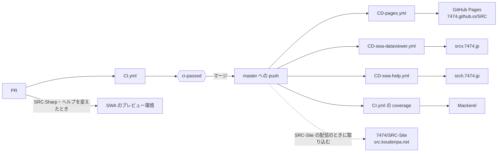
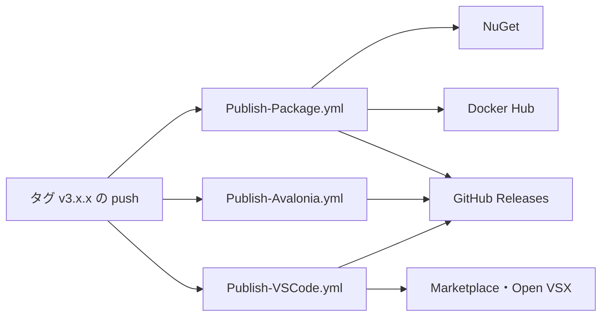
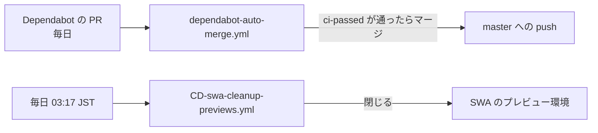

# 運用の全体像

このリポジトリで、何がきっかけで何が動き、どこに何が出るかの一覧です。各部分の詳しいことは、それぞれの文書にあります。

- CI のジョブ: [テストと CI の設計](./testing.md)
- リリース: [バージョンの管理](./versioning.md)・[リリースの案内](./releases/README.md)
- Static Web Apps: [Static Web Apps のワークフロー](./swa-workflows.md)

## 全体の図

### PR から master へ

### リリース

どのワークフローも、はじめに `tools/release.py check --tag` で版を確かめる。

### 定期・自動

## ワークフロー

| ワークフロー | きっかけ | すること | 出る先 |
|---|---|---|---|
| `CI.yml` | PR・master への push | ビルドとテスト、版と案内の確かめ（`release-check`）。結果を `ci-passed` にまとめる。push のときだけカバレッジを計る（`coverage`） | `ci-passed`（ブランチ保護の必須チェック）・Mackerel（サービス `SRCS` のカバレッジ） |
| `Packages.yml` | master への push（`SRC.Sharp/` を変えたとき）・手動 | 配る形で作って起動を確かめる。SRC#Avalonia の単一ファイル（linux-x64・win-x64 は `--smoke` で起動、osx は作るだけ）と、srcsharp の pack → tool install → `--version`・`lint`（#1359） | なし（確かめるだけ。Actions の成果物に 7 日残す） |
| `CD-pages.yml` | master への push | データビューア（`SRCDataViewer`）をルートに、SRC#Web を `web/` に置いて発行する | GitHub Pages（https://7474.github.io/SRC/ ・ https://7474.github.io/SRC/web/ ） |
| `CD-swa-dataviewer.yml` | master への push・PR（`SRC.Sharp/` を変えたとき） | `CD-pages.yml` と同じ構成を発行する。PR ではプレビュー環境に出して E2E を流し、PR が閉じたら閉じる | Static Web Apps（https://srcv.7474.jp/ ） |
| `CD-swa-help.yml` | master への push・PR（`SRC.Sharp.Help/` を変えたとき） | ヘルプ（Jekyll）を発行する。プレビュー環境の扱いは上と同じ | Static Web Apps（https://srch.7474.jp/ ） |
| `CD-swa-cleanup-previews.yml` | 毎日 03:17 JST・手動・このワークフローを変えた PR | PR が閉じたのに残っているプレビュー環境を閉じる | Static Web Apps |
| `Publish-Package.yml` | タグ（`v*`）の push | 版の確かめの後、NuGet（SRCCore・SRCDataLinter・SRCSharpTools）、SRC#Form と SRC#Web の zip、Docker イメージを出す。リリースの本文は `docs/releases/<タグ>.md` | NuGet・GitHub Releases・Docker Hub（`koudenpa/srcdatalinter`） |
| `Publish-Avalonia.yml` | タグの push・手動（過去のリリースに添付） | SRC#Avalonia を OS ごと（4 つ）の zip にする | GitHub Releases |
| `Publish-VSCode.yml` | タグの push・手動 | VS Code 拡張の .vsix を作って出す。公開済みの版なら飛ばす | Visual Studio Marketplace・Open VSX・GitHub Releases |
| `dependabot-auto-merge.yml` | Dependabot の PR | マイナー・パッチの更新のまとめに自動マージを設定する | master（`ci-passed` が通ったとき） |
| `regression-label.yml` | Issue の作成・編集 | 不具合の報告で「前の版では動いていた」と答えたものにラベル `regression` を付ける（[テストと CI の設計](./testing.md)） | Issue のラベル |

リポジトリの設定で動くもの（ワークフローのファイルは無い）として、Dependabot の更新の PR（毎日。`.github/dependabot.yml`）と、Copilot cloud agent・Copilot code review がある。

## 公開しているもの

| 公開先 | 中身 | 更新されるとき | 版 |
|---|---|---|---|
| https://src.koudenpa.net/ | SRC#Web・データビューア・lint（SRCLintWeb）を組み込んだサイト | 7474/SRC-Site の配信のとき。その時点の 7474/SRC の master を取り込む（下の「7474/SRC-Site とのつながり」） | master |
| https://7474.github.io/SRC/ ・ `/web/` | データビューア・SRC#Web | master への push ごと | master（開発版） |
| https://srcv.7474.jp/ ・ `/web/` | データビューア・SRC#Web | `SRC.Sharp/` を変えた master への push ごと | master（開発版） |
| https://srch.7474.jp/ | ヘルプ | `SRC.Sharp.Help/` を変えた master への push ごと | master |
| GitHub Releases | SRC#Form・SRC#Avalonia・SRC#Web の zip、VS Code 拡張の .vsix、リリースの案内 | タグの push | タグ |
| NuGet | `SRCCore`・`SRCDataLinter`・`SRCSharpTools`（`srcsharp`） | タグの push | タグ |
| Docker Hub | `koudenpa/srcdatalinter:<タグ>`・`latest` | タグの push | タグ |
| GitHub Releases の `dev`（プレリリース） | 開発版：SRC#Avalonia・srcsharp の nupkg・VS Code 拡張の .vsix・SRC#Web・lint・データビューアの zip、`manifest.json` | `SRC.Sharp/` を変えた master への push ごと（`Packages.yml` の起動の確かめが通ったとき。添付を入れ替える） | master（開発版。[バージョンの管理](./versioning.md)の「開発版」） |
| Docker Hub | `koudenpa/srcdatalinter:dev` | 同上 | master（開発版） |
| Visual Studio Marketplace・Open VSX | `koudenpa.src-vscode` | タグの push（公開済みの版なら飛ばす） | タグ |
| Mackerel（サービス `SRCS`） | カバレッジ（行・分岐） | master への push ごと | master |

## 7474/SRC-Site とのつながり

[7474/SRC-Site](https://github.com/7474/SRC-Site)（https://src.koudenpa.net/ ）は、このリポジトリから次のものを取り込む。

| 取り込むもの | SRC-Site の使い方 | 取り込むとき |
|---|---|---|
| SRC#Web（`SRCSharpWeb`） | `/play/` で遊ぶ | SRC-Site の配信（main への push・PR・手動） |
| lint（`SRCLintWeb`） | シナリオの投稿の前の確かめ | 同上 |
| データビューア（`SRCDataViewer`） | `/viewer/` でシナリオ・共有パックを見る | 同上 |
| `srcsharp`（`SRCSharpTools`） | サンドボックスのシナリオを画面なしで通す | SRC-Site のサンドボックスの CI（`sandbox/` を変えたとき・毎週） |

取り込む 7474/SRC の版は、SRC-Site の変数 `SRC_REF`（既定は `master`）で決まる。**7474/SRC をマージしても、src.koudenpa.net には SRC-Site が次に配信するまで入らない。** すぐに入れるには、SRC-Site の `Deploy` ワークフローを手動で動かす（配信先 `production`）。いま配信している版は https://src.koudenpa.net/play/version.txt で分かる。

## Secrets と外部サービス

| Secret・設定 | 使うワークフロー | 切れると止まるもの |
|---|---|---|
| `NUGET_OLG_API_KEY` | `Publish-Package.yml` | NuGet への公開 |
| `DOCKER_PASSWORD` | `Publish-Package.yml` | Docker Hub への公開 |
| environment `vscode-marketplace`（Azure のマネージド ID `mi-src-vscode-publish`、OIDC） | `Publish-VSCode.yml` | Marketplace への公開 |
| `OVSX_PAT`（任意） | `Publish-VSCode.yml` | Open VSX への公開（無ければ飛ばす） |
| `AZURE_STATIC_WEB_APPS_API_TOKEN_ICY_COAST_005428600` | `CD-swa-dataviewer.yml`・`CD-swa-cleanup-previews.yml` | srcv.7474.jp への配信と、そのプレビュー環境 |
| `AZURE_STATIC_WEB_APPS_API_TOKEN_YELLOW_PEBBLE_0DDB1C400` | `CD-swa-help.yml`・`CD-swa-cleanup-previews.yml` | srch.7474.jp への配信と、そのプレビュー環境 |
| `MACKEREL_API_KEY` | `CI.yml`（`coverage`） | カバレッジの送信（マージは止まらない） |
| `AUTOMERGE_TOKEN`（任意、Dependabot のシークレット） | `dependabot-auto-merge.yml` | 無ければ `GITHUB_TOKEN` で自動マージする。その場合、自動マージの push では配信のワークフローが動かない（[テストと CI の設計](./testing.md)） |

Dependabot とフォークからの PR には Actions のシークレットが渡らない。そのため、そうした PR ではプレビュー環境への配信を省く。

## 人がやること

| いつ | すること | どこで |
|---|---|---|
| 版を出すとき | 版を上げ、リリースの案内を書いた PR をマージし、タグ `v3.x.x` を push する（スキル `release`、[バージョンの管理](./versioning.md)） | 手元の git |
| タグの push の後 | リリースの頁で本文と添付を確かめる。environment `vscode-marketplace` に承認者がいれば、公開を承認する | GitHub の Releases・Actions |
| Dependabot のメジャーの更新・SkiaSharp のメジャーの更新・セキュリティの更新が来たとき | 確かめてマージする（自動マージの対象外） | PR |
| 7474/SRC の変更をすぐ src.koudenpa.net に出したいとき | SRC-Site の `Deploy` を手動で動かす（`production`） | 7474/SRC-Site の Actions |
| Secrets の期限が切れたとき | 上の表の Secret を更新する | Settings → Secrets and variables |
