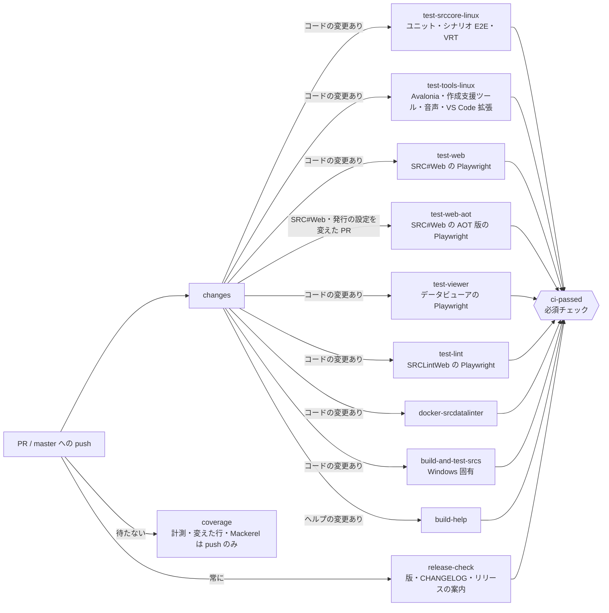

# テストと CI の設計 / Testing and CI

「CI が通れば人が見なくてもマージしてよい」と言える状態を保つための、テストの責務の分け方と CI の構成。シナリオの E2E・VRT の詳細は [E2E テスト方針](./gui/e2e-testing.md) にある。経緯は [判断の記録](./decisions/2026-10-20-ci-gate-and-auto-merge.md) にある。

## 方針

- **1 つのことは 1 つの層で確かめる**。シナリオの挙動と見た目は `SRCRender` のヘッドレスな E2E・VRT で確かめ、フロントエンドのテストは「画面が出て、入力が `ScreenGUI` に届くか」とそのフロントエンドにしか無い機能に絞る
- **正とする環境は Linux**。VRT の基準画像は Ubuntu 24.04 + `fonts-noto-cjk` で作っている。Windows では Windows でしか確かめられないものだけを動かす
- **マージを止めるのは、決定的に結果が出るテストだけ**。計測（カバレッジなど）と、配信した後の確認はマージを止めない
- **必須チェックは `ci-passed` の 1 つだけ**。ジョブを足しても減らしても、ブランチ保護の設定を変えなくてよい

## テストの層と責務

| 層 | 保証すること | 保証しないこと | プロジェクト | CI のジョブ |
|---|---|---|---|---|
| ユニット | 関数・式・イベントコマンド・データ読み込みの仕様。速く、待ちや時刻に依存しない | 画面・入力・スレッドの待ち合わせ | `SRCCoreTests`・`SRCAuthoringTests`・`SRCSoundTests`・`SRCSharpWebTests`（SRC#Web のうちブラウザに依存しない処理。セーブの同期・zip の展開・カタログの読み取り） | `test-srccore-linux`・`test-tools-linux`・`test-web`（`SRCCoreTests` は `build-and-test-srcs` でも） |
| シナリオ E2E | コーパス（`SRC.Sharp/E2E/`）を入力スクリプトでプレイしたときの挙動。イベントコマンドの網羅 | フロントエンドごとの見た目・入力の仕組み | `SRCRenderTests`（`E2ECorpusTests`・画面のシナリオのテスト） | `test-srccore-linux` |
| VRT | `SRCRender` が描いた画面が基準画像と一致すること | フロントエンドの部品（ボタン・メニュー）の見た目 | `SRCRenderTests`（`Baselines/`） | `test-srccore-linux` |
| フロントエンド E2E | 起動・描画・入力の経路と、そのフロントエンドにしか無い機能 | シナリオの挙動（シナリオ E2E が担う） | `SRCSharpAvaloniaTests`（Avalonia.Headless。起動の引数と `--smoke` の終了コード・効果音の再生の呼び出しも）・`SRCSharpWeb.E2E`（Playwright。読み込み・ブラウザ内保存・URL・タッチ・カタログ。ブラウザで動く lint）・`SRCSharpVSCode/test`（VS Code の中で拡張が有効になり、コマンドと言語が登録されること。`xvfb-run -a npm test`） | `test-tools-linux`・`test-web`・`test-lint` |
| 配布物 | 配る形でビルド・発行でき、最低限動くこと（`srcsharp` の各コマンドの終了コードと出力は、ユニットの `SRCAuthoringTests` の `CliTests` が確かめる）。master への push ごとに、リリースと同じ作り方の SRC#Avalonia（linux・windows は `--smoke` で起動、macOS は作るだけ）と srcsharp の .NET tool を確かめる（`Packages.yml`） | 機能の正しさ | Docker イメージ（`srcsharp`）・VS Code 拡張・SRC#Form の発行・SRC#Help（Jekyll） | `docker-srcdatalinter`・`test-tools-linux`・`build-and-test-srcs`・`build-help` |
| 版の揃い | アプリ・ライブラリ・VS Code 拡張の版、拡張の CHANGELOG、リリースの案内（`docs/releases`）が揃っていること | 公開できること（タグの push のときに公開ワークフローが確かめ直す） | `tools/release.py check` | `release-check`（文書だけの PR でも動く） |
| Windows 固有 | WinForms の SRC#Form を含むソリューション全体のビルド、大文字・小文字を区別しないファイルシステムでの `SRCCore`、Windows の実フォントの寸法、SkiaSharp のネイティブライブラリ | シナリオ E2E・VRT（Linux を正とする） | `SRCCoreTests`・`SRCRenderTests` の `WindowsFontMetricsTests`・`SkiaFontsTests` | `build-and-test-srcs` |
| データビューア | 置いたサイトのアーカイブ（シナリオ・パック）を読み、データ・画像（データで使っているかの印と絞り込み）・音・BGM の帯（画面を移っても鳴り続け、止められる）が動くこと | 7474/SRC-Data の作品のデータ | `SRCSharpWeb.E2E/tests/viewer.spec.js`（アーカイブは `viewer-fixtures.mjs` が作る） | `test-viewer` |
| 配信後の確認 | 配信したデータビューアが開き、データを読めること | マージの可否（マージの後に動く） | `SRCSharpWeb.E2E/tests/deployed.spec.js`（Playwright。配信した先を `DEPLOYED_URL` で渡す） | `CD-swa-dataviewer.yml` の `e2e` |
| 計測 | カバレッジ（テストのあるすべてのアセンブリを合わせたもの）、PR で変えた行のカバレッジ（`.github/scripts/diff-coverage.py`。50% を下回ると warning）、シナリオで実行したコマンドの網羅率 | マージの可否（`ci-passed` は待たない） | — | `CI.yml` の `coverage`（PR と master への push。Mackerel には push のときだけ送る） |

テストを足すときは、上の表で「保証すること」に当たる層に足す。シナリオの挙動を Playwright や Avalonia のテストで確かめたくなったら、まずコーパスにケースを足せないかを考える。

## 結果の固定（ゴールデン）

いまの振る舞いを表にしてリポジトリに置き、変わったら知らせるテスト。正しさは VB 版を期待値にしたテストが受け持ち、ここは「黙って変わっていないこと」を見る（[判断の記録](./decisions/2026-10-31-regression-first-qa-plan.md)）。

| 対象 | テスト | 表 |
|---|---|---|
| 戦闘の計算結果（使えるか・命中率・ダメージ・クリティカル率・期待ダメージ）。攻撃側 × 武器 × 防御側 × 地形 × 距離 × 気力 × スペシャルパワーの 2,400 通り | `SRCCoreTests/Golden/BattleGoldenTests.cs` | `SRCCoreTests/Golden/Battle/expected.txt`（データは同じフォルダの `Data/`） |
| 攻撃 1 回の結果。乱数の種を組み合わせごとに固定して Attack コマンド（通常戦闘）を 1 回動かし、両方の HP・EN・位置と戦闘のメッセージを記録する。武器（属性違い 16 種）× 防御側（シールド・バリア・フィールド・切り払い・迎撃・分身・反射・当て身技・自動反撃・広域の防御・パイロットの能力による強化など 45 種）× 防御の仕方（反撃・防御・回避）。どの防御の特殊能力が働いたか・反撃の結果がメッセージに出る | `SRCCoreTests/Golden/AttackGoldenTests.cs` | `SRCCoreTests/Golden/Attack/expected.txt`（データは同じフォルダの `Data/`） |
| 武器の計算結果（使えるか・命中率・ダメージ・クリティカル率・期待ダメージ）。攻撃側のパイロット（技能の有無）× 武器（属性違い・特殊効果つきの 25 種）× 防御側（上の防御側・大きさ違い・特殊効果無効化など 50 種）× 距離。一部はオプション（距離修正・ダメージ倍率低下など）とバトルコンフィグデータ（`Attack/battle.txt`）を変えて見る | 同上 | `SRCCoreTests/Golden/Attack/calc.txt`（データは `Attack/Data`） |
| 敵の思考（`COM.OperateUnit`）。敵 5 体・味方 3 体の戦場で、乱数の種を固定して敵を 5 回ずつ動かし、行動のたびに全ユニットの位置・HP・EN・気力を記録する。移動先・武器・対象の選び方と、命中・ダメージの判定が変わると記録が変わる | `SRCCoreTests/Golden/ComGoldenTests.cs` | `SRCCoreTests/Golden/Com/expected.txt`（データは `Battle/Data` と同じ） |

表のデータ（`Data/` のユニット・パイロット）はテストごとに分ける。`Battle/Data` を変えると `Com/expected.txt` まで変わるため、新しい組み合わせは別のフォルダに足す。

意図して結果を変えたときは、表を作り直して差分を PR に載せる。人のレビューは必須にしない（自動化を優先し、リグレッションが起きたら見直す）。

```sh
SRC_GOLDEN_UPDATE=1 dotnet test SRC.Sharp/SRCCoreTests --filter FullyQualifiedName~Golden
```

## セーブデータの版をまたぐ互換

`SRCRenderTests/SaveCompatibilityTests.cs` が、出した版ごとのセーブ（`SRC.Sharp/E2E/saves/v<版>/` のクイックセーブ・データセーブ・リスタート）のすべてから再開し、最後まで進められることを確かめる（#1357）。セーブはコーパス `save-compat` で作る。

- リリースのときに、その版のセーブを足す（`python3 tools/release.py saves`）。`release.py check`（CI の `release-check`）は、いまの版のセーブが無いと通らない
- 再開は、セーブを作ったときとは別の一時フォルダで行う。シナリオのフォルダを移しても再開できることを確かめる。v3.5.5 までのセーブはシナリオのファイルを絶対パスで持ち、それより後はシナリオのフォルダからの相対パスで持つ（#1375）

SRC#Web がブラウザ（IndexedDB）に保存したセーブも、版をまたいで確かめる（#1398）。`SRCSharpWeb.E2E/fixtures/srcweb-indexeddb-3.5.5.json` は、3.5.5 が保存した IndexedDB の中身（データベースの名前・版・ストアとキー、セーブのレコード）を書き出したもの。`web.spec.js` が、アプリを読み込む前にこれを IndexedDB にそのまま書き、そのセーブから再開して次のステージへ進めることを確かめる。

- 保存の形（`wwwroot/js/store.js` のデータベース・ストア・レコードの項目）を変えるときは、前の形のものを読めるように移す。fixture は変えない
- 保存の形を変えた版を出したら、その版の fixture を足す（書き出し方は fixture の `description` にある）

## CI の構成



- `changes` は PR の変更されたファイルを見て、文書だけ（`docs/`・ルートの `*.md`・Issue のテンプレート）の PR ではビルドとテストを省く。ワークフローの `paths` で絞ると必須チェックが報告されずにマージできなくなるため、ジョブの中で判定している。`if` で省いたジョブは成功として扱われる（[Using conditions to control job execution](https://docs.github.com/en/actions/how-tos/write-workflows/choose-when-workflows-run/control-jobs-with-conditions)）
- `ci-passed` は、すべてのジョブが成功か省略なら成功する。失敗・取り消しが 1 つでもあれば失敗する
- PR と master への push で動かすテストは同じ。違うのは SRC#Web の発行（PR はインタープリター、push は AOT）と、push のときだけの `coverage`
- SRC#Web・発行の設定（`Directory.Build.props`・`Directory.Packages.props`）・`CI.yml` を変えた PR では、`test-web-aot` が配るものと同じ AOT 版でも E2E を通す（約 12 分。ほかのジョブと並べて動く）。AOT の発行は約 8 分かかるため、ほかの PR では動かさない（#1360）

### ブランチ保護

master のブランチ保護の必須チェック（Require status checks to pass）は `ci-passed` だけにする。ほかのジョブを必須チェックにすると、そのジョブを省いたり名前を変えたりしたときにマージできなくなる。

設定は Settings → Branches → master のルール → Require status checks to pass before merging で行う（[Managing a branch protection rule](https://docs.github.com/en/repositories/configuring-branches-and-merges-in-your-repository/managing-protected-branches/managing-a-branch-protection-rule)）。

## 自動マージ

Dependabot のマイナー・パッチの更新は、ディレクトリ（エコシステム）ごとに 1 つの PR にまとめ（`.github/dependabot.yml` の `groups`）、`.github/workflows/dependabot-auto-merge.yml` が自動マージを設定する。マージされるのは `ci-passed` が通ったときだけ。

| 更新 | 扱い |
|---|---|
| `SRC.Sharp/` の NuGet（`nuget-minor-patch`。版は `SRC.Sharp/Directory.Packages.props` の 1 か所。ソリューションに無い `SRCSharpWeb`・`SRCLintWeb` もディレクトリを並べて対象にする） | 自動マージ |
| npm（`npm-minor-patch`。VS Code 拡張・SRC#Web の E2E・データビューアの E2E） | 自動マージ |
| `SRC.Sharp.Help/` の bundler（`bundler-minor-patch`） | 自動マージ（`build-help` で Jekyll のビルドを確かめる） |
| GitHub Actions（`actions-minor-patch`） | 自動マージ |
| SkiaSharp のメジャーの更新（`skiasharp-major`） | `SkiaSharp*` をまとめて 1 つの PR にする（管理側とネイティブの版が揃わないと動かないため）。人が確かめてマージする |
| そのほかのメジャーの更新・セキュリティの更新 | 個別の PR。人が確かめてマージする |

- まとめるのは、同じファイル（`.csproj`・`packages.config` など）を書き換える PR が何本も並び、1 本マージするたびに残りが競合して作り直しになるのを避けるため
- `GITHUB_TOKEN` で設定した自動マージによる push では、push で動くワークフロー（GitHub Pages・Static Web Apps への配信、`coverage`）が動かない（[GITHUB_TOKEN](https://docs.github.com/en/actions/concepts/security/github_token)）。次に人がマージしたときにまとめて配信される。すぐに配信したい場合は、Dependabot のシークレットに `AUTOMERGE_TOKEN`（このリポジトリの contents・pull requests に書き込める fine-grained personal access token）を登録すると、それで自動マージを設定する（[Dependabot のシークレット](https://docs.github.com/en/code-security/dependabot/troubleshooting-dependabot/troubleshooting-dependabot-on-github-actions)）
- Dependabot の PR では Actions のシークレットが渡されないため、Static Web Apps のプレビュー環境への配信と、その後の E2E は省く（[Static Web Apps のワークフロー](./swa-workflows.md)）

## 速さの計測

`test-web` は、SRC#Web で「灯の巡航船ランタン号」を選んでから最初のイベントが動くまでの時間（`lantern-start-ms`）を測り、ジョブのサマリに出す（#1365）。

- 基準は `.github/perf-baseline.json` に、発行の種類ごと（PR は `interpreter`、master への push は `aot`）に置く
- 基準の 1.5 倍を超えたら warning の注釈を出す。マージは止めない（ランナーによるばらつきがあるため）
- 意図して速さが変わったときや、ランナーが変わったときは、CI のサマリの値で基準を直す

## 不安定なテスト（flaky）の扱い

マージを止めるテストが時々落ちると、自動マージは止まり、人は「また flaky だろう」と失敗を読まなくなる。そのため次のようにする。

- **待ちの長いシナリオ E2E は Linux だけで動かす**。Windows のランナーでは同じテストがタイムアウトしやすい
- **Playwright は CI で 1 度だけやり直す**（`retries`）。やり直して通ったテストは結果に `flaky` と出る（[Retries](https://playwright.dev/docs/test-retries)）。`test-web` の「Summarize SRC#Web tests」が、ジョブのサマリに flaky のテストの一覧を出し、テストの行に warning の注釈を付ける（`.github/scripts/playwright-summary.mjs`）。flaky が出たら、待ちの条件か前提を直す
- **Playwright は CI で 2 並列で動かす**（`PW_WORKERS=2`、ファイルの中のテストも並べる）。ランナーは 4 vCPU。手元の計測では 1 並列 317 秒・2 並列 191 秒・3 並列 163 秒で、3 並列では負荷で落ちるテストが出たため 2 にしている。手元では既定の 1 並列
- **MSTest はやり直さない**。落ちたら、待ちの条件（`wait`・`auto` の秒数、`[DoNotParallelize]`）か、テストの前提（静的な状態・プロセス全体の設定）を直す
- ジョブの再実行で通すのは、ランナーの不調（取得・インストールの失敗）のときだけにする

## リグレッションが起きたら

当面は自動化を優先し、人のレビューを必須にしたゲートは増やさない。その代わり、前の版で動いていたものが壊れたら（リグレッション）、その領域の守りを厚くする（[判断の記録](./decisions/2026-10-31-regression-first-qa-plan.md)、#1350）。エラーバジェットは設けないが、考え方は同じ。

1. 不具合の報告で「前の版では動いていたか」に「はい」と答えると、`regression-label.yml` がラベル `regression` を付ける。人が後から付けてもよい
2. 直す PR で、同じ壊れ方を CI で見つけられるテストを、上の表の該当する層に足す
3. その領域でマージを止める位置（マージの前・後・リリース）が足りていたかを見直し、足りなければ #1350 の段階に足す

`regression` の Issue の数を、改善の効き目の物差しにする。

## 残っている課題

- Playwright の flaky なテスト（`シナリオを読み込んでいる間はほかの操作を受け付けない`・`アーカイブを追加し、再読み込み後もプレイできる` など、読み込みの待ちのタイムアウト）の待ちの条件を直す
- `SRCSharpWeb.E2E/tests/deployed.spec.js` は配信した後に動き、外部（`7474/SRC-Data`）のデータを読む。マージの可否には使わない
- SRC#Help の Ruby は Static Web Apps（Oryx）に合わせて 3.1 のままで、`Gemfile.lock` には Ruby 3.2 以上が要る版（`public_suffix` 7.0.5・`google-protobuf` 4.36 など）が入っている。Oryx と `build-help` は `Gemfile.lock` を固定せずに入れられる版に解決し直してビルドしている。Ruby を上げるか、Ruby 3.1 で `Gemfile.lock` を作り直す
