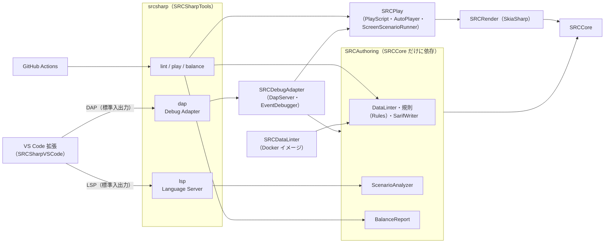
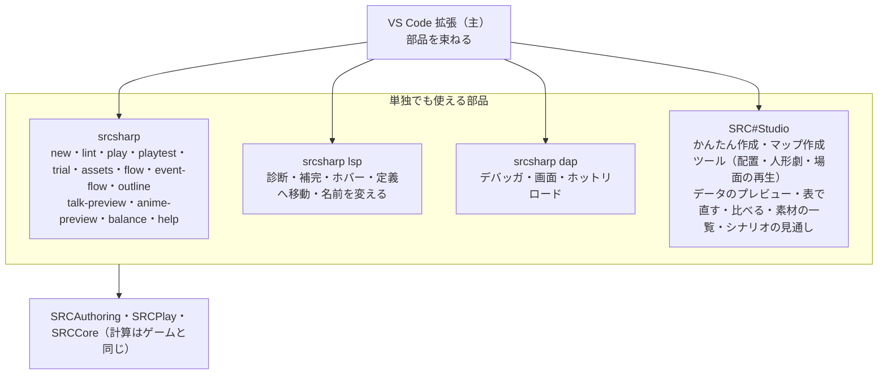

# 作成支援ツール（srcsharp・VS Code 拡張）

SRC のデータ・シナリオを作るための支援ツールの設計と使い方。データには lint（読み込みの誤りと、書き間違いを見つける規則）とバランスの集計、シナリオには自動プレイとイベントのデバッガ（行単位）を用意する。

## 方針

処理はすべて SRC# のコア（.NET）で動く CLI `srcsharp` に置き、エディタとは標準のプロトコルでつなぐ。VS Code 拡張は、言語クライアントとデバッガの登録、構文の色分けだけを持つ薄い層にする。

- **Language Server Protocol（LSP）**：サーバーは LSP で通信できれば、どの言語で書いてもよい。LSP に対応した他のエディタでも使える（[Language Server Extension Guide](https://code.visualstudio.com/api/language-extensions/language-server-extension-guide)、[仕様 3.17](https://microsoft.github.io/language-server-protocol/specifications/lsp/3.17/specification/)）
- **Debug Adapter Protocol（DAP）**：デバッガは、標準入出力で DAP を話す外部の実行ファイルとして登録できる（[Debugger Extension](https://code.visualstudio.com/api/extension-guides/debugger-extension)、[仕様](https://microsoft.github.io/debug-adapter-protocol/specification)）

同じエンジンを CI・コマンドライン・エディタで使い回せる。SRC#Web に Monaco を載せれば、同じ LSP を使うこともできる（未対応）。



## VS Code 拡張と、単独で使える部品

**VS Code 拡張（SRC# Authoring）を主（プライマリ）の作成環境にする。** 書く・見る・描く・試す・検査するが 1 つの画面でつながり、機能はまず VS Code で使える形で出す。そのうえで、**機能は部品として単独でも使えるようにする。** VS Code 拡張は部品を束ねる薄い層で、機能そのものは部品に置く（拡張だけにある機能は作らない）。



| 部品 | VS Code 拡張での使い方 | 単独での使い方 |
|---|---|---|
| `srcsharp`（CLI） | コマンド（新しいシナリオ・話のつながりの図・イベントの流れの図・会話のプレビュー・戦闘アニメのプレビュー・素材の一覧・lint・バランス・試し戦闘・強さの確かめ） | コマンドライン・CI（ひな形の GitHub Actions） |
| Language Server（`srcsharp lsp`） | イベント・データの編集 | LSP に対応したほかのエディタ |
| デバッガ（`srcsharp dap`） | F5・画面のタブ・ホットリロード・試し戦闘 | DAP に対応したほかのエディタ。画面なしの自動プレイは `srcsharp play` |
| SRC#Studio | `.map` のカスタムエディタ（配置・人形劇。場面の再生はデバッガ）、データのプレビュー（横に開く）、シナリオの見通し（横に開く。台本の行から会話のプレビュー） | ブラウザ（[https://src.koudenpa.net/studio/](https://src.koudenpa.net/studio/)・開発版 [https://7474.github.io/SRC/studio/](https://7474.github.io/SRC/studio/)）。インストールが要らない。かんたん作成・素材の一覧・シナリオの見通しもここ。場面の再生は同じサイトの SRC#Web |
| ブラウザの lint（SRCLintWeb） | ―（VS Code は Language Server） | 投稿サイト（7474/SRC-Site）がアップロードの前に使う |

- 新しい機能は、計算を部品（SRCAuthoring・SRCStudio など）に置き、VS Code 拡張から使う形を最初に作る。単独での使い方（CLI の引数・SRC#Studio の画面）は同じ部品で足す
- SRC#Studio は、VS Code を使わない人の入口と、VS Code の中の画面の両方を兼ねる。画面は 1 つで、ファイルの読み書きだけを場所ごとに替える
- 単独では無いもの: 試し戦闘の画面付きのプレイは VS Code（デバッガ）だけ。コマンドラインでは `srcsharp trial` でイベントを作り、`srcsharp play` で自動で動かすか、SRC#Avalonia・SRC#Web で遊ぶ

## 構成

| プロジェクト | 内容 |
|---|---|
| `SRC.Sharp/SRCPlay` | シナリオを画面なしで動かし、`.play` スクリプトで自動プレイする部品。`SRCRenderTests` の E2E と共通 |
| `SRC.Sharp/SRCAuthoring` | lint・SARIF・シナリオ解析（`ScenarioAnalyzer`・`ScenarioFlowAnalyzer`・`EventFlowAnalyzer`・`AssetReport`）・バランス集計・LSP・ひな形（`ScenarioTemplate`・`TrialTemplate`・`QuickBattleTemplate`）・マップ（`Maps`。読み書き・自動接続・イベントの配置・人形劇の `EventTimeline`）・データのプレビュー（`DataPreview`）。SRCCore だけに依存する（描画の部品は使わない） |
| `SRC.Sharp/SRCDebugAdapter` | DAP・イベントのデバッガ。シナリオを画面なしで動かすため SRCPlay（SRCRender）に依存する |
| `SRC.Sharp/SRCSharpTools` | CLI `srcsharp`（.NET tool） |
| `SRC.Sharp/SRCHelpSearch` | `srcsharp help` の検索（全文検索・埋め込みのベクトルの検索）。実行するとヘルプの断片のベクトルを作る（`srcsharp` のビルドで使う） |
| `SRC.Sharp/SRCAuthoringTests` | SRCAuthoring・SRCDebugAdapter のテスト（LSP・DAP はパイプでつないで確かめる） |
| `SRC.Sharp/SRCDataLinter` | 従来の lint の CLI と Docker イメージ。検査は SRCAuthoring の `DataLinter`（`srcsharp lint` と共通）で、出力の書式は従来どおり |
| `SRC.Sharp/SRCLintWeb` | ブラウザで動く lint（WebAssembly、スレッドなし）。`srcsharp lint` と同じ `DataLinter` と、LSP と同じ静的解析（`ScenarioAnalyzer`。ラベル・include）と素材の参照（`AssetReferenceChecker`。画像・音・マップのファイルがあるか）で zip を検査する。投稿サイト（7474/SRC-Site）がアップロードの前に使う（`SRC.Sharp/SRCLintWeb/README.md`） |
| `SRC.Sharp/SRCStudio` | SRC#Studio（作成支援の画面。かんたん作成・マップ作成ツール（配置・人形劇・場面の再生）・データのプレビュー・素材の一覧・シナリオの見通し）。.NET の WebAssembly と HTML・JavaScript の画面で、スタンドアロン（GitHub Pages の `/SRC/studio/`）と VS Code 拡張（`.map` のカスタムエディタ）で動く（`SRC.Sharp/SRCStudio/README.md`）。マップの読み書きと地形データは SRCAuthoring の `Maps` |
| `SRC.Sharp/SRCSharpVSCode` | VS Code 拡張 |

SRCCore には、デバッガ用のフック `IEventDebugger`（`Event.Debugger`）がある。`CmdData.Exec` の先頭と、イベントのエラーを表示する時に呼ばれる。設定しなければ null の判定だけで、通常の実行には影響しない。

## CLI

```sh
dotnet tool install -g SRCSharpTools

srcsharp new <フォルダ> [--title 題名] [--episodes 数] [--app-path SRCのフォルダ] [--force]
srcsharp flow [シナリオのフォルダかイベントファイル] [--format md|mmd|json] [--output ファイル] [--app-path SRCのフォルダ] [--scenario-root シナリオのフォルダ]
srcsharp event-flow <イベントファイル> [--format md|mmd|json] [--output ファイル] [--app-path SRCのフォルダ] [--scenario-root シナリオのフォルダ]
srcsharp talk-preview <イベントファイル> [--line 行] [--block 番号] [--stdin] [--input ファイル] [--format json|png] [--out ディレクトリ] [--output ファイル] [--no-images] [--app-path SRCのフォルダ] [--scenario-root シナリオのフォルダ]
srcsharp anime-preview <ファイルかフォルダ> [--list] [--file ファイル] [--line 行] [--kind animation|ext_animation|effect|subroutine] [--target 名称] [--situation 場面] [--spec 指定] [--attacker ユニット] [--attacker-pilot パイロット] [--defender ユニット] [--defender-pilot パイロット] [--play-once] [--skip-wait] [--out 画像ファイル] [--app-path SRCのフォルダ] [--scenario-root シナリオのフォルダ]
srcsharp assets [シナリオのフォルダ] [--format md|json|readme] [--output ファイル] [--app-path SRCのフォルダ] [--ext-data フォルダ] [--ext-data2 フォルダ] [--fail-on-missing]
srcsharp trial <シナリオのフォルダ> [--unit ユニット] [--pilot パイロット] [--enemy ユニット] [--enemy-pilot パイロット] [--level 数] [--enemies 数] [--app-path SRCのフォルダ] [--list]
srcsharp lint <ディレクトリかファイル>... [--format text|sarif] [--output ファイル] [--rules グループ,...|none] [--list-rules] [--app-path SRCのフォルダ]
srcsharp play <イベントファイル> [--script ファイル.play] [--out ディレクトリ] [--app-path SRCのフォルダ] [--scenario-root シナリオのフォルダ] [--steps 数] [--skip-wait] [--seed 数] [--state ファイル]
srcsharp playtest <イベントファイル> [--runs 数] [--seed 数] [--turns 数] [--policy smart|advance|hold] [--format md|json] [--output ファイル] [--min-wins 数] [--app-path SRCのフォルダ] [--scenario-root シナリオのフォルダ]
srcsharp outline [シナリオのフォルダかイベントファイル] [--format md|json] [--output ファイル] [--app-path SRCのフォルダ]
srcsharp balance <ディレクトリかファイル>... [--format md|csv|weapons-csv] [--output ファイル]
srcsharp lsp
srcsharp dap
srcsharp help [項目] [--list] [--search 文字列 [--limit 数] [--method hybrid|bm25|vector]] [--grep 文字列] [--export ディレクトリ]
srcsharp --version
```

| コマンド | 内容 |
|---|---|
| `new` | 新しいシナリオのひな形を作る（SRCAuthoring の `ScenarioTemplate`。7474/SRC#1640・#1652）。最小の汎用データで遊べる 1 話（`第1話.eve`・`第1話.map`・`Data/robot.txt`・`Data/pilot.txt`）、最後まで自動で遊ぶ手順（`第1話.play`）、VS Code のデバッガの構成（`.vscode/launch.json`。`--app-path` があれば `.vscode/settings.json` の `srcsharp.appPath` も）、作者のリポジトリの CI（`.github/workflows/src-check.yml`。最小の汎用データで `lint`（SARIF をコードスキャンに渡す）と `play`）、README・.gitignore。`--episodes 2` 以上を指定すると、全話分のイベント・マップ・単体/通しプレイ（`全話.play`。インターミッションのたびに `saveepisodes` で各話の始めの状態を `.srcsharp/episodes/第N話.srcs` に残し、VS Code の「この話から遊ぶ」が使う）と `Lib/include.eve`（共通の敗北・章題・報酬・単体開始用の `単体の部隊`）・`Lib/作戦会議.eve` を作る。既にあるファイルは上書きしない（`--force` で上書き）。VS Code のコマンド「新しいシナリオを作る」も同じ |
| `flow` | シナリオの `Continue`・`次ステージ`・`Exec`・`IntermissionCommand`・`Load`・`GameClear` と `If`/`Switch` の分岐をたどり、話のつながりの図を出す（SRCAuthoring の `ScenarioFlowAnalyzer`。7474/SRC#1652）。`--format md`（既定、Mermaid 付きの Markdown）・`mmd`（Mermaid）・`json`（ノード・エッジ・警告の構造化データ）。ノードには話で加わる味方（`Create 味方`・`Join` のパイロット。`joins`）と抜ける味方（`Leave`。`leaves`）を付け、図では「＋名前」「－名前」で添える（7474/SRC#1692）。VS Code のコマンド「話のつながりの図を表示」が `--format json` を使って SVG フローチャートを描き、クリックで該当ファイル・行へ飛べる |
| `event-flow` | 1 つのイベントファイル（と include・Require 先）について、発火イベント・ラベル・`Call`・`Goto`・`Require` のつながりの図を出す（SRCAuthoring の `EventFlowAnalyzer`。7474/SRC#1655）。`--format md`（既定）・`mmd`・`json`。VS Code のコマンド「イベントの流れの図を表示」は LSP の `srcsharp/eventFlow` を使って SVG フローチャートを描き、クリックで該当ファイル・行へ飛べる |
| `talk-preview` | イベントファイルの `Talk`・`AutoTalk` ブロックをゲームと同じメッセージウィンドウ（SRCRender の `TalkPreviewRunner`）で描画し、改ページごとの画像（PNG base64 の JSON または `--format png` で `page-NNN.png`）を出す（7474/SRC#1655）。シナリオを最初から遊ばずに見た目・改行・改ページ・顔グラフィックを確かめられる（`--stdin`・`--input` で未保存の内容も可）。VS Code のコマンド「会話をプレビュー」も同じ |
| `anime-preview` | `animation.txt`・`ext_animation.txt`・`effect.txt` の 1 定義や汎用戦闘アニメ（`Lib/汎用戦闘アニメ`）を、固定の攻撃側・防御側ユニットで再生する準備ファイル（`.srcsharp/preview/`、`AnimationPreviewTemplate`）を作る（7474/SRC#1655）。`--list` でファイル内の定義一覧と候補ユニット・パイロットを JSON で出し、`--play-once` で 1 回再生（`--out` で PNG 保存）する。VS Code のコマンド「戦闘アニメ・特殊効果をプレビュー」は同じ設定でデバッガ（`animationPreview`）を起動し、画面を見ながら「もう一度再生」（`srcsharpReplayAnimation`）で直してすぐ確認できる |
| `assets` | データとイベントが参照する画像・音・マップ（`AssetReferenceChecker` と共通の字句解析）を、参照している場所と一緒に並べ、SRC と同じ順（シナリオ → 拡張データ → SRC 本体）で探した結果を出す（`AssetReport`。7474/SRC#1654。素材の入手・再配布は扱わない）。式で組み立てる名前は「確かめられない」に分け、シナリオのフォルダ内で名前から参照されていない素材も並べる。`--format readme` でシナリオ外の必要素材を README 用に書き出す。`--fail-on-missing` で不足があれば終了コード 1（CI 用）。VS Code のコマンド「素材の一覧（揃っているか）を表示」・SRC#Studio の「素材の一覧」タブも同じ部品を使う |
| `trial` | 試し戦闘（SRCAuthoring の `TrialTemplate`。7474/SRC#1643）。シナリオのデータのユニット・パイロットを、小さなマップ（16×11）で敵と戦わせるイベントを、シナリオのフォルダの `.srcsharp/trial/試し戦闘.eve` に作り（毎回上書き）、そのパスを標準出力に出す。シナリオのフォルダで動くのでシナリオのデータをそのまま使い、デバッガのホットリロードでデータを直しながら戦える。省いた組は、味方のユニットはデータの最初、パイロットは最初の名前付き、敵は味方と同じユニットとザコか汎用のパイロット。`--list` はデータのユニット・パイロットを JSON で出す（VS Code の「試し戦闘」が使う） |
| `lint` | SRCDataLinter と同じ処理で検査する（データは種類ごとの読み込み処理、イベントは読み込みと構文の検査）。読み込めたデータには、`--rules` で選んだグループの規則もかける（下の「[データの規則](#データの規則)」。既定は `src`）。`--list-rules` は規則の一覧（ID・グループ・重さ・説明・出どころをタブで区切る）。`--format sarif` で GitHub のコードスキャンに渡せる（[SARIF support for code scanning](https://docs.github.com/en/code-security/code-scanning/integrating-with-code-scanning/sarif-support-for-code-scanning)。規則ごとに `rules` を出し、グループは `properties.tags`）。エラーか警告があれば終了コード 1（規則の「情報」は数えない）。`--app-path` を付けると、そのフォルダの `Data/System/*.txt`（`sp.txt` など）を先に読み、参照の先として使う（検査はしない。シナリオに無いスペシャルパワーを汎用データから使うときに要る） |
| `play` | シナリオを画面なしで動かす。`--script` の書式は [E2E テスト](../gui/e2e-testing.md) の PlayScript。無ければメッセージを送り、選択肢は先頭を選んで進める。`--out` にスナップショットを保存する。`--skip-wait` を付けると、決まった時間だけ待つ処理（戦闘アニメ、メッセージの表示時間、ユニットの移動、`Wait` や `Telop` など）を眠らずに飛ばし、その分だけ時計（`GeneralLib.timeGetTime`）を進める。入力を待つポーリングは実時間のまま。`--scenario-root` はシナリオのフォルダ（`Data`・`Lib`・`Continue` の基準）。無ければイベントファイルのあるフォルダで、そこに `Data`・`src.ini` が無ければ、それを持ついちばん近い親（`Data\System` のある SRC 本体のフォルダは除く）。シナリオのサブフォルダに置いた章を単体で動かすのに使う。`--seed` は乱数の種（省くと起動のたびに変わる）。同じ種・同じスクリプトなら毎回同じ結果になる。`--state` には、各話（イベントファイル）の終わりの状態（資金・ユニットとパイロットの一覧・グローバル変数・イベントのエラー）を書く（互換性の検証用のシナリオのゴールデンに使う。`SRC.Sharp/Compat/README.md`） |
| `help` | 同梱の [SRC# のヘルプ](../../SRC.Sharp.Help/README.md)（`SRC.Sharp.Help/src` の `*.md`、ビルドで srcsharp に埋め込む）を引く。項目はファイル名（`Askコマンド`・ページの中のリンク先の `Askコマンド.md#…` でもよい）か見出しで、大文字・小文字は区別しない。一致が無ければ前方一致（`Ask` → `Askコマンド`）、部分一致で探し、候補が複数なら一覧を出して終了コード 1。`--list` は項目の一覧（名前と見出しをタブで区切る）、`--search` は関連の高い順にページを出す（下の「ヘルプの検索」。ページごとに `項目<TAB>見出し<TAB>スコア` と、関係する行を `  行: 内容` で最大 3 行。`--limit` で件数、既定 10）、`--grep` は文字列を含む行を `項目:行: 内容` で出す、`--export` はすべてのページを元のファイル名で書き出す（AI のエージェントなどにリファレンスとして読ませる）。本文は日本語で、`--lang` では変わらない。項目を省くと使い方を出す |
| `--version` | 版を出す（VS Code 拡張が表示に使う） |
| `playtest` | 強さの確かめ（SRCPlay の `Playtest`。7474/SRC#1690）。1 話を、乱数の種を `--seed` から 1 ずつ変えて `--runs` 回（既定 5）、`--turns` ターン（既定 30）まで自動で遊ぶ（`play` の `auto`・`policy`・`turns` と同じ自動プレイ。待つ処理は飛ばす）。回ごとに勝ち（`GameClear` か `Continue` に着いた。1 話だけを見るので `Continue` で終える）・負け（`GameOver` に着いたか、味方が全滅した）・時間切れ・止まった（自動プレイが進めなくなった。勝ち負けに数えない）、終わったターン、落ちた味方、残った味方の HP を出し、勝ちの割合と直し方の手がかり（慣習に沿って、味方のレベルを大きく上げる直し方は勧めない）をまとめる。`--format md`（既定）・`json`。`--min-wins` を下回れば終了コード 1（CI で場面の強さを見張る）。自動で遊ぶ AI は人より弱いので、結果は「人ならこれより勝ちやすい」目安。VS Code のコマンド「この話の強さを確かめる」も同じ |
| `outline` | シナリオの見通し（SRCAuthoring の `ScenarioOutline`。7474/SRC#1692）。話のつながり（`flow`）の順に各話（と include・Lib）を SRCCore の読み込み処理で読み、次を出す。**部隊と登場人物**: 話ごとの加入・出撃（`Create 味方`・`Join`・`ChangeParty パイロット 味方`）・続けて出る（`Launch`）・離脱（`Leave`）・相手（`Create 敵`）・次の話（`Continue`）と、話す人ごとの行数と出る話。**出来事**: ラベルごとのきっかけ・いつ（「2 ターン目の味方のフェイズの始め」「シャアが落ちたとき」など）・条件（`If`・`ElseIf`・`Switch`/`Case` は「変数 = 値」）・すること（会話の行数・配置・援軍・加入・撤退・乗り換え・勝ち負け・次の話・Call）。**変数**: `Set`・`Incr`・`Global`・`Local`・代入で設定する場所と、条件・式・命令の引数・`$()` で読む場所。**台本**: 会話（`Talk`・`AutoTalk`）とテロップを、話・出来事の順に話す人付きで。**気づいたこと**: どの話でも `Create`・`Launch` されない相手の `破壊`・`損傷率`・`攻撃`（起きない出来事）、届かないターン（0 以下のターン、条件の無いターンのイベントで勝ち負け・`Continue` になったあとのターン・フェイズ。フェイズは味方→敵→中立→ＮＰＣの順）、その場にいない人の会話（プロローグ・エピローグ・`Call` の先を除く出来事の `Talk` の話す人が、どこかの話で出てくるパイロットなのに、その話で出撃・加入せず、前の話までに加わってもいない）、設定するだけで読まない変数、1 文字違いの変数（書き間違い）、戦闘のある話に勝ちの終わり方（`全滅 敵`・`GameClear`・`Continue`）が無い、`Continue` の先が無い（話のつながりの警告）。どれにも行へのリンクを付ける（`--output` のフォルダからの相対）。`--format json` も。VS Code のコマンド「シナリオの見通し」は `--format json` で `.srcsharp/見通し.json` に書き、SRC#Studio の見通しの画面（`studio/vscode-outline.html`。拡張は `src/outline.ts`）で横に出す。表は 気づいたこと・部隊と登場人物・出来事・台本・変数 で、行のリンクからエディタのその行へ飛ぶ。台本の行を選ぶと、その行を開いて会話のプレビュー（`talk-preview`。SRCRender で描いた画）を出す。画面の「Markdown に書き出す」で `.srcsharp/見通し.md` に書いて横に出す。SRC#Studio のスタンドアロンの「見通し」タブは、開いたシナリオのフォルダの `*.eve` と `Data` のファイルを WebAssembly の中のフォルダ（メモリ上）に置いて同じ `ScenarioOutline` で解析し、台本の行を選ぶとメッセージウィンドウの見た目（`message-window.js`。話す人の愛称と顔は `pilot.txt`・`non_pilot.txt` から）で出す。Language Server も、イベントを開いた・保存したときにシナリオ全体の見通しを作り直し、気づいたことを該当の行の診断（情報、code `outline`）として出す（初期化オプション `outlineFindings`。VS Code の設定 `srcsharp.outlineFindings`） |
| `event-text` | 出来事を足す（7474/SRC#1692）。`--json` の出来事（かんたん作成の `events` の 1 つと同じ項目: `trigger`（turn・attack・damaged・destroyed）・`turn`・`phase`・`unit`・`target`・`ratio`・`talk`・`allies`・`enemies`・`retreat`）を、かんたん作成と同じ部品（`QuickBattleTemplate.EventText`。勝利条件・全滅のイベントは出さない）で普通のイベントにして標準出力に出す。落ちたパイロットの出直しは乗り換え（`Unit`・`Ride`）で書く。イベントファイルを渡すと、シナリオに出てくる人（`ScenarioOutline` の加入・出撃・相手・話す人）と照らして書き間違いを標準エラーに出し、終了コード 1（出力はする）。VS Code のコマンド「出来事を足す」は、フォーム（QuickPick・InputBox）で選んだ出来事をこれで書き、開いている .eve の最後に足す（元に戻せる編集）。**直す**: `--line 行` で、その行を含む出来事（ラベルの上の注釈から `Exit` まで）をフォームの項目の JSON（`start`・`end`・`event`・`kept`）で出す（`QuickBattleTemplate.FindEvent`）。読めるのはきっかけがターン・攻撃・損傷率・破壊で、会話が 1 か所（`Talk 話す人` のみ）、分岐（`If`・`Goto` など）が無い出来事。それ以外の行（援軍の `Create`・乗り換えなど）は会話の前・後ろのどちらにあったかを覚えて残す。`--line` と `--json` を一緒に渡すと、直した書き方を出す（`RewriteEvent`）。VS Code のコマンド「出来事を直す」は、カーソルのある出来事をフォームに読み戻し（会話は「そのまま・後ろに足す・書き直す」）、その範囲だけを置き換える |
| `start-state` | 途中の話を、手で決めた始めの値から遊ぶ（7474/SRC#1692。SRCAuthoring の `StartStateTemplate`）。話のイベントファイルから、`.srcsharp/start/話.eve` にひな形を書く: はじめの話の `@` の行（データのフォルダ）、前の話の `Option`・`Load`・`RenameTerm`・`RenameBGM`・`IntermissionCommand`、前の話までに加わって離れていない味方（`Create 味方` の機体とレベルで `Unit`・`Pilot`・`Ride`）、`Money`、前の話で設定する `Global` の変数、最後に `Continue 話`（インターミッションを通ってその話へ）。既にあれば書かない（`--force`）。VS Code の「この話から遊ぶ」は、通しのセーブデータ（`.srcsharp/episodes`）が無ければ「通しで遊んで作る」か「始めの値を手で決める」を選ばせ、`.srcsharp/start/話.eve` があればそれを画面付きで始める |
| `balance` | unit.txt・robot.txt の能力値の一覧と、同じクラスのユニットの中での外れ値（\|z\| ≥ 2、5 体以上のクラス）。Markdown か CSV。準拠データパックの水準との比較と組の評価は未対応（https://github.com/7474/SRC/issues/1607。過去の設計は [履歴](../history/tools/balance-pack.md)） |

`srcsharp` は .NET tool（[.NET tools](https://learn.microsoft.com/dotnet/core/tools/global-tools)）で、リリースのタグで NuGet に公開する（[バージョンの管理](../versioning.md)）。NuGet に無い版は、リポジトリから作って入れる。

```sh
dotnet pack SRC.Sharp/SRCSharpTools/SRCSharpTools.csproj -c Release -o out/srcsharp
dotnet tool install -g SRCSharpTools --add-source out/srcsharp
```

表示の言語は `--lang ja|en|zh-Hans|…|auto`（値は [多言語対応](../i18n.md)）（どのコマンドでも、引数のどこに書いてもよい）か環境変数 `SRCSHARP_LANG` で切り替える。両方あれば `--lang` が優先。既定は日本語（`ja`）で、OS の言語には従わない。`auto` は OS の UI の言語（訳が無ければ日本語）。切り替わるのは使い方・件数などの人向けのメッセージだけで、SARIF・CSV・Markdown の出力と、lint の診断の文面は変わらない。文言は `SRCSharpTools/Resources/Strings.resx`（日本語）と `Strings.<カルチャ名>.resx`。Docker イメージでも、最初の引数を `--lang` にすれば `srcsharp` が動く。

```sh
srcsharp --lang en lint path/to/scenario
SRCSHARP_LANG=en srcsharp balance path/to/data
```

### ヘルプの検索

`srcsharp help --search` は、全文検索とベクトルの検索の順位を Reciprocal Rank Fusion（各 50 件、k = 60）で合わせる（`--method hybrid`、既定）。`--method bm25`・`--method vector` でそれぞれだけにできる。

| 方法 | 内容 |
|---|---|
| 全文検索（`bm25`） | BM25。日本語は文字の 2-gram、英数字は単語で、全角の英数字は半角にそろえる。見出し・ファイル名の語は本文 5 回分に数える。索引は起動時にメモリに作る |
| ベクトルの検索（`vector`） | 埋め込みのモデル [ruri-v3-30m](https://huggingface.co/cl-nagoya/ruri-v3-30m)（Apache-2.0、256 次元）の int8 の ONNX（[onnx-community/ruri-v3-30m-ONNX](https://huggingface.co/onnx-community/ruri-v3-30m-ONNX)）。ヘルプを空行で区切った段落を約 300 文字ずつの断片（約 2,000 個）にし、見出しを付けて埋め込む。検索語は「検索クエリ: 」、断片は「検索文書: 」を前に付ける。ページの近さは断片のコサイン類似度の最大で、全件と比べる |

- 断片のベクトルは `srcsharp` のビルドで作り（`SRCHelpSearch` を実行する、数十秒）、`help-vectors.bin`（int8、約 0.6MB）として埋め込む。ヘルプか `SRCHelpSearch` が変わった時だけ作り直す
- モデル（`help-model/model_int8.onnx`・`tokenizer.model`、約 39MB）は `SRCHelpSearch` のビルドで Hugging Face から版を固定して取り、ハッシュを確かめて出力に置く。取れなければ（ネットワークが無いなど）警告にして、全文検索だけで作る。実行時にモデルか ONNX Runtime のネイティブのライブラリが無ければ（ONNX Runtime の無い osx-x64 など）、警告を出して全文検索だけで探す
- 推論は [ONNX Runtime](https://onnxruntime.ai/)（`Microsoft.ML.OnnxRuntime`）、トークナイザは `Microsoft.ML.Tokenizers` の `SentencePieceTokenizer`。.NET tool のパッケージには、使わない Android・iOS 用のライブラリとネイティブのライブラリのデバッグシンボルを入れない（NuGet.org の上限 250MB に収めるため。`SRCSharpTools.csproj` の `RemoveUnusedNativeFiles`）
- 方式の比較（25 問の自作の質問で、正解のページが 5 位以内に入った数）は、全文検索 20、ベクトル 20、ハイブリッド 24

## データの規則

読み込めたデータ（ユニット・パイロット・武器・アビリティ・メッセージ）にかける、書き間違いを見つける規則。エンジンと規則の定義は SRCAuthoring の 1 つ（`SRCAuthoring/Rules`）で、`srcsharp lint`・VS Code 拡張（Language Server）・ブラウザの lint（SRCLintWeb。7474/SRC-Site のチェッカー）が同じ診断を出す。方針は [判断の記録](../decisions/2026-11-13-authoring-tools-convergence.md)。

規則はグループ（タグ）で管理する。グループは規則の観点（誰の、何の基準か）を表し、1 つの規則は 1 つ以上のグループに入る。選んだグループのどれかに入る規則を 1 回ずつ動かす。

| グループ | 観点 | 既定 |
|---|---|---|
| `src` | SRC の仕様と食い違い、意図どおりに動かないデータ。根拠は元の SRC（`SRC/SRC_20121125`）の実装。すべて「情報」 | 動く |
| `gsc-robo`・`gsc-ext` | GSC データパックのロボ基準・拡張基準の書き方の決まり（等身データ指針・ロボット基準ローカルルールマニュアル・SRC-Data のデータ作成ガイドライン） | 選んだときだけ |
| `robodun` | ロボダン（ロボッとダンジョンＢ！）の `Lib\UnitChecker.eve` の観点。ロボダンの作者がロボダンのために決めた上限と決まりで、ほかの作品の基準ではない。値と判定は UnitChecker.eve（v13404b）のとおり。すべて「情報」 | 選んだときだけ |

| 選ぶ場所 | 書き方 |
|---|---|
| `srcsharp lint` | `--rules src,gsc-ext`（`none` で動かさない） |
| VS Code 拡張 | 設定 `srcsharp.rules`（既定 `["src"]`。設定画面の「データの規則」） |
| SRCLintWeb | `lintZip(zip, { rules: ['src'] })`（既定。`[]` で動かさない） |
| 7474/SRC-Site のチェッカー・投稿 | `src` だけ。「規則」として一覧に出し、投稿は止めない |

| ID | グループ | 重さ | 内容 |
|---|---|---|---|
| `unit-transportation-invalid` | `src`・`robodun` | 情報 | 移動可能地形に、空・陸・水・地中・宇宙・- 以外がある（その部分は無いものとして扱われる） |
| `unit-transportation-adaption` | `src`・`robodun` | 情報 | 移動可能地形に空・陸・水・宇宙があるのに、その地形の地形適応が -（その地形を移動できない） |
| `pilot-sp-duplicate` | `src` | 情報 | 1 人のパイロットが同じスペシャルパワーを重ねて持つ |
| `message-situation-unknown` | `src` | 情報 | メッセージのシチュエーションが、SRC が使うものでも、武器・アビリティ・特殊能力・スペシャルパワーの名前でもない（表示されない） |
| `weapon-range1-infight` | `gsc-robo`・`gsc-ext` | 警告 | 射程 1 の武器に格（射程 1 は格が無くても格闘として計算される） |
| `weapon-range2-shooting` | `gsc-robo`・`gsc-ext` | 警告 | 射程 2 以上の武器に射（射程 2 以上は射が無くても射撃として計算される） |
| `weapon-range1-p` | `gsc-robo`・`gsc-ext` | 情報 | 射程 1 の武器にＰ（射程 1 の武器は書かなくても移動後に使える） |
| `weapon-cross-range-shooting` | `gsc-robo`・`gsc-ext` | 情報 | 射程 2 以上で突・武・接があり、格・複が無い（射撃として計算される） |
| `weapon-beam-adaption` | `gsc-robo` | 情報 | 射程 2 以上のＢの武器で、地形適応が AA-A・AACA 以外 |
| `weapon-beam-melee` | `gsc-robo` | 情報 | 射程 1 の武器にＢ（ビーム剣にはＢを付けない） |
| `unit-air-adaption-nonflyer` | `gsc-ext` | 情報 | 飛べないユニットの空の適応が -（拡張基準では、ジャンプ力に合わせて B〜D にする） |
| `name-length` | `gsc-robo`・`gsc-ext` | 情報 | 名前が長い（パイロットの愛称 10 文字・ユニットの愛称 16 文字・武器名 14 文字まで） |
| `number-rounding` | `gsc-robo`・`gsc-ext` | 情報 | 数値の刻み（HP 100・EN 10・装甲 50・運動性 5・武器の攻撃力 100・消費 EN 5）に合わない |
| `pilot-sp-count` | `gsc-robo`・`gsc-ext` | 情報 | 名前付きのパイロット（名前に (ザコ)・(汎用) が無い）のスペシャルパワーが 6 つでない |
| `pilot-sp-level-pattern` | `gsc-robo`・`gsc-ext` | 情報 | スペシャルパワーを覚えるレベルが、すべて 5 の倍数か、間隔が一定 |
| `message-sp-situation` | `gsc-robo`・`gsc-ext` | 情報 | スペシャルパワーを使ったときのメッセージ（復活・自爆を除く）がある |
| `robodun-pilot-exp` | `robodun` | 情報 | パイロットの経験値が 200 を超える（ロボダンの上限） |
| `robodun-pilot-stat` | `robodun` | 情報 | パイロットの格闘・射撃・命中・回避が 165、技量が 190、反応が 170 を超える（ロボダンの上限） |
| `robodun-pilot-attack-sum` | `robodun` | 情報 | パイロットの格闘と射撃の合計が 300 を超える（ロボダンの上限） |
| `robodun-sp-firepower` | `robodun` | 情報 | スペシャルパワーの組み合わせで最大火力が 3 倍（熱血・奇襲・勇気・夢＋痛撃・闘志・夢）か 4.5 倍（魂・決意・捨て身・奇跡＋痛撃・闘志・夢）になる（ロボダンの決まり。ロボダンはユニットに乗る全員で見るが、ここではパイロット 1 人ずつ見る） |
| `robodun-sp-infinite` | `robodun` | 情報 | スペシャルパワーの組み合わせで無限コンボができる（自爆か夢＋祈りか再動。ロボダンの決まり） |
| `robodun-sp-combo` | `robodun` | 情報 | スペシャルパワーの組み合わせで強力なコンボができる（集中・ひらめき・捨て身・みがわり＋忍耐、捨て身＋復活。ロボダンの決まり） |
| `robodun-unit-exp` | `robodun` | 情報 | ユニットの経験値が 200 を超える（ロボダンの上限） |
| `robodun-unit-stat` | `robodun` | 情報 | ユニットの HP が 15000、EN が 300、装甲が 2500、運動性が 140、移動力が 7 を超える（ロボダンの上限） |
| `robodun-weapon-cross-range` | `robodun` | 情報 | 射程 2 以上の突・武・接の武器に、格・複が無い（ロボダンの観点） |
| `robodun-weapon-range2-shooting` | `robodun` | 情報 | 射程 2 以上の武器に射（ロボダン独自の属性「延」の武器を除く。ロボダンの観点） |
| `robodun-weapon-range1-infight` | `robodun` | 情報 | 射程 1 の武器に格（ロボダン独自の属性「延」の武器を除く。ロボダンの観点） |
| `robodun-weapon-range1-p` | `robodun` | 情報 | 射程 1 の武器にＰ（ロボダン独自の属性「延」の武器を除く。ロボダンの観点） |
| `robodun-weapon-beam-water` | `robodun` | 情報 | Ｂの武器の水の地形適応が A か B（ロボダンの観点） |

- 診断の場所は、データの定義のあるファイルと行（`SRCCore.Models.DataLocation`。名前の行と、移動可能地形・最大ＨＰ・地形適応・格闘・スペシャルパワーの欄の行、武器・アビリティ・メッセージの行）
- 検査するのは、検査の対象のファイルで定義されたデータだけ（先に読む汎用データ・SRC 本体の `Data\System` は調べない）
- GSC の射程・属性の規則はマップ兵器（Ｍ）を除く。属性は元の SRC の `IsWeaponClassifiedAs` と同じく、括弧の中を除いて含むかで決める
- `message-situation-unknown` は、元の SRC が `PilotMessage`・`IsMessageDefined` に渡すシチュエーションと、読み込んだデータの武器・アビリティ・特殊能力・スペシャルパワーの名前に無いものを知らせる。比べるのは半角の「(」の前。ユニットのデータを 1 つも読んでいなければ調べない
- `robodun` の SP の組み合わせは、UnitChecker.eve と違い、パイロット 1 人ずつ見る（データだけでは乗る人が分からないため）。乗っているパイロット数・最強の武器とパイロットの得意の食い違いは、データだけでは判定できないので入れない
- 意図したデータなら直さなくてよい。規則の「情報」は終了コードに数えないので、版を上げただけで既存の CI は落ちない

## Docker イメージ

検証用のイメージ `koudenpa/srcdatalinter`（`SRC.Sharp/SRCDataLinter/Dockerfile`）には、従来の SRCDataLinter と `srcsharp` の両方を入れる。

- タグ：`latest`・`v3.x.x` は正式版（タグの push のとき）。`dev` は開発版で、master にマージされるたびに入れ替わる（[バージョンの管理](../versioning.md)の「開発版」）。他のリポジトリの CI で最新の `srcsharp` を使うときは `dev` を使い、同じものを使い続けたいときは、開発版のリリースの `manifest.json` にあるダイジェストで固定する
- 最初の引数が `srcsharp` のコマンド（`lint`・`play`・`balance`・`lsp`・`dap`・`help`）か `--version` なら `srcsharp` を動かす。それ以外は従来どおり SRCDataLinter を動かす（`docker-entrypoint.sh`）
- シナリオを画面なしで動かすため、fontconfig と Noto Sans CJK（CI の VRT と同じフォント）を入れる
- ビルドのコンテキストはリポジトリのルート（`docker build -f SRC.Sharp/SRCDataLinter/Dockerfile .`）。`srcsharp help` のヘルプ（`SRC.Sharp.Help/src`）を含めるため。コンテキストに含めるものは `Dockerfile.dockerignore` で `SRC.Sharp` とヘルプに絞る
- CI（`docker-srcdatalinter`）で、イメージのビルドと、従来の lint・`srcsharp` の lint・play・balance・help を確かめる

```sh
docker run --rm -v /path/to/data:/app/data koudenpa/srcdatalinter data
docker run --rm -v /path/to/scenario:/s koudenpa/srcdatalinter play /s/test.eve --script /s/test.play --out /s/snapshots
docker run --rm -v /path/to/scenario:/s koudenpa/srcdatalinter:dev lint /s   # 開発版（master の最新）
```

## エディタ（LSP）

| 機能 | 内容 |
|---|---|
| 診断 | イベントの読み込みエラー（構文・制御構造・引数）。書かれた Call・Goto の飛び先のラベルが無い（警告）。include するファイルが無い（警告）。保存前の内容で調べる。データ（`robot.txt`・`pilot.txt` など）は、開いた・保存したときに、シナリオの `Data` のフォルダ（いちばん近い親の `Data`）を `srcsharp lint` と同じく調べ（読み込みの誤りと、初期化オプション `rules` のグループの規則）、ファイルごとに出す。規則の ID は `code`。SRC 本体の `Data\System` を先に読む |
| アウトライン | ラベル |
| 定義へ移動・ホバー | ラベル（include 先・システムの Lib を含む）。include の行からそのファイル。Create・Unit・Pilot・Item の引数のデータの名前から、データの定義の行へ（ホバーは主な能力値） |
| コマンドのホバー | 行の最初の語（イベントコマンド）に、同梱のヘルプの「Xコマンド」の書式と説明 |
| 補完 | コマンド名（ヘルプの説明付き）・ラベル・シナリオのデータの名前（ユニット・パイロット・アイテム） |
| データの参照の診断 | Create・Unit・Pilot・Item の引数のユニット・パイロット・アイテムの名前（愛称でもよい）が、シナリオの Data のデータに無い（警告）。式（`$` を含む）・変数（Set・Local・Global・Incr で値を入れた名前）は見ない。その種類のデータがシナリオに 1 つも無ければ調べない（ほかの場所のデータを使うシナリオがあるため）。`srcsharp lint` とブラウザの lint も同じ（`DataReferenceChecker`） |
| データのファイル | 特殊能力・武器の属性の補完と、ホバーでヘルプの説明（「…特殊能力…」「…属性…」の頁の節。`ＨＰ回復Lv2`・`弱点=風` のようにレベル・値を付けても引く） |
| 名前を変える | `textDocument/prepareRename`・`textDocument/rename`（7474/SRC#1692。SRCAuthoring の `ScenarioRename`）。ユニット・パイロット・変数・ラベルの名前を、シナリオのフォルダの `*.eve` と Data の下のデータ（`robot.txt`・`unit.txt`・`pilot.txt`・`non_pilot.txt`・`pilot_message.txt`・`pilot_dialog.txt`・`item.txt`・`alias.txt`。`.srcsharp` は除く）で一度に変える。変えるのは前後が区切り（空白・引用符・括弧・カンマ・演算子・コロン）の所だけで、イベントの会話の文は `$(名前)` の中だけ、注釈（`#`・`//`）は変えない。括弧を含む名前（`敵兵(ザコ)`）も変えられる。開いている文書は保存前の内容で探す |
| イベントの流れの図 | 独自のリクエスト `srcsharp/eventFlow`（`uri`・`appPath`・`scenarioRoot`）に、開いているイベントファイル（未保存の内容を反映）と include・Require 先の `EventFlowGraph`（発火イベント・ラベル・Call・Goto・Require）を返す |

解析は、エディタで開いているファイルの内容を重ねたファイルシステム（`OverlayFileSystem`）で、SRCCore の `Event.LoadEventData` を動かして行う。本体と同じ検査をそのまま使う。

- **シナリオのフォルダ**：src.ini か Data フォルダのある、いちばん近い親フォルダ
- **SRC 本体のフォルダ**：設定（`srcsharp.appPath`）が無ければ、シナリオのフォルダの親のうち Lib か Data\System のあるもの。汎用戦闘アニメなどのシステムのラベルはここから読む
- **ラベルの検査から除くもの**
  - Talk の本文や Ask の選択肢（知らないコマンドの行は Call とみなされるため）
  - 変数に入れたラベル名（Set・Local・Global で値を入れた名前）
  - Require で（ファイル名を書いて）読み込むファイルにあるラベル

ロボダン（include 先を含めて約 19 万行）では、解析に 3〜4 秒かかる。誤検知は、別のモードのイベントファイルにだけあるラベルの 9 件（`ロボッとダンジョン.eve`）だった。解析は変更から 0.8 秒待って行い、同時には 1 つだけ動かす。

## デバッガ（DAP）

シナリオは画面なしで動かす（SRC#Avalonia などと同じ `ScreenGUI`）。入力は `.play` スクリプトで与える。無ければメッセージを送り、選択肢は先頭を選ぶ。

| 機能 | 内容 |
|---|---|
| ブレークポイント | イベントファイルの行（include 先も） |
| ステップ | ステップイン（次のコマンド）・ステップオーバー（同じか浅い Call の深さの次のコマンド）・ステップアウト（浅くなるまで） |
| 一時停止 | 次のコマンドで止める |
| エラーで止める | イベントのエラー（`DisplayEventErrorMessage`）で止める |
| スタック | 現在の行と、Call した行 |
| 変数 | ローカル（Local で作った変数と、イベントのローカル変数）・グローバル |
| 式の評価 | 止まっている時に、SRC の式として評価する |
| 画面 | 独自のリクエスト `srcsharpScreen` に、最後に表示したフレーム（`ScreenGUI.SnapshotPng`）を base64 の PNG で返す。止まっている間も撮れる。シナリオが終わる時は、`terminated` の前に同じ名前のイベントで最後の画面を送る |
| 操作（`interactive`） | 自動の入力を動かさず、タブの操作で進める（`InteractiveScreen`）。表示が変わったらフレームを `srcsharpFrame` イベント（WebP、最大で約 15 枚／秒）で送る。`srcsharpInput` リクエスト（pointer・wheel・key）を ScreenGUI の操作にする（キーの割り当ては SRC#Web と同じ。止まっている間の押下は捨てる）。文字入力・ファイルの選択は `srcsharpPrompt` イベントで尋ね、`srcsharpPromptResult` リクエストで答えを受ける。`script` があれば `script` で動かす |
| ホットリロード | 独自のリクエスト `srcsharpReload`（events・data・images・cancel）で受け、結果を同じ名前のイベント（waiting・reloaded・failed・canceled）で送る（`HotReloader`）。イベント・データは、ゲームスレッドの処理が待ちのループの中でなく（`GameThread.IsTopLevel`）、味方フェイズでコマンドを待つ時に、`DumpData`（クイックセーブの形、メモリ）→ データの読み直し（`IncludeData`・`LoadLocalData`）→ `LoadEventData(…, "クイックロード")` → `RestoreData`（クイックロード）の順に行う。前にイベントは `ScenarioAnalyzer`、データは `DataLinter` で調べ、エラーなら読み直さない。画像は `ScreenGUI.ClearImageCache` ですぐ捨てる |
| 演出プレビュー（`animationPreview`） | launch に `animationPreview` を指定すると、1 ターン目の操作待ちになったところで `AnimationPreviewRunner.Play` を 1 回再生する。独自のリクエスト `srcsharpReplayAnimation` を受けると、`animation.txt`・`ext_animation.txt`・`effect.txt`・汎用戦闘アニメの保存済みの定義を取り直し、画像キャッシュを捨てて再再生する |
| SRC 本体のフォルダ | launch の `appPath`。無ければシナリオのフォルダの親のうち Lib か Data\System のあるもの、それも無ければシナリオのフォルダ。VS Code 拡張は `srcsharp.appPath` を渡す |

止めている間はゲームスレッドが待つ。自動プレイ（`ScreenScenarioRunner.IsSuspended`）もその間は操作せず、待った時間は待ち時間に数えない。

`launch.json` の例：

```json
{
  "type": "srcsharp",
  "request": "launch",
  "name": "SRC# イベントを実行",
  "program": "${file}",
  "script": "${workspaceFolder}/test.play",
  "stopOnEntry": true
}
```

## かんたん作成（SRC#Studio）

作品のキャラを選んでマップに置き、セリフを書いて、すぐ SRC#Web で遊ぶ（7474/SRC#1659）。開発の知識が無い人の入口で、作ったものは普通のイベント・マップ・データの zip として保存し、VS Code で続きを書ける。作品のデータと場面のサンプル（マップ）は、SRC# のリポジトリの外（7474/SRC-Data など）から読む。詳細は [かんたん作成](./quick-create.md)。

## マップ作成ツール（SRC#Studio）

マップ（`.map`）を作る。スタンドアロンの Web アプリ（[`https://7474.github.io/SRC/studio/`](https://7474.github.io/SRC/studio/)）と、VS Code 拡張の `.map` のカスタムエディタで、同じ画面が動く（判断は [作成環境の補完](../decisions/2026-11-14-authoring-environment.md)、詳細は `SRC.Sharp/SRCStudio/README.md`）。

| 内容 | |
|---|---|
| 地形・画像 | SRCCore と同じ処理。SRC 本体の `Data/System/terrain.txt` にシナリオのものを重ね、画像はシナリオ → SRC 本体の順に `Bitmap/Map` を探す。SRC 本体のフォルダが無ければ最小の汎用データ |
| 操作 | 描く（右クリックはスポイト）・四角・塗りつぶし・スポイト・写す・貼る、地形とレイヤー、レイヤーを消す、自動接続（ON で描くと境目・変種を自動で選ぶ。7474/SRC#1663）・つなぎ直し、元に戻す・やり直す、拡大・縮小、マス目、大きさ（1〜50） |
| 書き出し | 読んだファイルの書き方（改行・1 行目・予約行）を保つ。変えていないマップは変わらない |
| スタンドアロン | Chrome・Edge はフォルダを直接読み書き（File System Access API）。ほかのブラウザは読み込みとダウンロード |
| 配置 | 「配置」でシナリオの `.eve` の Create・Launch・Move などをマップに重ね、ドラッグでその行の座標の欄だけを書き換える（7474/SRC#1653）。スタート・プロローグ以外のラベルで出るユニット（援軍など。`PlacementItem.ByEvent`）は破線の枠と一覧にラベル、`進入 X x y:` の目標のマスは黄色の旗で重ね、ドラッグでラベルの座標も書き換えられる（7474/SRC#1692） |
| 人形劇 | 「配置」で場面（ラベルの塊）を選ぶと、ユニットを動かしながら会話する場面を一手ずつ見る（7474/SRC#1694。SRCAuthoring の `EventTimeline`）。手ごとにマップの状態と会話、Move の通り道（アニメ表示は VB 版と同じく長い方の軸を先に進む L 字）、Center のマスを出す。行き先が埋まっている・入れない地形なら VB 版の `Unit.Jump` と同じ順で近くのマスへずらし、その旨と、まだいないユニットを動かす・話させることを知らせる。`変数 = UnitID(名前)` の変数は、そのユニットとして扱う。ユニットをドラッグすると今の手の後に `Move` を書き足し（会話の途中なら `End` で切って Move を挟み、同じ話す人の `Talk` で続ける）、Move の手でそのユニットを動かすと行き先を書き換える。条件分岐・Wait・戦闘の結果は追わない |
| 場面の再生 | 人形劇の「この場面を再生」で、選んだ場面だけをエンジンで流す（`EventTimeline.SceneScript`）。場面の再生.eve を作る: プロローグからは設定の命令（Option・Load・Global・Set など。Input は既定の値の Set）だけを持ってきて会話・選択・条件の中は飛ばし、スタートで場面のマップに移り（場面が ChangeMap していなければ）、場面がスタートでなければスタートの配置（Create・Launch・Move など。アニメ表示は外す）をしてから場面を流し、場面の Exit と最後で「場面の再生はここまで」と出して GameClear で終える。ほかの塊（Call の先・場面の中で起きるイベント）はそのまま残す。スタンドアロンは書きかけのイベント・マップを含むシナリオと一緒に zip にして同じサイトの SRC#Web に渡し（かんたん作成と同じ受け渡し。`?stored=…&eve=場面の再生.eve`）、VS Code は `.srcsharp/scene/場面の再生.eve` に書いてデバッガで動かす（試し戦闘と同じ扱い） |
| VS Code | SRC 本体のフォルダは `srcsharp.appPath`、無ければシナリオの親のうち Lib か Data/System のあるもの、それも無ければ最小の汎用データ。保存・元に戻す・未保存の印は VS Code のもの。SRC のマップでない `.map`（JavaScript のソースマップなど）は「テキストとして開く」で開き直せる |

## データのプレビュー（SRC#Studio）

データのファイル（`robot.txt`・`unit.txt`・`pilot.txt`・`pilot_message.txt`・`pilot_dialog.txt`）のユニット・パイロット・戦闘メッセージを、SRCCore の読み込み処理で読んで、画像・能力値・特殊能力・武器・アビリティ・スペシャルパワー・メッセージウィンドウのプレビューで見せる（SRCAuthoring の `DataPreview`。7474/SRC#1643・#1651）。スペシャルパワーは SRC 本体（とシナリオ）の `Data/System/sp.txt` を先に読んで解く。読み込みの誤りは行と一緒に出す。

| 場所 | 内容 |
|---|---|
| VS Code | データのファイルを開いて「SRC#: データのプレビュー」（エディタの右上のボタン）。横に開き、カーソルのあるユニット・パイロット・メッセージを、打つたびに（保存しなくても）出す。一覧で選ぶとその行へ移る |
| スタンドアロン | 「データのプレビュー」のタブ。シナリオのフォルダを開き、データのファイルを選ぶ |

- **表で直す**（7474/SRC#1644・#1656）: ユニットの能力値（HP・EN・装甲・運動性・移動力・地形適応）・パイロットの能力値（格闘・射撃・命中・回避・技量・反応・地形適応）と、武器・アビリティの行を、欄ごとの入力欄の表で直す。直した欄だけを書き換え、ほかの欄・空白・行末コメント（`//`）・必要条件（`<…>`・`(…)`）は残す。↑↓ で武器・アビリティの隣の行と入れ替える。行の続き（末尾の `_`）を使う行は表では直さない。VS Code は文書を書き換え（保存・元に戻すは VS Code）、スタンドアロンは「データを保存」で書く
- **メッセージのプレビューと充実度**（7474/SRC#1651）: `pilot_message.txt`・`pilot_dialog.txt` では、選んだセリフを SRC のメッセージウィンドウと同じ幅・顔グラフィック・区切り（`;`・`:`・`.`）・タグ（`<B>`・`<COLOR>` 等）でプレビューし、パイロットごとの標準シチュエーション・武装別ラインの充実度チップ（クリックで追記）と全パイロット一覧表・未記入パイロットを出す
- **比べる**（7474/SRC#1644）: 書いているユニットの HP・EN・装甲・運動性・移動力・最大攻撃力を、準拠するデータパック（ロボ・拡張）の全ユニットの中で上位何 % か、パイロットの能力値と SP を同じ帯（経験値）のパイロットの中で上位何 % かで出す。比べる相手は 7474/SRC-Data の Pages の評価の JSON（書式 2 の `units`・`pilots`。[データビューア](../gui/dataviewer.md)の「比べる」と同じ）

試し戦闘は VS Code の「SRC#: 試し戦闘」（エディタの右上のボタン）。味方と敵のユニット・パイロット・焦点（標準・攻撃／とどめ・回避・被弾・破壊）を選ぶと `srcsharp trial` でイベントを作り、デバッガの画面付き（`interactive`）で動かす。カーソルのあるユニットやパイロットを先頭に出す。

## VS Code 拡張

| 内容 | |
|---|---|
| 言語 | `src-eve`（`*.eve`）。文字コードの既定は UTF-8（SRC# の推奨。自動判別ありで、Shift_JIS のファイルも開ける）。`src-data`（`robot.txt`・`pilot.txt` など SRC のデータのファイル名。`#` のコメントの色分けだけ） |
| 構文の色分け | TextMate 文法（コマンド・ラベル・include・文字列・`$(...)`・コメント） |
| 設定 | `srcsharp.serverPath`（既定 `srcsharp`。PATH と `~/.dotnet/tools` から探す）・`srcsharp.serverArgs`・`srcsharp.appPath`・`srcsharp.rules`（データの規則のグループ）・`srcsharp.language`・`srcsharp.screen.autoOpen`。設定画面（Webview）でも書ける。変えると Language Server を起動し直す |
| 導入の支援 | srcsharp が無ければ `dotnet tool update -g SRCSharpTools` で入れる。dotnet が既定以外の場所なら `DOTNET_ROOT` を渡す。ワークスペースの中の SRC 本体のフォルダを `appPath` に勧める |
| 操作パネル | アクティビティバーの「SRC#」。状態（srcsharp の版・Language Server・SRC 本体のフォルダ）と操作を並べる |
| ホットリロード | デバッグ中のシナリオのフォルダと SRC 本体のフォルダの `*.eve`・`Data` の `*.txt`・画像の変化を見て、`srcsharpReload` を頼む（`srcsharp.hotReload`）。画面のタブとデバッグのツールバーに「読み直す」 |
| 画面 | デバッグ中のシナリオを Webview のタブで遊ぶ（launch の `interactive`）。フレームを受けて表示し、クリック・キー・ホイールを渡す。文字入力・ファイルの選択は VS Code の入力欄・ダイアログで尋ねる。`interactive` でなければ表示だけ（止まった時と実行中の 0.5 秒ごとに `srcsharpScreen` で取る） |
| コマンド | 開いているイベントの実行（画面付き）・デバッグ、画面の表示、ワークスペースの lint・バランスレポート・このイベントの自動プレイ、srcsharp を入れる／更新する |
| URI 連携 | データビューアの「VS Code で追加」から `vscode://koudenpa.src-vscode/addData` を受け取り、ワークスペースの `robot.txt` / `unit.txt` / `pilot.txt` の末尾か新しい無題の `src-data` ファイルへ定義ブロックを追加する（7474/SRC#1656） |
| デバッガ | 型 `srcsharp`、`launch` だけ。属性は `program`（必須）・`script`・`appPath`・`scenarioRoot`（シナリオのフォルダ。無ければ `program` のあるフォルダ、そこに `Data` が無ければ `Data` のある親）・`interactive`・`stopOnEntry`・`skipWait`（ウェイトを飛ばす）・`policy`・`turns`（`script` も `interactive` も無いときの味方フェイズの方針と上限）・`logLevel` |
| 表示言語 | `srcsharp.language`（環境変数 `SRCSHARP_LANG` として渡す）か、`srcsharp.serverArgs` に `["--lang", "en"]` などを入れる。切り替わるのはコマンドの出力だけで、LSP の診断と DAP のメッセージは日本語のまま |
| 導入 | Marketplace の `koudenpa.src-vscode`（版は srcsharp と同じ）。CI の成果物 `src-vscode-vsix` か、`npm run package`（esbuild でまとめる）で作った `.vsix` も入れられる |

導入・設定・デバッガの構成・トラブルシューティングは [拡張の README](../../SRC.Sharp/SRCSharpVSCode/README.md) にある。

拡張のバージョン（`package.json`）はライブラリ（srcsharp）と同じにし、手で上げる（[バージョンの管理](../versioning.md#vs-code-拡張)）。

## 未対応

| 項目 | 内容 |
|---|---|
| データの規則：パックの水準 | 準拠するパックの同じ層の実態との比較、役割表、組の評価、作品ごとの値で調べるパック定義（https://github.com/7474/SRC/issues/1607。試作は `tools/pack-stats`・`tools/pack-analysis` で、結果は 7474/SRC-Data の GitHub Pages にある） |
| バランス：ブラウザでの強さの確かめ | SRC#Studio のかんたん作成から、ブラウザの中で数回自動で遊ぶ。今は `srcsharp playtest`・VS Code の「この話の強さを確かめる」（7474/SRC#1690） |
| バランス：期待ダメージの表 | パイロットとユニットの組み合わせで、COM.SelectWeapon・ExpDamage による期待ダメージを一覧にする |
| エディタ：解析の高速化 | システムの Lib など、変わらない部分の解析結果を使い回す |
| 画面：音 | `interactive` で、効果音・BGM を Webview の Web Audio で鳴らす |
| 試し戦闘：ブラウザ単独 | SRC#Studio から、書いているシナリオのデータで試し戦闘を始める。SRC#Web に渡す仕組みはかんたん作成（[かんたん作成](./quick-create.md)）で作った。今は VS Code（デバッガ）か `srcsharp trial` と `srcsharp play`・SRC#Avalonia・SRC#Web |
| マップ作成ツール：言語 | 画面の文字列は日本語と英語だけ（ほかの言語は英語） |
| 拡張の公開 | Open VSX への公開（7474/SRC#1175）。`Publish-VSCode.yml` は Secrets に `OVSX_PAT` があるときだけ出す |
| SRC#Web | Monaco と同じ LSP でブラウザ上の編集支援（[SRC#Web](../gui/web.md) の外部コンテンツ管理と合わせて） |
