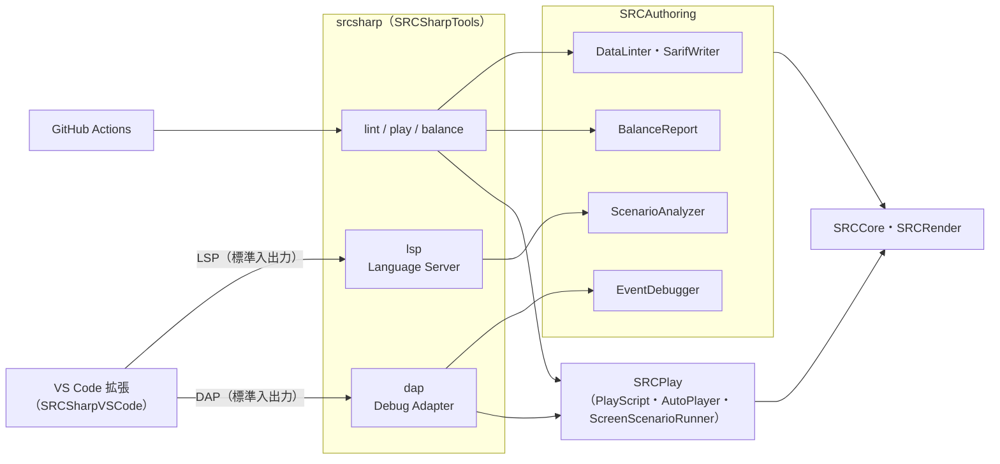

# 作成支援ツール（srcsharp・VS Code 拡張）

SRC のデータ・シナリオを作るための支援ツールの設計と使い方。データには lint とバランスの集計、シナリオには自動プレイとイベントのデバッガ（行単位）を用意する。

## 方針

処理はすべて SRC# のコア（.NET）で動く CLI `srcsharp` に置き、エディタとは標準のプロトコルでつなぐ。VS Code 拡張は、言語クライアントとデバッガの登録、構文の色分けだけを持つ薄い層にする。

- **Language Server Protocol（LSP）**：サーバーは LSP で通信できれば、どの言語で書いてもよい。LSP に対応した他のエディタでも使える（[Language Server Extension Guide](https://code.visualstudio.com/api/language-extensions/language-server-extension-guide)、[仕様 3.17](https://microsoft.github.io/language-server-protocol/specifications/lsp/3.17/specification/)）
- **Debug Adapter Protocol（DAP）**：デバッガは、標準入出力で DAP を話す外部の実行ファイルとして登録できる（[Debugger Extension](https://code.visualstudio.com/api/extension-guides/debugger-extension)、[仕様](https://microsoft.github.io/debug-adapter-protocol/specification)）

同じエンジンを CI・コマンドライン・エディタで使い回せる。将来は SRC#Web に Monaco を載せて、同じ LSP を使うこともできる。



## 構成

| プロジェクト | 内容 |
|---|---|
| `SRC.Sharp/SRCPlay` | シナリオを画面なしで動かし、`.play` スクリプトで自動プレイする部品（テストから切り出した） |
| `SRC.Sharp/SRCAuthoring` | lint・SARIF・シナリオ解析・バランス集計・LSP・DAP・イベントのデバッガ |
| `SRC.Sharp/SRCSharpTools` | CLI `srcsharp`（.NET tool） |
| `SRC.Sharp/SRCAuthoringTests` | 上の 2 つのテスト（LSP・DAP はパイプでつないで確かめる） |
| `SRC.Sharp/SRCSharpVSCode` | VS Code 拡張 |

SRCCore には、デバッガ用のフック `IEventDebugger`（`Event.Debugger`）を加えた。`CmdData.Exec` の先頭と、イベントのエラーを表示する時に呼ばれる。設定しなければ null の判定だけで、通常の実行には影響しない。

## CLI

```sh
dotnet tool install -g SRCSharpTools

srcsharp lint <ディレクトリかファイル>... [--format text|sarif] [--output ファイル]
srcsharp play <イベントファイル> [--script ファイル.play] [--out ディレクトリ] [--app-path SRCのフォルダ] [--steps 数]
srcsharp balance <ディレクトリかファイル>... [--format md|csv|weapons-csv] [--output ファイル]
srcsharp lsp
srcsharp dap
```

| コマンド | 内容 |
|---|---|
| `lint` | SRCDataLinter と同じ検査（データは種類ごとの読み込み処理、イベントは読み込みと構文の検査）。`--format sarif` で GitHub のコードスキャンに渡せる（[SARIF support for code scanning](https://docs.github.com/en/code-security/code-scanning/integrating-with-code-scanning/sarif-support-for-code-scanning)）。問題があれば終了コード 1 |
| `play` | シナリオを画面なしで動かす。`--script` の書式は [E2E テスト方針](../gui/e2e-testing.md) の PlayScript。無ければメッセージを送り、選択肢は先頭を選んで進める。`--out` にスナップショットを保存する |
| `balance` | unit.txt・robot.txt の能力値の一覧と、同じクラスのユニットの中での外れ値（\|z\| ≥ 2、5 体以上のクラス）。Markdown か CSV |

## エディタ（LSP）

| 機能 | 内容 |
|---|---|
| 診断 | イベントの読み込みエラー（構文・制御構造・引数）。書かれた Call・Goto の飛び先のラベルが無い（警告）。include するファイルが無い（警告）。保存前の内容で調べる |
| アウトライン | ラベル |
| 定義へ移動・ホバー | ラベル（include 先・システムの Lib を含む）。include の行からそのファイル |
| 補完 | コマンド名・ラベル |

解析は、エディタで開いているファイルの内容を重ねたファイルシステム（`OverlayFileSystem`）で、SRCCore の `Event.LoadEventData` を動かして行う。本体と同じ検査をそのまま使う。

- **シナリオのフォルダ**：src.ini か Data フォルダのある、いちばん近い親フォルダ
- **SRC 本体のフォルダ**：設定（`srcsharp.appPath`）が無ければ、シナリオのフォルダの親のうち、Lib か Data\System のあるもの。汎用戦闘アニメなどのシステムのラベルはここから読む
- **ラベルの検査から除くもの**
  - Talk の本文や Ask の選択肢（知らないコマンドの行は Call とみなされるため）
  - 変数に入れたラベル名（Set・Local・Global で値を入れた名前）
  - Require で（ファイル名を書いて）読み込むファイルにあるラベル

ロボダン（include 先を含めて約 19 万行）では、解析に 3〜4 秒かかる。誤検知は、別のモードのイベントファイルにだけあるラベルの 9 件（`ロボッとダンジョン.eve`）だった。解析は変更から 0.8 秒待って行い、同時には 1 つだけ動かす。

## デバッガ（DAP）

シナリオは画面なしで動かす（SRC#Avalonia などと同じ `ScreenGUI`）。入力は `.play` スクリプトで与える。無ければメッセージを送り、選択肢は先頭を選ぶ。

| 機能 | 内容 |
|---|---|
| ブレークポイント | イベントファイルの行（include 先も） |
| ステップ | ステップイン（次のコマンド）・ステップオーバー（同じか浅い Call の深さの次のコマンド）・ステップアウト（浅くなるまで） |
| 一時停止 | 次のコマンドで止める |
| エラーで止める | イベントのエラー（`DisplayEventErrorMessage`）で止める |
| スタック | 現在の行と、Call した行 |
| 変数 | ローカル（Local で作った変数と、イベントのローカル変数）・グローバル |
| 式の評価 | 止まっている時に、SRC の式として評価する |

止めている間はゲームスレッドが待つ。自動プレイ（`ScreenScenarioRunner.IsSuspended`）もその間は操作せず、待った時間は待ち時間に数えない。

`launch.json` の例：

```json
{
  "type": "srcsharp",
  "request": "launch",
  "name": "SRC# イベントを実行",
  "program": "${file}",
  "script": "${workspaceFolder}/test.play",
  "stopOnEntry": true
}
```

## VS Code 拡張

| 内容 | |
|---|---|
| 言語 | `src-eve`（`*.eve`）。文字コードの既定は Shift_JIS（自動判別あり） |
| 構文の色分け | TextMate 文法（コマンド・ラベル・include・文字列・`$(...)`・コメント） |
| 設定 | `srcsharp.serverPath`（既定 `srcsharp`）・`srcsharp.serverArgs`・`srcsharp.appPath` |
| コマンド | ワークスペースの lint・バランスレポート・このイベントの自動プレイ |

拡張のバージョン（`package.json`）は、`Directory.Build.props` のライブラリのバージョンに手で合わせる。

## 今後

| 項目 | 内容 |
|---|---|
| バランス：戦闘のシミュレーション | 指定した編成同士の戦闘を画面なしで多数回行い、勝率・ターン数を集計する（自動プレイの smart 方針を使う） |
| バランス：期待ダメージの表 | パイロットとユニットの組み合わせで、COM.SelectWeapon・ExpDamage による期待ダメージを一覧にする |
| エディタ：データの名前 | ユニット・パイロット・アイテムの名前の補完・ホバー・定義へ移動（データの読み込みを伴う） |
| エディタ：解析の高速化 | システムの Lib など、変わらない部分の解析結果を使い回す |
| デバッガ：画面 | 止まった時の画面を Webview に出す（`ScreenGUI.SnapshotPng`） |
| SRCDataLinter の統合 | `srcsharp lint` と同じ処理（`DataLinter`）を使う。描画の部品に依存しないように、lint を別のライブラリに分けてから行う |
| 拡張の公開 | Marketplace（または Open VSX）への公開と CI での .vsix の作成 |
| SRC#Web | Monaco と同じ LSP でブラウザ上の編集支援（[SRC#Web](../gui/web.md) の外部コンテンツ管理と合わせて） |
