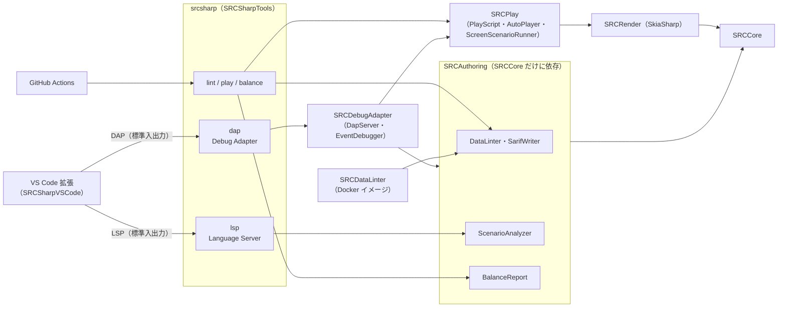

# 作成支援ツール（srcsharp・VS Code 拡張）

SRC のデータ・シナリオを作るための支援ツールの設計と使い方。データには lint とバランスの集計、シナリオには自動プレイとイベントのデバッガ（行単位）を用意する。

## 方針

処理はすべて SRC# のコア（.NET）で動く CLI `srcsharp` に置き、エディタとは標準のプロトコルでつなぐ。VS Code 拡張は、言語クライアントとデバッガの登録、構文の色分けだけを持つ薄い層にする。

- **Language Server Protocol（LSP）**：サーバーは LSP で通信できれば、どの言語で書いてもよい。LSP に対応した他のエディタでも使える（[Language Server Extension Guide](https://code.visualstudio.com/api/language-extensions/language-server-extension-guide)、[仕様 3.17](https://microsoft.github.io/language-server-protocol/specifications/lsp/3.17/specification/)）
- **Debug Adapter Protocol（DAP）**：デバッガは、標準入出力で DAP を話す外部の実行ファイルとして登録できる（[Debugger Extension](https://code.visualstudio.com/api/extension-guides/debugger-extension)、[仕様](https://microsoft.github.io/debug-adapter-protocol/specification)）

同じエンジンを CI・コマンドライン・エディタで使い回せる。将来は SRC#Web に Monaco を載せて、同じ LSP を使うこともできる。



## 構成

| プロジェクト | 内容 |
|---|---|
| `SRC.Sharp/SRCPlay` | シナリオを画面なしで動かし、`.play` スクリプトで自動プレイする部品（テストから切り出した） |
| `SRC.Sharp/SRCAuthoring` | lint・SARIF・シナリオ解析・バランス集計・LSP。SRCCore だけに依存する（描画の部品は使わない） |
| `SRC.Sharp/SRCDebugAdapter` | DAP・イベントのデバッガ。シナリオを画面なしで動かすため SRCPlay（SRCRender）に依存する |
| `SRC.Sharp/SRCSharpTools` | CLI `srcsharp`（.NET tool） |
| `SRC.Sharp/SRCAuthoringTests` | SRCAuthoring・SRCDebugAdapter のテスト（LSP・DAP はパイプでつないで確かめる） |
| `SRC.Sharp/SRCDataLinter` | 従来の lint の CLI と Docker イメージ。検査は SRCAuthoring の `DataLinter`（`srcsharp lint` と共通）で、出力の書式は従来どおり |
| `SRC.Sharp/SRCSharpVSCode` | VS Code 拡張 |

SRCCore には、デバッガ用のフック `IEventDebugger`（`Event.Debugger`）を加えた。`CmdData.Exec` の先頭と、イベントのエラーを表示する時に呼ばれる。設定しなければ null の判定だけで、通常の実行には影響しない。

## CLI

```sh
dotnet tool install -g SRCSharpTools

srcsharp lint <ディレクトリかファイル>... [--format text|sarif] [--output ファイル]
srcsharp play <イベントファイル> [--script ファイル.play] [--out ディレクトリ] [--app-path SRCのフォルダ] [--steps 数]
srcsharp balance <ディレクトリかファイル>... [--format md|csv|weapons-csv] [--output ファイル]
srcsharp lsp
srcsharp dap
srcsharp --version
```

| コマンド | 内容 |
|---|---|
| `lint` | SRCDataLinter と同じ処理で検査する（データは種類ごとの読み込み処理、イベントは読み込みと構文の検査）。`--format sarif` で GitHub のコードスキャンに渡せる（[SARIF support for code scanning](https://docs.github.com/en/code-security/code-scanning/integrating-with-code-scanning/sarif-support-for-code-scanning)）。問題があれば終了コード 1 |
| `play` | シナリオを画面なしで動かす。`--script` の書式は [E2E テスト方針](../gui/e2e-testing.md) の PlayScript。無ければメッセージを送り、選択肢は先頭を選んで進める。`--out` にスナップショットを保存する |
| `--version` | 版を出す（VS Code 拡張が表示に使う） |
| `balance` | unit.txt・robot.txt の能力値の一覧と、同じクラスのユニットの中での外れ値（\|z\| ≥ 2、5 体以上のクラス）。Markdown か CSV |

`srcsharp` は .NET tool（[.NET tools](https://learn.microsoft.com/dotnet/core/tools/global-tools)）で、リリースのタグで NuGet に公開する（[バージョンの管理](../versioning.md)）。NuGet に無い版は、リポジトリから作って入れる。

```sh
dotnet pack SRC.Sharp/SRCSharpTools/SRCSharpTools.csproj -c Release -o out/srcsharp
dotnet tool install -g SRCSharpTools --add-source out/srcsharp
```

表示の言語は `--lang ja|en|zh-Hans|…|auto`（値は [多言語対応](../i18n.md)）（どのコマンドでも、引数のどこに書いてもよい）か環境変数 `SRCSHARP_LANG` で切り替える。両方あれば `--lang` が優先。既定は日本語（`ja`）で、OS の言語には従わない。`auto` は OS の UI の言語（訳が無ければ日本語）。切り替わるのは使い方・件数などの人向けのメッセージだけで、SARIF・CSV・Markdown の出力と、lint の診断の文面は変わらない。文言は `SRCSharpTools/Resources/Strings.resx`（日本語）と `Strings.<カルチャ名>.resx`。Docker イメージでも、最初の引数を `--lang` にすれば `srcsharp` が動く。

```sh
srcsharp --lang en lint path/to/scenario
SRCSHARP_LANG=en srcsharp balance path/to/data
```

## Docker イメージ

検証用のイメージ `koudenpa/srcdatalinter`（`SRC.Sharp/SRCDataLinter/Dockerfile`）には、従来の SRCDataLinter と `srcsharp` の両方を入れる。

- 最初の引数が `srcsharp` のコマンド（`lint`・`play`・`balance`・`lsp`・`dap`・`help`）なら `srcsharp` を動かす。それ以外は従来どおり SRCDataLinter を動かす（`docker-entrypoint.sh`）
- シナリオを画面なしで動かすため、fontconfig と Noto Sans CJK（CI の VRT と同じフォント）を入れる
- CI（`docker-srcdatalinter`）で、イメージのビルドと、従来の lint・`srcsharp` の lint・play・balance を確かめる

```sh
docker run --rm -v /path/to/data:/app/data koudenpa/srcdatalinter data
docker run --rm -v /path/to/scenario:/s koudenpa/srcdatalinter play /s/test.eve --script /s/test.play --out /s/snapshots
```

## エディタ（LSP）

| 機能 | 内容 |
|---|---|
| 診断 | イベントの読み込みエラー（構文・制御構造・引数）。書かれた Call・Goto の飛び先のラベルが無い（警告）。include するファイルが無い（警告）。保存前の内容で調べる |
| アウトライン | ラベル |
| 定義へ移動・ホバー | ラベル（include 先・システムの Lib を含む）。include の行からそのファイル |
| 補完 | コマンド名・ラベル |

解析は、エディタで開いているファイルの内容を重ねたファイルシステム（`OverlayFileSystem`）で、SRCCore の `Event.LoadEventData` を動かして行う。本体と同じ検査をそのまま使う。

- **シナリオのフォルダ**：src.ini か Data フォルダのある、いちばん近い親フォルダ
- **SRC 本体のフォルダ**：設定（`srcsharp.appPath`）が無ければ、シナリオのフォルダの親のうち、Lib か Data\System のあるもの。汎用戦闘アニメなどのシステムのラベルはここから読む
- **ラベルの検査から除くもの**
  - Talk の本文や Ask の選択肢（知らないコマンドの行は Call とみなされるため）
  - 変数に入れたラベル名（Set・Local・Global で値を入れた名前）
  - Require で（ファイル名を書いて）読み込むファイルにあるラベル

ロボダン（include 先を含めて約 19 万行）では、解析に 3〜4 秒かかる。誤検知は、別のモードのイベントファイルにだけあるラベルの 9 件（`ロボッとダンジョン.eve`）だった。解析は変更から 0.8 秒待って行い、同時には 1 つだけ動かす。

## デバッガ（DAP）

シナリオは画面なしで動かす（SRC#Avalonia などと同じ `ScreenGUI`）。入力は `.play` スクリプトで与える。無ければメッセージを送り、選択肢は先頭を選ぶ。

| 機能 | 内容 |
|---|---|
| ブレークポイント | イベントファイルの行（include 先も） |
| ステップ | ステップイン（次のコマンド）・ステップオーバー（同じか浅い Call の深さの次のコマンド）・ステップアウト（浅くなるまで） |
| 一時停止 | 次のコマンドで止める |
| エラーで止める | イベントのエラー（`DisplayEventErrorMessage`）で止める |
| スタック | 現在の行と、Call した行 |
| 変数 | ローカル（Local で作った変数と、イベントのローカル変数）・グローバル |
| 式の評価 | 止まっている時に、SRC の式として評価する |
| 画面 | 独自のリクエスト `srcsharpScreen` に、最後に表示したフレーム（`ScreenGUI.SnapshotPng`）を base64 の PNG で返す。止まっている間も撮れる。シナリオが終わる時は、`terminated` の前に同じ名前のイベントで最後の画面を送る |
| 操作（`interactive`） | 自動の入力を動かさず、タブの操作で進める（`InteractiveScreen`）。表示が変わったらフレームを `srcsharpFrame` イベント（WebP、最大で約 15 枚／秒）で送る。`srcsharpInput` リクエスト（pointer・wheel・key）を ScreenGUI の操作にする（キーの割り当ては SRC#Web と同じ。止まっている間の押下は捨てる）。文字入力・ファイルの選択は `srcsharpPrompt` イベントで尋ね、`srcsharpPromptResult` リクエストで答えを受ける。`script` があれば `script` で動かす |
| ホットリロード | 独自のリクエスト `srcsharpReload`（events・data・images・cancel）で受け、結果を同じ名前のイベント（waiting・reloaded・failed・canceled）で送る（`HotReloader`）。イベント・データは、ゲームスレッドの処理が待ちのループの中でなく（`GameThread.IsTopLevel`）、味方フェイズでコマンドを待つ時に、`DumpData`（クイックセーブの形、メモリ）→ データの読み直し（`IncludeData`・`LoadLocalData`）→ `LoadEventData(…, "クイックロード")` → `RestoreData`（クイックロード）の順に行う。前にイベントは `ScenarioAnalyzer`、データは `DataLinter` で調べ、エラーなら読み直さない。画像は `ScreenGUI.ClearImageCache` ですぐ捨てる |
| SRC 本体のフォルダ | launch の `appPath`。無ければシナリオのフォルダの親のうち Lib か Data\System のあるもの、それも無ければシナリオのフォルダ。VS Code 拡張は `srcsharp.appPath` を渡す |

止めている間はゲームスレッドが待つ。自動プレイ（`ScreenScenarioRunner.IsSuspended`）もその間は操作せず、待った時間は待ち時間に数えない。

`launch.json` の例：

```json
{
  "type": "srcsharp",
  "request": "launch",
  "name": "SRC# イベントを実行",
  "program": "${file}",
  "script": "${workspaceFolder}/test.play",
  "stopOnEntry": true
}
```

## VS Code 拡張

| 内容 | |
|---|---|
| 言語 | `src-eve`（`*.eve`）。文字コードの既定は UTF-8（SRC# の推奨。自動判別ありで、Shift_JIS のファイルも開ける）。`src-data`（`robot.txt`・`pilot.txt` など SRC のデータのファイル名。`#` のコメントの色分けだけ） |
| 構文の色分け | TextMate 文法（コマンド・ラベル・include・文字列・`$(...)`・コメント） |
| 設定 | `srcsharp.serverPath`（既定 `srcsharp`。PATH と `~/.dotnet/tools` から探す）・`srcsharp.serverArgs`・`srcsharp.appPath`・`srcsharp.language`・`srcsharp.screen.autoOpen`。設定画面（Webview）でも書ける。変えると Language Server を起動し直す |
| 導入の支援 | srcsharp が無ければ `dotnet tool update -g SRCSharpTools` で入れる。dotnet が既定以外の場所なら `DOTNET_ROOT` を渡す。ワークスペースの中の SRC 本体のフォルダを `appPath` に勧める |
| 操作パネル | アクティビティバーの「SRC#」。状態（srcsharp の版・Language Server・SRC 本体のフォルダ）と操作を並べる |
| ホットリロード | デバッグ中のシナリオのフォルダと SRC 本体のフォルダの `*.eve`・`Data` の `*.txt`・画像の変化を見て、`srcsharpReload` を頼む（`srcsharp.hotReload`）。画面のタブとデバッグのツールバーに「読み直す」 |
| 画面 | デバッグ中のシナリオを Webview のタブで遊ぶ（launch の `interactive`）。フレームを受けて表示し、クリック・キー・ホイールを渡す。文字入力・ファイルの選択は VS Code の入力欄・ダイアログで尋ねる。`interactive` でなければ表示だけ（止まった時と実行中の 0.5 秒ごとに `srcsharpScreen` で取る） |
| コマンド | 開いているイベントの実行（画面付き）・デバッグ、画面の表示、ワークスペースの lint・バランスレポート・このイベントの自動プレイ、srcsharp を入れる／更新する |
| デバッガ | 型 `srcsharp`、`launch` だけ。属性は `program`（必須）・`script`・`appPath`・`stopOnEntry`・`maxSteps`（`script` が無いときの操作の上限） |
| 表示言語 | `srcsharp.language`（環境変数 `SRCSHARP_LANG` として渡す）か、`srcsharp.serverArgs` に `["--lang", "en"]` などを入れる。切り替わるのはコマンドの出力だけで、LSP の診断と DAP のメッセージは日本語のまま |
| 導入 | Marketplace の `koudenpa.src-vscode`（0.5.1 から正式版。0.5.0 はプレリリース）。CI の成果物 `src-vscode-vsix` か、`npm run package`（esbuild でまとめる）で作った `.vsix` も入れられる |

導入・設定・デバッガの構成・トラブルシューティングは [拡張の README](../../SRC.Sharp/SRCSharpVSCode/README.md) にまとめた。

拡張のバージョン（`package.json`）は、SRC# 本体とは別に上げる（[バージョンの管理](../versioning.md#vs-code-拡張)）。

## 今後

| 項目 | 内容 |
|---|---|
| バランス：戦闘のシミュレーション | 指定した編成同士の戦闘を画面なしで多数回行い、勝率・ターン数を集計する（自動プレイの smart 方針を使う） |
| バランス：期待ダメージの表 | パイロットとユニットの組み合わせで、COM.SelectWeapon・ExpDamage による期待ダメージを一覧にする |
| エディタ：データの名前 | ユニット・パイロット・アイテムの名前の補完・ホバー・定義へ移動（データの読み込みを伴う） |
| エディタ：解析の高速化 | システムの Lib など、変わらない部分の解析結果を使い回す |
| 画面：音 | `interactive` で、効果音・BGM を Webview の Web Audio で鳴らす |
| 拡張の公開 | Open VSX への公開（7474/SRC#1175）。Marketplace への公開と CI での .vsix の作成は済み |
| SRC#Web | Monaco と同じ LSP でブラウザ上の編集支援（[SRC#Web](../gui/web.md) の外部コンテンツ管理と合わせて） |
