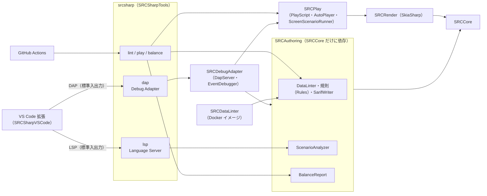

# 作成支援ツール（srcsharp・VS Code 拡張）

SRC のデータ・シナリオを作るための支援ツールの設計と使い方。データには lint（読み込みの誤りと、書き間違いを見つける規則）とバランスの集計、シナリオには自動プレイとイベントのデバッガ（行単位）を用意する。

## 方針

処理はすべて SRC# のコア（.NET）で動く CLI `srcsharp` に置き、エディタとは標準のプロトコルでつなぐ。VS Code 拡張は、言語クライアントとデバッガの登録、構文の色分けだけを持つ薄い層にする。

- **Language Server Protocol（LSP）**：サーバーは LSP で通信できれば、どの言語で書いてもよい。LSP に対応した他のエディタでも使える（[Language Server Extension Guide](https://code.visualstudio.com/api/language-extensions/language-server-extension-guide)、[仕様 3.17](https://microsoft.github.io/language-server-protocol/specifications/lsp/3.17/specification/)）
- **Debug Adapter Protocol（DAP）**：デバッガは、標準入出力で DAP を話す外部の実行ファイルとして登録できる（[Debugger Extension](https://code.visualstudio.com/api/extension-guides/debugger-extension)、[仕様](https://microsoft.github.io/debug-adapter-protocol/specification)）

同じエンジンを CI・コマンドライン・エディタで使い回せる。SRC#Web に Monaco を載せれば、同じ LSP を使うこともできる（未対応）。



## 構成

| プロジェクト | 内容 |
|---|---|
| `SRC.Sharp/SRCPlay` | シナリオを画面なしで動かし、`.play` スクリプトで自動プレイする部品。`SRCRenderTests` の E2E と共通 |
| `SRC.Sharp/SRCAuthoring` | lint・SARIF・シナリオ解析・バランス集計・LSP。SRCCore だけに依存する（描画の部品は使わない） |
| `SRC.Sharp/SRCDebugAdapter` | DAP・イベントのデバッガ。シナリオを画面なしで動かすため SRCPlay（SRCRender）に依存する |
| `SRC.Sharp/SRCSharpTools` | CLI `srcsharp`（.NET tool） |
| `SRC.Sharp/SRCHelpSearch` | `srcsharp help` の検索（全文検索・埋め込みのベクトルの検索）。実行するとヘルプの断片のベクトルを作る（`srcsharp` のビルドで使う） |
| `SRC.Sharp/SRCAuthoringTests` | SRCAuthoring・SRCDebugAdapter のテスト（LSP・DAP はパイプでつないで確かめる） |
| `SRC.Sharp/SRCDataLinter` | 従来の lint の CLI と Docker イメージ。検査は SRCAuthoring の `DataLinter`（`srcsharp lint` と共通）で、出力の書式は従来どおり |
| `SRC.Sharp/SRCLintWeb` | ブラウザで動く lint（WebAssembly、スレッドなし）。`srcsharp lint` と同じ `DataLinter` と、LSP と同じ静的解析（`ScenarioAnalyzer`。ラベル・include）と素材の参照（`AssetReferenceChecker`。画像・音・マップのファイルがあるか）で zip を検査する。投稿サイト（7474/SRC-Site）がアップロードの前に使う（`SRC.Sharp/SRCLintWeb/README.md`） |
| `SRC.Sharp/SRCSharpVSCode` | VS Code 拡張 |

SRCCore には、デバッガ用のフック `IEventDebugger`（`Event.Debugger`）がある。`CmdData.Exec` の先頭と、イベントのエラーを表示する時に呼ばれる。設定しなければ null の判定だけで、通常の実行には影響しない。

## CLI

```sh
dotnet tool install -g SRCSharpTools

srcsharp lint <ディレクトリかファイル>... [--format text|sarif] [--output ファイル] [--rules グループ,...|none] [--list-rules]
srcsharp play <イベントファイル> [--script ファイル.play] [--out ディレクトリ] [--app-path SRCのフォルダ] [--scenario-root シナリオのフォルダ] [--steps 数] [--skip-wait] [--seed 数] [--state ファイル]
srcsharp balance <ディレクトリかファイル>... [--format md|csv|weapons-csv] [--output ファイル]
srcsharp lsp
srcsharp dap
srcsharp help [項目] [--list] [--search 文字列 [--limit 数] [--method hybrid|bm25|vector]] [--grep 文字列] [--export ディレクトリ]
srcsharp --version
```

| コマンド | 内容 |
|---|---|
| `lint` | SRCDataLinter と同じ処理で検査する（データは種類ごとの読み込み処理、イベントは読み込みと構文の検査）。読み込めたデータには、`--rules` で選んだグループの規則もかける（下の「[データの規則](#データの規則)」。既定は `src`）。`--list-rules` は規則の一覧（ID・グループ・重さ・説明・出どころをタブで区切る）。`--format sarif` で GitHub のコードスキャンに渡せる（[SARIF support for code scanning](https://docs.github.com/en/code-security/code-scanning/integrating-with-code-scanning/sarif-support-for-code-scanning)。規則ごとに `rules` を出し、グループは `properties.tags`）。エラーか警告があれば終了コード 1（規則の「情報」は数えない） |
| `play` | シナリオを画面なしで動かす。`--script` の書式は [E2E テスト](../gui/e2e-testing.md) の PlayScript。無ければメッセージを送り、選択肢は先頭を選んで進める。`--out` にスナップショットを保存する。`--skip-wait` を付けると、決まった時間だけ待つ処理（戦闘アニメ、メッセージの表示時間、ユニットの移動、`Wait` や `Telop` など）を眠らずに飛ばし、その分だけ時計（`GeneralLib.timeGetTime`）を進める。入力を待つポーリングは実時間のまま。`--scenario-root` はシナリオのフォルダ（`Data`・`Lib`・`Continue` の基準）。無ければイベントファイルのあるフォルダで、そこに `Data`・`src.ini` が無ければ、それを持ついちばん近い親（`Data\System` のある SRC 本体のフォルダは除く）。シナリオのサブフォルダに置いた章を単体で動かすのに使う。`--seed` は乱数の種（省くと起動のたびに変わる）。同じ種・同じスクリプトなら毎回同じ結果になる。`--state` には、各話（イベントファイル）の終わりの状態（資金・ユニットとパイロットの一覧・グローバル変数・イベントのエラー）を書く（互換性の検証用のシナリオのゴールデンに使う。`SRC.Sharp/Compat/README.md`） |
| `help` | 同梱の [SRC# のヘルプ](../../SRC.Sharp.Help/README.md)（`SRC.Sharp.Help/src` の `*.md`、ビルドで srcsharp に埋め込む）を引く。項目はファイル名（`Askコマンド`・ページの中のリンク先の `Askコマンド.md#…` でもよい）か見出しで、大文字・小文字は区別しない。一致が無ければ前方一致（`Ask` → `Askコマンド`）、部分一致で探し、候補が複数なら一覧を出して終了コード 1。`--list` は項目の一覧（名前と見出しをタブで区切る）、`--search` は関連の高い順にページを出す（下の「ヘルプの検索」。ページごとに `項目<TAB>見出し<TAB>スコア` と、関係する行を `  行: 内容` で最大 3 行。`--limit` で件数、既定 10）、`--grep` は文字列を含む行を `項目:行: 内容` で出す、`--export` はすべてのページを元のファイル名で書き出す（AI のエージェントなどにリファレンスとして読ませる）。本文は日本語で、`--lang` では変わらない。項目を省くと使い方を出す |
| `--version` | 版を出す（VS Code 拡張が表示に使う） |
| `balance` | unit.txt・robot.txt の能力値の一覧と、同じクラスのユニットの中での外れ値（\|z\| ≥ 2、5 体以上のクラス）。Markdown か CSV。準拠データパックの水準との比較と組の評価は未対応（https://github.com/7474/SRC/issues/1607。過去の設計は [履歴](../history/tools/balance-pack.md)） |

`srcsharp` は .NET tool（[.NET tools](https://learn.microsoft.com/dotnet/core/tools/global-tools)）で、リリースのタグで NuGet に公開する（[バージョンの管理](../versioning.md)）。NuGet に無い版は、リポジトリから作って入れる。

```sh
dotnet pack SRC.Sharp/SRCSharpTools/SRCSharpTools.csproj -c Release -o out/srcsharp
dotnet tool install -g SRCSharpTools --add-source out/srcsharp
```

表示の言語は `--lang ja|en|zh-Hans|…|auto`（値は [多言語対応](../i18n.md)）（どのコマンドでも、引数のどこに書いてもよい）か環境変数 `SRCSHARP_LANG` で切り替える。両方あれば `--lang` が優先。既定は日本語（`ja`）で、OS の言語には従わない。`auto` は OS の UI の言語（訳が無ければ日本語）。切り替わるのは使い方・件数などの人向けのメッセージだけで、SARIF・CSV・Markdown の出力と、lint の診断の文面は変わらない。文言は `SRCSharpTools/Resources/Strings.resx`（日本語）と `Strings.<カルチャ名>.resx`。Docker イメージでも、最初の引数を `--lang` にすれば `srcsharp` が動く。

```sh
srcsharp --lang en lint path/to/scenario
SRCSHARP_LANG=en srcsharp balance path/to/data
```

### ヘルプの検索

`srcsharp help --search` は、全文検索とベクトルの検索の順位を Reciprocal Rank Fusion（各 50 件、k = 60）で合わせる（`--method hybrid`、既定）。`--method bm25`・`--method vector` でそれぞれだけにできる。

| 方法 | 内容 |
|---|---|
| 全文検索（`bm25`） | BM25。日本語は文字の 2-gram、英数字は単語で、全角の英数字は半角にそろえる。見出し・ファイル名の語は本文 5 回分に数える。索引は起動時にメモリに作る |
| ベクトルの検索（`vector`） | 埋め込みのモデル [ruri-v3-30m](https://huggingface.co/cl-nagoya/ruri-v3-30m)（Apache-2.0、256 次元）の int8 の ONNX（[onnx-community/ruri-v3-30m-ONNX](https://huggingface.co/onnx-community/ruri-v3-30m-ONNX)）。ヘルプを空行で区切った段落を約 300 文字ずつの断片（約 2,000 個）にし、見出しを付けて埋め込む。検索語は「検索クエリ: 」、断片は「検索文書: 」を前に付ける。ページの近さは断片のコサイン類似度の最大で、全件と比べる |

- 断片のベクトルは `srcsharp` のビルドで作り（`SRCHelpSearch` を実行する、数十秒）、`help-vectors.bin`（int8、約 0.6MB）として埋め込む。ヘルプか `SRCHelpSearch` が変わった時だけ作り直す
- モデル（`help-model/model_int8.onnx`・`tokenizer.model`、約 39MB）は `SRCHelpSearch` のビルドで Hugging Face から版を固定して取り、ハッシュを確かめて出力に置く。取れなければ（ネットワークが無いなど）警告にして、全文検索だけで作る。実行時にモデルか ONNX Runtime のネイティブのライブラリが無ければ（ONNX Runtime の無い osx-x64 など）、警告を出して全文検索だけで探す
- 推論は [ONNX Runtime](https://onnxruntime.ai/)（`Microsoft.ML.OnnxRuntime`）、トークナイザは `Microsoft.ML.Tokenizers` の `SentencePieceTokenizer`。.NET tool のパッケージには、使わない Android・iOS 用のライブラリとネイティブのライブラリのデバッグシンボルを入れない（NuGet.org の上限 250MB に収めるため。`SRCSharpTools.csproj` の `RemoveUnusedNativeFiles`）
- 方式の比較（25 問の自作の質問で、正解のページが 5 位以内に入った数）は、全文検索 20、ベクトル 20、ハイブリッド 24

## データの規則

読み込めたデータ（ユニット・パイロット・武器・アビリティ・メッセージ）にかける、書き間違いを見つける規則。エンジンと規則の定義は SRCAuthoring の 1 つ（`SRCAuthoring/Rules`）で、`srcsharp lint`・VS Code 拡張（Language Server）・ブラウザの lint（SRCLintWeb。7474/SRC-Site のチェッカー）が同じ診断を出す。方針は [判断の記録](../decisions/2026-11-13-authoring-tools-convergence.md)。

規則はグループ（タグ）で管理する。グループは規則の観点（誰の、何の基準か）を表し、1 つの規則は 1 つ以上のグループに入る。選んだグループのどれかに入る規則を 1 回ずつ動かす。

| グループ | 観点 | 既定 |
|---|---|---|
| `src` | SRC の仕様と食い違い、意図どおりに動かないデータ。根拠は元の SRC（`SRC/SRC_20121125`）の実装。すべて「情報」 | 動く |
| `gsc-robo`・`gsc-ext` | GSC データパックのロボ基準・拡張基準の書き方の決まり（等身データ指針・ロボット基準ローカルルールマニュアル・SRC-Data のデータ作成ガイドライン） | 選んだときだけ |
| `robodun` | ロボダン（ロボッとダンジョンＢ！）の `Lib\UnitChecker.eve` の観点。ロボダンの作者がロボダンのために決めた上限と決まりで、ほかの作品の基準ではない。値と判定は UnitChecker.eve（v13404b）のとおり。すべて「情報」 | 選んだときだけ |

| 選ぶ場所 | 書き方 |
|---|---|
| `srcsharp lint` | `--rules src,gsc-ext`（`none` で動かさない） |
| VS Code 拡張 | 設定 `srcsharp.rules`（既定 `["src"]`。設定画面の「データの規則」） |
| SRCLintWeb | `lintZip(zip, { rules: ['src'] })`（既定。`[]` で動かさない） |
| 7474/SRC-Site のチェッカー・投稿 | `src` だけ。「規則」として一覧に出し、投稿は止めない |

| ID | グループ | 重さ | 内容 |
|---|---|---|---|
| `unit-transportation-invalid` | `src`・`robodun` | 情報 | 移動可能地形に、空・陸・水・地中・宇宙・- 以外がある（その部分は無いものとして扱われる） |
| `unit-transportation-adaption` | `src`・`robodun` | 情報 | 移動可能地形に空・陸・水・宇宙があるのに、その地形の地形適応が -（その地形を移動できない） |
| `pilot-sp-duplicate` | `src` | 情報 | 1 人のパイロットが同じスペシャルパワーを重ねて持つ |
| `message-situation-unknown` | `src` | 情報 | メッセージのシチュエーションが、SRC が使うものでも、武器・アビリティ・特殊能力・スペシャルパワーの名前でもない（表示されない） |
| `weapon-range1-infight` | `gsc-robo`・`gsc-ext` | 警告 | 射程 1 の武器に格（射程 1 は格が無くても格闘として計算される） |
| `weapon-range2-shooting` | `gsc-robo`・`gsc-ext` | 警告 | 射程 2 以上の武器に射（射程 2 以上は射が無くても射撃として計算される） |
| `weapon-range1-p` | `gsc-robo`・`gsc-ext` | 情報 | 射程 1 の武器にＰ（射程 1 の武器は書かなくても移動後に使える） |
| `weapon-cross-range-shooting` | `gsc-robo`・`gsc-ext` | 情報 | 射程 2 以上で突・武・接があり、格・複が無い（射撃として計算される） |
| `weapon-beam-adaption` | `gsc-robo` | 情報 | 射程 2 以上のＢの武器で、地形適応が AA-A・AACA 以外 |
| `weapon-beam-melee` | `gsc-robo` | 情報 | 射程 1 の武器にＢ（ビーム剣にはＢを付けない） |
| `unit-air-adaption-nonflyer` | `gsc-ext` | 情報 | 飛べないユニットの空の適応が -（拡張基準では、ジャンプ力に合わせて B〜D にする） |
| `name-length` | `gsc-robo`・`gsc-ext` | 情報 | 名前が長い（パイロットの愛称 10 文字・ユニットの愛称 16 文字・武器名 14 文字まで） |
| `number-rounding` | `gsc-robo`・`gsc-ext` | 情報 | 数値の刻み（HP 100・EN 10・装甲 50・運動性 5・武器の攻撃力 100・消費 EN 5）に合わない |
| `pilot-sp-count` | `gsc-robo`・`gsc-ext` | 情報 | 名前付きのパイロット（名前に (ザコ)・(汎用) が無い）のスペシャルパワーが 6 つでない |
| `pilot-sp-level-pattern` | `gsc-robo`・`gsc-ext` | 情報 | スペシャルパワーを覚えるレベルが、すべて 5 の倍数か、間隔が一定 |
| `message-sp-situation` | `gsc-robo`・`gsc-ext` | 情報 | スペシャルパワーを使ったときのメッセージ（復活・自爆を除く）がある |
| `robodun-pilot-exp` | `robodun` | 情報 | パイロットの経験値が 200 を超える（ロボダンの上限） |
| `robodun-pilot-stat` | `robodun` | 情報 | パイロットの格闘・射撃・命中・回避が 165、技量が 190、反応が 170 を超える（ロボダンの上限） |
| `robodun-pilot-attack-sum` | `robodun` | 情報 | パイロットの格闘と射撃の合計が 300 を超える（ロボダンの上限） |
| `robodun-sp-firepower` | `robodun` | 情報 | スペシャルパワーの組み合わせで最大火力が 3 倍（熱血・奇襲・勇気・夢＋痛撃・闘志・夢）か 4.5 倍（魂・決意・捨て身・奇跡＋痛撃・闘志・夢）になる（ロボダンの決まり。ロボダンはユニットに乗る全員で見るが、ここではパイロット 1 人ずつ見る） |
| `robodun-sp-infinite` | `robodun` | 情報 | スペシャルパワーの組み合わせで無限コンボができる（自爆か夢＋祈りか再動。ロボダンの決まり） |
| `robodun-sp-combo` | `robodun` | 情報 | スペシャルパワーの組み合わせで強力なコンボができる（集中・ひらめき・捨て身・みがわり＋忍耐、捨て身＋復活。ロボダンの決まり） |
| `robodun-unit-exp` | `robodun` | 情報 | ユニットの経験値が 200 を超える（ロボダンの上限） |
| `robodun-unit-stat` | `robodun` | 情報 | ユニットの HP が 15000、EN が 300、装甲が 2500、運動性が 140、移動力が 7 を超える（ロボダンの上限） |
| `robodun-weapon-cross-range` | `robodun` | 情報 | 射程 2 以上の突・武・接の武器に、格・複が無い（ロボダンの観点） |
| `robodun-weapon-range2-shooting` | `robodun` | 情報 | 射程 2 以上の武器に射（ロボダン独自の属性「延」の武器を除く。ロボダンの観点） |
| `robodun-weapon-range1-infight` | `robodun` | 情報 | 射程 1 の武器に格（ロボダン独自の属性「延」の武器を除く。ロボダンの観点） |
| `robodun-weapon-range1-p` | `robodun` | 情報 | 射程 1 の武器にＰ（ロボダン独自の属性「延」の武器を除く。ロボダンの観点） |
| `robodun-weapon-beam-water` | `robodun` | 情報 | Ｂの武器の水の地形適応が A か B（ロボダンの観点） |

- 診断の場所は、データの定義のあるファイルと行（`SRCCore.Models.DataLocation`。名前の行と、移動可能地形・最大ＨＰ・地形適応・格闘・スペシャルパワーの欄の行、武器・アビリティ・メッセージの行）
- 検査するのは、検査の対象のファイルで定義されたデータだけ（先に読む汎用データ・SRC 本体の `Data\System` は調べない）
- GSC の射程・属性の規則はマップ兵器（Ｍ）を除く。属性は元の SRC の `IsWeaponClassifiedAs` と同じく、括弧の中を除いて含むかで決める
- `message-situation-unknown` は、元の SRC が `PilotMessage`・`IsMessageDefined` に渡すシチュエーションと、読み込んだデータの武器・アビリティ・特殊能力・スペシャルパワーの名前に無いものを知らせる。比べるのは半角の「(」の前。ユニットのデータを 1 つも読んでいなければ調べない
- `robodun` の SP の組み合わせは、UnitChecker.eve と違い、パイロット 1 人ずつ見る（データだけでは乗る人が分からないため）。乗っているパイロット数・最強の武器とパイロットの得意の食い違いは、データだけでは判定できないので入れない
- 意図したデータなら直さなくてよい。規則の「情報」は終了コードに数えないので、版を上げただけで既存の CI は落ちない

## Docker イメージ

検証用のイメージ `koudenpa/srcdatalinter`（`SRC.Sharp/SRCDataLinter/Dockerfile`）には、従来の SRCDataLinter と `srcsharp` の両方を入れる。

- タグ：`latest`・`v3.x.x` は正式版（タグの push のとき）。`dev` は開発版で、master にマージされるたびに入れ替わる（[バージョンの管理](../versioning.md)の「開発版」）。他のリポジトリの CI で最新の `srcsharp` を使うときは `dev` を使い、同じものを使い続けたいときは、開発版のリリースの `manifest.json` にあるダイジェストで固定する
- 最初の引数が `srcsharp` のコマンド（`lint`・`play`・`balance`・`lsp`・`dap`・`help`）か `--version` なら `srcsharp` を動かす。それ以外は従来どおり SRCDataLinter を動かす（`docker-entrypoint.sh`）
- シナリオを画面なしで動かすため、fontconfig と Noto Sans CJK（CI の VRT と同じフォント）を入れる
- ビルドのコンテキストはリポジトリのルート（`docker build -f SRC.Sharp/SRCDataLinter/Dockerfile .`）。`srcsharp help` のヘルプ（`SRC.Sharp.Help/src`）を含めるため。コンテキストに含めるものは `Dockerfile.dockerignore` で `SRC.Sharp` とヘルプに絞る
- CI（`docker-srcdatalinter`）で、イメージのビルドと、従来の lint・`srcsharp` の lint・play・balance・help を確かめる

```sh
docker run --rm -v /path/to/data:/app/data koudenpa/srcdatalinter data
docker run --rm -v /path/to/scenario:/s koudenpa/srcdatalinter play /s/test.eve --script /s/test.play --out /s/snapshots
docker run --rm -v /path/to/scenario:/s koudenpa/srcdatalinter:dev lint /s   # 開発版（master の最新）
```

## エディタ（LSP）

| 機能 | 内容 |
|---|---|
| 診断 | イベントの読み込みエラー（構文・制御構造・引数）。書かれた Call・Goto の飛び先のラベルが無い（警告）。include するファイルが無い（警告）。保存前の内容で調べる。データ（`robot.txt`・`pilot.txt` など）は、開いた・保存したときに、シナリオの `Data` のフォルダ（いちばん近い親の `Data`）を `srcsharp lint` と同じく調べ（読み込みの誤りと、初期化オプション `rules` のグループの規則）、ファイルごとに出す。規則の ID は `code`。SRC 本体の `Data\System` を先に読む |
| アウトライン | ラベル |
| 定義へ移動・ホバー | ラベル（include 先・システムの Lib を含む）。include の行からそのファイル |
| 補完 | コマンド名・ラベル |

解析は、エディタで開いているファイルの内容を重ねたファイルシステム（`OverlayFileSystem`）で、SRCCore の `Event.LoadEventData` を動かして行う。本体と同じ検査をそのまま使う。

- **シナリオのフォルダ**：src.ini か Data フォルダのある、いちばん近い親フォルダ
- **SRC 本体のフォルダ**：設定（`srcsharp.appPath`）が無ければ、シナリオのフォルダの親のうち、Lib か Data\System のあるもの。汎用戦闘アニメなどのシステムのラベルはここから読む
- **ラベルの検査から除くもの**
  - Talk の本文や Ask の選択肢（知らないコマンドの行は Call とみなされるため）
  - 変数に入れたラベル名（Set・Local・Global で値を入れた名前）
  - Require で（ファイル名を書いて）読み込むファイルにあるラベル

ロボダン（include 先を含めて約 19 万行）では、解析に 3〜4 秒かかる。誤検知は、別のモードのイベントファイルにだけあるラベルの 9 件（`ロボッとダンジョン.eve`）だった。解析は変更から 0.8 秒待って行い、同時には 1 つだけ動かす。

## デバッガ（DAP）

シナリオは画面なしで動かす（SRC#Avalonia などと同じ `ScreenGUI`）。入力は `.play` スクリプトで与える。無ければメッセージを送り、選択肢は先頭を選ぶ。

| 機能 | 内容 |
|---|---|
| ブレークポイント | イベントファイルの行（include 先も） |
| ステップ | ステップイン（次のコマンド）・ステップオーバー（同じか浅い Call の深さの次のコマンド）・ステップアウト（浅くなるまで） |
| 一時停止 | 次のコマンドで止める |
| エラーで止める | イベントのエラー（`DisplayEventErrorMessage`）で止める |
| スタック | 現在の行と、Call した行 |
| 変数 | ローカル（Local で作った変数と、イベントのローカル変数）・グローバル |
| 式の評価 | 止まっている時に、SRC の式として評価する |
| 画面 | 独自のリクエスト `srcsharpScreen` に、最後に表示したフレーム（`ScreenGUI.SnapshotPng`）を base64 の PNG で返す。止まっている間も撮れる。シナリオが終わる時は、`terminated` の前に同じ名前のイベントで最後の画面を送る |
| 操作（`interactive`） | 自動の入力を動かさず、タブの操作で進める（`InteractiveScreen`）。表示が変わったらフレームを `srcsharpFrame` イベント（WebP、最大で約 15 枚／秒）で送る。`srcsharpInput` リクエスト（pointer・wheel・key）を ScreenGUI の操作にする（キーの割り当ては SRC#Web と同じ。止まっている間の押下は捨てる）。文字入力・ファイルの選択は `srcsharpPrompt` イベントで尋ね、`srcsharpPromptResult` リクエストで答えを受ける。`script` があれば `script` で動かす |
| ホットリロード | 独自のリクエスト `srcsharpReload`（events・data・images・cancel）で受け、結果を同じ名前のイベント（waiting・reloaded・failed・canceled）で送る（`HotReloader`）。イベント・データは、ゲームスレッドの処理が待ちのループの中でなく（`GameThread.IsTopLevel`）、味方フェイズでコマンドを待つ時に、`DumpData`（クイックセーブの形、メモリ）→ データの読み直し（`IncludeData`・`LoadLocalData`）→ `LoadEventData(…, "クイックロード")` → `RestoreData`（クイックロード）の順に行う。前にイベントは `ScenarioAnalyzer`、データは `DataLinter` で調べ、エラーなら読み直さない。画像は `ScreenGUI.ClearImageCache` ですぐ捨てる |
| SRC 本体のフォルダ | launch の `appPath`。無ければシナリオのフォルダの親のうち Lib か Data\System のあるもの、それも無ければシナリオのフォルダ。VS Code 拡張は `srcsharp.appPath` を渡す |

止めている間はゲームスレッドが待つ。自動プレイ（`ScreenScenarioRunner.IsSuspended`）もその間は操作せず、待った時間は待ち時間に数えない。

`launch.json` の例：

```json
{
  "type": "srcsharp",
  "request": "launch",
  "name": "SRC# イベントを実行",
  "program": "${file}",
  "script": "${workspaceFolder}/test.play",
  "stopOnEntry": true
}
```

## VS Code 拡張

| 内容 | |
|---|---|
| 言語 | `src-eve`（`*.eve`）。文字コードの既定は UTF-8（SRC# の推奨。自動判別ありで、Shift_JIS のファイルも開ける）。`src-data`（`robot.txt`・`pilot.txt` など SRC のデータのファイル名。`#` のコメントの色分けだけ） |
| 構文の色分け | TextMate 文法（コマンド・ラベル・include・文字列・`$(...)`・コメント） |
| 設定 | `srcsharp.serverPath`（既定 `srcsharp`。PATH と `~/.dotnet/tools` から探す）・`srcsharp.serverArgs`・`srcsharp.appPath`・`srcsharp.rules`（データの規則のグループ）・`srcsharp.language`・`srcsharp.screen.autoOpen`。設定画面（Webview）でも書ける。変えると Language Server を起動し直す |
| 導入の支援 | srcsharp が無ければ `dotnet tool update -g SRCSharpTools` で入れる。dotnet が既定以外の場所なら `DOTNET_ROOT` を渡す。ワークスペースの中の SRC 本体のフォルダを `appPath` に勧める |
| 操作パネル | アクティビティバーの「SRC#」。状態（srcsharp の版・Language Server・SRC 本体のフォルダ）と操作を並べる |
| ホットリロード | デバッグ中のシナリオのフォルダと SRC 本体のフォルダの `*.eve`・`Data` の `*.txt`・画像の変化を見て、`srcsharpReload` を頼む（`srcsharp.hotReload`）。画面のタブとデバッグのツールバーに「読み直す」 |
| 画面 | デバッグ中のシナリオを Webview のタブで遊ぶ（launch の `interactive`）。フレームを受けて表示し、クリック・キー・ホイールを渡す。文字入力・ファイルの選択は VS Code の入力欄・ダイアログで尋ねる。`interactive` でなければ表示だけ（止まった時と実行中の 0.5 秒ごとに `srcsharpScreen` で取る） |
| コマンド | 開いているイベントの実行（画面付き）・デバッグ、画面の表示、ワークスペースの lint・バランスレポート・このイベントの自動プレイ、srcsharp を入れる／更新する |
| デバッガ | 型 `srcsharp`、`launch` だけ。属性は `program`（必須）・`script`・`appPath`・`scenarioRoot`（シナリオのフォルダ。無ければ `program` のあるフォルダ、そこに `Data` が無ければ `Data` のある親）・`interactive`・`stopOnEntry`・`skipWait`（ウェイトを飛ばす）・`policy`・`turns`（`script` も `interactive` も無いときの味方フェイズの方針と上限）・`logLevel` |
| 表示言語 | `srcsharp.language`（環境変数 `SRCSHARP_LANG` として渡す）か、`srcsharp.serverArgs` に `["--lang", "en"]` などを入れる。切り替わるのはコマンドの出力だけで、LSP の診断と DAP のメッセージは日本語のまま |
| 導入 | Marketplace の `koudenpa.src-vscode`（版は srcsharp と同じ）。CI の成果物 `src-vscode-vsix` か、`npm run package`（esbuild でまとめる）で作った `.vsix` も入れられる |

導入・設定・デバッガの構成・トラブルシューティングは [拡張の README](../../SRC.Sharp/SRCSharpVSCode/README.md) にある。

拡張のバージョン（`package.json`）はライブラリ（srcsharp）と同じにし、手で上げる（[バージョンの管理](../versioning.md#vs-code-拡張)）。

## 未対応

| 項目 | 内容 |
|---|---|
| データの規則：パックの水準 | 準拠するパックの同じ層の実態との比較、役割表、組の評価、作品ごとの値で調べるパック定義（https://github.com/7474/SRC/issues/1607。試作は `tools/pack-stats`・`tools/pack-analysis` で、結果は 7474/SRC-Data の GitHub Pages にある） |
| バランス：戦闘のシミュレーション | 指定した編成同士の戦闘を画面なしで多数回行い、勝率・ターン数を集計する（自動プレイの smart 方針を使う） |
| バランス：期待ダメージの表 | パイロットとユニットの組み合わせで、COM.SelectWeapon・ExpDamage による期待ダメージを一覧にする |
| エディタ：データの名前 | ユニット・パイロット・アイテムの名前の補完・ホバー・定義へ移動（データの読み込みを伴う） |
| エディタ：解析の高速化 | システムの Lib など、変わらない部分の解析結果を使い回す |
| 画面：音 | `interactive` で、効果音・BGM を Webview の Web Audio で鳴らす |
| 拡張の公開 | Open VSX への公開（7474/SRC#1175）。`Publish-VSCode.yml` は Secrets に `OVSX_PAT` があるときだけ出す |
| SRC#Web | Monaco と同じ LSP でブラウザ上の編集支援（[SRC#Web](../gui/web.md) の外部コンテンツ管理と合わせて） |
