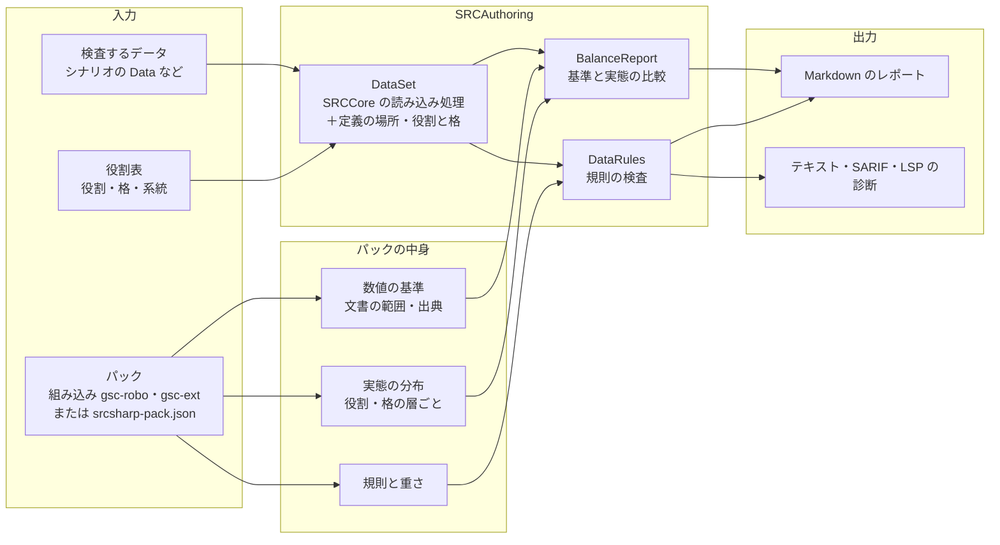

# 準拠データパックに応じたバランスの検査（設計） / Data-Pack Balance Rules (Design)

- 状態: 設計（未実装）
- 関係する Issue: https://github.com/7474/SRC/issues/1388

`srcsharp balance` に、シナリオが準拠しているデータパックを指定するオプションを加える。データの基準の実態は GSC（SRC 総合支援センター）のデータパックの「ロボ基準」と「拡張基準」なので、この 2 つを組み込みのパックとして持つ。

パックで扱うものは 2 種類に分ける。

| 種類 | 例 | 扱い |
|---|---|---|
| **数値**（能力値・攻撃力などの範囲） | HP、EN、格闘、SP | まず **基準と実態を比べるレポート** にする。検査（警告）にはしない。妥当な値はユニット・パイロットの **役割と格** で大きく違うので、役割と格で層に分けずに集計した統計は出さない |
| **規則**（書き方の決まり） | 射程 1 に格を付けない、名前の長さ | 規則の検査にする。重さは、パックのデータで守られている率で決める |

SRC の仕様と食い違うデータの検査は、パックによらないので `srcsharp lint` に入れる。

## 利用者から見た使い方

利用者向けの説明は [データの水準の確かめ方と組の評価（利用者向け）](./balance-pack-guide.md) にある。この設計を変えたときは、利用者向けの説明も合わせて直す。

## 範囲

- 組み込みのパックは GSC のロボ基準（`gsc-robo`）と拡張基準（`gsc-ext`）。巨大はデータが少ないので扱わない
- 作品独自のパック（ロボダンなど）は同梱しない。必要な人がパック定義（JSON）を書く
- 組み込む先は `srcsharp`（CLI）、7474/SRC-Site のチェッカー（SRCLintWeb）、VS Code 拡張まで

## 背景

### 発端

ロボダン（ロボッとダンジョンＢ！）は `Lib\UnitChecker.eve` で、ゲームの中でユニット 1 体ずつ、バランスとデータの指定のありがちな誤りを調べている（#1388）。ロボダンのデータ（ユニット 4,683、パイロット 2,171）に試作の検査をかけると、閾値（格闘＋射撃 > 300 など）はロボダン自身のデータも超えていた（味方だけで 157 件）。数値の閾値はパックに足すデータへの注意で、パックごと・範囲（味方・敵・ボス）ごとに違う。

### 基準の出どころ

GSC データパック（`GSC_data_full20240307.zip`）の `text` フォルダに、基準の文書が入っている。データ（robot.txt・unit.txt・pilot.txt の 1,921 ファイル）は、[7474/SRC-Data](https://github.com/7474/SRC-Data) の `GSCデータパック` と文字コード（SRC-Data は UTF-8 に変換済み）を除いて同じ。

| 文書 | 数値 | 規則 |
|---|---|---|
| `ＧＳＣロボット基準データローカルルールマニュアルl.txt`（2005 年度版） | — | Ｂの地形適応（粒子ビーム `AA-A`、レーザー `AACA`）、ビーム剣にＢを付けない |
| `等身データ指針.txt` | — | 名前の長さ（パイロット愛称 10・ユニット愛称 16・武器名 12〜14）、姓名を「＝」でつなぐ、射程 1 に格を付けない、射程 2 以上に射を付けない、射程 2 以上の突・武には格も要る、飛べないユニットも空の適応を B〜C にする |
| `戦艦データ指針.txt` | サイズごとの HP・EN の上限、装甲・運動性・移動力・射程・攻撃力の目安（戦艦の作品だけ） | — |
| [データ作成ガイドライン](https://github.com/7474/SRC-Data/blob/master/docs/%E3%83%87%E3%83%BC%E3%82%BF%E4%BD%9C%E6%88%90%E3%82%AC%E3%82%A4%E3%83%89%E3%83%A9%E3%82%A4%E3%83%B3.md)（SRC-Data） | ロボ・拡張ごとの、キャラクターの格（主人公格〜名前なし）・系統（スーパー・リアル・グレー）ごとの能力値・攻撃力の範囲 | 上の文書の決まりのまとめ |

格と系統はデータに書かれていないので、ガイドラインの格・系統ごとの範囲は、作者が格・系統を書いたデータとしか比べられない（下の「役割と格の決め方」）。

### パック内のデータの実態

GSC データパックのデータを SRCCore の読み込み処理で集計した。

| | ロボ | 拡張 |
|---|--:|--:|
| ユニット | 14,033 | 28,618 |
| パイロット（戦闘のステータスがあるもの） | 6,150 | 13,536 |
| 武器 | 48,284 | 101,517 |

**規則が守られている率**

| 規則 | ロボ | 拡張 | 読み取れること |
|---|--:|--:|---|
| 射程 1 に格 | 41 / 18,531（0.2%） | 57 / 47,127（0.1%） | ほぼ守られている。外れは誤りである見込みが高い |
| 射程 2 以上に射 | 28 / 29,753（0.1%） | 26 / 54,390（0.05%） | 同上 |
| 射程 1 にＰ | 19 / 18,531 | 25 / 47,127 | 同上 |
| 射程 2 以上の突・武・接に格・複が無い | 108 / 529（20%） | 516 / 5,275（10%） | 外れも多い。接（射撃＋近接の複合技にも付く）など、意図した射撃扱いがある |
| 移動可能地形があるのに地形適応が `-` | 184 / 14,033 | 44 / 28,618 | 少数。誤りである見込みが高い |
| 移動可能地形が不正 | 0 | 3（`陸地`・`地`） | 誤り |
| Ｂ（射程 2 以上）の地形適応 | `AA-A` 6,136・`AACA` 1,744・`AAAA` 451・`AABA` 385 | `AACA` 1,883・`AA-A` 1,107・`AABA` 774・`AAAA` 688 | ロボは文書の決まりが主。拡張では水が A・B のものが 31% あり、決まりとしては弱い |
| 飛べないユニットの空の適応 | `-` 6,169・B 711・C 361・A 273 | B 11,844・C 8,858・A 1,664・`-` 1,153 | 等身データ指針のとおり、ロボと拡張で逆 |
| パイロット愛称 > 10 文字 | 49 / 6,322 | 56 / 13,710 | ほぼ守られている |
| 武器名 > 14 文字 | 361 / 48,284 | 281 / 101,517 | ほぼ守られている |
| パイロット名に「・」 | 243 | 948 | 外れも多い |

**役割と格の手がかり**

データには格（主人公格〜名前なし）も系統（スーパー・リアル・グレー）も書かれていない。データの中にある手がかりと、それで層に分けたときの値は次のとおり（P10/P50/P90）。

| 手がかり | 分かること | 使えるか |
|---|---|---|
| パイロット名の `(ザコ)`・`(汎用)` | 名前なし | 使える（ロボ 931・拡張 2,343） |
| パイロットのクラスの「サポート」 | サポートパイロット（戦闘のステータスが 1） | 使える（ロボ 370・拡張 286） |
| ユニットの特殊能力「母艦」、パイロットのクラス「戦艦」 | 戦艦・艦長 | 使える（母艦はロボ 838・拡張 237） |
| パイロット・ユニットの経験値（撃破されたときに相手が得る経験値） | 作者が付けた重要度。格の代わりの目印になる（下の表） | 目印としては使える。ただし帯は重なり、作者・作品で付け方が違う |
| ユニット名とパイロット名の一致 | パイロットと乗るユニットの組（拡張は「ユニット＝変身後の姿・戦闘形態」なので名前が一致しやすい） | 拡張では使える（下の表）。ロボでは使えない |
| `#推奨ユニット` のコメント | パイロットと乗るユニットの組 | 使えない（ロボの 313 作品のうち 11 作品だけ、拡張は 0） |
| 系統（スーパー・リアル・グレー） | — | データからは分からない。能力値から推すと、比べたい値で分類することになり循環する |

ロボのパイロットを経験値で分けた結果（拡張も同じ傾向）。

| 層 | 件数 | 格闘＋射撃 | 技量 | SP | 魂か覚醒を持つ | 性格が強気・超強気 |
|---|--:|---|---|---|--:|--:|
| 名前なし（`(ザコ)`・`(汎用)`） | 931 | 230/253/281 | 130/140/160 | 0/30/40 | 1% | 16% |
| 経験値 200 以上 | 919 | 271/295/309 | 161/172/184 | 40/55/65 | 29% | 68% |
| 経験値 180〜199 | 1,057 | 265/289/302 | 159/171/181 | 40/55/60 | 19% | 68% |
| 経験値 160〜179 | 1,482 | 256/280/295 | 158/167/175 | 40/50/60 | 10% | 59% |
| 経験値 120〜159 | 1,339 | 239/270/289 | 152/163/172 | 40/50/55 | 6% | 48% |
| 経験値 120 未満 | 224 | 213/250/275 | 135/150/163 | 0/40/50 | 2% | 30% |

ロボのユニットを経験値で分けた結果。

| 層 | 件数 | HP | 装甲 | 運動性 | 最大攻撃力 |
|---|--:|---|---|---|---|
| 母艦 | 838 | 6,000/10,000/25,000 | 800/1,100/1,500 | 40/50/65 | 1,200/1,700/2,600 |
| 経験値 100 以上 | 7,190 | 3,000/4,300/9,300 | 800/1,200/1,600 | 55/85/110 | 1,300/1,900/2,800 |
| 経験値 70〜99 | 2,991 | 2,500/3,500/7,200 | 700/1,000/1,300 | 50/75/95 | 1,200/1,500/1,900 |
| 経験値 40〜69 | 2,370 | 2,000/3,000/5,200 | 500/800/1,100 | 50/70/90 | 1,000/1,400/1,700 |
| 経験値 40 未満 | 656 | 600/2,000/3,000 | 200/600/800 | 30/55/90 | 0/1,100/1,450 |

名前付きの戦闘パイロット（名前なし・サポートを除く）と、名前の一致するユニットの組。

| | 拡張 | ロボ |
|---|--:|--:|
| 名前付きの戦闘パイロット | 11,081 | 5,021 |
| 同名のユニットがある | 9,802（88%） | 784（16%） |
| 同じ作品に、括弧書き（`(…)`）を除いた名前が同じユニットがある | 10,255（93%）。候補は P50 で 1 件、P90 で 2 件 | 892（18%） |

拡張で同名のユニットと組めたものを、パイロットの経験値で分けた結果（P10/P50/P90）。実効性能の目安は、ガイドラインの「実効性能を決める要素」の第一（最強武器の攻撃力 × パイロットの格闘・射撃）を、最大攻撃力 × 格闘と射撃の高い方 ÷ 100 で表したもの。

| パイロットの経験値 | 組 | ユニットの HP | 最大攻撃力 | 実効性能の目安 |
|---|--:|---|---|---|
| 200 以上 | 868 | 3,000/4,500/9,800 | 1,200/1,800/2,500 | 1,885/2,844/3,840 |
| 180〜199 | 1,535 | 3,100/4,100/6,100 | 1,300/1,800/2,300 | 1,885/2,682/3,624 |
| 160〜179 | 2,648 | 3,000/3,800/5,200 | 1,200/1,700/2,100 | 1,788/2,484/3,213 |
| 120〜159 | 4,388 | 2,800/3,600/5,000 | 1,100/1,500/2,000 | 1,529/2,175/2,900 |
| 120 未満 | 363 | 2,300/3,400/5,100 | 300/1,300/1,700 | 357/1,716/2,368 |

経験値の高い層ほど能力値が高く、魂・覚醒を持つ割合と強気の性格が多い。ガイドラインの「主人公格は実効性能が最も高い・覚醒や魂を持つ・強気が多い」と合う。一方で、帯の間の重なりは大きい（格闘＋射撃の P10〜P90 が隣の帯と重なる）。

ここから次のことが言える。

1. 文書の規則でも、守られている率に差がある。規則の重さの既定は、この率で決める
2. ロボと拡張で逆の決まりがある。パックを決めずに一律に調べることはできない
3. 数値は役割と格で大きく違う。役割と格を混ぜた分布や範囲（全データの P99、格をまとめたガイドラインの外枠）と比べても、妥当かどうかは判断できない
4. 役割（名前なし・サポート・戦艦）はデータから分かる。格は経験値が目印になるが推定にとどまり、系統は分からない。確かな格・系統は、作者が書くしかない
5. 拡張では、パイロットと乗るユニットの組が名前の一致でほぼ分かる。組が分かれば、ユニットをパイロットの格（経験値）で分けられ、組としての実効性能も比べられる。ロボでは組は分からない
6. 格は作品の中での相対的なもの（ガイドライン）なので、作品の中で比べることにも意味がある（主人公格の実効性能が作品内で最も高いか、など）

## 全体



- 数値の比較（`BalanceReport`）は Markdown のレポートにだけ出し、診断（警告）にはしない
- 規則の検査（`DataRules`）は `SRCAuthoring/Analysis` に新しく作り、`balance` と `lint` の両方から使う
- 規則は「SRC の仕様」の組（`src`）と、パックが有効にする組に分ける。`lint` は `src` の組だけを動かす

## 数値: 役割と格で層に分けた、基準と実態の比較レポート

### 役割と格の決め方

ユニット・パイロットごとに「役割」と「格」を決め、比べるのは同じ役割・格の中だけにする。決め方は、作者が書いたもの（宣言）を優先し、無ければデータの手がかりから推す（推定）。レポートには、どちらで決めたかを必ず書く。

| 区分 | 値 | 宣言 | 推定 |
|---|---|---|---|
| 役割（パイロット） | 戦闘・艦長・サポート・名前なし・追加パイロット | 役割表 | ユニットの特殊能力「追加パイロット」「暴走時パイロット」で使われる → 追加パイロット（単独では比べない。「ＳＰなし」のものが多い）、名前の `(ザコ)`・`(汎用)` → 名前なし、クラスの「サポート」→ サポート、クラスの「戦艦」→ 艦長、ほかは戦闘 |
| 役割（ユニット） | 機体・戦艦 | 役割表 | 特殊能力「母艦」→ 戦艦 |
| 格 | 主人公格・準主役格・サブキャラ格・端役格・名前なし（ガイドラインの 5 段階） | 役割表 | 推さない。代わりに経験値の帯（パックごとに区切りを決める）で層に分け、「格の推定ではなく経験値の帯」と書く |
| 系統（ユニット） | スーパー・リアル・グレー | 役割表 | 推さない（能力値から推すと循環する）。宣言が無ければ系統で分けない |
| サイズ（ユニット） | SS〜XL | — | データのとおり |
| 組（パイロットと乗るユニット） | ユニットの名前 | 役割表 | 拡張: 同名のユニット、無ければ同じ作品で括弧書きを除いた名前が同じユニット。ロボ: クラスの一致（作品の中で、経験値の高いパイロットから順に、乗れるユニットのうち経験値の高いものを 1 機ずつ。名前なしは経験値の最も低いもの）。どちらも、変形・換装・ハイパーモード・他形態でたどれる形態のうち最も強いもの（経験値・最大攻撃力・HP の順）を使う。追加パイロット・暴走時パイロットを持つユニットは自動では組にしない |
| ユニットの格 | パイロットと同じ | 役割表 | 組のパイロットの格（宣言）か経験値の帯を引き継ぐ。組が無ければユニットの経験値の帯 |

- **役割表**は、名前と役割・格・系統・乗るユニットを対応させる表（CSV か、パック定義の `roles`）。作品のフォルダに置く。データの書式（unit.txt・pilot.txt）は変えない。役割には、組を作らない「サブ」（乗るユニットのサブパイロット）と「ボス」（組の評価のボス戦の相手）も書ける
- 経験値の帯の区切りは、組み込みのパックではパックのデータを見て決める（上の表のロボなら 200・180・160・120）。帯と格は対応させない（同じ帯に複数の格が混ざる）

### 比べるもの

レポートの表は、すべて「パック × 役割 × 格（または経験値の帯）」で分けて出す。ユニットはさらにサイズ、宣言があれば系統で分ける。分けない全体の集計は出さない。

| 列 | 内容 |
|---|---|
| 層 | パック・役割・格（宣言か、経験値の帯か）・サイズ・系統 |
| 基準 | その層に対応する基準の範囲と出典。ガイドラインの格・系統ごとの範囲は、格・系統を宣言した層にだけ当てる。経験値の帯の層には当てない |
| パックの実態 | パックのデータのその層の分布（件数・P10・P50・P90） |
| 検査するデータ | 検査するデータのその層の分布と、基準の範囲・パックの実態の P10〜P90 を外れたものの名前 |

- 件数が少ない層（既定 20 件未満）は分布を出さず、件数と値の一覧だけを出す
- 戦艦データ指針の上限は、役割が戦艦の層にだけ当てる

### 作品の中での比較

格は作品の中での相対的なもの（ガイドライン）なので、作品（データのフォルダ）ごとに次を出す。

- パイロットを格（宣言）か経験値の順に並べ、格闘＋射撃・技量・SP・魂や覚醒の有無・性格を並べた表
- 格（宣言）や経験値が上の組が、下の組に全ての使いどころ（下の「組の評価」）で並ばれるか上回られているもの（逆転）。ガイドラインの「主人公格は実効性能が最も高い」の確認に使う。役割の違う組（支援役とアタッカー）を一つの値で比べないよう、全ての使いどころで劣る場合だけを逆転とする。逆転は情報として出すだけで、誤りとはしない

組（パイロットと乗るユニット）が分かれば、組としての実効性能の目安（最大攻撃力 × 格闘と射撃の高い方 ÷ 100）と、ユニットの HP・装甲・運動性も並べ、逆転を見る。拡張では名前の一致で組が分かるので、役割表が無くても出せる。ロボのクラスの一致は推定で、作品の設定と合わない組（司令官が機体に乗る、生身のユニットと組になるなど）もあるので、ロボは役割表を書くのを前提にし、レポートに組の決め方を必ず出す。

### 基準の書き方

パックの基準は、層を指定して書く。

```json
"basis": [
  {
    "source": "データ作成ガイドライン 2.1",
    "target": "pilot",
    "where": { "role": "戦闘", "rank": "主人公格" },
    "values": { "格闘": [150, 170], "射撃": [125, 165], "命中": [135, 155], "回避": [130, 165], "技量": [170, 190], "反応": [155, 170], "SP": [50, 80] }
  },
  {
    "source": "データ作成ガイドライン 2.2",
    "target": "unit",
    "where": { "role": "機体", "line": "スーパー" },
    "values": { "HP": [4500, 8000], "EN": [100, 250], "装甲": [1200, 2500], "運動性": [40, 70] }
  },
  {
    "source": "戦艦データ指針",
    "target": "unit",
    "where": { "role": "戦艦", "size": "M" },
    "values": { "HP": [null, 6000], "EN": [null, 200] }
  }
]
```

- `where` に書ける条件は、役割（`role`）・格（`rank`）・系統（`line`）・サイズ（`size`）・範囲（`scope`）
- 組み込みのパックには、データ作成ガイドラインの格・系統ごとの範囲と、戦艦データ指針の上限を、出典つきで入れる。役割と格を混ぜた外枠は入れない

### 進め方への影響

組み込みのパックで基準と実態を比べられるのは、役割表のある作品だけになる。GSC のデータには役割表が無いので、まず次を行う。

1. 役割（名前なし・サポート・戦艦）と経験値の帯で層に分けたパックの実態を出す（役割表が無くても出せる）。拡張は名前の一致で組を作り、ユニットもパイロットの経験値の帯で分ける
2. いくつかの作品で役割表を作り（格・系統、ロボは乗るユニットも）、ガイドラインの範囲とその作品の実態を比べる。作品はロボ・拡張それぞれ、スーパー系・リアル系の代表的なものを選ぶ
3. 比べた結果で、ガイドラインの範囲を直すか、役割表を広げるかを決める

## 組の評価（遊び）

ユニットとパイロットの組を、使いどころごとに評価してカードにする。バランスの検査ではなく、データを眺めて楽しむ・組み合わせを考えるためのもの。

### 何を出すか

試作（[試作結果](./balance-pack-analysis.md)）で実際に計算した値を、カードの形にしたもの。役割表で組を書いた例。

```text
## アムロ＝レイ × νガンダム   gsc-robo・戦闘・主人公格（役割表）・経験値 200 以上
前提: レベル 30、平地。ボス戦の相手は上位作品のボス 6 組、ザコ掃討の相手は名前なしの代表、回避・囮の相手は同じ帯の代表の組

| 使いどころ | 評価 | 主な指標 |
| ボス戦     | A    | 気力 130・SP を使って、1 回でボスの最大 HP の 1.94 倍を削る（期待ダメージ 10,648、命中率 100%） |
| ザコ掃討   | B    | 補給なしで 30 回行動して倒せるザコ 26.2 体 |
| 回避・囮   | A    | 同じ帯の相手の命中率 46%、倒されるまでに受ける攻撃 13.4 回（うち SP の絶対回避 8 回） |
| 遊撃       | B    | 移動後の期待ダメージ 3,000（ザコ相手、ザコの HP で頭打ち） |
| 長距離     | A    | 射程 3 以上での期待ダメージ 3,000（同上） |
| 支援       | -    | 味方に効く SP・修理や補給のアビリティなし |

役割: ボス戦・回避・囮・長距離で同じ帯の上位 25% に入る（役割あり）
似た組: ヒイロ＝ユイ × ウイングガンダムゼロ(ＥＷ)（全ての使いどころで同じ評価）
```

### 前提をそろえる

組の値は、ゲームと同じ計算（SRCCore の `UnitWeapon.HitProbability`・`Damage`・`CriticalProbability`・`ExpDamage`、COM と SRCPlay の `smart` 方針が使う `COM.SelectWeapon`）で出す。小さな仮のマップに組と相手を置いて計算する（SRCCoreTests と同じ方法）。

| 前提 | 既定 | 変え方 |
|---|---|---|
| パイロットのレベル | 30（特殊能力・SP の習得レベルに効く） | `--level` |
| 気力 | 100 と 130 の両方 | — |
| 地形 | ユニットに合わせる（陸・空を移動できれば平地、水だけなら海、宇宙だけなら宇宙）。相手も同じ地形に置く | `--terrain` |
| 相手 | 使いどころごとに変える。ボス戦はパックのボスの候補（組み込みのパックでは、ロボはスパロボの参戦回数、拡張は原作のメディア（マンガ・ライトノベル・ゲームなど）ごとの売り上げの上位作品のボス 6 組。役割表の「ボス」で変えられる。無ければ経験値 200 以上の代表）の平均、ザコ掃討は名前なしの代表（能力値が中央に近いパイロットとユニット）、回避・囮は同じ層の代表の組（能力値が中央に近い実在の組。自分自身なら次の組） | `--against` で組を指定 |
| SP | SRCCore の `Unit.MakeSpecialPowerInEffect` でユニットに効果をかけ、ゲームと同じ計算に任せる（入れ子の SP も展開する）。乗っている全員（メインとサブ）の、そのレベルで使える SP のうち、使いどころに合う効果の種類ごとに最も強いものを 1 つずつ使う。絶対回避の SP は使える回数を耐える回数に足す | — |
| 乗る人 | 役割表の「サブ」を、乗るユニットにサブパイロットとして乗せる（複数人乗りのユニット） | — |
| 改造・アイテム・イベント | 含めない | — |

### 指標

| 指標 | 内容 |
|---|---|
| 火力 | 相手への 1 回の攻撃の期待ダメージの最大（命中率 × ダメージ、クリティカルを含む）。相手の HP では切らない |
| 移動後の火力 | 移動後に使える武器だけでの火力 |
| 射程ごとの火力 | 距離 1〜最大射程それぞれでの火力（反撃できない距離が分かる） |
| 継戦 | 補給なしで 30 回（1 回の出撃の目安）行動するあいだに倒せる相手の数。相手の HP を減らしながら数え、EN・弾数が尽きたら止める |
| 撃破 | 相手を倒すのに要る攻撃回数の期待値 |
| 回避 | 相手の攻撃がこの組に当たる率 |
| 耐久 | この組が倒されるまでに受ける、相手の攻撃の回数の期待値 |
| 機動 | 移動力、移動可能地形、地形適応 |
| 支援 | 修理・補給などのアビリティ、他のユニットに効く SP（sp.txt の効果で判定）、援護の特殊能力 |
| SP | SP の量と、効果の種類ごとの使える回数（ダメージ増加・絶対命中・絶対回避・移動力強化・回復など） |

### 使いどころ

指標の組み合わせで決める。評価は、同じパック・同じ役割・同じ格（または経験値の帯）の組の中での順位で付ける（上位 5% が S、25% が A、60% が B、85% が C、ほかは D。同じ値は平均の順位）。全体の中での順位は出さない。比べる組が 20 組に満たない層は評価しない。

| 使いどころ | 使う指標 |
|---|---|
| ボス戦 | ボスの候補それぞれへの、気力 130 でダメージを上げる SP（熱血・魂など）と命中を上げる SP（必中・集中など）を使った 1 回の期待ダメージ ÷ ボスの最大 HP の平均 |
| ザコ掃討 | 名前なしの敵への継戦 |
| 回避・囮 | 同じ層の敵の攻撃への耐久（回避を上げる SP・被ダメージを下げる SP を使って、倒されるまでに受ける攻撃の回数。絶対回避の SP の回数を足す） |
| 遊撃 | 機動と移動後の火力 |
| 長距離 | 射程 3 以上での火力 |
| 支援 | 支援 |

- **役割があるか**: どれかの使いどころで同じ層の上位 25% に入れば「役割あり」。どれにも入らず、同じ層に全ての使いどころで上回る組があれば「役割が見当たらない」として、その組を示す
- **似た組**: 使いどころの評価が近い組を、同じ作品の中とパックの中から 3 つずつ出す

### 組の作り方

- 拡張: 名前の一致、ロボ: クラスの一致（上の「役割と格の決め方」）。役割表に書いた組が優先する
- `--pair パイロット名` でユニットを省くと、ロボではパイロットが乗れるユニット（クラスの一致）をすべて評価し、使いどころごとに向くユニットを並べる（「このパイロットに向く機体」）
- 追加パイロットとパイロット能力付加を両方持つユニットは、SRCCore がスタックオーバーフローで落ちるため（https://github.com/7474/SRC/issues/1407 ）、直るまで評価しない
- `--pair パイロット名/ユニット名` で組を指定できる

### 出し方

```text
srcsharp balance <ディレクトリ>... --pair パイロット名[/ユニット名] [--pack ...] [--level 数] [--terrain 地形] [--against パイロット名/ユニット名]
srcsharp balance <ディレクトリ>... --pairs [--pack ...]      # 使いどころごとの上位の組と、役割が見当たらない組の一覧
```

- 同じ層の中での順位を出すために、パックの組の指標の分布を、実態の分布と一緒に組み込みのパックに埋め込む
- VS Code 拡張では、パイロット・ユニットの定義の上で「組を評価」のコマンドを動かし、カードを開く
- SRC-Site のチェッカーには入れない

## 規則

ID は小文字とハイフン。既定の重さは、GSC での守られている率を見て決めた。

| ID | 組 | 既定の重さ | 内容 | 根拠 |
|---|---|---|---|---|
| `unit-transportation-invalid` | src | 情報 | 移動可能地形に、空・陸・水・地中・宇宙・`-` 以外がある | [ユニットデータ](../../SRC.Sharp.Help/src/ユニットデータ.md) の (7)。GSC でも 3 件（`陸地`・`地`） |
| `unit-transportation-adaption` | src | 情報 | 移動可能地形に空・陸・水・宇宙があるのに、その地形適応が `-` | 同上。GSC で 228 件 |
| `weapon-range1-infight` | gsc-robo・gsc-ext | 警告 | 射程 1 に格 | 等身データ指針。GSC で外れは 0.2% 以下 |
| `weapon-range2-shooting` | gsc-robo・gsc-ext | 警告 | 射程 2 以上に射 | 同上 |
| `weapon-range1-p` | gsc-robo・gsc-ext | 情報 | 射程 1 にＰ（書かなくても移動後に使える） | [使用可能時に関する属性](../../SRC.Sharp.Help/src/使用可能時に関する属性.md) |
| `weapon-cross-range-shooting` | gsc-robo・gsc-ext | 情報 | 射程 2 以上で突・武・接があり、格・複が無い（射撃として計算される） | 等身データ指針。GSC で 10〜20% が外れるので「情報」 |
| `weapon-beam-adaption` | gsc-robo | 情報 | 射程 2 以上のＢで、地形適応が `AA-A`・`AACA` 以外 | ロボットローカルルールマニュアル【３】 |
| `weapon-beam-melee` | gsc-robo | 情報 | 射程 1 の武器にＢ（ビーム剣にはＢを付けない） | 同上。GSC にも 951 件あるので「情報」 |
| `unit-air-adaption-nonflyer` | gsc-ext | 情報 | 飛べないユニットの空の適応が `-` | 等身データ指針 4 |
| `name-length` | gsc-robo・gsc-ext | 情報 | パイロット愛称 > 10、ユニット愛称 > 16、武器名 > 14 文字 | 等身データ指針 2 |
| `name-separator` | gsc-robo・gsc-ext | 無効 | パイロット名に「・」 | 同上。GSC でも外れが多い |
| `sp-combo` | パック定義 | 無効 | 1 人のパイロットが持つ SP の効果の組み合わせ（sp.txt の効果の種類で判定） | パック定義 |

- 数値の範囲を外れたことを知らせる規則は、当面作らない。比較レポートで基準と実態のずれを確かめ、基準を直してから考える
- データだけでは判定できない検査（パイロット数、最強武器とパイロットの型、キャラクターの格・系統）は入れない

## パック

### 組み込みのパック

| 名前 | 内容 |
|---|---|
| `src` | SRC の仕様の規則だけ |
| `gsc-robo` | GSC データパックのロボ基準。`src` を引き継ぐ |
| `gsc-ext` | GSC データパックの拡張基準。`src` を引き継ぐ |

- 数値の基準は、データ作成ガイドラインの格・系統ごとの範囲と、戦艦データ指針の上限（役割が戦艦の層）を、層と出典つきで書く（上の「基準の書き方」）
- 経験値の帯の区切りを持つ（当面はロボ・拡張とも 200・180・160・120。上の表を作った区切りで、どちらも帯の順に能力値が並ぶ）
- 層ごとの実態の分布と作品の一覧（`ロボ`・`拡張` の下のフォルダの名前）は、SRC-Data の `GSCデータパック` から作った JSON を srcsharp に埋め込む。データそのものは含めない（GSC のデータは転載・改変とも自由だが（`データの転載・改変について.txt`）、要るのは分布だけ）。作り直すのは、SRC-Data のデータパックを更新したとき

### パックの選び方

1. `--pack` があればそれを使う
2. 無ければ、検査するディレクトリから上へ `srcsharp-pack.json` を探す
3. 無ければ、シナリオが読み込む作品のデータフォルダ（`@作品名`、`Data` の下のフォルダ）を、組み込みのパックの作品の一覧と照らして推定する。ロボと拡張の両方の作品を使っていれば、作品ごとにそのパックで調べる。推定したパックはレポートに書く
4. どれでもなければ `src` だけ

### パック定義（JSON）

組み込みのパックを引き継いで変えるか、作品独自のパックを作るのに使う。シナリオのフォルダに置くか、パックの作者がパックのフォルダに置いて一緒に配る。

```json
{
  "name": "シナリオ独自",
  "extends": ["gsc-robo"],
  "reference": ["Data/味方", "Data/敵"],
  "ignoreWeaponAttributes": ["延"],
  "scopes": {
    "味方": { "files": ["**/味方/**"] }
  },
  "roles": "roles.csv",
  "basis": [
    {
      "source": "シナリオの決まり",
      "target": "pilot",
      "where": { "role": "戦闘", "rank": "主人公格", "scope": "味方" },
      "values": { "格闘": [null, 165], "格闘+射撃": [null, 300] }
    }
  ],
  "rules": {
    "weapon-beam-adaption": "off",
    "sp-combo": {
      "combos": [
        { "effects": ["ダメージ増加", "クリティカル率増加"], "message": "最大火力が大きく上がる" }
      ]
    }
  },
  "exclude": ["名前"]
}
```

| 項目 | 内容 |
|---|---|
| `name` | 表示の名前 |
| `extends` | 引き継ぐパック（組み込みの名前かファイル）。後に書いたものが優先 |
| `reference` | パックのデータ（このファイルからの相対パス）。ここから実態の分布を作り、引き継いだ分布に代える。ここに入るデータは検査しない |
| `ignoreWeaponAttributes` | 属性の判定で無いものとして扱う属性（パック独自の属性） |
| `scopes` | 範囲の名前と、その範囲に入るデータのファイル（glob） |
| `roles` | 役割表（CSV。列は種類（`pilot`・`unit`）・名前・役割・格・系統・乗るユニット（複数なら `;` で区切る））か、同じ内容の配列。書いたものは推定より優先する。書式は [利用者向けの説明](./balance-pack-guide.md#役割表を書く) |
| `expBands` | 経験値の帯の区切り（引き継いだものを変えるとき） |
| `basis` | 数値の基準。層（`where`）・項目ごとの範囲（`[下限, 上限]`、無い側は `null`）・出典（`source`）。比較レポートにだけ使う |
| `rules` | 規則の ID ごとの設定。`"off"` で無効にする。オブジェクトなら `scope`・`severity`（`error`・`warning`・`information`）と規則ごとの値 |
| `exclude` | 検査しないユニット・パイロットの名前（意図して外したもの） |

JSON Schema を srcsharp と VS Code の拡張に同梱し、補完できるようにする（Schema の置き場所は実装の時に決める）。

## コマンド

```text
srcsharp balance <ディレクトリかファイル>... [--pack 名前かファイル] [--reference ディレクトリ]...
                 [--roles 役割表] [--format md|csv|weapons-csv|text|sarif] [--output ファイル] [--fail-on none|warning|error]
srcsharp balance --pack 名前かファイル                       # パックの基準と実態の比較だけ
srcsharp balance --list-rules [--pack 名前かファイル]
srcsharp balance <ディレクトリ>... --pair パイロット名[/ユニット名] | --pairs [--level 数] [--terrain 地形] [--against 組]
srcsharp balance <ディレクトリ>... --export-distribution [--output ファイル]
srcsharp lint <ディレクトリかファイル>... [--rules src|none]
```

| オプション | 内容 |
|---|---|
| `--pack` | パック。組み込みの名前（`src`・`gsc-robo`・`gsc-ext`）か JSON のファイル。省くと「パックの選び方」のとおり。データを指定しなければ、パックの基準と実態の比較だけを出す |
| `--reference` | パックのデータのディレクトリ。パック定義の `reference` より優先する |
| `--format md` | 既定。使ったパック、役割と格の決め方（宣言・推定の件数）、層ごとの基準と実態の比較、作品の中での比較、規則に合わないデータ、今の一覧 |
| `--format text\|sarif` | 規則の検査の結果だけを出す。`text` は `lint` と同じ書式（`ファイル(行): warning: メッセージ[規則 ID]`）、`sarif` は GitHub のコードスキャン用 |
| `--fail-on` | その重さ以上の規則の結果があれば終了コード 1。既定は `none`（今の `balance` と同じく常に 0）。比較レポートの数値は数えない |
| `--list-rules` | 規則の ID・既定の重さ・説明と、パックで変えた値を出す |
| `--export-distribution` | データの層ごとの分布を JSON で出す（パック定義の `reference` の代わりに分布だけを配るのに使う） |
| `--roles` | 役割表のファイル。パック定義の `roles` より優先する |
| `--pair`・`--pairs` | 組の評価（上の「組の評価」） |
| `lint --rules` | `src` の組を動かすか。既定は `src` |

今のクラスごとの z 値による外れ値は、役割と格を見ていないので、パックを使うときは出さない。

## 組み込む先

| 先 | 出すもの |
|---|---|
| `srcsharp`（CLI） | すべて（組の評価を含む） |
| 7474/SRC-Site のチェッカー（SRCLintWeb） | `src` の組の規則（`lint` と同じ）。パックを推定できれば、そのパックの規則も診断として出す。比較レポートは出さない |
| VS Code 拡張（LSP） | 規則の診断（`src` の組と、ワークスペースのパック）。比較レポートと組の評価のカードは、コマンドで `srcsharp balance` を動かして Markdown を開く |

SRC-Site のシナリオの投稿で、準拠するパックを宣言させることはしない。

## 実装に要るもの

| 変更 | 内容 |
|---|---|
| 定義の場所（ファイル・行） | `UnitData`・`PilotData`・`WeaponData` に、定義のあるファイルと行番号を記録する（今は持っていない）。SARIF・LSP で行を示すのに要る。読み込みの処理で記録し、ゲームの動作は変えない |
| `SrcDiagnostic.RuleId` | 規則の ID を加える。`SarifWriter` は規則ごとに `rules` を出す（今は `src-data-error`・`src-data-warning` の 2 つ） |
| `DataSet` | 検査するデータとパックのデータを読み込み、どちらのデータか・どのファイルか・どの作品か（フォルダ）を持つ。`BalanceReport.Create` と `DataLinter` の読み込みを寄せる |
| `RoleResolver` | 役割表の読み込みと、手がかり（名前・クラス・母艦・経験値）からの推定、拡張での名前の一致による組。どちらで決めたかを持つ |
| `Distribution` | 層ごとの分布の集計と JSON の読み書き。`--export-distribution` |
| `PackDefinition` | パックの読み込み・`extends` の解決・組み込みのパック・JSON Schema |
| `BalanceReport` | 層ごとの基準と実態の比較、作品の中での比較 |
| `DataRules` | 規則の検査。規則は `IDataRule`（ID・組・既定の重さ・検査） |
| `PairEvaluator` | 組の評価。仮のマップに組と相手を置き、SRCCore の計算で指標を出す。使いどころの評価・役割の有無・似た組 |
| 組み込みの分布の生成 | SRC-Data の `GSCデータパック` から `gsc-robo`・`gsc-ext` の分布と作品の一覧を作る処理（SRC-Data の `tools` か、本リポジトリの開発用の処理） |
| `srcsharp` | オプションの追加 |
| SRCLintWeb・LSP・VS Code 拡張 | 規則の診断の表示、比較レポートを開くコマンド |

### lint の終了コード

今の `lint` は警告でも終了コード 1 にしている（SRCDataLinter と同じ判定）。`src` の組の規則は「情報」とし、終了コードに数えない。既存のシナリオの CI を、版を上げただけで落とさないためである。重さを上げたい人は `balance --pack` と `--fail-on` を使う。

## 進め方

1. 役割と格の決め方（`RoleResolver`）と層ごとの分布の集計（`Distribution`・`--export-distribution`）、組み込みの分布の生成
2. パック定義の読み込みと組み込みのパック（数値の基準）、`balance --pack` の比較レポート（層ごと・作品の中）
3. GSC のいくつかの作品で役割表を作り、ガイドラインの範囲と実態のずれを確かめる（上の「進め方への影響」）
4. 定義の場所の記録と `SrcDiagnostic.RuleId`・SARIF の規則
5. `src` の組の 2 規則を `lint` に入れる（情報）
6. パックの規則の検査、`--fail-on`・`--list-rules`
7. パックの推定（作品の一覧）
8. SRCLintWeb・VS Code 拡張への表示
9. 組の評価（`--pair`・`--pairs`、パックの組の指標の分布の生成、VS Code 拡張のコマンド）

各段階で、SRCAuthoringTests に小さなデータの検査を加え、CI の `docker-srcdatalinter` で `balance --pack` を動かす。GSC データパックに規則をかけた件数（上の表）を回帰の確認に使う（大きく変わったら、規則の実装か SRC-Data の更新を疑う）。

## 試作の結果

組の評価と役割・格の決め方を試作のプログラム（[`tools/pack-analysis`](../../tools/pack-analysis/README.md)。サンプルの計測を再現できる）で試し、GSC の主な作品にかけた結果を [準拠データパックの分析の試作結果](./balance-pack-analysis.md) に載せた。対象作品は、ロボはスーパーロボット大戦シリーズの参戦回数、拡張は原作のメディアごとの売り上げ（マンガ・ライトノベルの発行部数、ゲームの販売本数、メディアをまたいだ総収入）の上位と、同人ゲーム・深夜アニメの代表作から選んだ。そこで見つけた課題（回避・囮・ザコ掃討・ボス戦の頭打ち、ボス戦の相手が 1 組、SP の扱い、サブパイロット、ロボの比べる組の偏り、地形、形態、逆転の判定、追加パイロット）は、この設計に反映した。実装では、この試作の結果（例えば、役割表を書いた組の評価）を回帰の確認に使う。

## 決めていないこと

- **データ作成ガイドラインの数値の範囲を、役割表を作った作品の比較を見て直すか。** 直すなら、組み込みのパックの基準も合わせる
- **役割表を作る作品と、誰が作るか。** GSC の全作品（ロボ 313・拡張 620）に作るのは現実的でないので、代表の作品から始める
- **組の評価の使いどころと指標の重み。** 遊びなので、出してみて遊んだ人の感想で直す。試作では、経験値の帯が機体の世代を表さない（同じ帯に年代の違う機体が混ざる）、SP の量や使う順番（複数ターンの戦い方）を見ていない、が残っている
- **役割の区分をこれで足りるとするか。** ボス（敵専用の高性能機）・量産機と専用機の区別は、データの手がかりが無く、役割表で書くしかない
