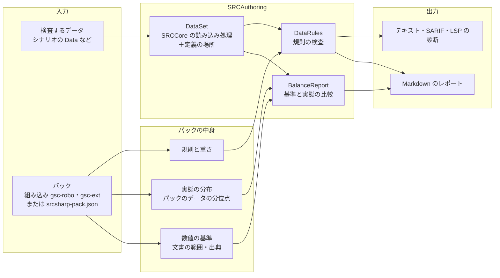

# 準拠データパックに応じたバランスの検査（設計） / Data-Pack Balance Rules (Design)

- 状態: 設計（未実装）
- 関係する Issue: https://github.com/7474/SRC/issues/1388

`srcsharp balance` に、シナリオが準拠しているデータパックを指定するオプションを加える。データの基準の実態は GSC（SRC 総合支援センター）のデータパックの「ロボ基準」と「拡張基準」なので、この 2 つを組み込みのパックとして持つ。

パックで扱うものは 2 種類に分ける。

| 種類 | 例 | 扱い |
|---|---|---|
| **数値**（能力値・攻撃力などの範囲） | HP、EN、格闘、SP | まず **基準と実態を比べるレポート** にする。検査（警告）にはしない |
| **規則**（書き方の決まり） | 射程 1 に格を付けない、名前の長さ | 規則の検査にする。重さは、パックのデータで守られている率で決める |

SRC の仕様と食い違うデータの検査は、パックによらないので `srcsharp lint` に入れる。

## 範囲

- 組み込みのパックは GSC のロボ基準（`gsc-robo`）と拡張基準（`gsc-ext`）。巨大はデータが少ないので扱わない
- 作品独自のパック（ロボダンなど）は同梱しない。必要な人がパック定義（JSON）を書く
- 組み込む先は `srcsharp`（CLI）、7474/SRC-Site のチェッカー（SRCLintWeb）、VS Code 拡張まで

## 背景

### 発端

ロボダン（ロボッとダンジョンＢ！）は `Lib\UnitChecker.eve` で、ゲームの中でユニット 1 体ずつ、バランスとデータの指定のありがちな誤りを調べている（#1388）。ロボダンのデータ（ユニット 4,683、パイロット 2,171）に試作の検査をかけると、閾値（格闘＋射撃 > 300 など）はロボダン自身のデータも超えていた（味方だけで 157 件）。数値の閾値はパックに足すデータへの注意で、パックごと・範囲（味方・敵・ボス）ごとに違う。

### 基準の出どころ

GSC データパック（`GSC_data_full20240307.zip`）の `text` フォルダに、基準の文書が入っている。データ（robot.txt・unit.txt・pilot.txt の 1,921 ファイル）は、[7474/SRC-Data](https://github.com/7474/SRC-Data) の `GSCデータパック` と文字コード（SRC-Data は UTF-8 に変換済み）を除いて同じ。

| 文書 | 数値 | 規則 |
|---|---|---|
| `ＧＳＣロボット基準データローカルルールマニュアルl.txt`（2005 年度版） | — | Ｂの地形適応（粒子ビーム `AA-A`、レーザー `AACA`）、ビーム剣にＢを付けない |
| `等身データ指針.txt` | — | 名前の長さ（パイロット愛称 10・ユニット愛称 16・武器名 12〜14）、姓名を「＝」でつなぐ、射程 1 に格を付けない、射程 2 以上に射を付けない、射程 2 以上の突・武には格も要る、飛べないユニットも空の適応を B〜C にする |
| `戦艦データ指針.txt` | サイズごとの HP・EN の上限、装甲・運動性・移動力・射程・攻撃力の目安（戦艦の作品だけ） | — |
| [データ作成ガイドライン](https://github.com/7474/SRC-Data/blob/master/docs/%E3%83%87%E3%83%BC%E3%82%BF%E4%BD%9C%E6%88%90%E3%82%AC%E3%82%A4%E3%83%89%E3%83%A9%E3%82%A4%E3%83%B3.md)（SRC-Data） | ロボ・拡張ごとの、キャラクターの格（主人公格〜名前なし）・系統（スーパー・リアル・グレー）ごとの能力値・攻撃力の範囲 | 上の文書の決まりのまとめ |

格と系統はデータに書かれていないので、ガイドラインの範囲は格・系統をまとめた外枠（最小〜最大）でしか比べられない。

### パック内のデータの実態

GSC データパックのデータを SRCCore の読み込み処理で集計した。

| | ロボ | 拡張 |
|---|--:|--:|
| ユニット | 14,033 | 28,618 |
| パイロット（戦闘のステータスがあるもの） | 6,150 | 13,536 |
| 武器 | 48,284 | 101,517 |

**規則が守られている率**

| 規則 | ロボ | 拡張 | 読み取れること |
|---|--:|--:|---|
| 射程 1 に格 | 41 / 18,531（0.2%） | 57 / 47,127（0.1%） | ほぼ守られている。外れは誤りである見込みが高い |
| 射程 2 以上に射 | 28 / 29,753（0.1%） | 26 / 54,390（0.05%） | 同上 |
| 射程 1 にＰ | 19 / 18,531 | 25 / 47,127 | 同上 |
| 射程 2 以上の突・武・接に格・複が無い | 108 / 529（20%） | 516 / 5,275（10%） | 外れも多い。接（射撃＋近接の複合技にも付く）など、意図した射撃扱いがある |
| 移動可能地形があるのに地形適応が `-` | 184 / 14,033 | 44 / 28,618 | 少数。誤りである見込みが高い |
| 移動可能地形が不正 | 0 | 3（`陸地`・`地`） | 誤り |
| Ｂ（射程 2 以上）の地形適応 | `AA-A` 6,136・`AACA` 1,744・`AAAA` 451・`AABA` 385 | `AACA` 1,883・`AA-A` 1,107・`AABA` 774・`AAAA` 688 | ロボは文書の決まりが主。拡張では水が A・B のものが 31% あり、決まりとしては弱い |
| 飛べないユニットの空の適応 | `-` 6,169・B 711・C 361・A 273 | B 11,844・C 8,858・A 1,664・`-` 1,153 | 等身データ指針のとおり、ロボと拡張で逆 |
| パイロット愛称 > 10 文字 | 49 / 6,322 | 56 / 13,710 | ほぼ守られている |
| 武器名 > 14 文字 | 361 / 48,284 | 281 / 101,517 | ほぼ守られている |
| パイロット名に「・」 | 243 | 948 | 外れも多い |

数値の実態は、下の「レポートの例」に載せた。

ここから次のことが言える。

1. 文書の規則でも、守られている率に差がある。規則の重さの既定は、この率で決める
2. ロボと拡張で逆の決まりがある。パックを決めずに一律に調べることはできない
3. 数値は、ガイドラインの外枠に収まる率が項目によって違う（パイロットの能力値は 97〜100%、ロボの HP は 83%、拡張の EN は 81%）。戦艦データ指針の上限は戦艦の作品だけのもので、全ユニットに当てはめると合わない。数値をいきなり検査にすると、基準と実態のずれをそのまま警告にしてしまう。まず比べられるようにして、基準を見直す材料にする

## 全体



- 数値の比較（`BalanceReport`）は Markdown のレポートにだけ出し、診断（警告）にはしない
- 規則の検査（`DataRules`）は `SRCAuthoring/Analysis` に新しく作り、`balance` と `lint` の両方から使う
- 規則は「SRC の仕様」の組（`src`）と、パックが有効にする組に分ける。`lint` は `src` の組だけを動かす

## 数値: 基準と実態の比較レポート

### 比べるもの

| 列 | 内容 |
|---|---|
| 基準 | パックに書いた範囲（下限〜上限）と出典（文書の名前） |
| パックの実態 | パックのデータの分布（P10・P50・P90・P99・最大）と、基準より下・中・上の割合 |
| 検査するデータ | 検査するデータの分布と、基準より下・中・上の件数。基準の外のものは名前を並べる |

- 項目は、ユニットの HP・EN・装甲・運動性・移動力・最大攻撃力と、パイロットの格闘・射撃・命中・回避・技量・反応・格闘＋射撃・SP
- 分け方は、全体とサイズ（SS〜XL）ごと。基準に範囲（`scope`）があれば、その範囲だけで比べる（戦艦データ指針は戦艦の作品だけ）
- パックの実態の分布は、組み込みのパックでは srcsharp に埋め込む（下の「組み込みのパック」）。検査するデータの分布は、その場で集計する
- 検査するデータを指定しなければ、パックの基準と実態の比較だけを出す（基準の文書を見直すためのレポート）

### レポートの例

GSC のデータと、データ作成ガイドラインの範囲（格・系統をまとめた外枠）を比べたもの。

**ロボ**

| 項目 | 基準（ガイドライン） | P10 | P50 | P90 | 基準より下 | 基準の中 | 基準より上 |
|---|---|--:|--:|--:|--:|--:|--:|
| HP | 2,000〜8,000 | 2,500 | 3,900 | 8,800 | 5.3% | 83.1% | 11.7% |
| EN | 60〜250 | 70 | 140 | 240 | 6.5% | 87.5% | 6.1% |
| 装甲 | 500〜2,500 | 600 | 1,000 | 1,500 | 3.4% | 96.0% | 0.6% |
| 運動性 | 40〜120 | 50 | 75 | 105 | 2.6% | 95.8% | 1.7% |
| 最大攻撃力 | 700〜4,700 | 1,100 | 1,600 | 2,500 | 3.6% | 96.3% | 0.1% |
| 格闘 | 80〜170 | 110 | 138 | 154 | 0.2% | 99.3% | 0.5% |
| 射撃 | 75〜165 | 122 | 140 | 152 | 0.2% | 99.7% | 0.2% |
| 命中 | 90〜160 | 130 | 142 | 153 | 0.0% | 98.5% | 1.4% |
| 回避 | 85〜165 | 129 | 140 | 153 | 0.0% | 99.6% | 0.3% |
| 技量 | 120〜190 | 143 | 165 | 177 | 0.0% | 99.5% | 0.5% |
| 反応 | 120〜170 | 148 | 156 | 162 | 0.0% | 99.9% | 0.1% |
| SP | 25〜80 | 30 | 50 | 60 | 7.9% | 92.1% | 0.0% |

**拡張**

| 項目 | 基準（ガイドライン） | P10 | P50 | P90 | 基準より下 | 基準の中 | 基準より上 |
|---|---|--:|--:|--:|--:|--:|--:|
| HP | 800〜9,000 | 2,600 | 3,800 | 6,000 | 0.4% | 96.8% | 2.8% |
| EN | 30〜160 | 80 | 130 | 180 | 0.5% | 80.9% | 18.6% |
| 装甲 | 200〜2,000 | 600 | 900 | 1,300 | 0.3% | 99.6% | 0.1% |
| 運動性 | 20〜110 | 50 | 70 | 90 | 0.5% | 99.3% | 0.2% |
| 最大攻撃力 | 800〜3,000 | 1,100 | 1,500 | 2,000 | 4.0% | 95.3% | 0.7% |
| 格闘 | 70〜170 | 120 | 140 | 154 | 0.0% | 99.9% | 0.0% |
| 射撃 | 70〜155 | 115 | 137 | 150 | 0.0% | 96.8% | 3.2% |
| 命中 | 85〜160 | 132 | 143 | 152 | 0.0% | 99.4% | 0.6% |
| 回避 | 80〜165 | 130 | 140 | 152 | 0.0% | 99.9% | 0.1% |
| 技量 | 110〜190 | 145 | 164 | 176 | 0.1% | 99.7% | 0.2% |
| 反応 | 110〜170 | 150 | 157 | 162 | 0.1% | 99.9% | 0.0% |
| SP | 20〜60 | 25 | 50 | 55 | 8.5% | 90.8% | 0.7% |

- ロボの HP の 11.7%、拡張の EN の 18.6% が基準より上にある。基準（ガイドライン）の範囲を見直す候補
- SP が基準より下のものは、SP を持たない名前なしのパイロット（SP 0）を含む。基準に「SP なし」を許すかを書けるようにする
- 実際のレポートでは、サイズごとの表と、検査するデータの列が加わる

## 規則

ID は小文字とハイフン。既定の重さは、GSC での守られている率を見て決めた。

| ID | 組 | 既定の重さ | 内容 | 根拠 |
|---|---|---|---|---|
| `unit-transportation-invalid` | src | 情報 | 移動可能地形に、空・陸・水・地中・宇宙・`-` 以外がある | [ユニットデータ](../../SRC.Sharp.Help/src/ユニットデータ.md) の (7)。GSC でも 3 件（`陸地`・`地`） |
| `unit-transportation-adaption` | src | 情報 | 移動可能地形に空・陸・水・宇宙があるのに、その地形適応が `-` | 同上。GSC で 228 件 |
| `weapon-range1-infight` | gsc-robo・gsc-ext | 警告 | 射程 1 に格 | 等身データ指針。GSC で外れは 0.2% 以下 |
| `weapon-range2-shooting` | gsc-robo・gsc-ext | 警告 | 射程 2 以上に射 | 同上 |
| `weapon-range1-p` | gsc-robo・gsc-ext | 情報 | 射程 1 にＰ（書かなくても移動後に使える） | [使用可能時に関する属性](../../SRC.Sharp.Help/src/使用可能時に関する属性.md) |
| `weapon-cross-range-shooting` | gsc-robo・gsc-ext | 情報 | 射程 2 以上で突・武・接があり、格・複が無い（射撃として計算される） | 等身データ指針。GSC で 10〜20% が外れるので「情報」 |
| `weapon-beam-adaption` | gsc-robo | 情報 | 射程 2 以上のＢで、地形適応が `AA-A`・`AACA` 以外 | ロボットローカルルールマニュアル【３】 |
| `weapon-beam-melee` | gsc-robo | 情報 | 射程 1 の武器にＢ（ビーム剣にはＢを付けない） | 同上。GSC にも 951 件あるので「情報」 |
| `unit-air-adaption-nonflyer` | gsc-ext | 情報 | 飛べないユニットの空の適応が `-` | 等身データ指針 4 |
| `name-length` | gsc-robo・gsc-ext | 情報 | パイロット愛称 > 10、ユニット愛称 > 16、武器名 > 14 文字 | 等身データ指針 2 |
| `name-separator` | gsc-robo・gsc-ext | 無効 | パイロット名に「・」 | 同上。GSC でも外れが多い |
| `sp-combo` | パック定義 | 無効 | 1 人のパイロットが持つ SP の効果の組み合わせ（sp.txt の効果の種類で判定） | パック定義 |

- 数値の範囲を外れたことを知らせる規則は、当面作らない。比較レポートで基準と実態のずれを確かめ、基準を直してから考える
- データだけでは判定できない検査（パイロット数、最強武器とパイロットの型、キャラクターの格・系統）は入れない

## パック

### 組み込みのパック

| 名前 | 内容 |
|---|---|
| `src` | SRC の仕様の規則だけ |
| `gsc-robo` | GSC データパックのロボ基準。`src` を引き継ぐ |
| `gsc-ext` | GSC データパックの拡張基準。`src` を引き継ぐ |

- 数値の基準は、データ作成ガイドラインの範囲（格・系統をまとめた外枠）と、戦艦データ指針の上限（`scope` を戦艦の作品に絞る）を、出典つきで書く
- 実態の分布と作品の一覧（`ロボ`・`拡張` の下のフォルダの名前）は、SRC-Data の `GSCデータパック` から作った JSON を srcsharp に埋め込む。データそのものは含めない（GSC のデータは転載・改変とも自由だが（`データの転載・改変について.txt`）、要るのは分布だけ）。作り直すのは、SRC-Data のデータパックを更新したとき

### パックの選び方

1. `--pack` があればそれを使う
2. 無ければ、検査するディレクトリから上へ `srcsharp-pack.json` を探す
3. 無ければ、シナリオが読み込む作品のデータフォルダ（`@作品名`、`Data` の下のフォルダ）を、組み込みのパックの作品の一覧と照らして推定する。ロボと拡張の両方の作品を使っていれば、作品ごとにそのパックで調べる。推定したパックはレポートに書く
4. どれでもなければ `src` だけ

### パック定義（JSON）

組み込みのパックを引き継いで変えるか、作品独自のパックを作るのに使う。シナリオのフォルダに置くか、パックの作者がパックのフォルダに置いて一緒に配る。

```json
{
  "name": "シナリオ独自",
  "extends": ["gsc-robo"],
  "reference": ["Data/味方", "Data/敵"],
  "ignoreWeaponAttributes": ["延"],
  "scopes": {
    "味方": { "files": ["**/味方/**"] }
  },
  "basis": {
    "unit": {
      "HP": { "min": 2000, "max": 15000, "scope": "味方", "source": "シナリオの決まり" }
    },
    "pilot": {
      "格闘": { "max": 165, "scope": "味方" },
      "格闘+射撃": { "max": 300, "scope": "味方" }
    }
  },
  "rules": {
    "weapon-beam-adaption": "off",
    "sp-combo": {
      "combos": [
        { "effects": ["ダメージ増加", "クリティカル率増加"], "message": "最大火力が大きく上がる" }
      ]
    }
  },
  "exclude": ["名前"]
}
```

| 項目 | 内容 |
|---|---|
| `name` | 表示の名前 |
| `extends` | 引き継ぐパック（組み込みの名前かファイル）。後に書いたものが優先 |
| `reference` | パックのデータ（このファイルからの相対パス）。ここから実態の分布を作り、引き継いだ分布に代える。ここに入るデータは検査しない |
| `ignoreWeaponAttributes` | 属性の判定で無いものとして扱う属性（パック独自の属性） |
| `scopes` | 範囲の名前と、その範囲に入るデータのファイル（glob） |
| `basis` | 数値の基準。項目ごとに `min`・`max`・`scope`・`source`（出典）。比較レポートにだけ使う |
| `rules` | 規則の ID ごとの設定。`"off"` で無効にする。オブジェクトなら `scope`・`severity`（`error`・`warning`・`information`）と規則ごとの値 |
| `exclude` | 検査しないユニット・パイロットの名前（意図して外したもの） |

JSON Schema を srcsharp と VS Code の拡張に同梱し、補完できるようにする（Schema の置き場所は実装の時に決める）。

## コマンド

```text
srcsharp balance <ディレクトリかファイル>... [--pack 名前かファイル] [--reference ディレクトリ]...
                 [--format md|csv|weapons-csv|text|sarif] [--output ファイル] [--fail-on none|warning|error]
srcsharp balance --pack 名前かファイル                       # パックの基準と実態の比較だけ
srcsharp balance --list-rules [--pack 名前かファイル]
srcsharp balance <ディレクトリ>... --export-distribution [--output ファイル]
srcsharp lint <ディレクトリかファイル>... [--rules src|none]
```

| オプション | 内容 |
|---|---|
| `--pack` | パック。組み込みの名前（`src`・`gsc-robo`・`gsc-ext`）か JSON のファイル。省くと「パックの選び方」のとおり。データを指定しなければ、パックの基準と実態の比較だけを出す |
| `--reference` | パックのデータのディレクトリ。パック定義の `reference` より優先する |
| `--format md` | 既定。使ったパック、基準と実態の比較、規則に合わないデータ、今の一覧 |
| `--format text\|sarif` | 規則の検査の結果だけを出す。`text` は `lint` と同じ書式（`ファイル(行): warning: メッセージ[規則 ID]`）、`sarif` は GitHub のコードスキャン用 |
| `--fail-on` | その重さ以上の規則の結果があれば終了コード 1。既定は `none`（今の `balance` と同じく常に 0）。比較レポートの数値は数えない |
| `--list-rules` | 規則の ID・既定の重さ・説明と、パックで変えた値を出す |
| `--export-distribution` | データの分布を JSON で出す（パック定義の `reference` の代わりに分布だけを配るのに使う） |
| `lint --rules` | `src` の組を動かすか。既定は `src` |

今のクラスごとの z 値による外れ値は、パックが無いときだけ出す。

## 組み込む先

| 先 | 出すもの |
|---|---|
| `srcsharp`（CLI） | すべて |
| 7474/SRC-Site のチェッカー（SRCLintWeb） | `src` の組の規則（`lint` と同じ）。パックを推定できれば、そのパックの規則も診断として出す。比較レポートは出さない |
| VS Code 拡張（LSP） | 規則の診断（`src` の組と、ワークスペースのパック）。比較レポートは、コマンドで `srcsharp balance` を動かして Markdown を開く |

SRC-Site のシナリオの投稿で、準拠するパックを宣言させることはしない。

## 実装に要るもの

| 変更 | 内容 |
|---|---|
| 定義の場所（ファイル・行） | `UnitData`・`PilotData`・`WeaponData` に、定義のあるファイルと行番号を記録する（今は持っていない）。SARIF・LSP で行を示すのに要る。読み込みの処理で記録し、ゲームの動作は変えない |
| `SrcDiagnostic.RuleId` | 規則の ID を加える。`SarifWriter` は規則ごとに `rules` を出す（今は `src-data-error`・`src-data-warning` の 2 つ） |
| `DataSet` | 検査するデータとパックのデータを読み込み、どちらのデータか・どのファイルか・どの作品か（フォルダ）を持つ。`BalanceReport.Create` と `DataLinter` の読み込みを寄せる |
| `Distribution` | 分布の集計と JSON の読み書き。`--export-distribution` |
| `PackDefinition` | パックの読み込み・`extends` の解決・組み込みのパック・JSON Schema |
| `BalanceReport` | 基準と実態の比較 |
| `DataRules` | 規則の検査。規則は `IDataRule`（ID・組・既定の重さ・検査） |
| 組み込みの分布の生成 | SRC-Data の `GSCデータパック` から `gsc-robo`・`gsc-ext` の分布と作品の一覧を作る処理（SRC-Data の `tools` か、本リポジトリの開発用の処理） |
| `srcsharp` | オプションの追加 |
| SRCLintWeb・LSP・VS Code 拡張 | 規則の診断の表示、比較レポートを開くコマンド |

### lint の終了コード

今の `lint` は警告でも終了コード 1 にしている（SRCDataLinter と同じ判定）。`src` の組の規則は「情報」とし、終了コードに数えない。既存のシナリオの CI を、版を上げただけで落とさないためである。重さを上げたい人は `balance --pack` と `--fail-on` を使う。

## 進め方

1. 分布の集計（`Distribution`・`--export-distribution`）と、組み込みの分布の生成
2. パック定義の読み込みと組み込みのパック（数値の基準）、`balance --pack` の比較レポート。ここで基準（ガイドライン）と実態のずれを確かめる
3. 定義の場所の記録と `SrcDiagnostic.RuleId`・SARIF の規則
4. `src` の組の 2 規則を `lint` に入れる（情報）
5. パックの規則の検査、`--fail-on`・`--list-rules`
6. パックの推定（作品の一覧）
7. SRCLintWeb・VS Code 拡張への表示

各段階で、SRCAuthoringTests に小さなデータの検査を加え、CI の `docker-srcdatalinter` で `balance --pack` を動かす。GSC データパックに規則をかけた件数（上の表）を回帰の確認に使う（大きく変わったら、規則の実装か SRC-Data の更新を疑う）。

## 決めていないこと

- **データ作成ガイドラインの数値の範囲を、比較レポートを見て直すか。** 直すなら、組み込みのパックの基準も合わせる
- **SP 0（SP を持たない名前なし）を基準の範囲にどう書くか**
