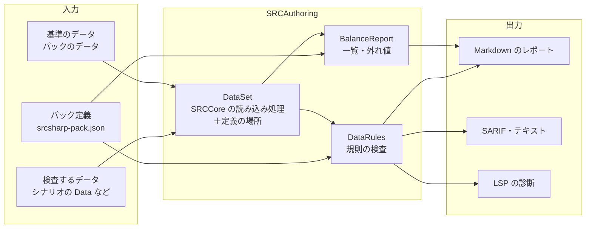

# 準拠データパックに応じたバランスの検査（設計） / Data-Pack Balance Rules (Design)

- 状態: 設計（未実装）
- 関係する Issue: https://github.com/7474/SRC/issues/1388

`srcsharp balance` に、シナリオが準拠しているデータパック（汎用データや、ロボダンのような作品のデータ一式）の決まりに照らしてデータを検査するオプションを加える。決まりは「パック定義」（JSON）に書き、パックの作者やシナリオの作者が用意する。SRC の仕様と食い違うデータの検査は、パックによらないので `srcsharp lint` に入れる。

## 背景

ロボダン（ロボッとダンジョンＢ！）は `Lib\UnitChecker.eve` で、ゲームの中でユニット 1 体ずつについて、ゲームバランスとデータの指定のありがちな誤りを調べている（#1388）。これを `srcsharp` に取り込めるかを、ロボダンのデータ（ユニット 4,683、パイロット 2,171、スペシャルパワー 86）に試作の検査をかけて調べた。

| 検査（UnitChecker） | 該当件数（フォルダ別） | 分かったこと |
|---|---|---|
| 移動可能地形と地形適応の食い違い（「空」があるのに空の適応が `-` など） | 16 | SRC の仕様に照らした誤り。パックによらない |
| 射程 2 以上の接近戦攻撃（突・武・接）に格・複が無い | 18 | 同上（射撃型として扱われる） |
| HP > 15000 | ボス 85・敵 6・System 4・辞典 2 | 上限はパックの中でも味方と敵・ボスで違う |
| 格闘＋射撃 > 300 | 味方 157・ボス 60・敵 3・辞典 4 | パック自身のデータも閾値を超えている。閾値は、**パックに足すデータ（シナリオのローカルデータ）** に対する注意として使われている |
| ビーム兵器の水適応が A・B | 味方 501・敵 43・ボス 18 | スパロボの慣習。既定で有効にすると誤検出が多すぎる |
| スペシャルパワーの組み合わせ（2 倍＋クリティカル、自爆＋祈りなど） | ボス 6（ダメージ増加＋クリティカル率増加） | 名前（熱血・魂）ではなく sp.txt の効果で判定すれば、名前を変えたパックにも使える |
| 「延」の付いた武器の除外 | — | 「延」は SRC の属性ではなく、ロボダン独自の属性。除外する属性はパックごとに決める |
| パイロット数、最強武器とパイロットの格闘・射撃の型 | — | 実際に乗っているパイロットで決まる。データだけでは判定できない |

ここから次のことが言える。

1. 閾値・慣習・除外する属性は **パックごとに違う**。SRC# が一律の値を持つことはできない
2. 同じパックの中でも、**範囲（味方・敵・ボス、フォルダ）ごとに上限が違う**
3. 検査したいのは主に **パックに足すデータ**。パック自身のデータは基準として使う
4. SRC の仕様と食い違うデータ（移動可能地形と地形適応など）は **パックによらない**

## 全体



- 規則の検査（`DataRules`）は `SRCAuthoring/Analysis` に新しく作り、`balance` と `lint` の両方から使う
- 規則は「SRC の仕様」の組（`src`、組み込み）と、パック定義が有効にする組に分ける
  - `lint` は `src` の組だけを動かす
  - `balance --pack` は、パック定義の組（`src` を含めるかは定義が決める）を動かす

## コマンド

```text
srcsharp balance <ディレクトリかファイル>... [--pack 名前かファイル] [--reference ディレクトリ]...
                 [--format md|csv|weapons-csv|text|sarif] [--output ファイル] [--fail-on none|warning|error]
srcsharp balance --list-rules [--pack 名前かファイル]
srcsharp lint <ディレクトリかファイル>... [--rules src|none]
```

| オプション | 内容 |
|---|---|
| `--pack` | パック定義。組み込みの名前（`src`）か JSON のファイル。省くと、検査するディレクトリから上へ `srcsharp-pack.json` を探し、見つかれば使う。見つからなければ今までどおり（一覧と外れ値だけ） |
| `--reference` | 基準のデータのディレクトリ。パック定義の `reference` より優先する。基準のデータは読み込むが、検査の対象にはしない（規則の検査をしない） |
| `--format text\|sarif` | 規則の検査の結果だけを出す。`text` は `lint` と同じ書式（`ファイル(行): warning: メッセージ[規則 ID]`）、`sarif` は GitHub のコードスキャン用 |
| `--fail-on` | その重さ以上の結果があれば終了コード 1。既定は `none`（今の `balance` と同じく常に 0） |
| `--list-rules` | 規則の ID・既定の重さ・説明と、パック定義で変えた値を出す |
| `lint --rules` | `src` の組を動かすか。既定は `src`。重さは「情報」で、`lint` の終了コードには数えない（下の「lint の終了コード」） |

`--format md`（既定）のレポートには、今の一覧と外れ値に加えて「規則に合わないデータ」の節を、規則ごとにまとめて出す。

## パック定義

シナリオの作者がシナリオのフォルダに置くか、パックの作者がパックのフォルダに置いて一緒に配る。JSON Schema を srcsharp と VS Code の拡張に同梱し、補完できるようにする（Schema の置き場所は実装の時に決める）。

```json
{
  "name": "ロボダン",
  "extends": ["src"],
  "reference": ["Data/味方", "Data/敵", "Data/ボス"],
  "ignoreWeaponAttributes": ["延"],
  "scopes": {
    "味方": { "files": ["**/味方/**"] },
    "敵": { "files": ["**/敵/**", "**/ボス/**"] }
  },
  "rules": {
    "unit-max": {
      "scope": "味方",
      "severity": "warning",
      "values": { "HP": 15000, "EN": 300, "装甲": 2500, "運動性": 140, "移動力": 7, "経験値": 200 }
    },
    "pilot-max": {
      "scope": "味方",
      "values": { "格闘": 165, "射撃": 165, "命中": 165, "回避": 165, "技量": 190, "反応": 170, "経験値": 200 }
    },
    "pilot-sum-max": {
      "scope": "味方",
      "sums": [{ "items": ["格闘", "射撃"], "max": 300 }]
    },
    "sp-combo": {
      "combos": [
        { "effects": ["ダメージ増加", "クリティカル率増加"], "message": "最大火力が大きく上がる" },
        { "effects": ["自爆", "行動数回復"], "message": "無限に繰り返せる" }
      ]
    },
    "weapon-beam-water": { "severity": "information" },
    "weapon-redundant-attribute": "off"
  },
  "exclude": ["ゲッターロボ號"]
}
```

| 項目 | 内容 |
|---|---|
| `name` | 表示の名前 |
| `extends` | 引き継ぐパック定義（組み込みの名前かファイル）。後に書いたものが優先 |
| `reference` | 基準のデータ（パック定義のファイルからの相対パス）。外れ値の基準と、検査から除くデータに使う |
| `ignoreWeaponAttributes` | 属性の判定で無いものとして扱う属性（パック独自の属性） |
| `scopes` | 規則を当てる範囲の名前と、その範囲に入るデータのファイル（glob）。将来、ユニットクラス（`class`）でも選べるようにする |
| `rules` | 規則の ID ごとの設定。`"off"` で無効にする。オブジェクトなら `scope`・`severity`（`error`・`warning`・`information`）と規則ごとの値 |
| `exclude` | 検査しないユニット・パイロットの名前（意図して外したもの） |

### 検査の対象

- 引数のデータのうち、`reference` に含まれないもの（シナリオのローカルデータ）を検査する
- `reference` を指定しなければ、引数のデータすべてを検査する（パックの作者がパック自身を調べる使い方）
- 外れ値（今の `balance` の z 値）は、`reference` があれば基準のデータのクラスごとの平均・標準偏差を使い、検査するデータがパックの分布から外れていないかを見る。無ければ今までどおり検査するデータ自身の分布を使う

## 規則

ID は小文字とハイフン。組は `src`（SRC の仕様。パックによらない）と `pack`（パック定義で有効にする）。

| ID | 組 | 既定 | 内容 | 根拠 |
|---|---|---|---|---|
| `unit-transportation-invalid` | src | 情報 | 移動可能地形に、空・陸・水・地中・宇宙・`-` 以外がある（「海」など） | [ユニットデータ](../../SRC.Sharp.Help/src/ユニットデータ.md) の (7) |
| `unit-transportation-adaption` | src | 情報 | 移動可能地形に空・陸・水・宇宙があるのに、その地形適応が `-` | 同上 |
| `weapon-cross-range-shooting` | src | 情報 | 射程 2 以上で突・武・接があり、格・複が無い（射撃型として計算される） | [攻撃種類に関する属性](../../SRC.Sharp.Help/src/攻撃種類に関する属性.md)、[ダメージ算出方法に関する属性](../../SRC.Sharp.Help/src/ダメージ算出方法に関する属性.md) |
| `weapon-redundant-attribute` | pack | 無効 | 射程 2 以上の射、射程 1 の格・Ｐ（書かなくても同じ）。射程の補正（`SetMaxRangeCorrection`）で射程 1 の武器が伸びる場合は意味があるので、誤りとはしない | [使用可能時に関する属性](../../SRC.Sharp.Help/src/使用可能時に関する属性.md) |
| `unit-max` | pack | 無効 | ユニットの能力値の上限 | パック定義 |
| `pilot-max` | pack | 無効 | パイロットの能力値の上限 | パック定義 |
| `pilot-sum-max` | pack | 無効 | パイロットの能力値の和の上限 | パック定義 |
| `sp-combo` | pack | 無効 | 1 人のパイロットが持つスペシャルパワーの効果の組み合わせ（sp.txt の効果の種類で判定） | パック定義 |
| `weapon-beam-water` | pack | 無効 | Ｂ属性の武器の水の適応が A・B | パック定義 |

- 重さの既定は、`src` の組は「情報」、`pack` の組はパック定義が有効にしたときに「警告」
- データだけでは判定できない検査（パイロット数、最強武器とパイロットの型）は入れない。イベントの `Create`・`Ride` などからユニットとパイロットの組み合わせを推定できれば（`ScenarioAnalyzer`）、後で加える

## 実装に要るもの

| 変更 | 内容 |
|---|---|
| 定義の場所（ファイル・行） | `UnitData`・`PilotData`・`WeaponData` に、定義のあるファイルと行番号を記録する（今は持っていない）。SARIF・LSP で行を示すのに要る。読み込みの処理（`UnitDataList.Load` など）で記録し、ゲームの動作は変えない |
| `SrcDiagnostic.RuleId` | 規則の ID を加える。`SarifWriter` は規則ごとに `rules` を出す（今は `src-data-error`・`src-data-warning` の 2 つ） |
| `DataSet` | 検査するデータと基準のデータを読み込み、どちらのデータか・どのファイルかを持つ。`BalanceReport.Create` と `DataLinter` の読み込みを寄せる |
| `DataRules` | 規則の検査。規則は `IDataRule`（ID・組・既定の重さ・検査）で、パック定義の設定を受け取る |
| `PackDefinition` | パック定義の読み込み・`extends` の解決・JSON Schema |
| `BalanceReport` | `reference` の分布で外れ値を出す。レポートに規則の節を加える |
| `srcsharp` | オプションの追加、`--list-rules` |
| LSP・SRCLintWeb | `src` の組を情報の診断として出す。パック定義がワークスペースにあれば `pack` の組も出す |

### lint の終了コード

今の `lint` は警告でも終了コード 1 にしている（SRCDataLinter と同じ判定）。`src` の組の規則は「情報」とし、終了コードに数えない。既存のシナリオの CI を、版を上げただけで落とさないためである。重さを上げたい人は `balance --pack` と `--fail-on` を使う。

## 進め方

1. 定義の場所の記録と `SrcDiagnostic.RuleId`・SARIF の規則
2. `src` の組の 3 規則を `lint` に入れる（情報）
3. パック定義・`balance --pack`・`--reference`・`--fail-on`・`--list-rules`
4. `reference` の分布による外れ値
5. LSP・SRCLintWeb への表示、VS Code 拡張での JSON Schema の補完

各段階で、SRCAuthoringTests に小さなデータの検査を加え、CI の `docker-srcdatalinter` で `balance --pack` を動かす。

## 決めていないこと

- **パック定義を誰が持つか。** 組み込みは `src` だけにし、作品のパック定義（ロボダンなど）は作者が配る形を基本にする。UnitChecker の値をサンプルとして同梱するなら、ロボダンの作者の了承を得る
- **パック定義をシナリオの投稿（7474/SRC-Site）で宣言させるか。** 宣言させれば、アップロードの前の lint（SRCLintWeb）で `pack` の組も動かせる
- **範囲をユニットクラスやフォルダ以外（イベントで使われ方を推定した敵・味方の区別）で選べるようにするか**
