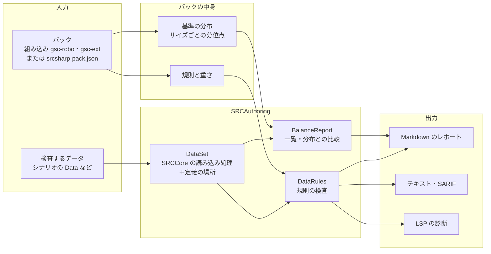

# 準拠データパックに応じたバランスの検査（設計） / Data-Pack Balance Rules (Design)

- 状態: 設計（未実装）
- 関係する Issue: https://github.com/7474/SRC/issues/1388

`srcsharp balance` に、シナリオが準拠しているデータパックの基準に照らしてデータを検査するオプションを加える。データの基準の実態は GSC（SRC 総合支援センター）のデータパックの「ロボ基準」と「拡張基準」で、ごく一部に「巨大」がある。そこで、GSC のロボ基準・拡張基準を組み込みのパックとして持ち、それ以外のパックは定義ファイル（JSON）で足せるようにする。

パックは次の 2 つでできている。

- **規則**: 基準の文書に書かれた決まり（属性の付け方、名前の長さなど）
- **基準の分布**: パックのデータの実際の値の分布（サイズごとの HP の分位点など）

SRC の仕様と食い違うデータの検査は、パックによらないので `srcsharp lint` に入れる。

## 背景

### 発端

ロボダン（ロボッとダンジョンＢ！）は `Lib\UnitChecker.eve` で、ゲームの中でユニット 1 体ずつ、バランスとデータの指定のありがちな誤りを調べている（#1388）。ロボダンのデータ（ユニット 4,683、パイロット 2,171）に試作の検査をかけた結果は次のとおり。

- 閾値はパック自身のデータも超えている（格闘＋射撃 > 300 は味方だけで 157 件）。閾値は、パックに足すデータへの注意として使われている
- 範囲によって上限が違う（HP > 15000 の 97 件のうち 85 件はボス）
- 「延」のようにパック独自の属性がある

### 基準の出どころ

GSC データパック（`GSC_data_full20240307.zip`）の `text` フォルダに、基準の文書が入っている。データ（robot.txt・unit.txt・pilot.txt の 1,921 ファイル）は、[7474/SRC-Data](https://github.com/7474/SRC-Data) の `GSCデータパック` と文字コード（SRC-Data は UTF-8 に変換済み）を除いて同じ。

| 文書 | 内容 | 機械的に調べられるもの |
|---|---|---|
| `ＧＳＣロボット基準データローカルルールマニュアルl.txt`（2005 年度版） | 前提のオプション（乗り換え・アイテム交換・合体技パートナー行動数無消費）、追加・変更した SP、属性の付け方 | Ｂの地形適応（粒子ビーム `AA-A`、レーザー `AACA`）、ビーム剣にＢを付けない |
| `等身データ指針.txt` | 名前、属性、空と宇宙の地形適応 | 名前の長さ（パイロット愛称 10・ユニット愛称 16・武器名 12〜14）、姓名を「＝」でつなぐ、射程 1 に格を付けない、射程 2 以上に射を付けない、射程 2 以上の突・武には格も要る、飛べないユニットも空の適応を B〜C にする |
| `戦艦データ指針.txt` | サイズごとの HP・EN の上限、装甲・運動性・移動力・射程・攻撃力の目安 | サイズごとの上限（HP: SS 2000・S 4000・M 6000・L 8000・LL 12000、EN: SS 50〜LL 400 など）。戦艦の作品に限る |
| `GSCデータパックで用いられるSPについて.htm` | GSC の sp.txt の SP | SP の効果（各パックの `System\sp.txt` を読めば足りる） |

[データ作成ガイドライン](https://github.com/7474/SRC-Data/blob/master/docs/%E3%83%87%E3%83%BC%E3%82%BF%E4%BD%9C%E6%88%90%E3%82%AC%E3%82%A4%E3%83%89%E3%83%A9%E3%82%A4%E3%83%B3.md)（SRC-Data）は、これらとデータの傾向をまとめたもの。ただし、能力値の範囲は「キャラクターの格（主人公格〜名前なし）」と「系統（スーパー・リアル・グレー）」ごとに書かれている。格と系統はデータに書かれていないので、そのままでは機械的に調べられない。

### パック内のデータの実態

GSC データパックのデータを SRCCore の読み込み処理で読んで集計した結果。

| | ロボ | 拡張 |
|---|--:|--:|
| ユニット | 14,033 | 28,618 |
| パイロット（戦闘のステータスがあるもの） | 6,150 | 13,536 |
| 武器 | 48,284 | 101,517 |

**サイズごとの分布**（ロボ。P は分位点）

| 項目 | サイズ | P50 | P90 | P99 | 最大 |
|---|---|--:|--:|--:|--:|
| HP | S | 3,000 | 4,100 | 5,500 | 16,000 |
| HP | M | 3,700 | 5,400 | 12,000 | 80,000 |
| HP | L | 6,200 | 9,000 | 38,000 | 65,000 |
| HP | LL | 9,000 | 20,000 | 55,000 | 90,000 |
| 装甲 | M | 1,000 | 1,400 | 2,000 | 4,000 |
| 運動性 | M | 80 | 110 | 125 | 150 |
| 最大攻撃力 | M | 1,600 | 2,500 | 3,500 | 4,700 |

| パイロット | ロボ P50 | ロボ P99 | 拡張 P50 | 拡張 P99 |
|---|--:|--:|--:|--:|
| 格闘 | 138 | 169 | 140 | 163 |
| 技量 | 165 | 188 | 164 | 186 |
| 格闘＋射撃 | 277 | 312 | 277 | 307 |
| SP | 50 | 70 | 50 | 60 |

ロボダンの UnitChecker の閾値（格闘 165・技量 190・格闘＋射撃 300）は、GSC のパイロットの P97〜P99 にあたる。

**基準の規則がどれだけ守られているか**

| 規則 | ロボ | 拡張 | 読み取れること |
|---|--:|--:|---|
| 射程 1 に格 | 41 / 18,531（0.2%） | 57 / 47,127（0.1%） | ほぼ守られている。外れは誤りである見込みが高い |
| 射程 2 以上に射 | 28 / 29,753（0.1%） | 26 / 54,390（0.05%） | 同上 |
| 射程 1 にＰ | 19 / 18,531 | 25 / 47,127 | 同上 |
| 射程 2 以上の突・武・接に格・複が無い | 108 / 529（20%） | 516 / 5,275（10%） | 守られていないことも多い。接（射撃＋近接の複合技にも付く）など、意図した射撃扱いがある |
| 移動可能地形があるのに地形適応が `-` | 184 / 14,033 | 44 / 28,618 | 少数。誤りである見込みが高い |
| 移動可能地形が不正 | 0 | 3（`陸地`・`地`） | 誤り |
| Ｂ（射程 2 以上）の地形適応 | `AA-A` 6,136・`AACA` 1,744・`AAAA` 451・`AABA` 385 | `AACA` 1,883・`AA-A` 1,107・`AABA` 774・`AAAA` 688 | ロボは文書の決まり（粒子ビーム・レーザー）が主。拡張では水が A・B のものが 31% あり、決まりとしては弱い |
| 飛べないユニットの空の適応 | `-` 6,169・B 711・C 361・A 273 | B 11,844・C 8,858・A 1,664・`-` 1,153 | 等身データ指針のとおり、ロボと拡張で逆になっている |
| パイロット愛称 > 10 文字 | 49 / 6,322 | 56 / 13,710 | ほぼ守られている |
| 武器名 > 14 文字 | 361 / 48,284 | 281 / 101,517 | ほぼ守られている |
| パイロット名に「・」 | 243 | 948 | 守られていないことも多い |

ここから次のことが言える。

1. **基準は文書だけでは足りず、データの実態と合わせて決める必要がある。** 文書の決まりでも守られている率に差がある（射程 1 の格は 0.2%、突・武・接の格は 10〜20% が外れる）。重さの既定は、守られている率で決める
2. **ロボと拡張で逆の決まりがある**（飛べないユニットの空の適応、Ｂの地形適応）。パックを指定せずに一律に調べることはできない
3. **能力値の上限は、決まった値よりサイズごとの分布の方が実態に合う。** HP の P99 は M で 12,000、LL で 55,000 と大きく違う。分布は裾が長いので（M の最大は 80,000）、z 値（平均と標準偏差）より分位点の方が向いている
4. **キャラクターの格と系統は、データだけでは分からない。** ガイドラインの格ごとの範囲は、レポートで参考として示すにとどめる
5. **SRC の仕様と食い違うデータ**（移動可能地形の不正、移動可能地形と地形適応）は、どのパックでも誤り

## 全体



- 規則の検査（`DataRules`）は `SRCAuthoring/Analysis` に新しく作り、`balance` と `lint` の両方から使う
- 規則は「SRC の仕様」の組（`src`）と、パックが有効にする組に分ける。`lint` は `src` の組だけを動かす

## パック

### 組み込みのパック

| 名前 | 内容 |
|---|---|
| `src` | SRC の仕様の規則だけ（分布なし） |
| `gsc-robo` | GSC データパックのロボ基準。`src` を引き継ぐ |
| `gsc-ext` | GSC データパックの拡張基準。`src` を引き継ぐ |

- 規則は基準の文書から作り、重さは上の「守られている率」で決める
- 基準の分布は、7474/SRC-Data の `GSCデータパック` から作った JSON を srcsharp に埋め込む。データそのものは含めない（GSC のデータは転載・改変とも自由だが（`データの転載・改変について.txt`）、要るのは分布だけ）。作り直すのは、SRC-Data のデータパックを更新したとき
- 巨大の基準は、基準の文書とデータが手元に無いので、当面は持たない。必要になれば同じ形で足す

### パックの選び方

1. `--pack` があればそれを使う
2. 無ければ、検査するディレクトリから上へ `srcsharp-pack.json` を探す
3. 無ければ、シナリオが読み込む作品のデータフォルダ（`@作品名`、`Data` の下のフォルダ）を、組み込みのパックの作品の一覧と照らして推定する。ロボと拡張の両方の作品を使っていれば、作品ごとにそのパックで調べる。推定したパックはレポートに書く
4. どれでもなければ `src` だけ

作品の一覧は、基準の分布と一緒に SRC-Data から作る（`ロボ`・`拡張` の下のフォルダの名前）。

### パック定義（JSON）

組み込みのパックを引き継いで変えるか、独自のパック（ロボダンなど）を作るのに使う。シナリオのフォルダに置くか、パックの作者がパックのフォルダに置いて一緒に配る。

```json
{
  "name": "ロボダン",
  "extends": ["gsc-robo"],
  "reference": ["Data/味方", "Data/敵", "Data/ボス"],
  "ignoreWeaponAttributes": ["延"],
  "scopes": {
    "味方": { "files": ["**/味方/**"] },
    "敵": { "files": ["**/敵/**", "**/ボス/**"] }
  },
  "rules": {
    "unit-percentile": { "scope": "味方", "percentile": 99 },
    "pilot-max": {
      "scope": "味方",
      "values": { "格闘": 165, "射撃": 165, "命中": 165, "回避": 165, "技量": 190, "反応": 170 }
    },
    "pilot-sum-max": { "scope": "味方", "sums": [{ "items": ["格闘", "射撃"], "max": 300 }] },
    "sp-combo": {
      "combos": [
        { "effects": ["ダメージ増加", "クリティカル率増加"], "message": "最大火力が大きく上がる" },
        { "effects": ["自爆", "行動数回復"], "message": "無限に繰り返せる" }
      ]
    }
  },
  "exclude": ["ゲッターロボ號"]
}
```

| 項目 | 内容 |
|---|---|
| `name` | 表示の名前 |
| `extends` | 引き継ぐパック（組み込みの名前かファイル）。後に書いたものが優先 |
| `reference` | 基準のデータ（このファイルからの相対パス）。ここから基準の分布を作り、引き継いだ分布に代える。ここに入るデータは検査しない |
| `ignoreWeaponAttributes` | 属性の判定で無いものとして扱う属性（パック独自の属性） |
| `scopes` | 規則を当てる範囲の名前と、その範囲に入るデータのファイル（glob） |
| `rules` | 規則の ID ごとの設定。`"off"` で無効にする。オブジェクトなら `scope`・`severity`（`error`・`warning`・`information`）と規則ごとの値 |
| `exclude` | 検査しないユニット・パイロットの名前（意図して外したもの） |

JSON Schema を srcsharp と VS Code の拡張に同梱し、補完できるようにする（Schema の置き場所は実装の時に決める）。

### 基準の分布

- サイズ（SS〜XL）ごとに、ユニットの HP・EN・装甲・運動性・移動力・最大攻撃力と、パイロットの各能力値・格闘＋射撃・SP の分位点（P10・P50・P90・P99・最大）を持つ
- `unit-percentile`・`pilot-percentile` は、検査するデータの値がこの分位点（既定 P99）を超えたら知らせる
- パックの作者は `srcsharp balance --export-distribution` で、自分のパックのデータから分布の JSON を作り、パック定義に含められる

## コマンド

```text
srcsharp balance <ディレクトリかファイル>... [--pack 名前かファイル] [--reference ディレクトリ]...
                 [--format md|csv|weapons-csv|text|sarif] [--output ファイル] [--fail-on none|warning|error]
srcsharp balance --list-rules [--pack 名前かファイル]
srcsharp balance <ディレクトリ>... --export-distribution [--output ファイル]
srcsharp lint <ディレクトリかファイル>... [--rules src|none]
```

| オプション | 内容 |
|---|---|
| `--pack` | パック。組み込みの名前（`src`・`gsc-robo`・`gsc-ext`）か JSON のファイル。省くと「パックの選び方」のとおり |
| `--reference` | 基準のデータのディレクトリ。パック定義の `reference` より優先する |
| `--format text\|sarif` | 規則の検査の結果だけを出す。`text` は `lint` と同じ書式（`ファイル(行): warning: メッセージ[規則 ID]`）、`sarif` は GitHub のコードスキャン用 |
| `--fail-on` | その重さ以上の結果があれば終了コード 1。既定は `none`（今の `balance` と同じく常に 0） |
| `--list-rules` | 規則の ID・既定の重さ・説明と、パックで変えた値を出す |
| `--export-distribution` | データの分布を JSON で出す（パック定義の基準の分布に使う） |
| `lint --rules` | `src` の組を動かすか。既定は `src` |

`--format md`（既定）のレポートには、今の一覧に加えて次の節を出す。

- 使ったパック（推定したなら、そう判断した作品）
- 規則に合わないデータ（規則ごと）
- 基準の分布との比較（サイズごとに、検査するデータの P50・P90 と、基準の P50・P90・P99 を並べる）

今のクラスごとの z 値による外れ値は、パックが無いときだけ出す。

## 規則

ID は小文字とハイフン。既定の重さは、GSC での「守られている率」を見て決めた。

| ID | 組 | 既定の重さ | 内容 | 根拠 |
|---|---|---|---|---|
| `unit-transportation-invalid` | src | 情報 | 移動可能地形に、空・陸・水・地中・宇宙・`-` 以外がある | [ユニットデータ](../../SRC.Sharp.Help/src/ユニットデータ.md) の (7)。GSC でも 3 件（`陸地`・`地`） |
| `unit-transportation-adaption` | src | 情報 | 移動可能地形に空・陸・水・宇宙があるのに、その地形適応が `-` | 同上。GSC で 228 件 |
| `weapon-range1-infight` | gsc-robo・gsc-ext | 警告 | 射程 1 に格 | 等身データ指針。GSC で外れは 0.2% 以下 |
| `weapon-range2-shooting` | gsc-robo・gsc-ext | 警告 | 射程 2 以上に射 | 同上 |
| `weapon-range1-p` | gsc-robo・gsc-ext | 情報 | 射程 1 にＰ（書かなくても移動後に使える） | [使用可能時に関する属性](../../SRC.Sharp.Help/src/使用可能時に関する属性.md) |
| `weapon-cross-range-shooting` | gsc-robo・gsc-ext | 情報 | 射程 2 以上で突・武・接があり、格・複が無い（射撃として計算される） | 等身データ指針。ただし GSC で 10〜20% が外れるので「情報」 |
| `weapon-beam-adaption` | gsc-robo | 情報 | 射程 2 以上のＢで、地形適応が `AA-A`・`AACA` 以外 | ロボットローカルルールマニュアル【３】 |
| `weapon-beam-melee` | gsc-robo | 情報 | 射程 1 の武器にＢ（ビーム剣にはＢを付けない） | 同上。GSC にも 951 件あるので「情報」。射程 1 のビームも原作によりある |
| `unit-air-adaption-nonflyer` | gsc-ext | 情報 | 飛べないユニットの空の適応が `-` | 等身データ指針 4 |
| `name-length` | gsc-robo・gsc-ext | 情報 | パイロット愛称 > 10、ユニット愛称 > 16、武器名 > 14 文字 | 等身データ指針 2 |
| `name-separator` | gsc-robo・gsc-ext | 無効 | パイロット名に「・」 | 同上。GSC でも守られていないことが多い |
| `unit-percentile` | gsc-robo・gsc-ext | 情報 | ユニットの能力値が、同じサイズの基準の P99 を超える | 基準の分布 |
| `pilot-percentile` | gsc-robo・gsc-ext | 情報 | パイロットの能力値が、基準の P99 を超える | 基準の分布 |
| `unit-max`・`pilot-max`・`pilot-sum-max` | パック定義 | 無効 | 決まった値の上限（ロボダンの UnitChecker の形） | パック定義 |
| `sp-combo` | パック定義 | 無効 | 1 人のパイロットが持つ SP の効果の組み合わせ（sp.txt の効果の種類で判定） | パック定義 |

- データだけでは判定できない検査（パイロット数、最強武器とパイロットの型、キャラクターの格・系統）は入れない。イベントの `Create`・`Ride` などからユニットとパイロットの組み合わせを推定できれば（`ScenarioAnalyzer`）、後で加える
- 戦艦データ指針のサイズごとの上限は、戦艦の作品にだけ当てはまる。パック定義で `scope` を戦艦の作品に絞って `unit-max` で書ける

## 実装に要るもの

| 変更 | 内容 |
|---|---|
| 定義の場所（ファイル・行） | `UnitData`・`PilotData`・`WeaponData` に、定義のあるファイルと行番号を記録する（今は持っていない）。SARIF・LSP で行を示すのに要る。読み込みの処理で記録し、ゲームの動作は変えない |
| `SrcDiagnostic.RuleId` | 規則の ID を加える。`SarifWriter` は規則ごとに `rules` を出す（今は `src-data-error`・`src-data-warning` の 2 つ） |
| `DataSet` | 検査するデータと基準のデータを読み込み、どちらのデータか・どのファイルか・どの作品か（フォルダ）を持つ。`BalanceReport.Create` と `DataLinter` の読み込みを寄せる |
| `DataRules` | 規則の検査。規則は `IDataRule`（ID・組・既定の重さ・検査） |
| `PackDefinition` | パックの読み込み・`extends` の解決・組み込みのパック・JSON Schema |
| `Distribution` | 分布の集計と JSON の読み書き。`--export-distribution` |
| 組み込みの分布の生成 | SRC-Data の `GSCデータパック` から `gsc-robo`・`gsc-ext` の分布と作品の一覧を作る処理（SRC-Data の `tools` か、本リポジトリの開発用の処理） |
| `BalanceReport` | 分布との比較と規則の節 |
| `srcsharp` | オプションの追加 |
| LSP・SRCLintWeb | `src` の組を情報の診断として出す。パックが決まれば、そのパックの規則も出す |

### lint の終了コード

今の `lint` は警告でも終了コード 1 にしている（SRCDataLinter と同じ判定）。`src` の組の規則は「情報」とし、終了コードに数えない。既存のシナリオの CI を、版を上げただけで落とさないためである。重さを上げたい人は `balance --pack` と `--fail-on` を使う。

## 進め方

1. 定義の場所の記録と `SrcDiagnostic.RuleId`・SARIF の規則
2. `src` の組の 2 規則を `lint` に入れる（情報）
3. 規則の検査・パック定義・`balance --pack`・`--fail-on`・`--list-rules`。組み込みは `gsc-robo`・`gsc-ext` の規則だけ
4. 分布（`--export-distribution`、`unit-percentile`・`pilot-percentile`、レポートの比較）と、組み込みの分布の生成
5. パックの推定（作品の一覧）
6. LSP・SRCLintWeb への表示、VS Code 拡張での JSON Schema の補完

各段階で、SRCAuthoringTests に小さなデータの検査を加え、CI の `docker-srcdatalinter` で `balance --pack` を動かす。GSC データパックに規則をかけた件数（上の表）を回帰の確認に使う（大きく変わったら、規則の実装か SRC-Data の更新を疑う）。

## 決めていないこと

- **データ作成ガイドラインとの関係。** ガイドラインの数値（ユニット・パイロットの範囲）を、組み込みの分布から作り直すか。格・系統ごとの範囲は分布からは作れないので、文章としては残る
- **巨大の基準。** 文書とデータが手に入れば、`gsc-giant` として足す
- **ロボダンのパック定義。** サンプルとして同梱するなら、ロボダンの作者の了承を得る
- **シナリオの投稿（7474/SRC-Site）で、準拠するパックを宣言させるか。** 宣言させれば、アップロードの前の lint（SRCLintWeb）でパックの規則も動かせる
